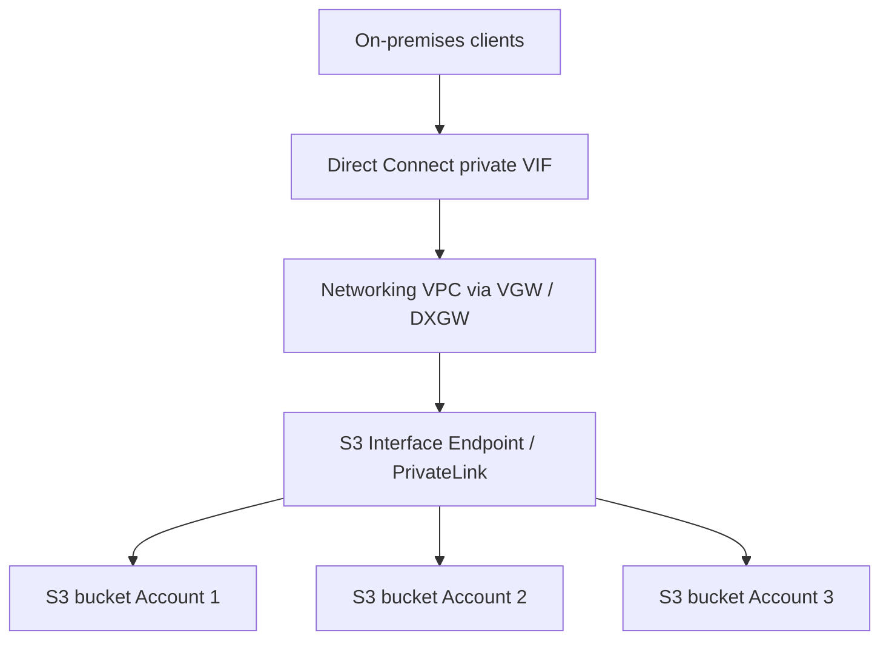
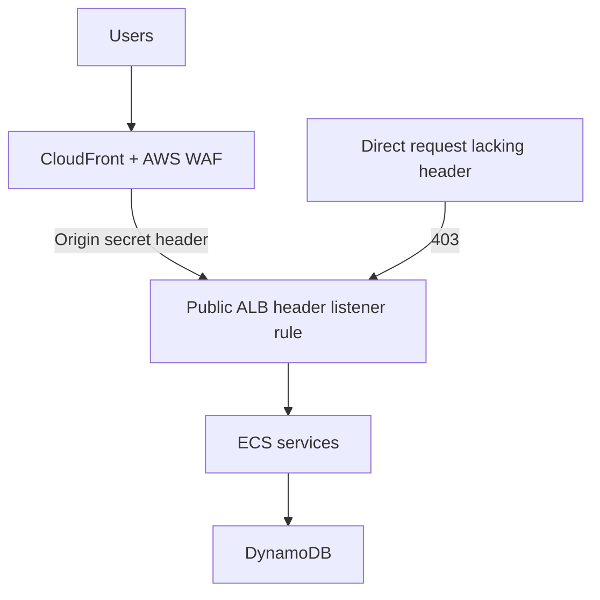
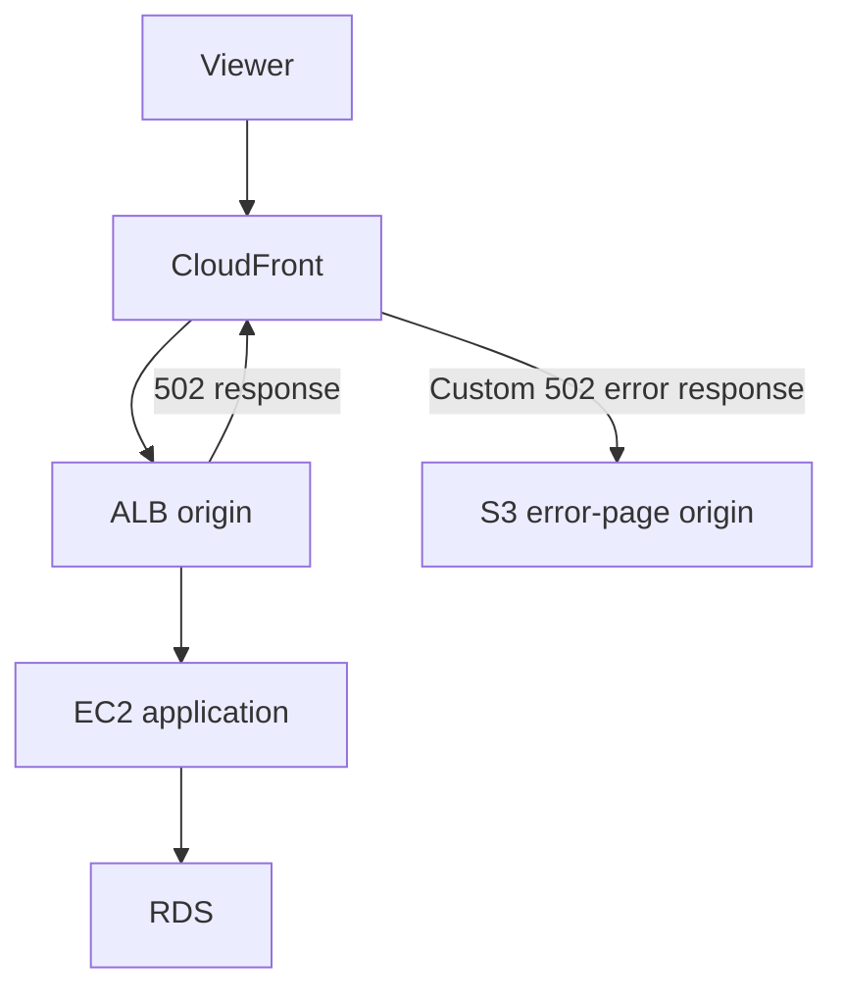

# Domain 3 Multi-Answer Consolidated Audit — 2026-11-03

Repository: cseprakash2007/sap-c02-test-suite, branch `answer-audit-2026-10-28`. Dataset blob `60b5ee3540f2fef80b5fc72339e6c577cba57352`; study-notes blob `b51e723ae60d769c4b154f24f9edb6efb20a3e13`.

## Executive summary
- 674 total dataset questions; exactly **58 Domain 3 multi-answer records**; all have stems, options, answer arrays, matching answerCount, explanation text and status.
- **43/58** dedicated question-number headings in study notes; 15 without a dedicated heading: Q18, Q32, Q45, Q60, Q63, Q83, Q159, Q172, Q174, Q175, Q177, Q182, Q210, Q548, Q563. Q83 appears as a title with a different format and is present in the document. Heading absence does not prove missing prose.
- **4** answer statuses explicitly show external verification pending/unconfirmed: Q18, Q32, Q115, Q140.
- **5** high-risk disputed/defective statuses: Q63, Q210, Q428, Q469, Q533.
- 54/58 records carry nonempty sourceWarning; 4 have no sourceWarning field text (Q18,Q32,Q45,Q60).
- 13 records mention duplicates in sourceWarning; see below for confirmed pairs versus thematic matches.
- Audit is of repository evidence; it is NOT a fresh independent re-verification of every cited external website.

## Highest priority unresolved items
1. **Q533:** policy JSON missing from options B–E; cannot reliably answer as stored. Restore exact policies before treating the key C+D as usable.
2. **Q63:** disputed source key A+E; review notes indicate technical recommendation B+E. Do not automatically overwrite without checking complete options and AWS documentation.
3. **Q428:** disputed B+E; inaccurate CloudFront Price Class 200 terminology/semantics.
4. **Q469:** disputed D+E+F; original wording/key technically defective.
5. **Q210:** Step Functions States.ALL does not catch all terminal/runtime error classes; historical A+B+C not universal.
6. **Q649:** original C+E corrected to intended A+E, but E unnecessarily requires DNS modification; retain defective wording warning.
7. **Q18/Q32/Q115/Q140:** external variant verification explicitly pending or unconfirmed in stored statuses.

## Confirmed/flagged duplicate relationships
- Q32 and Q83: near-duplicate with identical five options and C+E answers; stem differences affect requester assumptions.
- Q140 and Q225: near-exact duplicate with same five options and A+B answers.
- Q51 and Q442: near-duplicate flagged in Q442, whose stem is truncated; Q51 lies outside this 58-question Domain 3 multi-answer selection.
- Other related questions in warnings should not be automatically merged without option-level comparison.

## Architecture patterns and explanations

### A. Hybrid private access to Amazon S3 — Q664

**Answer A+C.** Gateway endpoints cannot serve on-premises traffic over Direct Connect; public VIF is not the intended private endpoint path; VPC peering is unnecessary for cross-account S3 buckets.

### B. Protect an ECS application behind CloudFront — Q641

**Answer A+E.** WAF filters malicious HTTP traffic at the edge; ALB secret-header listener rule discourages bypass. Header is not complete authentication and must be protected and rotated.

### C. Custom error pages for intermittent ALB 502 — Q649

**Intended answer A+E, defective wording.** Store custom error HTML in separate S3 origin and configure CloudFront 502 custom response. Do not change Route 53 DNS to a public error website for transient per-request 502.

### D. Other exam decision frameworks
- **Network access:** distinguish Direct Connect public/private VIF, interface/gateway endpoints, DNS and security-group scope.
- **Availability and DR:** distinguish multi-AZ resilience, multi-Region failover, asynchronous replication and true RPO/RTO.
- **Storage and cost:** check modern default S3 encryption, lifecycle choices, replication backfill and CloudFront price-class semantics.
- **Security and observability:** distinguish reactive CloudTrail/EventBridge controls from preventive access controls; use OpenTelemetry/ADOT for modern tracing rather than relying on older X-Ray SDK guidance.
- **Event-driven services:** SQS event source mapping polls queues, retries are at least once, and idempotency matters.

## All 58 question records

| ID | Answers stored | Status | Study-note heading | Source warning |
|---|---|---|---|---|
| Q18 | A+B | aws-docs-reviewed-external-pending | No | None |
| Q32 | C+E | aws-docs-verified-external-variant-pending | No | None |
| Q45 | A+C+E | aws-docs-and-external-variant-verified | No | None |
| Q60 | B+D+E | aws-docs-aligned-with-source-wording-defect | No | None |
| Q63 | A+E | disputed-source-key-technical-recommendation-B-E | No | DEFECTIVE SOURCE ANSWER: stored A,E includes A's non-existent standard RDS MySQL single reader endpo |
| Q83 | C+E | aws-docs-and-external-variants-verified | No | Near-duplicate Q32; typo spacing in stem and options; Q83 omits explicit anonymous user premise from |
| Q115 | A+C | aws-docs-verified-external-variant-unconfirmed | Yes | C omits explicit Kinesis Data Streams intermediary, and database activity stream must be configured  |
| Q127 | C+D | aws-docs-and-external-variant-verified-with-caveat | Yes | C is supportive rather than necessary to prevent recurrence; D is the essential root-cause fix. 'Lau |
| Q135 | B+D | aws-docs-verified-external-variant-found | Yes | ALB logs are best-effort, not complete accounting; lack of observed logs is not proof an IP was inac |
| Q140 | A+B | aws-docs-verified-external-exact-variant-not-confirmed | Yes | Historical reference to 'EC2 VM Import feature of AWS Import/Export' is dated; current terminology V |
| Q147 | A+C+F | aws-docs-and-external-variants-verified | Yes | The stem lacks workload I/O profiling; FSx for Lustre is appropriate for HPC but specific gains depe |
| Q155 | A+D+E | verified-with-outdated-option-D | Yes | Option D is outdated for least operational overhead: ECR replication backfill now handles existing i |
| Q157 | A+D+E | verified-aws-docs-and-external-variants-with-reactive-security-caveat | Yes | Reactive CloudTrail/EventBridge delivery is best-effort and asynchronous; cannot guarantee immediate |
| Q158 | A+C | verified-with-architecture-defects-and-external-conflicts | Yes | Defective implicit architecture: source says Lambda puts documents in S3 but A requires browser dire |
| Q159 | A+C+E | verified-with-policy-wording-caveat | No | Historic/outdated manual S3 encryption premise: all new objects are encrypted automatically since 20 |
| Q172 | A+D+E | corrected-answer-aws-docs | No | Historical A,D,F incorrect; corrected A,D,E. External variant also carries defective C,D,E key (vari |
| Q174 | A+C | verified-with-truncated-stem-warning | No | Truncated original stem ending 'Options:'; missing spaces. A needs Identity Center ABAC attribute ma |
| Q175 | B+E | verified-alternative-designs-source-defect | No | Select TWO ambiguous: B and E are alternative network architectures, not additive steps. Neptune sec |
| Q177 | B+E | verified | No | B says Lambda pulls SQS URLs; technically event source mapping polls SQS. At-least-once processing a |
| Q182 | A+D+E | verified-with-dr-caveats | No | Option A mentions Region parameter but CloudFormation stack deployment Region must be selected separ |
| Q210 | A+B+C | historical-best-source-defective-all-errors | No | DEFECTIVE ALL-ERRORS REQUIREMENT: A,B,C only catch catchable errors. States.ALL does not catch State |
| Q225 | A+B | verified-duplicate-q140-external-variants-reviewed | Yes | Exact same five option texts and answer A,B as Q140 of 674 (near-exact question duplicate). Original |
| Q247 | B+C | verified-corrected-b-c-conflicting-external-key | Yes | Original key A+B is wrong: A reverses ingress direction. Exam-Tests Q184 repeats A+B while its own e |
| Q283 | A+C+D | verified-corrected-a-c-d-external-key-defect | Yes | Original C+D+E answer key incorrectly substitutes Shield Advanced for mandatory AWS Config. Multiple |
| Q302 | A+E | verified-intended-a-e-security-conditions-missing | Yes | Under-specified security scenario: A+E is common exam key but does not alone ensure only authorized  |
| Q305 | A+D | verified-a-d-aws-and-external | Yes | Source stem and A/D options contain missing punctuation and spaces. Random prefixes are not a generi |
| Q323 | B+D | verified-b-d-aws-and-external | Yes | Typo 'DynamoOB'. WCUs specifically apply to provisioned mode; on-demand uses write request units, pe |
| Q328 | A+B+D | verified-a-b-d-with-xray-sdk-maintenance-warning | Yes | AWS X-Ray SDK and daemon entered maintenance mode February 25 2026; AWS recommends OpenTelemetry/ADO |
| Q331 | A+D+F | verified-intended-a-d-f-attempt-vs-deletion-defect | Yes | Question says 'every attempt' but direct S3 Object Deleted events (D) cover successful deletion even |
| Q353 | A+C | verified-a-c | Yes | SES event publishing is not enabled merely by creating a configuration set: the application must use |
| Q388 | D+E | verified-d-e-external-variant-conflict | Yes | Original text has spacing/typos ('Regionsunder', 'issue1'). Some third-party answer sites incorrectl |
| Q390 | A+B+E | verified-a-b-e | Yes | Stem punctuation and option F 'AVVS' typo. 'Remain synchronized' is asynchronous, not instant cross- |
| Q396 | C+E+F | verified-historical-c-e-f-outdated-cloudfront-functions | Yes | Historically keyed C+E+F, but C and E overlap unless C specifically means Lambda code published as L |
| Q422 | A+C+E | verified-a-c-e | Yes | Original has transcription defects: 'loT', duplicated 'are periodically', 'RealProvisioned Throughpu |
| Q425 | C+E | verified-c-e | Yes | Original has multiple OCR/transcription defects: 'win deploy', 'two-net' (two-tier), 'tor', 'loT' no |
| Q428 | B+E | defective-source-key-b-e-disputed | Yes | DEFECTIVE QUESTION. Original source key B+E repeated by Certstopics and DumpsPedia, but E incorrectl |
| Q435 | C+E | verified-source-key-corrected-c-e | Yes | CORRECTED SOURCE KEY B+E -> C+E. B+E combines mutually alternative database migrations and fails to  |
| Q442 | A+C+F | verified-a-c-f-duplicate-q51 | Yes | NEAR-DUPLICATE / TRUNCATED STEM: Q442 repeats Q51's cost-reporting requirements and six matching opt |
| Q469 | D+E+F | defective-source-key-d-e-f-disputed | Yes | DEFECTIVE MULTI-ANSWER QUESTION: historical key D+E+F repeated by DumpsTech Q95, ExamCollection Q58, |
| Q486 | A+B | verified-a-b | Yes | SOURCE ANSWER A+B VERIFIED; no correction required. Minor wording ambiguity: 'allows Lambda function |
| Q519 | A+C | verified-a-c | Yes | SOURCE KEY A+C VERIFIED. No deprecated AWS service. Important nuance: it is inaccurate to claim HTTP |
| Q530 | A+D | verified-a-d-outdated-service-names | Yes | OCR defects in original stem/options: 'visualization toot', 'semi -structured', 'enabled©', 'functio |
| Q533 | C+D | defective-missing-policy-json-intended-c-d | Yes | SEVERE CORRUPTION: original B,C,D,E option text has no JSON policy blocks, making the question unans |
| Q548 | B+C+E | verified | No | Original stem/options have missing spaces and redundant 'Options:'. External Vargas/P2P exam PDF pri |
| Q563 | A+D | verified-with-ambiguity | No | Answer-key conflict: GitHub A+D, JPNShiken A+D, ExamTopics community A+D; FreeCram, Pupuweb and VCEp |
| Q570 | B+D | verified | Yes | External variants Pupuweb, FreeCram, CertsMania, ExamTopics, and reordered ValidBraindumps agree B+D |
| Q575 | C+D | verified-with-source-defect | Yes | Defective/ambiguous source key: original B+D repeated in FreePDFDumps and DumpSolutions, but current |
| Q576 | A+E | verified-with-source-defect | Yes | Defective/incomplete question: A+E are the intended two options and corroborated by multiple externa |
| Q592 | B+D | verified | Yes | No exact normalized stem or identical option-set duplicate among 674; related Q469, Q159, Q596, Q312 |
| Q600 | B+D | verified | Yes | Original typos: 'Cloud Formation' should be 'CloudFormation'; B is missing punctuation after 'accoun |
| Q614 | B+D+E | verified | Yes | Exam question assumes tables created with 'default table settings' were provisioned, but modern AWS  |
| Q619 | A+D | verified | Yes | The source says video processing but describes new image uploads; wording mismatch is cosmetic. ECS  |
| Q622 | A+D+F | verified | Yes | A does not explicitly require the two EC2 instances to be placed in different AZs; configure ASG acr |
| Q628 | C+E | verified | Yes | Original has formatting errors: '(Select TWO}' mismatched bracket, 'AWSLambda', missing punctuation. |
| Q639 | A+D | verified | Yes | A is colloquial: adding a Region means creating/attaching a secondary Aurora DB cluster in an Aurora |
| Q641 | A+E | verified | Yes | Stem repeats 'prevent'. Option A imprecisely says header on CloudFront domain rather than origin con |
| Q649 | A+E | verified-with-source-defect | Yes | Original key C+E corrected to intended A+E. E includes defective instruction to modify DNS; A's S3 s |
| Q664 | A+C | verified | Yes | Question punctuation/spacing defective; option A omits private VIF gateway attachment detail. Extern |

## Next actions
1. Reconstruct missing Q533 policy options from a verifiable source; avoid relying on absent JSON.
2. Re-verify Q63, Q428, Q469, Q210 and other ambiguous cases against current AWS docs; preserve both original and corrected keys.
3. Normalize all 58 study-note headings and ensure every entry has full stem, options, answer-by-answer reasoning, official sources, duplicate references, and architecture where useful.
4. Resolve outstanding external variant verification for Q18, Q32, Q115, Q140.
5. Only after these checks, generate the complete Domain 3 PDF; avoid presenting defective options as unqualified facts.

## Official reference starting points
- https://docs.aws.amazon.com/AmazonS3/latest/userguide/privatelink-interface-endpoints.html
- https://docs.aws.amazon.com/AmazonCloudFront/latest/DeveloperGuide/creating-custom-error-pages.html
- https://docs.aws.amazon.com/AmazonCloudFront/latest/DeveloperGuide/restrict-access-to-load-balancer.html
- https://docs.aws.amazon.com/step-functions/latest/dg/concepts-error-handling.html
- https://docs.aws.amazon.com/waf/latest/developerguide/web-acl.html

---
Generated from repository records; does not modify the 58 question answers.
