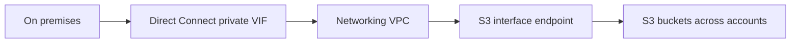
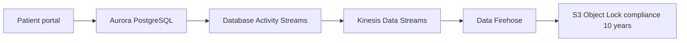
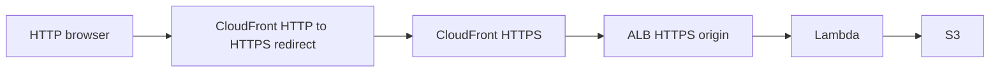
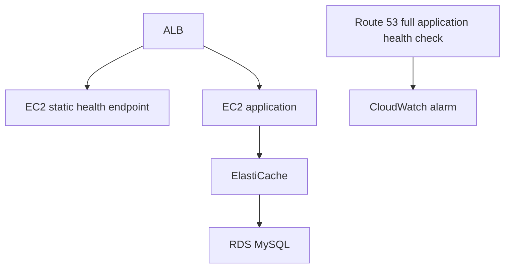

# Domain 3 Multi-Answer — Normalized 58-Question Study Companion

Source: `cseprakash2007/sap-c02-test-suite`, branch `answer-audit-2026-10-28`; questions.json blob `8e059c55c272d6e6c38e08a39b7bfb2ee4ea2871`. Generated 2026-11-03.

This companion preserves all original question records, stored answer keys, explanations and source warnings. It is an organizational consolidation, **not** a new independent verification of every answer. Where originalQuestionSnapshot exists, it takes priority for the original stem. For Q533, policy JSON is labeled reconstructed, not original.

## Coverage and status index

| # | ID | Stored answers | Verification / defect status | Warning |
|---:|---|---|---|---|
| 1 | Q18 | A+B | verified-external-variants-conflicting-scheduled-scaling | Yes |
| 2 | Q32 | C+E | verified-aws-and-multiple-external-variants | Yes |
| 3 | Q45 | A+C+E | aws-docs-and-external-variant-verified | No |
| 4 | Q60 | B+D+E | aws-docs-aligned-with-source-wording-defect | No |
| 5 | Q63 | B+E | verified-technical-b-e-conflicting-external-source-a-e | Yes |
| 6 | Q83 | C+E | aws-docs-and-external-variants-verified | Yes |
| 7 | Q115 | A+C | aws-verified-one-external-exact-variant-found | Yes |
| 8 | Q127 | C+D | aws-docs-and-external-variant-verified-with-caveat | Yes |
| 9 | Q135 | B+D | aws-docs-verified-external-variant-found | Yes |
| 10 | Q140 | A+B | verified-aws-and-multiple-exact-external-variants | Yes |
| 11 | Q147 | A+C+F | aws-docs-and-external-variants-verified | Yes |
| 12 | Q155 | A+D+E | verified-with-outdated-option-D | Yes |
| 13 | Q157 | A+D+E | verified-aws-docs-and-external-variants-with-reactive-security-caveat | Yes |
| 14 | Q158 | A+C | verified-with-architecture-defects-and-external-conflicts | Yes |
| 15 | Q159 | A+C+E | verified-with-policy-wording-caveat | Yes |
| 16 | Q172 | A+D+E | corrected-answer-aws-docs | Yes |
| 17 | Q174 | A+C | verified-with-truncated-stem-warning | Yes |
| 18 | Q175 | B+E | verified-alternative-designs-source-defect | Yes |
| 19 | Q177 | B+E | verified | Yes |
| 20 | Q182 | A+D+E | verified-with-dr-caveats | Yes |
| 21 | Q210 | A+B+C | historical-best-source-defective-all-errors | Yes |
| 22 | Q225 | A+B | verified-duplicate-q140-external-variants-reviewed | Yes |
| 23 | Q247 | B+C | verified-corrected-b-c-conflicting-external-key | Yes |
| 24 | Q283 | A+C+D | verified-corrected-a-c-d-external-key-defect | Yes |
| 25 | Q302 | A+E | verified-intended-a-e-security-conditions-missing | Yes |
| 26 | Q305 | A+D | verified-a-d-aws-and-external | Yes |
| 27 | Q323 | B+D | verified-b-d-aws-and-external | Yes |
| 28 | Q328 | A+B+D | verified-a-b-d-with-xray-sdk-maintenance-warning | Yes |
| 29 | Q331 | A+D+F | verified-intended-a-d-f-attempt-vs-deletion-defect | Yes |
| 30 | Q353 | A+C | verified-a-c | Yes |
| 31 | Q388 | D+E | verified-d-e-external-variant-conflict | Yes |
| 32 | Q390 | A+B+E | verified-a-b-e | Yes |
| 33 | Q396 | C+E+F | verified-historical-c-e-f-outdated-cloudfront-functions | Yes |
| 34 | Q422 | A+C+E | verified-a-c-e | Yes |
| 35 | Q425 | C+E | verified-c-e | Yes |
| 36 | Q428 | B+E | defective-source-key-b-e-disputed | Yes |
| 37 | Q435 | C+E | verified-source-key-corrected-c-e | Yes |
| 38 | Q442 | A+C+F | verified-a-c-f-duplicate-q51 | Yes |
| 39 | Q469 | D+E+F | defective-source-key-d-e-f-disputed | Yes |
| 40 | Q486 | A+B | verified-a-b | Yes |
| 41 | Q519 | A+C | verified-a-c | Yes |
| 42 | Q530 | A+D | verified-a-d-outdated-service-names | Yes |
| 43 | Q533 | C+D | reconstructed-external-policies-intended-c-d-not-fully-functional | Yes |
| 44 | Q548 | B+C+E | verified | Yes |
| 45 | Q563 | A+D | verified-with-ambiguity | Yes |
| 46 | Q570 | B+D | verified | Yes |
| 47 | Q575 | C+D | verified-with-source-defect | Yes |
| 48 | Q576 | A+E | verified-with-source-defect | Yes |
| 49 | Q592 | B+D | verified | Yes |
| 50 | Q600 | B+D | verified | Yes |
| 51 | Q614 | B+D+E | verified | Yes |
| 52 | Q619 | A+D | verified | Yes |
| 53 | Q622 | A+D+F | verified | Yes |
| 54 | Q628 | C+E | verified | Yes |
| 55 | Q639 | A+D | verified | Yes |
| 56 | Q641 | A+E | verified | Yes |
| 57 | Q649 | A+E | verified-with-source-defect | Yes |
| 58 | Q664 | A+C | verified | Yes |

## Architecture reference patterns

### Hybrid S3 private access — Q664

### Aurora immutable audit trail — Q115

### CloudFront redirect to ALB — Q469

### ALB health-check decoupling — Q63

## Confirmed or flagged related-question pairs
- Q32 and Q83: near-duplicate lifecycle scenario; same C+E answers.
- Q140 and Q225: near-duplicate with identical option sets; same A+B answers.
- Q51 and Q442: identical option set; Q442 truncated; Q51 is outside this 58-question selection.

## Unresolved question quality issues
- Q115 has one confirmed external exact variant; a second is not established.
- Q18 has competing external answer interpretations; Spot availability depends on capacity strategy.
- Q210 has an impossible absolute 'all errors' guarantee from the offered Catch-only answers.
- Q428 has no fully correct two-option answer as written.
- Q469 has a Select THREE contradiction: HTTPS Only and Redirect HTTP to HTTPS cannot both be selected for the same behavior.
- Q533 has reconstructed policy JSON, but recovered ListBucket ARN is defective.

## Complete original questions and detailed explanations

### Q18 — 1 of 58

**Original question:** An events company runs a ticketing platform on AWS. The company's customers configure and schedule their events on the platform The events result in large increases of traffic to the platform The company knows the date and time of each customer's events The company runs the platform on an Amazon Elastic Container Service (Amazon ECS) cluster The ECS cluster consists of Amazon EC2 On-Demand Instances that are in an Auto Scaling group. The Auto Scaling group uses a predictive scaling policy The ECS cluster makes frequent requests to an Amazon S3 bucket to download ticket assets The ECS cluster and the S3 bucket are in the same AWS Region and the same AWS account Traffic between the ECS cluster and the S3 bucket flows across a NAT gateway The company needs to optimize the cost of the platform without decreasing the platform's availability Which combination of steps will meet these requirements? (Select TWO)

**Original options:**
- **A.** Create a gateway VPC endpoint for the S3 bucket
- **B.** Add another ECS capacity provider that uses an Auto Scaling group of Spot Instances Configure the new capacity provider strategy to have the same weight as the existing capacity provider strategy
- **C.** Create On-Demand Capacity Reservations for the applicable instance type for the time period of the scheduled scaling policies
- **D.** Enable S3 Transfer Acceleration on the S3 bucket
- **E.** Replace the predictive scaling policy with scheduled scaling policies for the scheduled events

**Stored answers:** A, B. **Status:** `verified-external-variants-conflicting-scheduled-scaling`.

**Explanation:** A removes NAT gateway data-processing costs for S3 traffic by using an S3 gateway VPC endpoint, provided route tables and policies are configured. B adds a Spot-backed ECS capacity provider alongside existing On-Demand capacity, reducing average compute costs; availability depends on keeping sufficient On-Demand baseline capacity and making workloads resilient to Spot interruptions. C reserves On-Demand capacity but is not itself a discount. D S3 Transfer Acceleration is not useful for same-Region private traffic. E scheduled scaling may be useful for known events, but replacing predictive scaling is not inherently a cost reduction and risks missing unexpected load. Source A+B retained with Spot-availability caveat.

**Other options:** C. Capacity Reservations add commitment cost rather than reduce it. D. Transfer Acceleration is for long-distance uploads and adds
cost. The cluster and bucket are in the same Region. E. Replacing predictive scaling with scheduled scaling does not make compute
cheaper and may reduce flexibility.

**Study takeaway:** • NAT gateway charges for S3 or DynamoDB traffic = use a gateway endpoint. • Mix On-Demand and Spot with ECS capacity
providers to cut cost safely.
Reference: AWS documentation — https://docs.aws.amazon.com/

**Defects/caveats:** Exact external ExamTopics Q529 and P2PCerts variants found; reordered ExamsReviews Q203 keys scheduled scaling plus gateway endpoint (maps to E+A). AWS technically supports A+B for cost savings but equal Spot weight alone cannot guarantee availability during interruption. Scheduled scaling can be reasonable given known events; source disagreement retained.

**References:** [Source](https://docs.aws.amazon.com/vpc/latest/privatelink/vpc-endpoints-s3.html) · [Source](https://docs.aws.amazon.com/AmazonECS/latest/developerguide/asg-capacity-providers.html) · [Source](https://www.examtopics.com/discussions/amazon/view/143123-exam-aws-certified-solutions-architect-professional-sap-c02-topic-1-question-529-discussion/) · [Source](https://www.p2pcerts.com/amazon/sap-c02.html) · [Source](https://www.examsreviews.com/articles/best-preparations-of-sap-c02-exam-2025-aws-certified-solutions-architect-unlimited-510-questions-q190-q208/)

---
 
### Q32 — 2 of 58

**Original question:** A company has an application that stores user-uploaded videos in an Amazon S3 bucket that uses S3 Standard storage. Users access the videos frequently in the first 180 days after the videos are uploaded. Access after 180 days is rare. Named users and anonymous users access the videos. Most of the videos are more than 100 MB in size. Users often have poor internet connectivity when they upload videos, resulting in failed uploads. The company uses multipart uploads for the videos. A solutions architect needs to optimize the S3 costs of the application. Which combination of actions will meet these requirements? (Select TWO.)

**Original options:**
- **A.** Configure the S3 bucket to be a Requester Pays bucket.
- **B.** Use S3 Transfer Acceleration to upload the videos to the S3 bucket.
- **C.** Create an S3 Lifecycle configuration to expire incomplete multipart uploads 7 days after initiation.
- **D.** Create an S3 Lifecycle configuration to transition objects to S3 Glacier Instant Retrieval after 1 day.
- **E.** Create an S3 Lifecycle configuration to transition objects to S3 Standard-Infrequent Access (S3 Standard-IA) after 180 days.

**Stored answers:** C, E. **Status:** `verified-aws-and-multiple-external-variants`.

**Explanation:** Incomplete multipart uploads keep their uploaded parts in S3 and you pay for them, so a lifecycle rule that aborts incomplete
multipart uploads after 7 days removes that waste. After 180 days the videos are rarely accessed, so moving them to S3 Standard-IA
lowers storage cost and still gives instant access.

**Other options:** A. Requester Pays only works for authenticated requesters. Anonymous users cannot use it. B. Transfer Acceleration improves upload
speed but adds charges, so it does not optimize cost. D. Moving to Glacier Instant Retrieval after 1 day is wrong. Videos are accessed
often in the first 180 days, so you would pay retrieval fees and a 90-day minimum.

**Study takeaway:** • Abort incomplete multipart uploads lifecycle rule = easy S3 savings. • Match the storage class to when access actually drops.
Reference: AWS documentation — https://docs.aws.amazon.com/

**Defects/caveats:** Exact Certstopics Q58 and reordered PassLeaderVCE match C+E. Q83 near-duplicate; Requester Pays incompatible with anonymous access; Standard-IA 30-day minimum and retrieval charges.

**References:** [Source](https://docs.aws.amazon.com/AmazonS3/latest/userguide/mpu-abort-incomplete-mpu-lifecycle-config.html) · [Source](https://docs.aws.amazon.com/AmazonS3/latest/userguide/storage-class-intro.html) · [Source](https://docs.aws.amazon.com/AmazonS3/latest/userguide/lifecycle-transition-general-considerations.html) · [Source](https://www.certstopics.com/questions/legit-sap-c02-exam-download.html) · [Source](https://itexambus.passleadervce.com/articles/nov-2025-sap-c02-dumps-with-100-verified-q-as-pass-guarantee-or-full-refund-q168-q183/)

---
 
### Q45 — 3 of 58

**Original question:** A company runs a Linux app on Amazon EKS usingM6iEC2 instances under a Savings Plan that is about to expire. They want toreduce costsafter expiration.

**Original options:**
- **A.** Rebuild containers forARM64architecture.
- **B.** Rebuild containers for container compatibility (invalid/unclear).
- **C.** Migrate EKS nodes toGraviton(e.g., C7g, M7g).
- **D.** Replace nodes with latestx86_64instances.
- **E.** Purchase new Savings Plan for Graviton instance family.
- **F.** Purchase new Savings Plan for x86_64 instances.

**Stored answers:** A, C, E. **Status:** `aws-docs-and-external-variant-verified`.

**Explanation:** Graviton (ARM64) instances give better price performance. You need to rebuild the container images for ARM64 (A), move the EKS
node group to Graviton instance types such as M7g or C7g (C), and then buy a new Savings Plan that covers the Graviton usage (E).

**Other options:** B. This option is unclear in the source and describes nothing useful. D. Newer x86 instances help a little but do not deliver the
Graviton savings. F. Buying a plan for x86 would lock you into the more expensive family.

**Study takeaway:** • Linux + containers + cost = consider Graviton: rebuild for arm64, move nodes, buy a matching plan. • A Compute Savings Plan
follows you across instance families, including Graviton.
HEADS-UP ON THIS QUESTION
• The wording of the options in your PDF is garbled in places. The key A, C, E follows the standard Graviton migration steps.
Reference: AWS documentation — https://docs.aws.amazon.com/

**Defects/caveats:** No specific source warning recorded.

**References:** [Source](https://docs.aws.amazon.com/savingsplans/latest/userguide/plan-types.html) · [Source](https://aws.github.io/graviton/containers.html) · [Source](https://docs.aws.amazon.com/it_it/prescriptive-guidance/latest/eks-cost-optimization/3-migration-to-graviton.html) · [Source](https://www.dumpstech.com/free-amazon-web-services/sap-c02-practice-9.html) · [Source](https://www.certensure.com/amazon-web-services/sap-c02-cert-practice-test.html)

---
 
### Q60 — 4 of 58

**Original question:** A company wants to run a custom network analysis software package to inspect traffic as traffic leaves and enters a VPC. The company has deployed the solution by using AWS Cloud Formation on three Amazon EC2 instances in an Auto Scaling group. All network routing has been established to direct traffic to the EC2 instances. Whenever the analysis software stops working, the Auto Scaling group replaces an instance. The network routes are not updated when the instance replacement occurs. Which combination of steps will resolve this issue? {Select THREE.)

**Original options:**
- **A.** Create alarms based on EC2 status check metrics that will cause the Auto Scaling group to replace the failed instance.
- **B.** Update the Cloud Formation template to install the Amazon CloudWatch agent on the EC2 instances. Configure the CloudWatch agent to send process metrics for the application.
- **C.** Update the Cloud Formation template to install AWS Systems Manager Agent on the EC2 instances. Configure Systems Manager Agent to send process metrics for the application.
- **D.** Create an alarm for the custom metric in Amazon CloudWatch for the failure scenarios. Configure the alarm to publish a message to an Amazon Simple Notification Service (Amazon SNS) topic.
- **E.** Create an AWS Lambda function that responds to the Amazon Simple Notification Service (Amazon SNS) message to take the instance out of service. Update the network routes to point to the replacement instance.
- **F.** In the Cloud Formation template, write a condition that updates the network routes when a replacement instance is launched.

**Stored answers:** B, D, E. **Status:** `aws-docs-aligned-with-source-wording-defect`.

**Explanation:** The Auto Scaling group does not notice an application-level failure with default checks, so the CloudWatch agent should send process
metrics (B). A CloudWatch alarm on that metric publishes to SNS (D). A Lambda subscribed to the topic marks the instance unhealthy
so it is replaced and updates the route to point to the replacement (E).

**Other options:** A. EC2 status checks only see instance-level problems, not a stopped application process. C. The SSM Agent is for management and
does not send application process metrics. F. CloudFormation conditions run at deploy time and do not fire when Auto Scaling
replaces an instance.

**Study takeaway:** • Application-level health needs custom/process metrics via the CloudWatch agent. • Automation chain: metric -> alarm -> SNS ->
Lambda action.
HEADS-UP ON THIS QUESTION
• Today you would usually put a Gateway Load Balancer in front of inspection appliances so routes never change when instances are
replaced.
Reference: AWS documentation — https://docs.aws.amazon.com/

**Defects/caveats:** No specific source warning recorded.

**References:** [Source](https://docs.aws.amazon.com/AmazonCloudWatch/latest/monitoring/CloudWatch-Agent-procstat-process-metrics.html) · [Source](https://docs.aws.amazon.com/AmazonCloudWatch/latest/monitoring/AlarmThatSendsEmail.html) · [Source](https://docs.aws.amazon.com/autoscaling/ec2/userguide/health-checks-overview.html) · [Source](https://docs.aws.amazon.com/elasticloadbalancing/latest/gateway/introduction.html)

---
 
### Q63 — 5 of 58

**Original question:** A public retail web application uses an Application Load Balancer (ALB) in front of Amazon EC2 instances running across multiple Availability Zones (AZs) in a Region backed by an Amazon RDS MySQL Multi-AZ deployment. Target group health checks are configured to use HTTP and pointed at the product catalog page. Auto Scaling is configured to maintain the web fleet size based on the ALB health check. Recently, the application experienced an outage. Auto Scaling continuously replaced the instances during the outage. A subsequent investigation determined that the web server metrics were within the normal range, but the database tier was experiencing high toad, resulting in severely elevated query response times. Which of the following changes together would remediate these issues while improving monitoring capabilities for the availability and functionality of the entire application stack for future growth? (Select TWO.)

**Original options:**
- **A.** Configure read replicas for Amazon RDS MySQL and use the single reader endpoint in the web application to reduce the load on the backend database tier.
- **B.** Configure the target group health check to point at a simple HTML page instead of a product catalog page and the Amazon Route 53 health check against the product page to evaluate full application functionality. Configure Ama7on CloudWatch alarms to notify administrators when the site fails.
- **C.** Configure the target group health check to use a TCP check of the Amazon EC2 web server and the Amazon Route S3 health check against the product page to evaluate full application functionality. Configure Amazon CloudWatch alarms to notify administrators when the site fails.
- **D.** Configure an Amazon CtoudWatch alarm for Amazon RDS with an action to recover a high-load, impaired RDS instance in the database tier.
- **E.** Configure an Amazon Elastic ache cluster and place it between the web application and RDS MySQL instances to reduce the load on the backend database tier.

**Stored answers:** B, E. **Status:** `verified-technical-b-e-conflicting-external-source-a-e`.

**Explanation:** Corrected technical answer B+E: B decouples ALB instance health from DB-dependent product page and uses separate Route53 full-stack health checks plus CloudWatch alarms; E caches repeated DB reads to relieve RDS load. Original source A+E is technically defective because ordinary RDS MySQL read replicas have individual endpoints, not a single Aurora-style reader endpoint. Exact external sources conflict: ExamsVCE A+E; ExamTopics Q444 community discusses B+E. AWS docs take precedence.

**Other options:** A: Standard RDS MySQL read replicas do not supply a single managed reader endpoint; Aurora does. B: correct web health vs end-to-end monitoring separation. C: ALB target group health checks do not support TCP (only HTTP/HTTPS), despite similar functionality in NLB. D: CloudWatch alarm action cannot directly recover an overloaded RDS instance as described. E: ElastiCache can relieve cacheable database reads, with cache-invalidation requirements.

**Study takeaway:** ALB HTTP/HTTPS health checks; don't couple instance health to a slow database. Route 53 health check + CloudWatch alarm for end-to-end functionality. RDS MySQL replicas have distinct endpoints; Aurora offers a managed reader endpoint. ElastiCache helps repeated cacheable reads.

**Defects/caveats:** DEFECTIVE SOURCE ANSWER: stored A,E includes A's non-existent standard RDS MySQL single reader endpoint and ignores B's crucial health-check decoupling. Best technically supported B,E, but no independent exact variant confirmation. C's ALB TCP check is invalid. OCR errors: 'toad', 'Ama7on', 'CtoudWatch', 'Elastic ache'. Re-review 2026-11-03: preserve A+E as source key pending exact external variant; B+E recommended technical answer. Exact external match found 2026-11-03: ExamsVCE source A+E conflicts with ExamTopics community B+E and AWS RDS/ALB docs. Technical answer updated B+E; historical A+E retained in review.sourceAnswers.

**References:** [Source](https://docs.aws.amazon.com/elasticloadbalancing/latest/application/target-group-health-checks.html) · [Source](https://docs.aws.amazon.com/AmazonRDS/latest/UserGuide/USER_ReadRepl.html) · [Source](https://docs.aws.amazon.com/AmazonRDS/latest/AuroraUserGuide/Aurora.Endpoints.Reader.html) · [Source](https://docs.aws.amazon.com/AmazonRDS/latest/UserGuide/CHAP_CommonTasks.Connect.EndpointAndPort.html) · [Source](https://www.examsvce.com/sap-c02/a-public-retail-web-application-uses-an-question-answer.html) · [Source](https://www.examtopics.com/discussions/amazon/view/136548-exam-aws-certified-solutions-architect-professional-sap-c02-topic-1-question-444-discussion/) · [Source](https://docs.aws.amazon.com/Route53/latest/DeveloperGuide/monitoring-health-checks.html)

---
 
### Q83 — 6 of 58

**Original question:** A company has an application that stores user-uploaded videos in an Amazon S3 bucket using S3 Standard storage. Users access videos frequently for the first 180 days, and rarely after that. Most videos are over 100 MB. Users often have poor internet connectivity, and the company uses multipart uploads. A solutions architect needs tooptimize S3 storage costs. Which combination of actions will meet these requirements? (Select TWO.)

**Original options:**
- **A.** Configure the S3 bucket to be a Requester Pays bucket.
- **B.** Use S3 Transfer Acceleration to upload the videos.
- **C.** Create a lifecycle rule to expireincomplete multipart uploadsafter 7 days.
- **D.** Create a lifecycle rule to transition objects toS3 Glacier Instant Retrieval after 1 day.
- **E.** Create a lifecycle rule to transition objects toS3 Standard-IA after 180 days.

**Stored answers:** C, E. **Status:** `aws-docs-and-external-variants-verified`.

**Explanation:** Expire incomplete multipart uploads after 7 days (C) and transition to Standard-IA after 180 days (E). See Question 32 for the full
reasoning.

**Other options:** A. Requester Pays does not work for anonymous users. B. Transfer Acceleration adds cost. D. Glacier Instant Retrieval after 1 day
causes retrieval charges while the data is still hot.

**Study takeaway:** • Abort incomplete multipart uploads, and move to IA only when access really drops.
Reference: AWS documentation — https://docs.aws.amazon.com/

**Defects/caveats:** Near-duplicate Q32; typo spacing in stem and options; Q83 omits explicit anonymous user premise from Q32.

**References:** [Source](https://docs.aws.amazon.com/AmazonS3/latest/userguide/mpu-abort-incomplete-mpu-lifecycle-config.html) · [Source](https://docs.aws.amazon.com/AmazonS3/latest/userguide/mpuoverview.html) · [Source](https://docs.aws.amazon.com/AmazonS3/latest/userguide/storage-class-intro.html) · [Source](https://docs.aws.amazon.com/AmazonS3/latest/userguide/lifecycle-transition-general-considerations.html) · [Source](https://www.examsvce.com/sap-c02/questiona-company-has-an-application-that-stores-question-answer.html) · [Source](https://www.certprep.io/amazon/sap-c02/questions)

---
 
### Q115 — 7 of 58

**Original question:** A healthcare company is designing a patient portal. The portal must use a database to store patient data. The portal must encrypt all data at rest and in transit. The portal must audit all data access. Database users must not be able to tamper with the audit trail. The company must retain the audit data for 10 years. The audit data must be immutable. Which combination of steps will meet these requirements? (Select TWO.)

**Original options:**
- **A.** Store data in an Amazon Aurora PostgreSQL encrypted database. Enforce the use of TLS for all connections.
- **B.** Store data in an Amazon RDS for PostgreSQL encrypted database. Enforce the use of TLS for all connections.
- **C.** Create a database activity stream in the database cluster. Use Amazon Data Firehose to send the data to an Amazon S3 bucket. Enable S3 Object Lock in compliance mode with a 10-year retention period.
- **D.** Install pgAudit in the database cluster. Store the data in Amazon CloudWatch Logs. Use Amazon Data Firehose to send the data to an Amazon S3 bucket. Enable S3 Object Lock in compliance mode with a 10-year retention period.
- **E.** Install pgAudit in the database cluster. Store the data in Amazon CloudWatch Logs. Use Amazon Data Firehose to send the data to an Amazon S3 bucket. Enable S3 Object Lock in governance mode with a 10-year retention period.

**Stored answers:** A, C. **Status:** `aws-verified-one-external-exact-variant-found`.

**Explanation:** A,C. Aurora PostgreSQL with encryption at rest and TLS provides database confidentiality. Aurora Database Activity Streams audit database activity outside ordinary DBA control, feed a managed Kinesis data stream, and can be consumed by Firehose to deliver S3 audit objects protected with Object Lock compliance mode for 10 years. Configure appropriate audit policy, delivery and retention, and verify region/engine support.

**Other options:** A correct: Aurora encrypted and TLS. B not the intended pair: standalone RDS PostgreSQL is not the Aurora cluster required by C; engine-specific RDS activity stream support differs. C correct: independent audit pipeline and immutable compliance retention. D pgAudit to CloudWatch Logs can capture configured activity but lacks the stronger separation from DBA control afforded by Database Activity Streams; logging configuration and audit coverage matter. E governance Object Lock can be bypassed by authorized principals, unlike compliance mode.

**Study takeaway:** Aurora PostgreSQL Database Activity Streams -> Kinesis Data Streams -> Firehose -> S3 Object Lock compliance mode. Encryption at rest plus TLS in transit. Activity stream access controlled by IAM, not DBAs.

**Defects/caveats:** C omits explicit Kinesis Data Streams intermediary, and database activity stream must be configured with suitable audit policy. S3 Object Lock compliance mode requires versioning and correct retention configuration. Database activity streams availability varies by engine/version/Region. Exact SPOTO variant A+C found; a second independently checked exact external variant remains unconfirmed. Database Activity Streams emit through Kinesis Data Streams before Firehose; ensure audit coverage, encryption, versioning and S3 Object Lock compliance 10-year retention. Aurora DAS engine/region support matters.

**References:** [Source](https://docs.aws.amazon.com/AmazonRDS/latest/AuroraUserGuide/DBActivityStreams.html) · [Source](https://docs.aws.amazon.com/AmazonRDS/latest/AuroraUserGuide/DBActivityStreams.Enabling.html) · [Source](https://docs.aws.amazon.com/AmazonS3/latest/userguide/object-lock.html) · [Source](https://cciedump.spoto.net/exam-questions/free-aws-sap-c02-practice-questions-answers-2026-part1)

---
 
### Q127 — 8 of 58

**Original question:** A company has used infrastructure as code (IaC) to provision a set of two Amazon EC2 instances. The instances have remained the same for several years. The company's business has grown rapidly in the past few months. In response the company's operations team has implemented an Auto Scaling group to manage the sudden increases in traffic. Company policy requires a monthly installation of security updates on all operating systems that are running. The most recent security update required a reboot. As a result, the Auto Scaling group terminated the instances and replaced them with new, unpatched instances. Which combination of steps should a solutions architect recommend to avoid a recurrence of this issue? (Choose two.)

**Original options:**
- **A.** Modify the Auto Scaling group by setting the Update policy to target the oldest launch configuration for replacement.
- **B.** Create a new Auto Scaling group before the next patch maintenance. During the maintenance window, patch both groups and reboot the instances.
- **C.** Create an Elastic Load Balancer in front of the Auto Scaling group. Configure monitoring to ensure that target group health checks return healthy after the Auto Scaling group replaces the terminated instances.
- **D.** Create automation scripts to patch an AMI, update the launch configuration, and invoke an Auto Scaling instance refresh.
- **E.** Create an Elastic Load Balancer in front of the Auto Scaling group. Configure termination protection on the instances.

**Stored answers:** C, D. **Status:** `aws-docs-and-external-variant-verified-with-caveat`.

**Explanation:** C,D. D builds a new patched AMI, updates the launch configuration or preferably a launch template, and invokes EC2 Auto Scaling instance refresh so replacements are patched. C adds load-balancer target health monitoring to validate newly launched instances during replacement and preserve service availability; configure health checks and replacement policy carefully.

**Other options:** A wrong: 'Update policy' is a CloudFormation mechanism and does not target the oldest launch configuration in the stated manner. B wrong: manually patching two groups still leaves launch images stale and does not ensure replacement instances are patched. C correct for traffic management/health monitoring but alone does not fix stale AMIs. D correct durable golden-image refresh. E wrong: EC2 termination protection does not reliably protect instances from Auto Scaling scale-in and does not patch replacement AMIs.

**Study takeaway:** Immutable patched AMI + launch template/config update + Auto Scaling instance refresh; ALB health checks. Prefer launch templates over legacy launch configurations.

**Defects/caveats:** C is supportive rather than necessary to prevent recurrence; D is the essential root-cause fix. 'Launch configuration' is legacy; prefer a launch template. Existing reboot replacement behavior depends on health-check/grace-period settings.

**References:** [Source](https://docs.aws.amazon.com/autoscaling/ec2/userguide/instance-refresh-overview.html) · [Source](https://docs.aws.amazon.com/autoscaling/ec2/userguide/asg-instance-refresh.html) · [Source](https://docs.aws.amazon.com/autoscaling/ec2/userguide/health-checks-overview.html) · [Source](https://docs.aws.amazon.com/autoscaling/ec2/userguide/launch-templates.html) · [Source](https://www.scribd.com/document/931431704/AWS-Certified-Solutions-Architect-Professional-SAP-C02-Exam-ExamTopics-301-350) · [Source](https://www.exam-tests.com/SAP-C02-exam/Amazon.SAP-C02.v2025-02-24.q513.html?p=18)

---
 
### Q135 — 9 of 58

**Original question:** A company has an application that runs on a fleet of Amazon EC2 instances behind an Application Load Balancer (ALB). The application is in an AWS account that has AWS CloudTrail enabled. The company restricts access to the application by adding the IP addresses of end users to a security group that is associated with the ALB. The company is developing an AWS Lambda function to determine if the allowed IP addresses have accessed the application recently. If an allowed IP address has not accessed the application in the last 90 days, the Lambda function will remove the IP address from the security group. The company needs to implement the functionality for the Lambda function to check the IPaddresses. Which combination of steps will provide this functionality MOST cost-effectively? (Select TWO.)

**Original options:**
- **A.** For the VPC that contains the ALB, configure VPC flow logs to be sent to a log group in Amazon CloudWatch Logs.
- **B.** Enable access logging on the ALB. Create an Amazon Athena table to query the ALB access logs.
- **C.** Program the Lambda function to check when each allowed IP address from the security group last appeared in the VPC flow logs.
- **D.** Program the Lambda function to check when each allowed IP address from the security group last appeared in the ALB access logs.
- **E.** Program the Lambda function to check when each allowed IP address from the security group last appeared in the CloudTrail logs.

**Stored answers:** B, D. **Status:** `aws-docs-verified-external-variant-found`.

**Explanation:** B,D. Enable ALB access logs (traditionally S3) and create an Athena table to query source client IP and request timestamps; Lambda checks the most recent occurrence for each allowed source IP and removes security-group rules only when no qualifying request occurred within 90 days. CloudTrail records AWS API activity, not each web request.

**Other options:** A: VPC Flow Logs in CloudWatch can capture flows but incur collection/ingestion/query cost and do not offer ALB application-request context. B correct: ALB access logs and Athena enable economical S3-based analysis. C: flow logs can help but are not the most cost-effective direct access-request record here. D correct: Lambda can query ALB access logs, typically through Athena. E wrong: CloudTrail does not record ordinary ALB HTTP request client IP activity.

**Study takeaway:** ALB access logs include client:port and timestamp; Athena query over S3; CloudTrail logs API calls, not web access; ALB logs are best effort and not guaranteed complete accounting.

**Defects/caveats:** ALB logs are best-effort, not complete accounting; lack of observed logs is not proof an IP was inactive. Proxies/NAT mean observed client IP may differ from end-user IP. Athena cost depends on data scanned and partitioning; 90-day retention required.

**References:** [Source](https://docs.aws.amazon.com/elasticloadbalancing/latest/application/load-balancer-access-logs.html) · [Source](https://docs.aws.amazon.com/athena/latest/ug/application-load-balancer-logs.html) · [Source](https://docs.aws.amazon.com/athena/latest/ug/query-alb-access-logs-examples.html) · [Source](https://www.freecram.net/Amazon.SAP-C02.v2025-04-03.q227.pdf)

---
 
### Q140 — 10 of 58

**Original question:** A solutions architect is importing a VM from an on-premises environment by using the Amazon EC2 VM Import feature of AWS Import/Export. The solutions architect has created an AMI and has provisioned an Amazon EC2 instance that is based on that AMI. The EC2 instance runs inside a public subnet in a VPC and has a public IP address assigned. The EC2 instance does not appear as a managed instance in the AWS Systems Manager console. Which combination of steps should the solutions architect take to troubleshoot this issue? (Select TWO.)

**Original options:**
- **A.** Verify that Systems Manager Agent is installed on the instance and is running.
- **B.** Verify that the instance is assigned an appropriate IAM role for Systems Manager.
- **C.** Verify the existence of a VPC endpoint on the VPC.
- **D.** Verify that the AWS Application Discovery Agent is configured.
- **E.** Verify the correct configuration of service-linked roles for Systems Manager.

**Stored answers:** A, B. **Status:** `verified-aws-and-multiple-exact-external-variants`.

**Explanation:** A,B. A VM-imported custom AMI may lack running SSM Agent; the agent must register with Systems Manager. B an EC2 instance needs appropriate SSM permissions through an IAM instance profile or modern Default Host Management Configuration. Verify outbound HTTPS access to SSM endpoints; public IP alone does not guarantee an internet route.

**Other options:** A correct: SSM Agent running. B correct: suitable IAM permissions, though Default Host Management Configuration is an alternative. C not mandatory: interface endpoints are optional when internet egress is available, but can be required for isolated subnets. D Application Discovery Agent is unrelated to SSM registration. E service-linked roles are not the normal per-instance prerequisite.

**Study takeaway:** SSM Agent; IAM instance profile/AmazonSSMManagedInstanceCore or Default Host Management Configuration; outbound HTTPS 443 to SSM endpoints; VPC endpoints optional if internet connectivity exists.

**Defects/caveats:** Historical reference to 'EC2 VM Import feature of AWS Import/Export' is dated; current terminology VM Import/Export. B wording overstates instance profile necessity under Default Host Management Configuration. Exact ExamTopics Q492 and ExamsVCE agree A+B. Modern Default Host Management Configuration may replace instance-profile permission path; verify agent, permissions and outbound HTTPS connectivity. VM Import/Export terminology updated.

**References:** [Source](https://docs.aws.amazon.com/systems-manager/latest/userguide/fleet-manager-troubleshooting-managed-nodes.html) · [Source](https://docs.aws.amazon.com/systems-manager/latest/userguide/setup-instance-permissions.html) · [Source](https://docs.aws.amazon.com/systems-manager/latest/userguide/troubleshooting-managed-nodes-using-ssm-cli.html) · [Source](https://www.examtopics.com/discussions/amazon/view/142926-exam-aws-certified-solutions-architect-professional-sap-c02/) · [Source](https://www.examsvce.com/sap-c02/questiona-solutions-architect-is-importing-a-vm-question-answer.html)

---
 
### Q147 — 11 of 58

**Original question:** A company has built a high performance computing (HPC) cluster in AWS tor a tightly coupled workload that generates a large number of shared files stored in Amazon EFS. The cluster was performing well when the number of Amazon EC2 instances in the cluster was 100. However, when the company increased the cluster size to 1,000 EC2 instances, overall performance was well below expectations. Which collection of design choices should a solutions architect make to achieve the maximum performance from the HPC cluster? (Select THREE.)

**Original options:**
- **A.** Ensure the HPC cluster Is launched within a single Availability Zone.
- **B.** Launch the EC2 instances and attach elastic network interfaces in multiples of four.
- **C.** Select EC2 Instance types with an Elastic Fabric Adapter (EFA) enabled.
- **D.** Ensure the cluster Is launched across multiple Availability Zones.
- **E.** Replace Amazon EFS with multiple Amazon EBS volumes in a RAID array.
- **F.** Replace Amazon EFS with Amazon FSx for Lustre.

**Stored answers:** A, C, F. **Status:** `aws-docs-and-external-variants-verified`.

**Explanation:** A,C,F. Keep tightly coupled MPI-style EC2 workers within one AZ for lower inter-node latency and cluster placement options; use EFA-capable instances for high-performance network communication; replace EFS with FSx for Lustre, a parallel file system designed for demanding HPC shared-file I/O. Size FSx throughput and select EFA-compatible clients if using EFA-enabled FSx.

**Other options:** A correct single-AZ for tightly coupled jobs. B wrong: adding ENIs in multiples of four is not a general HPC performance rule. C correct: EFA reduces latency and increases throughput for tightly coupled workloads. D wrong: multi-AZ adds inter-AZ latency for synchronous tight coupling. E wrong: EBS RAID is normally attached to an individual instance, not a shared distributed parallel filesystem across 1000 EC2 workers. F correct: FSx for Lustre is purpose-built for parallel HPC storage.

**Study takeaway:** Tightly coupled HPC: one AZ, cluster placement group, EFA, FSx for Lustre. EBS RAID is not shared cluster storage. Benchmark FSx throughput and metadata performance.

**Defects/caveats:** The stem lacks workload I/O profiling; FSx for Lustre is appropriate for HPC but specific gains depend on file size, access pattern and provisioned throughput. Source typo 'AWS tor'.

**References:** [Source](https://docs.aws.amazon.com/wellarchitected/latest/high-performance-computing-lens/tightly-coupled-scenarios.html) · [Source](https://docs.aws.amazon.com/wellarchitected/latest/high-performance-computing-lens/workload-architecture.html) · [Source](https://docs.aws.amazon.com/fsx/latest/LustreGuide/performance.html) · [Source](https://docs.aws.amazon.com/fsx/latest/LustreGuide/efa-file-systems.html) · [Source](https://www.freecram.net/question/Amazon.SAP-C02.v2026-03-31.q264/a-company-has-built-a-high-performance-computing-hpc-cluster-in-aws-tor-a-tightly-coupled-workload) · [Source](https://www.exam-tests.com/SAP-C02-exam/Amazon.SAP-C02.v2025-02-24.q513.html?p=63)

---
 
### Q155 — 12 of 58

**Original question:** A company runs an ecommerce website on Amazon ECS behind an Application Load Balancer (ALB). The container images are stored in Amazon ECR. The website stores data in an Amazon Aurora MySQL DB cluster. The ALB uses an HTTPS listener with a public SSL certificate that is saved in AWS Certificate Manager (ACM). The website domain is registered with Amazon Route 53. The company wants to duplicate this setup in a second AWS Region in an active-active configuration. The website can tolerate minor latency for data replication between Regions. The company has already deployed an ECS cluster with an ALB in the secondary Region. The ECS cluster is registered for geolocation routing with Route 53. Which combination of steps will meet these requirements with the LEAST operational overhead? (Select THREE.)

**Original options:**
- **A.** Request a new ACM certificate for the company website in the secondary Region. Configure the ALB in the secondary Region with an HTTPS listener. Set the new ACM certificate as the default certificate.
- **B.** Share the ACM certificate with the secondary Region by using AWS Resource Access Manager (AWS RAM). Configure the ALB in the secondary Region with an HTTPS listener. Set the shared ACM certificate as the default certificate.
- **C.** Create a VPC endpoint for Amazon ECR in the secondary Region. Configure Amazon EC2 instances to download container images from the primary Region.
- **D.** Enable Cross-Region Replication for ECR repositories to the secondary Region. Re- push the existing images to ECR repositories with a new tag.
- **E.** Configure an Aurora global database in the primary Region. Enable write forwarding to the secondary Region.
- **F.** Use an Aurora DB cluster that has multiple writer instances in the primary Region. Create a secondary Aurora DB instance in the secondary Region. Enable cross-Region writes between the DB clusters.

**Stored answers:** A, D, E. **Status:** `verified-with-outdated-option-D`.

**Explanation:** A,D,E. Request a distinct regional ACM certificate for the second ALB (A). Enable ECR cross-Region replication and re-push or re-tag existing images because replication only applies to images pushed after configuration (D). Aurora Global Database with write forwarding supports regional reads and forwards secondary-region writes to the primary writer (E). Ensure engine/version/Region support and secondary cluster configured.

**Other options:** A correct: ACM certificates for ALB are regional. B wrong: ACM certificates cannot be shared across AWS Regions using RAM. C wrong: regional ECR VPC endpoints do not make cross-Region primary ECR image pulls a proper replication strategy. D correct: replication plus re-push/re-tag for existing images, subject to tag immutability. E correct: Aurora Global Database write forwarding, but still a single primary writer. F wrong: Aurora MySQL global database is not multi-writer across Regions in the described configuration.

**Study takeaway:** ACM ALB cert Region-local; ECR replication not retroactive; Aurora Global Database write forwarding is not multi-writer. Route 53 geolocation needs sensible default routing.

**Defects/caveats:** Option D is outdated for least operational overhead: ECR replication backfill now handles existing images without re-push. Recommended rewrite: enable ECR cross-Region replication and start replication backfill. Aurora global write forwarding retains a single primary writer.

**References:** [Source](https://docs.aws.amazon.com/acm/latest/userguide/acm-overview.html) · [Source](https://docs.aws.amazon.com/AmazonECR/latest/userguide/replication-backfill.html) · [Source](https://docs.aws.amazon.com/AmazonRDS/latest/AuroraUserGuide/aurora-global-database-write-forwarding-ams.html)

---
 
### Q157 — 13 of 58

**Original question:** A company is running an application in the AWS Cloud. The company's security team must approve the creation of all new IAM users. When a new IAM user is created, all access for the user must be removed automatically. The security team must then receive a notification to approve the user. The company has a multi-Region AWS CloudTrail trail In the AWS account. Which combination of steps will meet these requirements? (Select THREE.)

**Original options:**
- **A.** Create an Amazon EventBridge (Amazon CloudWatch Events) rule. Define a pattern with the detail-type value set to AWS API Call via CloudTrail and an eventName of CreateUser.
- **B.** Configure CloudTrail to send a notification for the CreateUser event to an Amazon Simple Notification Service (Amazon SNS) topic.
- **C.** Invoke a container that runs in Amazon Elastic Container Service (Amazon ECS) with AWS Fargate technology to remove access
- **D.** Invoke an AWS Step Functions state machine to remove access.
- **E.** Use Amazon Simple Notification Service (Amazon SNS) to notify the security team.
- **F.** Use Amazon Pinpoint to notify the security team.

**Stored answers:** A, D, E. **Status:** `verified-aws-docs-and-external-variants-with-reactive-security-caveat`.

**Explanation:** A,D,E. EventBridge rule matches CloudTrail IAM CreateUser management events (A). Step Functions orchestrates prompt user lockdown (for example apply explicit-deny permissions boundary or deny policy, remove access keys, deactivate console login, handle group/attached policies) and approval workflow (D). SNS notifies the security team (E). Use defense-in-depth IAM governance because event delivery is best effort and asynchronous.

**Other options:** A correct: EventBridge CloudTrail CreateUser event. B wrong: CloudTrail does not directly provide per-event SNS notification with the proposed configuration; EventBridge routes events. C wrong: Fargate could run automation but adds unnecessary operational complexity versus Step Functions orchestration. D correct: Step Functions coordinates access removal and approvals via service integrations or Lambda. E correct: SNS alerts security reviewers. F wrong: Pinpoint is unnecessary for internal security notifications.

**Study takeaway:** EventBridge source aws.iam, detail-type AWS API Call via CloudTrail, eventSource iam.amazonaws.com, eventName CreateUser. Step Functions IAM controls and SNS approval notification; CloudTrail events best effort.

**Defects/caveats:** Reactive CloudTrail/EventBridge delivery is best-effort and asynchronous; cannot guarantee immediate zero access. New IAM user has no permissions by default, but subsequent grants may occur. Use preventive guardrails and periodic reconciliation; IAM events should be matched in us-east-1. Legacy CloudWatch Events terminology in A.

**References:** [Source](https://docs.aws.amazon.com/eventbridge/latest/ref/events-ref-iam.html) · [Source](https://docs.aws.amazon.com/step-functions/latest/dg/connect-sns.html) · [Source](https://repost.aws/knowledge-center/iam-eventbridge-sns-rule) · [Source](https://www.exam-tests.com/SAP-C02-exam/Amazon.SAP-C02.v2025-02-24.q513.html?p=23) · [Source](https://www.examcollection.us/exam/SAP-C02-question-answer-3.html)

---
 
### Q158 — 14 of 58

**Original question:** A company is building an electronic document management system in which users upload their documents. The application stack is entirely serverless and runs on AWS in the eu- central-1 Region. The system includes a web application that uses an Amazon CloudFront distribution for delivery with Amazon S3 as the origin. The web application communicates with Amazon API Gateway Regional endpoints. The API Gateway APIs call AWS Lambda functions that store metadata in an Amazon Aurora Serverless database and put the documents into an S3 bucket. The company is growing steadily and has completed a proof of concept with its largest customer. The company must improve latency outside of Europe. Which combination of actions will meet these requirements? (Select TWO.)

**Original options:**
- **A.** Enable S3 Transfer Acceleration on the S3 bucket. Ensure that the web application uses the Transfer Acceleration signed URLs.
- **B.** Create an accelerator in AWS Global Accelerator. Attach the accelerator to the CloudFront distribution.
- **C.** Change the API Gateway Regional endpoints to edge-optimized endpoints.
- **D.** Provision the entire stack in two other locations that are spread across the world. Use global databases on the Aurora Serverless cluster.
- **E.** Add an Amazon RDS proxy between the Lambda functions and the Aurora Serverless database.

**Stored answers:** A, C. **Status:** `verified-with-architecture-defects-and-external-conflicts`.

**Explanation:** A,C. S3 Transfer Acceleration uses CloudFront edge locations to accelerate globally distributed clients uploading documents directly to an S3 bucket with acceleration-aware signed URLs. API Gateway edge-optimized REST endpoints route globally distributed API requests through AWS edge network toward the regional backend. These improve client ingress latency without duplicating all stateful infrastructure.

**Other options:** A correct for direct S3 upload URLs with accelerate endpoint; if Lambda itself performs the S3 PutObject after API request, architecture must change to browser direct upload for benefit. B wrong: Global Accelerator cannot attach CloudFront distribution as an accelerator endpoint. C correct for API Gateway REST APIs (not HTTP APIs, which lack edge-optimized endpoint type). D wrong: replicating whole stack and Aurora Serverless global database introduces complexity and may not be supported in all proposed configurations. E wrong: RDS Proxy can help database connection scaling but does not directly optimize worldwide client network latency.

**Study takeaway:** S3 Transfer Acceleration endpoint s3-accelerate.amazonaws.com; signed URLs must target accelerate endpoint. Edge-optimized API Gateway REST endpoints use AWS-managed CloudFront. Global Accelerator endpoints cannot be CloudFront distributions.

**Defects/caveats:** Defective implicit architecture: source says Lambda puts documents in S3 but A requires browser direct-to-S3 accelerated signed URLs; must redesign upload flow. C only supported for REST API, stem does not specify REST. No guaranteed speedup, benchmark latency and transfer costs. External discussion has dissent though official AWS features favor A+C.

**References:** [Source](https://docs.aws.amazon.com/AmazonS3/latest/userguide/transfer-acceleration-examples.html) · [Source](https://docs.aws.amazon.com/apigateway/latest/developerguide/api-gateway-api-endpoint-types.html) · [Source](https://docs.aws.amazon.com/global-accelerator/latest/dg/about-endpoints.html) · [Source](https://aws.amazon.com/blogs/networking-and-content-delivery/implementing-secure-file-uploads-to-amazon-s3-at-the-edge-choosing-the-right-pattern/) · [Source](https://www.exam-tests.com/SAP-C02-exam/Amazon.SAP-C02.v2025-02-24.q513.html?p=43) · [Source](https://www.freecram.com/discussions/Amazon/exam-sap-c02-topic-2-question-284-discussion-p1298270.html) · [Source](https://www.examtopics.com/discussions/amazon/view/95309-exam-aws-certified-solutions-architect-professional-sap-c02-topic-1-question-81-discussion/)

---
 
### Q159 — 15 of 58

**Original question:** A company is designing a new website that hosts static content. The website will give users the ability to upload and download large files. According to company requirements, all data must be encrypted in transit and at rest. A solutions architect is building the solution by using Amazon S3 and Amazon CloudFront. Which combination of steps will meet the encryption requirements? (Select THREE.)

**Original options:**
- **A.** Turn on S3 server-side encryption for the S3 bucket that the web application uses.
- **B.** Add a policy attribute of "aws:SecureTransport": "true" for read and write operations in the S3 ACLs.
- **C.** Create a bucket policy that denies any unencrypted operations in the S3 bucket that the web application uses.
- **D.** Configure encryption at rest on CloudFront by using server-side encryption with AWS KMS keys (SSE-KMS).
- **E.** Configure redirection of HTTP requests to HTTPS requests in CloudFront.
- **F.** Use the RequireSSL option in the creation of presigned URLs for the S3 bucket that the web application uses.

**Stored answers:** A, C, E. **Status:** `verified-with-policy-wording-caveat`.

**Explanation:** Verified A, C, E as the intended three exam answers. A: S3 SSE protects stored objects; since 2023-01-05 all new S3 objects are encrypted with SSE-S3 by default, so enabling SSE-S3 is no longer a necessary manual step. C: S3 bucket policy can explicitly Deny requests when aws:SecureTransport is false; this concerns encryption in transit, NOT encryption at rest, and the option is ambiguous without specifying its condition. E: CloudFront viewer protocol policy Redirect HTTP to HTTPS protects supported viewer requests; for upload/write paths, HTTPS Only or direct HTTPS requests are safer than assuming every method will redirect. Configure S3 REST origin and CloudFront OAC for private origin traffic.

**Other options:** B incorrect: S3 ACLs cannot carry IAM condition key aws:SecureTransport. D incorrect: CloudFront has no user-configurable SSE-KMS encryption-at-rest setting for its cache; encryption is configured at the S3 origin. F incorrect: S3 presigned URL creation has no RequireSSL parameter; enforce TLS via HTTPS URL and bucket policy. Beware external variants reordering options.

**Study takeaway:** A+C+E expected; SSE-S3 default since Jan 2023; aws:SecureTransport=false must be in bucket policy (not ACL); CloudFront viewer protocol redirect vs HTTPS Only; CloudFront OAC + S3 REST origin; no presigned URL RequireSSL option.

**Defects/caveats:** Historic/outdated manual S3 encryption premise: all new objects are encrypted automatically since 2023-01-05. C's 'unencrypted operations' is underspecified; Deny aws:SecureTransport=false handles HTTP, separate policies govern required SSE-KMS uploads. CloudFront viewer redirect depends on method/version and docs differ on behavior for write methods; use HTTPS Only for strict write routes. CloudFront S3 website origin cannot use HTTPS to origin. Exact duplicate stem none across 674; related Q115 Q456 Q469 Q390 Q541.

**References:** [Source](https://docs.aws.amazon.com/AmazonS3/latest/userguide/default-encryption-faq.html) · [Source](https://docs.aws.amazon.com/AmazonS3/latest/userguide/amazon-s3-policy-keys.html) · [Source](https://docs.aws.amazon.com/AmazonCloudFront/latest/DeveloperGuide/using-https-viewers-to-cloudfront.html) · [Source](https://docs.aws.amazon.com/AmazonCloudFront/latest/DeveloperGuide/using-https-cloudfront-to-s3-origin.html) · [Source](https://docs.aws.amazon.com/AmazonCloudFront/latest/DeveloperGuide/private-content-restricting-access-to-s3.html) · [Source](https://myportal.utt.edu.tt/ICS/icsfs/d97df75f-867e-411a-ac5f-e13435c2eedc.pdf?target=c53e5228-7ce9-4ef5-a5ec-d932dc3abaad)

---
 
### Q172 — 16 of 58

**Original question:** A company has many AWS accounts in an organization in AWS Organizations. The accounts contain many Amazon EC2 instances that run different types of workloads. The workloads have different usage patterns. The company needs recommendations for how to rightsize the EC2 instances based on CPU and memory usage during the last 90 days. Which combination of steps will provide these recommendations? (Select THREE.)

**Original options:**
- **A.** Opt in to AWS Compute Optimizer and enable trusted access for Compute Optimizer for the organization.
- **B.** Configure a delegated administrator account for AWS Systems Manager for the organization.
- **C.** Use an AWS CloudFormation stack set to enable detailed monitoring for all the EC2 instances.
- **D.** Install and configure the Amazon CloudWatch agent on all the EC2 instances to send memory utilization metrics to CloudWatch.
- **E.** Activate enhanced metrics in AWS Compute Optimizer.
- **F.** Configure AWS Systems Manager to pass metrics to AWS Trusted Advisor.

**Stored answers:** A, D, E. **Status:** `corrected-answer-aws-docs`.

**Explanation:** A,D,E is the current technically correct answer, replacing historical A,D,F. A opts the organization into Compute Optimizer with trusted access; D supplies OS-level memory utilization to CloudWatch using the CloudWatch agent; E enables enhanced infrastructure metrics for a lookback of up to 93 days, covering the requested last 90 days. Systems Manager does not forward metrics to Trusted Advisor to provide these recommendations.

**Other options:** A correct: organization-wide Compute Optimizer enrollment/trusted access. B wrong: Systems Manager delegated administration is not needed for Compute Optimizer. C wrong: detailed EC2 monitoring gives 1-minute CPU granularity but not OS memory metrics and not 90-day lookback. D correct: install CloudWatch agent and publish memory metrics (or supported external metric source). E correct: paid enhanced infrastructure metrics extends lookback from 14 to 93 days. F wrong: no Systems Manager-to-Trusted Advisor rightsizing metric pipeline as described.

**Study takeaway:** Compute Optimizer default 14-day analysis; enhanced infrastructure metrics up to 93 days and may incur cost; EC2 memory is not a default CloudWatch hypervisor metric; use CloudWatch agent.

**Defects/caveats:** Historical A,D,F incorrect; corrected A,D,E. External variant also carries defective C,D,E key (variant mapping to dataset A,F,D), missing E 93-day enhanced metrics. Enhanced infrastructure metrics is paid; 93-day analysis requires historical CloudWatch data, not retroactive memory data collection. Newer Compute Optimizer rightsizing preference can offer 32-day lookback but not 90-day without paid enhanced metrics.

**References:** [Source](https://docs.aws.amazon.com/compute-optimizer/latest/ug/account-opt-in.html) · [Source](https://docs.aws.amazon.com/compute-optimizer/latest/ug/ec2-metrics-analyzed.html) · [Source](https://docs.aws.amazon.com/compute-optimizer/latest/ug/enhanced-infrastructure-metrics.html) · [Source](https://docs.aws.amazon.com/compute-optimizer/latest/ug/rightsizing-preferences-process.html) · [Source](https://www.freecram.net/question/Amazon.SAP-C02.v2026-03-31.q264/a-company-has-many-aws-accounts-in-an-organization-in-aws-organizations-the-accounts-contain-many-amazon)

---
 
### Q174 — 17 of 58

**Original question:** A company uses IAM Identity Center for data scientist access. Each user should be able to accessonly their own datain an S3 bucket. The company also needs to generatemonthly access reportsper user. Options:

**Original options:**
- **A.** Use IAM Identity Center permission sets to allow S3 access scoped to userName tag.
- **B.** Use a shared IAM Identity Center role for all users and bucket policy.
- **C.** Use AWS CloudTrail to log S3 data events, query via Athena.
- **D.** Use CloudTrail management events to CloudWatch, then use Athena.
- **E.** Use S3 access logs and S3 Select for reporting.

**Stored answers:** A, C. **Status:** `verified-with-truncated-stem-warning`.

**Explanation:** A,C. IAM Identity Center permission sets can scope S3 actions to each user's prefix using ABAC principal attributes/tags and policy variables, with Identity Center attributes correctly mapped into the AWS session. C CloudTrail S3 data events (not just management events) can capture per-object API activity; deliver to S3 and use Athena queries grouped by principal and month. Ensure reporting identifies the individual session rather than only a shared role.

**Other options:** A correct in principle: configure Identity Center access control attributes and IAM policy variables, and use separate prefixes or access points. B wrong: an unqualified shared role and bucket policy do not reliably isolate each user; ABAC could make a shared permission-set role safe, but B omits that. C correct: S3 CloudTrail data events with Athena provide user-level object access audit. D wrong: CloudTrail management events omit S3 object-level reads/writes. E wrong: S3 server access logging + S3 Select does not provide a robust per-user audit/reporting architecture; S3 Select is not an Athena replacement.

**Study takeaway:** IAM Identity Center ABAC attributes -> session principal tags; S3 prefix policy; CloudTrail S3 data events (opt-in) -> S3/Athena; management events alone insufficient.

**Defects/caveats:** Truncated original stem ending 'Options:'; missing spaces. A needs Identity Center ABAC attribute mapping and principal tag based S3 prefix IAM policies; B could be safe if ABAC specified. CloudTrail S3 data events opt-in and charged; audit attribution must identify individual sessions. No independently verified complete external variant.

**References:** [Source](https://docs.aws.amazon.com/singlesignon/latest/userguide/attributesforaccesscontrol.html) · [Source](https://docs.aws.amazon.com/awscloudtrail/latest/userguide/logging-data-events-with-cloudtrail.html)

---
 
### Q175 — 18 of 58

**Original question:** A company is running a serverless application that consists of several AWS Lambda functions and Amazon DynamoDB tables. The company has created new functionality that requires the Lambda functions to access an Amazon Neptune DB cluster. The Neptune DB cluster is located in three subnets in a VPC. Which of the possible solutions will allow the Lambda functions to access the Neptune DB cluster and DynamoDB tables? (Select TWO.)

**Original options:**
- **A.** Create three public subnets in the Neptune VPC, and route traffic through an internet gateway. Host the Lambda functions in the three new public subnets.
- **B.** Create three private subnets in the Neptune VPC, and route internet traffic through a NAT gateway. Host the Lambda functions in the three new private subnets.
- **C.** Host the Lambda functions outside the VPC. Update the Neptune security group to allow access from the IP ranges of the Lambda functions.
- **D.** Host the Lambda functions outside the VPC. Create a VPC endpoint for the Neptune database, and have the Lambda functions access Neptune over the VPC endpoint.
- **E.** Create three private subnets in the Neptune VPC. Host the Lambda functions in the three new isolated subnets. Create a VPC endpoint for DynamoDB, and route DynamoDB traffic to the VPC endpoint.

**Stored answers:** B, E. **Status:** `verified-alternative-designs-source-defect`.

**Explanation:** B,E are two alternative viable architectures, not two steps that should be implemented simultaneously. Both put Lambda in VPC private subnets with security-group access to the private Neptune endpoint. B uses NAT gateway outbound internet to reach public DynamoDB service endpoints. E instead uses a DynamoDB gateway VPC endpoint and route-table association, avoiding NAT for DynamoDB. E is normally preferable for cost/security when DynamoDB is the only additional external service.

**Other options:** A wrong: placing Lambda in public subnets does not assign its execution environment a public IP; IGW alone does not provide internet egress. B correct: private Lambda with NAT can reach DynamoDB and Neptune over VPC. C wrong: Neptune is VPC private and Lambda outside VPC cannot simply be allowed by public Lambda IP ranges. D wrong: a Neptune VPC endpoint is not a substitute for placing Lambda in a network with route to Neptune DB cluster. E correct: private Lambda and DynamoDB gateway endpoint provide both services without NAT.

**Study takeaway:** Lambda in VPC private subnets; security groups allow Neptune database port; DynamoDB gateway endpoint via route table; Lambda public subnet does not grant public IP; B/E are alternative solutions.

**Defects/caveats:** Select TWO ambiguous: B and E are alternative network architectures, not additive steps. Neptune security group and route-table setup assumed; gateway endpoint usually lower cost for DynamoDB-only external access.

**References:** [Source](https://docs.aws.amazon.com/lambda/latest/dg/configuration-vpc-internet.html) · [Source](https://docs.aws.amazon.com/vpc/latest/privatelink/vpc-endpoints-ddb.html)

---
 
### Q177 — 19 of 58

**Original question:** A company runs a web-crawling process on a list of target URLs to obtain training documents for machine learning (ML) training algorithms. A fleet of Amazon EC2 t2.micro instances pulls the target URLs from an Amazon SQS queue. The instances write the result of the crawling algorithm as a CSV file to an Amazon EFS volume. The EFS volume is mounted on all instances in the fleet. A second system occasionally adds the URLs to the SQS queue. The EC2 instances crawl each new URL in 10 seconds or less. Metrics indicate that some instances are idle when no URLs are in the SQS queue. A solutions architect needs to redesign the architecture to optimize costs. Which combination of steps will meet these requirements MOST cost-effectively? (Select TWO.)

**Original options:**
- **A.** Use m5.8xlarge instances instead of t2.micro instances for the web-crawling process. Reduce the number of instances in the fleet by 50%.
- **B.** Use an AWS Lambda function to run the web-crawling process. Configure the Lambda function to pull URLs from the SQS queue.
- **C.** Modify the web-crawling process to store results in Amazon Neptune.
- **D.** Modify the web-crawling process to store results in an Amazon Aurora Serverless MySQL instance.
- **E.** Modify the web-crawling process to store results in Amazon S3.

**Stored answers:** B, E. **Status:** `verified`.

**Explanation:** B,E. SQS-triggered Lambda functions scale processing with queue demand and do not incur idle EC2 cost. A crawl of <=10 seconds is well within Lambda invocation limits; configure timeout, SQS visibility timeout and idempotency. Write generated CSV objects to S3 rather than keeping an always-mounted EFS shared filesystem, paying for object storage and requests rather than filesystem capacity/throughput. Consider crawl egress and robots/security restrictions.

**Other options:** A wrong: m5.8xlarge is dramatically more expensive than t2.micro, and halving instance count is not a reliable cost optimization. B correct: event-driven Lambda from SQS removes idle EC2 capacity. C wrong: Neptune is a graph database, not an economical CSV object store. D wrong: Aurora Serverless is a relational DB, unnecessary for crawl-result files and adds operational cost. E correct: S3 is inexpensive durable object storage for CSV output.

**Study takeaway:** SQS event source mapping Lambda; Lambda timeout and visibility timeout; at-least-once delivery/idempotency; S3 object storage for CSV; avoid always-on EC2/EFS when event-driven.

**Defects/caveats:** B says Lambda pulls SQS URLs; technically event source mapping polls SQS. At-least-once processing and retries require idempotency. No confirmed outdated recommendation.

**References:** [Source](https://docs.aws.amazon.com/lambda/latest/dg/with-sqs.html) · [Source](https://docs.aws.amazon.com/lambda/latest/dg/services-sqs-configure.html) · [Source](https://docs.aws.amazon.com/lambda/latest/dg/services-sqs-errorhandling.html)

---
 
### Q182 — 20 of 58

**Original question:** A company is using a single AWS Region for its ecommerce website. The website includes a web application that runs on several Amazon EC2 instances behind an Application Load Balancer (ALB). The website also includes an Amazon DynamoDB table. A custom domain name in Amazon Route 53 is linked to the ALB. The company created an SSL/TLS certificate in AWS Certificate Manager (ACM) and attached the certificate to the ALB. The company is not using a content delivery network as part of its design. The company wants to replicate its entire application stack in a second Region to provide disaster recovery, plan for future growth, and provide improved access time to users. A solutions architect needs to implement a solution that achieves these goals and minimizes administrative overhead. Which combination of steps should the solutions architect take to meet these requirements? (Select THREE.)

**Original options:**
- **A.** Create an AWS CloudFormation template for the current infrastructure design. Use parameters for important system values, including Region. Use the CloudFormation template to create the new infrastructure in the second Region.
- **B.** Use the AWS Management Console to document the existing infrastructure design in the first Region and to create the new infrastructure in the second Region.
- **C.** Update the Route 53 hosted zone record for the application to use weighted routing. Send 50% of the traffic to the ALB in each Region.
- **D.** Update the Route 53 hosted zone record for the application to use latency-based routing. Send traffic to the ALB in each Region.
- **E.** Update the configuration of the existing DynamoDB table by enabling DynamoDB Streams. Add the second Region to create a global table.
- **F.** Create a new DynamoDB table. Enable DynamoDB Streams for the new table. Add the second Region to create a global table. Copy the data from the existing DynamoDB table to the new table as a one-time operation.

**Stored answers:** A, D, E. **Status:** `verified-with-dr-caveats`.

**Explanation:** A,D,E. CloudFormation makes second-Region EC2/ALB infrastructure reproducible with parameters. Route 53 latency routing can direct clients toward a low-latency healthy regional ALB (configure health checks/evaluate target health and fallback). DynamoDB global tables multi-Region eventual consistency can add a replica to an existing table without manual data migration. A regional ACM certificate must also be provisioned for the second ALB, though absent from options.

**Other options:** A correct: IaC repeatable cross-Region deployment. B wrong: console recreation is manual and error-prone. C wrong: 50/50 weighted routing ignores client latency and isn't best for access time. D correct: latency routing across regional ALBs; health configuration needed for DR. E correct for MREC global tables: add a regional replica to existing table; stream support may be enabled/managed. F wrong: creating a new table and copying existing data is unnecessary for MREC global tables.

**Study takeaway:** CloudFormation regional stacks; Route 53 latency alias + health; DynamoDB MREC global tables add replicas to populated tables; ACM certificates are regional.

**Defects/caveats:** Option A mentions Region parameter but CloudFormation stack deployment Region must be selected separately. Option E implies manual enabling of Streams; modern MREC global tables manage Streams automatically. MRSC conversion restrictions differ. DR requires Route 53 alias health evaluation and separate regional ACM certificate, omitted from options. MREC eventual replication can lag.

**References:** [Source](https://docs.aws.amazon.com/amazondynamodb/latest/developerguide/V2globaltables_HowItWorks.html) · [Source](https://docs.aws.amazon.com/amazondynamodb/latest/developerguide/globaltables-CoreConcepts.html) · [Source](https://docs.aws.amazon.com/Route53/latest/DeveloperGuide/resource-record-sets-values-latency-alias.html) · [Source](https://docs.aws.amazon.com/Route53/latest/DeveloperGuide/dns-failover-complex-configs.html)

---
 
### Q210 — 21 of 58

**Original question:** A company has automated the nightly retraining of its machine learning models by using AWS Step Functions. The workflow consists of multiple steps that use AWS Lambda Each step can fail for various reasons and any failure causes a failure of the overall workflow A review reveals that the retraining has failed multiple nights in a row without the company noticing the failure A solutions architect needs to improve the workflow so that notifications are sent for all types of failures in the retraining process Which combination of steps should the solutions architect take to meet these requirements? (Select THREE)

**Original options:**
- **A.** Create an Amazon Simple Notification Service (Amazon SNS) topic with a subscription of type "Email" that targets the team's mailing list.
- **B.** Create a task named "Email" that forwards the input arguments to the SNS topic
- **C.** Add a Catch field all Task Map. and Parallel states that have a statement of "Error Equals": [ “States. ALL”] and "Next": "Email".
- **D.** Add a new email address to Amazon Simple Email Service (Amazon SES). Verify the email address.
- **E.** Create a task named "Email" that forwards the input arguments to the SES email address
- **F.** Add a Catch field to all Task Map, and Parallel states that have a statement of "Error Equals": [ "states. Runtime”] and "Next": "Email".

**Stored answers:** A, B, C. **Status:** `historical-best-source-defective-all-errors`.

**Explanation:** A,B,C is the best offered design for common catchable task failures: SNS topic email subscription (A), Step Functions task integrated with SNS Publish (B), and States.ALL Catch on Task, Map, and Parallel states transitioning to notification (C). But States.ALL explicitly cannot catch States.Runtime or States.DataLimitExceeded, and a top-level state-machine failure may not be catchable internally. To notify on ALL execution failures, also add an EventBridge Step Functions Execution Status Change rule for FAILED/TIMED_OUT/ABORTED and target SNS.

**Other options:** A correct: SNS email subscriptions notify team. B correct if Email is a Step Functions SNS publish service-integration Task and IAM permissions are granted. C correct for catchable errors, but not all types as the stem demands. D SES verified address is unnecessary for SNS email. E SES direct task adds complexity and is not the intended SNS integration. F wrong: States.Runtime is terminal and cannot be caught by States.ALL; the error name capitalization in source is malformed.

**Study takeaway:** Catch only Task/Map/Parallel; States.ALL cannot catch States.Runtime or States.DataLimitExceeded; EventBridge Step Functions execution status change catches overall failed/timed-out/aborted execution events (delivery best effort).

**Defects/caveats:** DEFECTIVE ALL-ERRORS REQUIREMENT: A,B,C only catch catchable errors. States.ALL does not catch States.Runtime or States.DataLimitExceeded; latter may be caught explicitly per current docs. Need EventBridge Step Functions Execution Status Change FAILED/TIMED_OUT/ABORTED for Standard workflows, delivered best-effort; Express workflows use CloudWatch monitoring. C/F contain malformed OCR and case-sensitive error names.

**References:** [Source](https://docs.aws.amazon.com/step-functions/latest/dg/concepts-error-handling.html) · [Source](https://docs.aws.amazon.com/step-functions/latest/dg/eventbridge-integration.html) · [Source](https://certempire.com/demo-files/sap-c02-demo-certempire.pdf) · [Source](https://actualtests.crampdf.com/articles/amazon-sap-c02-certification-all-in-one-exam-guide-feb-2025-q14-q32/)

---
 
### Q225 — 22 of 58

**Original question:** A solutions architect is importing a VM from an on-premises environment by using the Amazon EC2 VM Import feature. The imported instance has a public IP and runs in a public subnet in a VPC. However, the instance doesnot appearin the AWS Systems Manager (SSM) console as a managed instance. Which combination of steps should the architect take to resolve the issue? (Select TWO.)

**Original options:**
- **A.** Verify that Systems Manager Agent is installed on the instance and is running.
- **B.** Verify that the instance is assigned an appropriate IAM role for Systems Manager.
- **C.** Verify the existence of a VPC endpoint on the VPC.
- **D.** Verify that the AWS Application Discovery Agent is configured.
- **E.** Verify the correct configuration of service-linked roles for Systems Manager.

**Stored answers:** A, B. **Status:** `verified-duplicate-q140-external-variants-reviewed`.

**Explanation:** A,B (Select TWO). SSM Agent must be installed and running, and SSM permissions must be available via an instance profile with AmazonSSMManagedInstanceCore or eligible Default Host Management Configuration (DHMC); also confirm outbound HTTPS 443 access to ssm and ssmmessages endpoints. The public IP/public subnet alone does not prove an internet gateway route, working SG/NACL or DNS.

**Other options:** A correct—agent mandatory. B intended correct—permissions mandatory, although modern DHMC (IMDSv2 and SSM Agent >=3.2.582.0) removes the universal need to attach an instance IAM role. C not universally required; PrivateLink/interface endpoints are an alternative to internet egress, but verify them when there is no public endpoint reachability. D Application Discovery Agent serves migration discovery, not SSM managed-node registration. E Systems Manager service-linked roles do not substitute for agent/instance credentials.

**Study takeaway:** Agent + permissions (instance profile or eligible DHMC) + HTTPS 443 to Systems Manager. Interface VPC endpoints are optional with valid internet egress. DHMC requires IMDSv2 and current agent. Duplicate Q140: same options.

**Defects/caveats:** Exact same five option texts and answer A,B as Q140 of 674 (near-exact question duplicate). Original stem has malformed 'doesnot appearin'. B is dated as a blanket requirement because DHMC supports account-level permissions; public subnet/IP do not guarantee connectivity. Legacy AWS Import/Export labeling on Q140 is dated. Third-party older reordered variant publishes THREE answers to a Select TWO stem (invalid).

**References:** [Source](https://docs.aws.amazon.com/systems-manager/latest/userguide/ssm-agent.html) · [Source](https://docs.aws.amazon.com/systems-manager/latest/userguide/setup-instance-permissions.html) · [Source](https://docs.aws.amazon.com/systems-manager/latest/userguide/troubleshooting-ssm-agent.html) · [Source](https://docs.aws.amazon.com/systems-manager/latest/userguide/fleet-manager-default-host-management-configuration.html) · [Source](https://www.examsvce.com/sap-c02/questiona-solutions-architect-is-importing-a-vm-question-answer.html) · [Source](https://www.examtopics.com/discussions/amazon/view/142926-exam-aws-certified-solutions-architect-professional-sap-c02/) · [Source](https://actualtests.crampdf.com/articles/amazon-sap-c02-certification-all-in-one-exam-guide-feb-2025-q14-q32/)

---
 
### Q247 — 23 of 58

**Original question:** A company has an application that runs on Amazon EC2 instances. A solutions architect is designing VPC infrastructure in an AWS Region where the application needs to access an Amazon Aurora DB cluster. The EC2 instances are all associated with the same security group. The DB cluster is associated with its own security group. The solutions architect needs to add rules to the security groups to provide the application with least privilege access to the DB cluster. Which combination of steps will meet these requirements? (Select TWO.)

**Original options:**
- **A.** Add an inbound rule to the EC2 instances' security group. Specify the DB cluster's security group as the source over the default Aurora port.
- **B.** Add an outbound rule to the EC2 instances' security group. Specify the DB cluster's security group as the destination over the default Aurora port.
- **C.** Add an inbound rule to the DB cluster's security group. Specify the EC2 instances' security group as the source over the default Aurora port.
- **D.** Add an outbound rule to the DB cluster's security group. Specify the EC2 instances' security group as the destination over the default Aurora port.
- **E.** Add an outbound rule to the DB cluster's security group. Specify the EC2 instances' security group as the destination over the ephemeral ports.

**Stored answers:** B, C. **Status:** `verified-corrected-b-c-conflicting-external-key`.

**Explanation:** B and C. EC2 initiates the connection, so EC2 SG egress to DB SG on the Aurora engine's TCP listener port, and DB SG ingress from EC2 SG on the same port. Security groups are stateful, so return traffic needs no separate rules. Aurora MySQL normally uses 3306 and Aurora PostgreSQL 5432.

**Other options:** A reverses ingress direction by permitting Aurora-originated connections into EC2. B correct: EC2 egress to Aurora. C correct: Aurora ingress from EC2. D does not allow the initial EC2-to-DB connection; response egress is statefully allowed. E unnecessary ephemeral-port egress because security groups track connections.

**Study takeaway:** Source EC2 SG outbound -> destination Aurora SG inbound; stateful return; MySQL 3306 vs PostgreSQL 5432; least privilege with SG references.

**Defects/caveats:** Original key A+B is wrong: A reverses ingress direction. Exam-Tests Q184 repeats A+B while its own explanation says B+C; another reordered external variant confirms corresponding B+C. Wording 'default Aurora port' is ambiguous because Aurora MySQL and PostgreSQL have different default ports. Least privilege assumes EC2 default allow-all egress is removed/restricted; otherwise B may be redundant.

**References:** [Source](https://docs.aws.amazon.com/vpc/latest/userguide/security-group-rules.html) · [Source](https://docs.aws.amazon.com/us_en/AmazonRDS/latest/AuroraUserGuide/Overview.RDSSecurityGroups.html) · [Source](https://docs.aws.amazon.com/us_en/AWSEC2/latest/UserGuide/ec2-security-groups.html) · [Source](https://www.exam-tests.com/SAP-C02-exam/Amazon.SAP-C02.v2025-02-24.q513.html?p=38) · [Source](https://note.com/hip_wolf4336/n/nd8acc510d8b4?hl=en)

---
 
### Q283 — 24 of 58

**Original question:** A company is using an organization in AWS Organizations to manage hundreds of AWS accounts. A solutions architect is working on a solution to provide baseline protection for the Open Web Application Security Project (OWASP) top 10 web application vulnerabilities. The solutions architect is using AWS WAF for all existing and new Amazon CloudFront distributions that are deployed within the organization. Which combination of steps should the solutions architect take to provide the baseline protection? (Select THREE.)

**Original options:**
- **A.** Enable AWS Config in all accounts.
- **B.** Enable Amazon GuardDuty in all accounts.
- **C.** Enable all features for the organization.
- **D.** Use AWS Firewall Manager to deploy AWS WAF rules in all accounts for all CloudFront distributions.
- **E.** Use AWS Shield Advanced to deploy AWS WAF rules in all accounts for all CloudFront distributions.
- **F.** Use AWS Security Hub to deploy AWS WAF rules in all accounts for all CloudFront distributions.

**Stored answers:** A, C, D. **Status:** `verified-corrected-a-c-d-external-key-defect`.

**Explanation:** A+C+D. AWS Firewall Manager organization-wide WAF policies require AWS Config in member accounts (with continuous recording of relevant resources, CloudFront in us-east-1), AWS Organizations all features, and a Firewall Manager WAF policy targeting CloudFront. A designated Firewall Manager administrator is another required prerequisite not offered.

**Other options:** A correct: Config tracks resources and compliance. B incorrect: GuardDuty detects threats, not WAF rule deployment. C correct: Organizations all features required. D correct: Firewall Manager centrally deploys WAF policies to current and new CloudFront distributions. E incorrect: Shield Advanced focuses on advanced DDoS protections, not centrally distributing WAF policies. F incorrect: Security Hub aggregates findings and posture, not WAF policy deployment.

**Study takeaway:** Firewall Manager prerequisites: Organizations all features; Firewall Manager administrator; AWS Config in accounts and required regions; WAF policy scoped to CloudFront. For CloudFront AWS Config recording use us-east-1.

**Defects/caveats:** Original C+D+E answer key incorrectly substitutes Shield Advanced for mandatory AWS Config. Multiple third-party dumps repeat this defective key with reordered options. Firewall Manager administrator setup is missing from options. OWASP Top 10 coverage depends on selected managed rules, not a blanket guarantee.

**References:** [Source](https://docs.aws.amazon.com/waf/latest/developerguide/fms-prereq.html) · [Source](https://docs.aws.amazon.com/waf/latest/developerguide/join-aws-orgs.html) · [Source](https://docs.aws.amazon.com/waf/latest/developerguide/enable-config.html) · [Source](https://aws.amazon.com/documentation-overview/firewall-manager/) · [Source](https://www.allfreedumps.com/downloadfile.html?id=20649) · [Source](https://www.examsreviews.com/articles/best-preparations-of-sap-c02-exam-2025-aws-certified-solutions-architect-unlimited-510-questions-q190-q208/) · [Source](https://www.dumpsking.com/articles/get-the-important-preparation-guide-with-sap-c02-dumps-q117-q141/)

---
 
### Q302 — 25 of 58

**Original question:** A company has an IoT data lake that is stored in Amazon S3. Data scientists in a separate AWS account need to analyze the data on Amazon EC2 instances in a VPC. Company policy requires that only authorized networks access the IoT data. The EC2 instances already have an IAM role that allows access to Amazon S3. An S3 access point exists on the data lake S3 bucket. The company needs to provide secure access to the S3 data lake for the EC2 instances while complying with the policy that requires access from only authorized networks. Which combination of steps will meet these requirements? (Select TWO.)

**Original options:**
- **A.** Create a gateway VPC endpoint for Amazon S3 in the data scientists’ VPC.
- **B.** Update the S3 access point settings to block public access.
- **C.** Update the EC2 instance role. Add a policy with a condition that denies the s3:GetObject action when the value for the s3:DataAccessPointArn condition key is a valid access point ARN.
- **D.** Update the VPC route table to route S3 traffic to the S3 access point.
- **E.** Add an S3 bucket policy with a condition that allows the s3:GetObject action when the value for the s3:DataAccessPointArn condition key is a valid access point ARN.

**Stored answers:** A, E. **Status:** `verified-intended-a-e-security-conditions-missing`.

**Explanation:** Intended exam key A+E (qualified). A: S3 gateway endpoint provides private network path from the data scientists' VPC. E: bucket policy can allow GetObject via approved access point ARN. But neither by itself enforces 'only authorized networks'; the existing access point must be VPC-origin restricted and bucket/endpoint/access point policies must enforce authorized VPC/VPCE and cross-account principals.

**Other options:** A correct private path; B insufficient: Block Public Access is not equivalent to VPC network origin, and existing access-point settings cannot be changed in place; C incorrect explicit Deny for GetObject through access point; D incorrect routing to access point rather than gateway endpoint; E intended correct, but a broadly valid ARN condition is insufficient without network restrictions and explicit resource/principal permissions.

**Study takeaway:** S3 gateway VPC endpoint + bucket policy permitting approved access point; VPC-origin access point is immutable after creation; s3:DataAccessPointArn does not itself prove authorized network; cross-account IAM, bucket, access point, endpoint policies all matter.

**Defects/caveats:** Under-specified security scenario: A+E is common exam key but does not alone ensure only authorized networks. Existing access point's VPC network origin unspecified; cannot modify existing network origin or block public access settings. Option E says 'a valid ARN', not approved ARN and does not enforce aws:SourceVpce or s3:AccessPointNetworkOrigin. ExamTopics older variant has different B (create access point), and cross-account access points are now supported.

**References:** [Source](https://docs.aws.amazon.com/AmazonS3/latest/userguide/access-points.html) · [Source](https://docs.aws.amazon.com/AmazonS3/latest/userguide/access-points-policies.html) · [Source](https://docs.aws.amazon.com/vpc/latest/privatelink/vpc-endpoints-s3.html) · [Source](https://repost.aws/knowledge-center/s3-access-bucket-restricted-to-vpc) · [Source](https://www.examtopics.com/discussions/amazon/view/143132-exam-aws-certified-solutions-architect-professional-sap-c02/) · [Source](https://www.examtopics.cn/exam-aws-certified-solutions-architect-professional-1)

---
 
### Q305 — 26 of 58

**Original question:** A video streaming company recently launched a mobile app for video sharing. The app uploads various files to an Amazon S3 bucket in the us-east-1 Region. The files range in size from 1 GB to 10 GB. Users who access the app from Australia have experienced uploads that take long periods of time Sometimes the files fail to completely upload for these users . A solutions architect must improve the app' performance for these uploads Which solutions will meet these requirements? (Select TWO.)

**Original options:**
- **A.** Enable S3 Transfer Acceleration on the S3 bucket Configure the app to use the Transfer Acceleration endpoint for uploads
- **B.** Configure an S3 bucket in each Region to receive the uploads. Use S3 Cross-Region Replication to copy the files to the distribution S3 bucket.
- **C.** Set up Amazon Route 53 with latency-based routing to route the uploads to the nearest S3 bucket Region.
- **D.** Configure the app to break the video files into chunks Use a multipart upload to transfer files to Amazon S3.
- **E.** Modify the app to add random prefixes to the files before uploading

**Stored answers:** A, D. **Status:** `verified-a-d-aws-and-external`.

**Explanation:** A+D verified. A enables S3 Transfer Acceleration and accelerate endpoint to optimize long-distance uploads from Australia through nearby AWS edge locations to the us-east-1 bucket. D uses multipart upload to parallelize 1–10 GB transfers and retry only failed parts; AWS recommends multipart for objects >=100 MB.

**Other options:** A correct: optimized edge-to-S3 transfer path. B unnecessary complex multi-Region bucket + asynchronous CRR design, not direct optimization of the centralized bucket. C Route 53 latency routing does not accelerate an S3 upload or provision regional endpoints. D correct: multipart parallelism and failed-part retry. E random prefixes help high-request-rate scaling in some workloads, not long-distance upload reliability.

**Study takeaway:** S3 Transfer Acceleration: bucket-name.s3-accelerate.amazonaws.com, DNS-compliant bucket name without dots, possible extra charges; multipart >=100 MB recommended, max 10,000 parts, retry parts; measure performance and abort incomplete uploads.

**Defects/caveats:** Source stem and A/D options contain missing punctuation and spaces. Random prefixes are not a generic cure for upload latency; they may help request-rate scaling. Transfer Acceleration benefit depends on network conditions, bucket naming, and charges. Third-party reordered variants use different answer letters; compare text, not letters.

**References:** [Source](https://docs.aws.amazon.com/AmazonS3/latest/userguide/transfer-acceleration.html) · [Source](https://docs.aws.amazon.com/AmazonS3/latest/userguide/mpuoverview.html) · [Source](https://docs.aws.amazon.com/AmazonS3/latest/userguide/optimizing-performance-design-patterns.html) · [Source](https://docs.aws.amazon.com/AmazonS3/latest/userguide/qfacts.html) · [Source](https://www.exam-tests.com/SAP-C02-exam/Amazon.SAP-C02.v2025-02-24.q513.html?p=42) · [Source](https://www.certstopics.com/questions/free-access-amazon-web-services-sap-c02-new-release.html) · [Source](https://www.examsreviews.com/articles/best-preparations-of-sap-c02-exam-2025-aws-certified-solutions-architect-unlimited-510-questions-q190-q208/)

---
 
### Q323 — 27 of 58

**Original question:** A media storage application uploads user photos to Amazon S3 for processing by AWS Lambda functions. Application state is stored in Amazon DynamoOB tables. Users are reporting that some uploaded photos are not being processed properly. The application developers trace the logs and find that Lambda is experiencing photo processing issues when thousands of users upload photos simultaneously. The issues are the result of Lambda concurrency limits and the performance of DynamoDB when data is saved. Which combination of actions should a solutions architect take to increase the performance and reliability of the application? (Select TWO.)

**Original options:**
- **A.** Evaluate and adjust the RCUs for the DynamoDB tables.
- **B.** Evaluate and adjust the WCUs for the DynamoDB tables.
- **C.** Add an Amazon ElastiCache layer to increase the performance of Lambda functions.
- **D.** Add an Amazon Simple Queue Service (Amazon SQS) queue and reprocessing logic between Amazon S3 and the Lambda functions.
- **E.** Use S3 Transfer Acceleration to provide lower latency to users.

**Stored answers:** B, D. **Status:** `verified-b-d-aws-and-external`.

**Explanation:** B+D verified. B: evaluate and increase DynamoDB write capacity units (WCUs) for provisioned tables where write throttling occurs; on-demand tables instead need write throughput/peak/hot-partition analysis. D: insert SQS between S3 ObjectCreated notifications and Lambda to buffer spikes, control processing concurrency, retry failures and use DLQ.

**Other options:** A RCUs address read throughput, not state-save write bottlenecks. B correct WCUs for write-heavy DynamoDB provisioned tables. C ElastiCache cannot fix Lambda concurrency or DynamoDB write throughput. D correct SQS buffers event bursts and supports retries. E Transfer Acceleration optimizes uploading to S3, not downstream Lambda/DynamoDB processing.

**Study takeaway:** S3 ObjectCreated -> SQS -> Lambda event source mapping -> DynamoDB. Set SQS maximum concurrency, visibility timeout, DLQ, idempotent processing; monitor DynamoDB throttles, provisioned WCUs or on-demand scaling and hot partitions.

**Defects/caveats:** Typo 'DynamoOB'. WCUs specifically apply to provisioned mode; on-demand uses write request units, peak scaling and max throughput. SQS does not raise Lambda account concurrency limits; it buffers/retries and can control concurrency. Lambda/SQS at-least-once delivery demands idempotency.

**References:** [Source](https://docs.aws.amazon.com/lambda/latest/dg/services-sqs-configure.html) · [Source](https://docs.aws.amazon.com/lambda/latest/dg/services-sqs-scaling.html) · [Source](https://docs.aws.amazon.com/lambda/latest/dg/with-sqs.html) · [Source](https://docs.aws.amazon.com/amazondynamodb/latest/developerguide/Constraints.html) · [Source](https://docs.aws.amazon.com/amazondynamodb/latest/developerguide/on-demand-capacity-mode.html) · [Source](https://www.dumpstech.com/free-amazon-web-services/sap-c02-practice.html) · [Source](https://www.examdiscuss.com/Amazon/discussions/1281529-exam-sap-c02-topic-1-question-397-discussion/)

---
 
### Q328 — 28 of 58

**Original question:** A company built an ecommerce website on AWS using a three-tier web architecture. The application is Java-based and composed of an Amazon CloudFront distribution, an Apache web server layer of Amazon EC2 instances in an Auto Scaling group, and a backend Amazon Aurora MySQL database. Last month, during a promotional sales event, users reported errors and timeouts while adding items to their shopping carts. The operations team recovered the logs created by the web servers and reviewed Aurora DB cluster performance metrics. Some of the web servers were terminated before logs could be collected and the Aurora metrics were not sufficient for query performance analysis. Which combination of steps must the solutions architect take to improve application performance visibility during peak traffic events? (Choose three.)

**Original options:**
- **A.** Configure the Aurora MySQL DB cluster to publish slow query and error logs to Amazon CloudWatch Logs.
- **B.** Implement the AWS X-Ray SDK to trace incoming HTTP requests on the EC2 instances and implement tracing of SQL queries with the X-Ray SDK for Java.
- **C.** Configure the Aurora MySQL DB cluster to stream slow query and error logs to Amazon Kinesis
- **D.** Install and configure an Amazon CloudWatch Logs agent on the EC2 instances to send the Apache logs to CloudWatch Logs.
- **E.** Enable and configure AWS CloudTrail to collect and analyze application activity from Amazon EC2 and Aurora.
- **F.** Enable Aurora MySQL DB cluster performance benchmarking and publish the stream to AWS X-Ray.

**Stored answers:** A, B, D. **Status:** `verified-a-b-d-with-xray-sdk-maintenance-warning`.

**Explanation:** A+B+D verified for the historical exam. A: Aurora MySQL slow query/error logs to CloudWatch Logs, enabling slow logging and suitable long_query_time. B: distributed Java HTTP and SQL/JDBC tracing using AWS X-Ray SDK (legacy; new deployments use OpenTelemetry). D: centralize Apache access/error logs from ephemeral Auto Scaling EC2 instances using CloudWatch Agent to CloudWatch Logs.

**Other options:** A correct native Aurora CloudWatch Logs export. B correct historical X-Ray Java instrumentation, now legacy SDK. C incorrect: Aurora does not directly export these DB logs to Kinesis as specified. D correct: ship EC2 Apache logs before instance termination. E incorrect: CloudTrail is API activity auditing, not request/SQL application performance tracing. F incorrect: no Aurora performance benchmarking stream to X-Ray.

**Study takeaway:** Aurora MySQL slowquery/error log export; CloudWatch unified agent for Apache logs; distributed tracing with OpenTelemetry for new deployments, AWS X-Ray SDK for historical exam; CloudTrail != application tracing.

**Defects/caveats:** AWS X-Ray SDK and daemon entered maintenance mode February 25 2026; AWS recommends OpenTelemetry/ADOT. Original 'CloudWatch Logs agent' is legacy terminology; unified CloudWatch Agent preferred. Aurora slow query logging must be enabled and configured. Option F invents an unsupported Aurora benchmarking stream.

**References:** [Source](https://docs.aws.amazon.com/AmazonRDS/latest/AuroraUserGuide/AuroraMySQL.Integrating.CloudWatch.html) · [Source](https://docs.aws.amazon.com/AmazonRDS/latest/AuroraUserGuide/aurora-mysql-troubleshooting-logging.html) · [Source](https://docs.aws.amazon.com/xray/latest/devguide/xray-sdk-java-sqlclients.html) · [Source](https://docs.aws.amazon.com/xray/latest/devguide/xray-sdk-java.html) · [Source](https://www.realexamfree.com/articles/download-sap-c02-dumps-2023-free-pdf-exam-demo-q45-q60/) · [Source](https://www.scribd.com/document/931432252/AWS-Certified-Solutions-Architect-Professional-SAP-C02-Exam-ExamTopics-351-400)

---
 
### Q331 — 29 of 58

**Original question:** A company is storing sensitive data in an Amazon S3 bucket. The company must log all activities for objects in the S3 bucket and must keep the logs for 5 years. The company's security team also must receive an email notification every time there is an attempt to delete data in the S3 bucket. Which combination of steps will meet these requirements MOST cost-effectively? (Select THREE.)

**Original options:**
- **A.** Configure AWS CloudTrail to log S3 data events.
- **B.** Configure S3 server access logging for the S3 bucket.
- **C.** Configure Amazon S3 to send object deletion events to Amazon Simple Email Service (Amazon SES).
- **D.** Configure Amazon S3 to send object deletion events to an Amazon EventBridge event bus that publishes to an Amazon Simple Notification Service (Amazon SNS) topic.
- **E.** Configure Amazon S3 to send the logs to Amazon Timestream with data storage tiering.
- **F.** Configure a new S3 bucket to store the logs with an S3 Lifecycle policy.

**Stored answers:** A, D, F. **Status:** `verified-intended-a-d-f-attempt-vs-deletion-defect`.

**Explanation:** A+D+F is the intended exam key, with a material caveat. A enables CloudTrail S3 object data events including API requests and failed attempts. D S3 direct Object Deleted -> EventBridge -> SNS email alerts for actual deletion events, but not denied delete attempts; to meet literal 'every attempt', match CloudTrail DeleteObject/DeleteObjects data API calls (including AccessDenied) via EventBridge instead. F stores CloudTrail logs in dedicated S3 bucket with lifecycle tiering and five-year retention.

**Other options:** A correct identity-aware object API audit. B S3 server access logging is an alternative but less suited to CloudTrail API/identity audit and adds logging overhead. C S3 cannot directly send native deletion notifications to SES. D intended correct S3 EventBridge -> SNS email; direct Object Deleted events exclude failed deletion attempts. E Timestream not a CloudTrail log archive destination. F correct S3 log archive with lifecycle and five-year retention; Object Lock if immutability required.

**Study takeaway:** S3 CloudTrail data events (explicit opt-in; billed), GetObject/PutObject/DeleteObject; direct S3 Object Deleted event vs CloudTrail DeleteObject attempted API; EventBridge -> SNS email; S3 lifecycle + retention/Object Lock; avoid duplicate DeleteObjects alerts.

**Defects/caveats:** Question says 'every attempt' but direct S3 Object Deleted events (D) cover successful deletion events, not denied attempts. For literal requirement use CloudTrail API Call via CloudTrail EventBridge rule on DeleteObject/DeleteObjects including AccessDenied; consider S3 Object Lock for tamper-resistant 5-year logs. A+D+F is expected historical exam key but not sufficient as literally worded.

**References:** [Source](https://docs.aws.amazon.com/AmazonS3/latest/userguide/cloudtrail-logging-s3-info.html) · [Source](https://docs.aws.amazon.com/eventbridge/latest/ref/events-ref-s3.html) · [Source](https://docs.aws.amazon.com/eventbridge/latest/userguide/eb-log-s3-data-events.html) · [Source](https://docs.aws.amazon.com/AmazonS3/latest/userguide/ev-events.html) · [Source](https://www.freecram.com/discussions/Amazon/exam-sap-c02-topic-3-question-128-discussion-p1338480.html) · [Source](https://pupuweb.com/aws-sap-c02-exam-question-answer-steps-keep-logs-notification/)

---
 
### Q353 — 30 of 58

**Original question:** A travel company built a web application that uses Amazon SES to send email notifications to users. The company needs to enable logging to help troubleshoot email delivery issues. The company also needs the ability to do searches that are based on recipient, subject, and time sent. Which combination of steps should a solutions architect take to meet these requirements? (Select TWO.)

**Original options:**
- **A.** Create an Amazon SES configuration set with Amazon Data Firehose as the destination. Choose to send logs to an Amazon S3 bucket.
- **B.** Enable AWS CloudTrail logging. Specify an Amazon S3 bucket as the destination for the logs.
- **C.** Use Amazon Athena to query the logs in the Amazon S3 bucket for recipient, subject, and time sent.
- **D.** Create an Amazon CloudWatch log group. Configure Amazon SES to send logs to the log group.
- **E.** Use Amazon Athena to query the logs in Amazon CloudWatch for recipient, subject, and time sent.

**Stored answers:** A, C. **Status:** `verified-a-c`.

**Explanation:** Verified A+C. SES configuration set publishes send/delivery/bounce/complaint/delay events to Amazon Data Firehose, which delivers JSON records to S3. Athena queries S3 records for recipient (mail.destination), subject (mail.headers when present), and send time (mail.timestamp). Configure the sending application to specify the configuration set; create Firehose delivery stream and IAM permissions.

**Other options:** A correct: detailed SES event records via Firehose to S3. B incorrect: CloudTrail audits API actions, not detailed per-message delivery outcomes/subject. C correct: Athena SQL queries S3 JSON records. D incorrect: SES CloudWatch event destination publishes metrics, not direct detailed logs to arbitrary CloudWatch Logs group as stated. E incorrect: Athena does not directly query CloudWatch Logs as an S3 data source; use CloudWatch Logs Insights for logs.

**Study takeaway:** SES configuration set + event destination; Amazon Data Firehose to S3; Athena SQL; mail.destination, mail.headers Subject, mail.timestamp; SES delivery vs Send; CloudTrail API auditing vs delivery events; CloudWatch metrics vs Logs.

**Defects/caveats:** SES event publishing is not enabled merely by creating a configuration set: the application must use it for sends. Subject header may be absent/truncated in some records; validate captured fields and consider explicit custom tags or app-side correlation. Existing stem/options use current Amazon Data Firehose name.

**References:** [Source](https://docs.aws.amazon.com/ses/latest/dg/event-publishing-add-event-destination-firehose.html) · [Source](https://docs.aws.amazon.com/ses/latest/dg/event-publishing-retrieving-firehose-contents.html) · [Source](https://docs.aws.amazon.com/ses/latest/dg/event-publishing-send-email.html) · [Source](https://docs.aws.amazon.com/ses/latest/dg/event-publishing-retrieving-cloudwatch.html) · [Source](https://www.exam-tests.com/SAP-C02-exam/Amazon.SAP-C02.v2025-02-24.q513.html?p=59) · [Source](https://pupuweb.com/aws-certified-solutions-architect-professional-sap-c02-actual-exam-question-answer-dumps-8/2/) · [Source](https://www.examtopics.cn/exam-aws-certified-solutions-architect-professional-2)

---
 
### Q388 — 31 of 58

**Original question:** A solutions architect has deployed a web application that serves users across two AWS Regionsunder a custom domain The application uses Amazon Route 53 latency-based routing The solutions architect has associated weighted record sets with a pair of web servers in separate Availability Zones for each Region The solutions architect runs a disaster recovery scenario When all the web servers in one Region are stopped. Route 53 does not automatically redirect users to the other Region Which of the following are possible root causes of this issue1? (Select TWO)

**Original options:**
- **A.** The weight for the Region where the web servers were stopped is higher than the weight for the other Region.
- **B.** One of the web servers in the secondary Region did not pass its HTTP health check
- **C.** Latency resource record sets cannot be used in combination with weighted resource record sets
- **D.** The setting to evaluate target health is not turned on for the latency alias resource record set that is associated with the domain in the Region where the web servers were stopped.
- **E.** An HTTP health check has not been set up for one or more of the weighted resource record sets associated with the stopped web servers

**Stored answers:** D, E. **Status:** `verified-d-e-external-variant-conflict`.

**Explanation:** Verified D+E against AWS Route 53 documentation on complex health-check trees. Latency alias records may point to weighted record groups. Evaluate Target Health=Yes on the latency alias propagates the child health assessment; missing checks on weighted non-alias leaf records cause Route 53 to treat those records as healthy. Either misconfiguration can keep routing into a failed Region.

**Other options:** A wrong: weighted leaf records distribute among servers in a Region; weights do not supersede latency-region selection or health checks. B wrong as stated: one unhealthy secondary server is insufficient to prevent regional failover if another healthy server remains; if all secondary endpoints fail, behavior differs. C wrong: Route 53 explicitly supports latency alias to weighted records, documented as a complex routing configuration. D correct: Evaluate Target Health off on latency alias prevents proper cross-region branch failover. E correct: missing weighted record health checks causes false-healthy leaf selection.

**Study takeaway:** Route 53 latency alias → weighted non-alias records; Evaluate Target Health Yes; HTTP health checks for all leaf endpoints; unchecked leaves treated healthy; regional failover vs weighted intra-region selection; DNS TTL/cache delay; all-unhealthy fallback.

**Defects/caveats:** Original text has spacing/typos ('Regionsunder', 'issue1'). Some third-party answer sites incorrectly claim latency and weighted routing cannot be combined (C); AWS explicitly documents the combination. DNS failover is not instantaneous because health-check detection and resolver TTL/cache delay apply.

**References:** [Source](https://docs.aws.amazon.com/Route53/latest/DeveloperGuide/dns-failover-complex-configs.html) · [Source](https://docs.aws.amazon.com/Route53/latest/DeveloperGuide/health-checks-how-route-53-chooses-records.html) · [Source](https://docs.aws.amazon.com/Route53/latest/DeveloperGuide/dns-failover-simple-configs.html) · [Source](https://www.exam-tests.com/SAP-C02-exam/Amazon.SAP-C02.v2025-02-24.q513.html?p=13) · [Source](https://www.examtopics.com/discussions/amazon/view/132993-exam-aws-certified-solutions-architect-professional-sap-c02-topic-1-question-442-discussion/) · [Source](https://www.jpntest.com/blog/2024%E5%B9%B405%E6%9C%88-%E7%84%A1%E6%96%99aws-solutions-architect-professional%E8%A9%A6%E9%A8%93%E5%95%8F%E9%A1%8C%E9%9B%86%E8%A9%A6%E9%A8%93%E7%82%B9%E6%95%B0%E3%82%92%E4%BC%B8%E3%81%B0%E3%81%9D%E3%81%86-q10-q29/)

---
 
### Q390 — 32 of 58

**Original question:** A solutions architect is creating an application that stores objects in an Amazon S3 bucket The solutions architect must deploy the application in two AWS Regions that will be used simultaneously The objects in the two S3 buckets must remain synchronized with each other. Which combination of steps will meet these requirements with the LEAST operational overhead? (Select THREE)

**Original options:**
- **A.** Create an S3 Multi-Region Access Point. Change the application to refer to the Multi- Region Access Point
- **B.** Configure two-way S3 Cross-Region Replication (CRR) between the two S3 buckets
- **C.** Modify the application to store objects in each S3 bucket.
- **D.** Create an S3 Lifecycle rule for each S3 bucket to copy objects from one S3 bucket to the other S3 bucket.
- **E.** Enable S3 Versioning for each S3 bucket
- **F.** Configure an event notification for each S3 bucket to invoke an AVVS Lambda function to copy objects from one S3 bucket to the other S3 bucket.

**Stored answers:** A, B, E. **Status:** `verified-a-b-e`.

**Explanation:** Verified A+B+E against AWS S3 documentation. A Multi-Region Access Point supplies one global endpoint and routes requests to a nearby regional bucket, but does not replicate objects. B configures bidirectional S3 Cross-Region Replication to asynchronously synchronize new/changed objects. E enables versioning on both buckets, a mandatory S3 replication prerequisite.

**Other options:** A correct: global endpoint and latency/proximity routing. B correct: native two-way replication between buckets. C incorrect: application dual writes require custom retry and reconciliation logic. D incorrect: S3 Lifecycle rules transition or expire objects, not cross-bucket copy. E correct: source and destination versioning required. F incorrect: S3 notifications and Lambda can custom-copy but increase operational overhead and need idempotency/error handling.

**Study takeaway:** MRAP routing != replication; MRAP may route GET to bucket missing object (404); two-way CRR; both buckets versioned; asynchronous eventual cross-Region convergence; S3 Batch Replication for pre-existing objects; S3 RTC optional 15-minute SLA; replica modification sync and delete marker replication optional; concurrent writes need conflict policy.

**Defects/caveats:** Stem punctuation and option F 'AVVS' typo. 'Remain synchronized' is asynchronous, not instant cross-Region strong consistency. MRAP alone does not synchronize data; newly written objects may be temporarily unavailable in other Region. Live CRR excludes preexisting objects; use Batch Replication if needed. Deletion and metadata replication need specific configuration; concurrent same-key writes need conflict strategy.

**References:** [Source](https://docs.aws.amazon.com/AmazonS3/latest/userguide/MultiRegionAccessPointRequestRouting.html) · [Source](https://docs.aws.amazon.com/AmazonS3/latest/userguide/mrap-create-two-way-replication-rules.html) · [Source](https://docs.aws.amazon.com/AmazonS3/latest/userguide/replication-requirements.html) · [Source](https://docs.aws.amazon.com/AmazonS3/latest/userguide/replication.html) · [Source](https://www.examtopics.com/discussions/amazon/view/110403-exam-aws-certified-solutions-architect-professional-sap-c02-topic-1-question-186-discussion/) · [Source](https://www.exact2pass.com/sap-c02-aws-certified-solutions-architect-professional-question-3.html)

---
 
### Q396 — 33 of 58

**Original question:** A company has registered 10 new domain names. The company uses the domains for online marketing. The company needs a solution that will redirect online visitors to a specific URL for each domain. All domains and target URLs are defined in a JSON document. All DNS records are managed by Amazon Route 53. A solutions architect must implement a redirect service that accepts HTTP and HTTPS requests. Which combination of steps should the solutions architect take to meet these requirements with the LEAST amount of operational effort? (Choose three.)

**Original options:**
- **A.** Create a dynamic webpage that runs on an Amazon EC2 instance. Configure the webpage to use the JSON document in combination with the event message to look up and respond with a redirect URL.
- **B.** Create an Application Load Balancer that includes HTTP and HTTPS listeners.
- **C.** Create an AWS Lambda function that uses the JSON document in combination with the event message to look up and respond with a redirect URL.
- **D.** Use an Amazon API Gateway API with a custom domain to publish an AWS Lambda function.
- **E.** Create an Amazon CloudFront distribution. Deploy a Lambda@Edge function.
- **F.** Create an SSL certificate by using AWS Certificate Manager (ACM). Include the domains as Subject Alternative Names.

**Stored answers:** C, E, F. **Status:** `verified-historical-c-e-f-outdated-cloudfront-functions`.

**Explanation:** Historical exam key C+E+F. C implements JSON hostname-to-target mapping in Lambda code; E deploys the function as a Lambda@Edge version on a CloudFront viewer-request trigger to return HTTP 301/302 Location responses; F supplies ACM certificate SANs for all 10 custom domains. Route 53 alias records and CloudFront alternate domain names are also required. Current AWS guidance prefers CloudFront Functions (with optional KeyValueStore) for lightweight URL redirects, making this question partly outdated.

**Other options:** A incorrect: EC2 web server needs maintenance and scaling. B alternative but not least overhead: ALB listener redirect actions can work, but add load balancer configuration/cost and limited dynamic JSON lookup. C historical correct: Lambda implements mapping, must be deployed as Lambda@Edge with CloudFront. D alternative: API Gateway custom domain + Lambda can redirect, but adds API infrastructure and custom domain setup. E historical correct: CloudFront with Lambda@Edge runs redirects at edge without origin. F correct: ACM multi-SAN certificate covers HTTPS marketing domains; for CloudFront certificate must be in us-east-1.

**Study takeaway:** Route 53 DNS aliases; CloudFront alternate domain names; ACM certificate us-east-1 SAN; viewer-request redirect 301/302 Location; Lambda@Edge function must be versioned and in us-east-1; CloudFront Functions + KeyValueStore modern alternative; ALB listener redirects vs edge code; no origin fetch needed for redirects.

**Defects/caveats:** Historically keyed C+E+F, but C and E overlap unless C specifically means Lambda code published as Lambda@Edge. Modern best practice for lightweight redirects is CloudFront Functions, absent from options. Third-party answer keys conflict: Pupuweb and SecExams list B+C+F despite referencing Lambda@Edge, while PassITExams/Meatsby/FreeCram list C+E+F. Certificate must be issued/imported in us-east-1 for CloudFront; Route 53 records and CloudFront alternate domain names are implied but omitted.

**References:** [Source](https://docs.aws.amazon.com/AmazonCloudFront/latest/DeveloperGuide/edge-functions-choosing.html) · [Source](https://docs.aws.amazon.com/AmazonCloudFront/latest/DeveloperGuide/CNAMEs.html) · [Source](https://docs.aws.amazon.com/AmazonCloudFront/latest/DeveloperGuide/lambda-examples.html) · [Source](https://www.repost.aws/knowledge-center/multiple-domains-https-cloudfront) · [Source](https://passitexams.com/articles/quizzes/sap-c02-question-19/) · [Source](https://meatsby.github.io/05.-infrastructure/01.-aws/02.-certification/03.-aws-sap-c02/01.-aws-sap-c02-practice-questions) · [Source](https://pupuweb.com/aws-certified-solutions-architect-professional-sap-c02-actual-exam-question-answer-dumps-1/) · [Source](https://www.secexams.com/exams/Amazon/aws-certified-solutions-architect-professional-sap-c02/view/3)

---
 
### Q422 — 34 of 58

**Original question:** A company has loT sensors that monitor traffic patterns throughout a large city. The company wants to read and collect data from the sensors and perform aggregations on the data. A solutions architect designs a solution in which the loT devices are streaming to Amazon Kinesis Data Streams. Several applications are reading from the stream. However, several consumers are experiencing throttling and are periodically and are periodically encountering a RealProvisioned Throughput Exceeded error. Which actions should the solution architect take to resolve this issue? (Select THREE.)

**Original options:**
- **A.** Reshard the stream to increase the number of shards s in the stream.
- **B.** Use the Kinesis Producer Library KPL). Adjust the polling frequency.
- **C.** Use consumers with the enhanced fan-out feature.
- **D.** Reshard the stream to reduce the number of shards in the stream.
- **E.** Use an error retry and exponential backoff mechanism in the consumer logic.
- **F.** Configure the stream to use dynamic partitioning.

**Stored answers:** A, C, E. **Status:** `verified-a-c-e`.

**Explanation:** Verified A+C+E. A increases shard count and total read throughput if records are distributed across shards. C uses enhanced fan-out for dedicated 2 MiB/s per shard per registered consumer rather than sharing standard 2 MiB/s per shard. E retries transient ReadProvisionedThroughputExceeded / ProvisionedThroughputExceededException with exponential backoff and jitter. AWS docs recommend all three.

**Other options:** A correct: split shards to increase aggregate throughput, check hot partition keys. B incorrect: KPL is producer-side; consumer polling is KCL and excessive GetRecords calls can cause throttling. C correct: enhanced fan-out gives dedicated read throughput to each registered consumer. D incorrect: reducing shard count decreases capacity. E correct: backoff/retry reduces bursts during transient throttling. F incorrect: dynamic partitioning belongs to Amazon Data Firehose, not a Kinesis Data Streams consumer throttle setting.

**Study takeaway:** Standard GetRecords read 2 MiB/s per shard shared across consumers; max 5 GetRecords TPS per shard; enhanced fan-out dedicated 2 MiB/s per shard per registered consumer using SubscribeToShard; resharding increases capacity but hot keys can still throttle; retry with exponential backoff and jitter; KCL for consumers vs KPL for producers; monitor ReadProvisionedThroughputExceeded and IteratorAgeMilliseconds; on-demand capacity mode modern alternative.

**Defects/caveats:** Original has transcription defects: 'loT', duplicated 'are periodically', 'RealProvisioned Throughput Exceeded' (should be ReadProvisionedThroughputExceeded metric or ProvisionedThroughputExceededException), 'shards s', 'KPL)' and ambiguous 'dynamic partitioning'. Shard scaling does not fix a single hot partition key automatically. On-demand mode may scale stream capacity but does not eliminate per-shard hot keys or shared consumer read contention; enhanced fan-out has additional charges.

**References:** [Source](https://docs.aws.amazon.com/streams/latest/dev/kinesis-fis-provisioned-throughput.html) · [Source](https://docs.aws.amazon.com/streams/latest/dev/enhanced-consumers.html) · [Source](https://docs.aws.amazon.com/streams/latest/dev/troubleshooting-consumers.html) · [Source](https://docs.aws.amazon.com/streams/latest/dev/how-do-i-size-a-stream.html) · [Source](https://www.repost.aws/knowledge-center/kinesis-readprovisionedthroughputexceeded) · [Source](https://www.certensure.com/amazon-web-services/sap-c02-cert-practice-test.html) · [Source](https://www.dumps-files.com/downloadfile.html?id=7391)

---
 
### Q425 — 35 of 58

**Original question:** A company is using multiple AWS accounts The DNS records are stored in a private hosted zone for Amazon Route 53 in Account A The company's applications and databases are running in Account B. A solutions architect win deploy a two-net application In a new VPC To simplify the configuration, the db.example com CNAME record set tor the Amazon RDS endpoint was created in a private hosted zone for Amazon Route 53. During deployment, the application failed to start. Troubleshooting revealed that db.example com is not resolvable on the Amazon EC2 instance The solutions architect confirmed that the record set was created correctly in Route 53. Which combination of steps should the solutions architect take to resolve this issue? (Select TWO )

**Original options:**
- **A.** Deploy the database on a separate EC2 instance in the new VPC Create a record set for the instance's private IP in the private hosted zone
- **B.** Use SSH to connect to the application tier EC2 instance Add an RDS endpoint IP address to the /eto/resolv.conf file
- **C.** Create an authorization lo associate the private hosted zone in Account A with the new VPC In Account B
- **D.** Create a private hosted zone for the example.com domain m Account B Configure Route 53 replication between AWS accounts
- **E.** Associate a new VPC in Account B with a hosted zone in Account A. Delete the association authorization In Account A.

**Stored answers:** C, E. **Status:** `verified-c-e`.

**Explanation:** Verified C+E. Account A owns Route 53 private hosted zone example.com with db.example.com CNAME pointing to RDS endpoint; Account B's new VPC cannot resolve it until cross-account VPC association. First create VPC association authorization in Account A (C), then associate Account B VPC to Account A zone in Account B (E), optionally delete the authorization in Account A after success; deleting authorization does not disassociate the VPC. Enable VPC DNS support and hostnames.

**Other options:** A incorrect: replacing managed RDS with EC2 database is unnecessary and worsens operations. B incorrect: /etc/resolv.conf (misspelled /eto/resolv.conf in source) configures DNS resolvers, not mapping a hostname to IP; RDS IP may change. C correct: hosted zone owner must authorize cross-account association. D incorrect: no built-in Route 53 private hosted zone replication between accounts; duplicate zones are unnecessary. E correct: VPC owner performs AssociateVPCWithHostedZone then hosted zone owner may delete authorization as cleanup; this does not remove association.

**Study takeaway:** Private hosted zone DNS visibility depends on VPC association; cross-account steps authorize in hosted-zone owner → associate in VPC owner → delete authorization (recommended cleanup); VPC enableDnsSupport and enableDnsHostnames true; Route 53 Resolver; RDS CNAME keeps endpoint stable even if IP changes; deleting authorization != disassociating VPC; private DNS resolution does not itself establish network connectivity.

**Defects/caveats:** Original has multiple OCR/transcription defects: 'win deploy', 'two-net' (two-tier), 'tor', 'loT' not relevant, '/eto/resolv.conf' vs /etc/resolv.conf, 'domain m', 'In' and missing punctuation. Option E combines required association with optional recommended authorization deletion. Cross-account association via Route 53 API/CLI, not the Route 53 console. Check VPC DNS support/hostnames and actual network connectivity separately.

**References:** [Source](https://docs.aws.amazon.com/Route53/latest/DeveloperGuide/hosted-zone-private-associate-vpcs-different-accounts.html) · [Source](https://repost.aws/knowledge-center/route53-private-hosted-zone) · [Source](https://docs.aws.amazon.com/Route53/latest/DeveloperGuide/hosted-zone-private-considerations.html) · [Source](https://docs.aws.amazon.com/Route53/latest/APIReference/API_CreateVPCAssociationAuthorization.html) · [Source](https://docs.aws.amazon.com/Route53/latest/APIReference/API_AssociateVPCWithHostedZone.html) · [Source](https://www.examtopics.com/discussions/amazon/view/91008-exam-aws-certified-solutions-architect-professional-sap-c02-topic-1-question-15-discussion/) · [Source](https://certempire.com/demo-files/aws-sap-c02-demo-file.pdf) · [Source](https://www.certensure.com/amazon-web-services/sap-c02-cert-practice-test.html)

---
 
### Q428 — 36 of 58

**Original question:** An application uses CloudFront, App Runner, and two S3 buckets — one for static assets and one for user-uploaded content. User content is infrequently accessed after 30 days. Users are located only in Europe. How can the companyoptimize cost?

**Original options:**
- **A.** Expire S3 objects after 30 days.
- **B.** Transition S3 content toGlacier Deep Archiveafter 30 days.
- **C.** Use Spot Instances with App Runner.
- **D.** Add auto scaling to Aurora read replica.
- **E.** UseCloudFront Price Class 200(Europe and U.S. only).

**Stored answers:** B, E. **Status:** `defective-source-key-b-e-disputed`.

**Explanation:** SOURCE KEY B+E IS DEFECTIVE AS WRITTEN. B can reduce storage expense ONLY if user uploads are long-lived and can tolerate asynchronous Deep Archive restores (typically 12-48 hours; 180-day minimum duration), none of which is specified. E is factually misdescribed: CloudFront Price Class 100 includes Europe, USA, Canada and Israel and is the cheaper geographic price tier for Europe-only viewers; Price Class 200 additionally covers many regions in Asia, Africa and the Middle East. Source-key B+E repeated by external exam sites but cannot be independently endorsed as best cost optimization. Preserve source answers for audit provenance; flag as disputed and recommend correcting E to Price Class 100 and clarifying archival access requirements.

**Other options:** A incorrect: expire deletes data without retention requirement. B conditional, not universally correct: Deep Archive saves storage costs for very infrequently accessed, long-retained data with slow restore acceptable, not ordinary on-demand user uploads. C incorrect: AWS App Runner does not provide Spot Instances configuration. D incorrect: Aurora read replicas not mentioned; scaling not directly relevant. E incorrect as written: Price Class 200 is not 'Europe and U.S. only'; Price Class 100 is lower-cost tier suited to European audience.

**Study takeaway:** CloudFront Price Class 100: US/Canada/Europe/Israel; Price Class 200 adds other global regions; S3 Deep Archive 180-day minimum and hours-long restores; S3 Standard-IA 30-day minimum; S3 Intelligent-Tiering for unpredictable access; S3 Glacier Instant Retrieval for rare immediate-access retrieval; App Runner no Spot instances; App Runner closed to new customers April 30 2026, ECS Express Mode recommended.

**Defects/caveats:** DEFECTIVE QUESTION. Original source key B+E repeated by Certstopics and DumpsPedia, but E incorrectly labels Price Class 200 as Europe and US only (this is closer to Price Class 100; actual class 100 includes Canada/Israel too). Deep Archive requires archival tolerance not given. No fully correct two-option combination as written. App Runner stopped accepting new customers April 30, 2026; existing services remain operational. Preserve original options and historical answers; do not mark as verified.

**References:** [Source](https://docs.aws.amazon.com/cdk/api/v2/python/aws_cdk.aws_cloudfront/PriceClass.html) · [Source](https://docs.aws.amazon.com/AmazonS3/latest/userguide/glacier-storage-classes.html) · [Source](https://docs.aws.amazon.com/AmazonS3/latest/userguide/storage-class-intro.html) · [Source](https://aws.amazon.com/apprunner/) · [Source](https://www.certstopics.com/questions/free-sap-c02-questions-attempt.html) · [Source](https://www.dumpspedia.com/sap-c02-aws-certified-solutions-architect-professional-dumps.html)

---
 
### Q435 — 37 of 58

**Original question:** A company runs an loT platform on AWS loT sensors in various locations send data to the company's Node js API servers on Amazon EC2 instances running behind an Application Load Balancer The data is stored in an Amazon RDS MySQL DB instance that uses a 4 TB General Purpose SSD volume The number of sensors the company has deployed in the field has increased over time and is expected to grow significantly The API servers are consistently overloaded and RDS metrics show high write latency Which of the following steps together will resolve the issues permanently and enable growth as new sensors are provisioned, while keeping this platform cost-efficient? {Select TWO.)

**Original options:**
- **A.** Resize the MySQL General Purpose SSD storage to 6 TB to improve the volume's IOPS
- **B.** Re-architect the database tier to use Amazon Aurora instead of an RDS MySQL DB instance andadd read replicas
- **C.** Leverage Amazon Kinesis Data Streams and AWS Lambda to ingest and process the raw data
- **D.** Use AWS X-Ray to analyze and debug application issues and add more API servers to match the load
- **E.** Re-architect the database tier to use Amazon DynamoDB instead of an RDS MySQL DB instance

**Stored answers:** C, E. **Status:** `verified-source-key-corrected-c-e`.

**Explanation:** VERIFIED C+E: Kinesis Data Streams plus Lambda decouples sensor ingestion from overloaded EC2 Node.js API servers, buffering and processing telemetry elastically. DynamoDB replaces write-latency-constrained RDS MySQL with a horizontally scalable managed key-value/document store suitable for a telemetry access pattern. These two changes address independent ingestion and database-write bottlenecks. Requires appropriate DynamoDB partition-key design, capacity/quota planning, ingestion integration, and data-model migration; cost efficiency is workload-dependent.

**Other options:** A. Increasing General Purpose SSD volume from 4 TB to 6 TB may increase size-based gp2 IOPS but is costly, finite and does not resolve overloaded API servers; gp3 IOPS can be configured independently. B. Aurora readers scale SELECT/read queries, not write throughput; the question reports high write latency and API overload. C. CORRECT: Kinesis Data Streams absorbs ingestion spikes, and Lambda processes records without maintaining EC2 ingestion workers. D. AWS X-Ray helps trace issues, and adding EC2 instances is a reactive capacity workaround that does not solve write-side database bottlenecks. E. CORRECT: DynamoDB supports horizontally scalable low-latency writes for appropriately modeled sensor telemetry and on-demand/provisioned capacity modes.

**Study takeaway:** Kinesis streams buffer and decouple high-rate device events; Lambda batch consumption is at-least-once, so use idempotent writes and monitor IteratorAge/retries. DynamoDB on-demand scales write throughput but partition keys, hot partitions, account/table quotas and costs matter. Aurora read replicas perform read-only workload scaling, not write scaling. Aurora and DynamoDB are alternatives, not a meaningful B+E combination.

**Defects/caveats:** CORRECTED SOURCE KEY B+E -> C+E. B+E combines mutually alternative database migrations and fails to remedy overloaded APIs. Matching external exam variants (ExamTopics #80, SPOTO #9/#150, Pupuweb #97, Brainscape) give C+E; official AWS architecture guidance supports streaming+serverless ingestion and DynamoDB, while Aurora docs explicitly limit replicas to read scaling. Original question has OCR/transcription defects: 'loT', missing punctuation, 'Node js', 'andadd', '{Select TWO.)'. Cost-efficiency and DynamoDB suitability are conditional on access patterns, partition design, throughput and migration effort. Source key preserved in review history.

**References:** [Source](https://docs.aws.amazon.com/wellarchitected/latest/iot-lens/workload-architecture.html) · [Source](https://docs.aws.amazon.com/wellarchitected/latest/serverless-applications-lens/streaming-processing.html) · [Source](https://docs.aws.amazon.com/lambda/latest/dg/with-kinesis.html) · [Source](https://docs.aws.amazon.com/amazondynamodb/latest/developerguide/on-demand-capacity-mode.html) · [Source](https://docs.aws.amazon.com/AmazonRDS/latest/AuroraUserGuide/Aurora.Replication.html) · [Source](https://www.examtopics.com/discussions/amazon/view/95308-exam-aws-certified-solutions-architect-professional-sap-c02/) · [Source](https://cciedump.spoto.net/exam-questions/free-aws-sap-c02-practice-questions-answers-2026-part4) · [Source](https://pupuweb.com/aws-certified-solutions-architect-professional-sap-c02-actual-exam-question-answer-dumps-1/10/)

---
 
### Q442 — 38 of 58

**Original question:** The company needs to determine which costs on the monthly AWS bill are attributable to each application or team. The company also must be able to create reports to compare costs from the last 12 months and to help forecast costs for the next 12 months. A solutions architect must recommend an AWS Billing and Cost Management solution that provides these cost reports. Which combination of actions will meet these requirements? (Select THREE.)

**Original options:**
- **A.** Activate the user-defined cost allocation tags that represent the application and the team.
- **B.** Activate the AWS generated cost allocation tags that represent the application and the team.
- **C.** Create a cost category for each application in Billing and Cost Management.
- **D.** Activate IAM access to Billing and Cost Management.
- **E.** Create a cost budget.
- **F.** Enable Cost Explorer.

**Stored answers:** A, C, F. **Status:** `verified-a-c-f-duplicate-q51`.

**Explanation:** VERIFIED A+C+F: Activate user-defined cost allocation tags for application/team (A), organize business groupings with AWS Cost Categories (C), and use AWS Cost Explorer for historical cost comparisons and future forecasts (F). Cost Explorer supports at least 12 months of history and 12 months of forecasting. IMPORTANT: Q442 is a truncated near-duplicate of Q51, which explicitly states that resources already have application/team tags; Q442 omits this prerequisite. Cost allocation tags must be applied and activated; historical attribution is not automatically retroactive.

**Other options:** A CORRECT: activate custom application/team resource tags for cost allocation; tags must also be applied. B WRONG: AWS-generated tags (for example createdBy) are not arbitrary user-defined application/team tags. C CORRECT: Cost Categories map billing line items into application/team groupings; recommended pattern is one Application category with values per app, rather than a separate category for each app. D WRONG for reporting objective: IAM billing access grants permissions and may be needed for delegated users, but doesn't create cost classification/reports. E WRONG: Budgets provides targets and alerts, not the requested comparative reporting experience. F CORRECT: Cost Explorer analyzes history and forecasts costs.

**Study takeaway:** Cost allocation tags = identify resource ownership; Cost Categories = business grouping rules; Cost Explorer = cost reports and forecasts; Budgets = targets/alerts; IAM billing access = permissions. Current Cost Explorer docs describe at least 13 months of historical data and 12 or 18 months forecast depending on experience. Q51 has the same six options and full opening scenario, making Q442 a truncated near-duplicate.

**Defects/caveats:** NEAR-DUPLICATE / TRUNCATED STEM: Q442 repeats Q51's cost-reporting requirements and six matching options but drops the first scenario paragraph establishing that team/application resource tags already exist. A assumes tags were applied; activation does not backfill all prior history. Option C imprecisely says 'a cost category for each application'; better model is a single Application category with values per app. External SAP-C02 variants consistently key ACF; a historical SAP-C01 copy has conflicting keyed choices, so prioritize current AWS docs. Preserve original text and answers.

**References:** [Source](https://docs.aws.amazon.com/cost-management/latest/userguide/ce-what-is.html) · [Source](https://docs.aws.amazon.com/cost-management/latest/userguide/bcm-lite-cost-explorer.html) · [Source](https://docs.aws.amazon.com/us_en/awsaccountbilling/latest/aboutv2/custom-tags.html) · [Source](https://docs.aws.amazon.com/us_en/awsaccountbilling/latest/aboutv2/manage-cost-categories.html) · [Source](https://www.freecram.net/question/Amazon.SAP-C02.v2026-03-31.q264/a-company-s-factory-and-automaton-applications-are-running-in-a-single-vpc-more-than-23-applications) · [Source](https://www.exam-tests.com/SAP-C02-exam/Amazon.SAP-C02.v2025-02-24.q513.html?p=96) · [Source](https://www.testpassed.com/articles/2023-realistic-testpassed-sap-c02-dumps-pdf-100-passing-guarantee-q147-q171/) · [Source](https://cciedump.spoto.net/exam-questions/free-aws-sap-c02-practice-questions-answers-2026-part2)

---
 
### Q469 — 39 of 58

**Original question:** A company stores a static website on Amazon S3. AWS Lambda functions retrieve content from an S3 bucket and serve the content as a website. An Application Load Balancer (ALB) directs incoming traffic to the Lambda functions. An Amazon CloudFront distribution routes requests to the ALB. The company has set up an AWS Certificate Manager (ACM) certificate on the HTTPS listener of the ALB. The company needs all users to communicate with the website through HTTPS. HTTP users must not receive an error. Which combination of steps will meet these requirements? (Select THREE.)

**Original options:**
- **A.** Configure the ALB with a TCP listener on port 443 for passthrough to backend systems.
- **B.** Create an S3 bucket policy that denies access to the S3 bucket if the aws:SecureTransport request is false.
- **C.** Configure HTTP to HTTPS redirection on the S3 bucket.
- **D.** Set the origin protocol policy to HTTPS Only for CloudFront.
- **E.** Set the viewer protocol policy to HTTPS Only for CloudFront.
- **F.** Set the viewer protocol policy to Redirect HTTP to HTTPS for CloudFront.

**Stored answers:** D, E, F. **Status:** `defective-source-key-d-e-f-disputed`.

**Explanation:** DEFECTIVE SELECT THREE SOURCE KEY D+E+F: Official CloudFront documentation establishes that HTTPS Only (E) and Redirect HTTP to HTTPS (F) are mutually exclusive values of ViewerProtocolPolicy for a single cache behavior. HTTPS Only returns 403 to HTTP viewers, violating 'HTTP users must not receive an error'. The technically required combination is D+F: OriginProtocolPolicy HTTPS Only for CloudFront -> ALB, and ViewerProtocolPolicy Redirect HTTP to HTTPS for browser -> CloudFront. B is a valid additional S3 transport-security control but is neither a viewer redirect nor required by the stated viewer-to-ALB objective. No unambiguously correct three-option solution exists as written; preserve historical source key for provenance and mark defective.

**Other options:** A WRONG: Application Load Balancers support HTTP/HTTPS listeners, not TCP passthrough (NLB feature). B OPTIONAL: an S3 bucket policy denying aws:SecureTransport=false enforces TLS for direct S3 requests, not the CloudFront viewer redirect; valid defense in depth but not a required third step. C WRONG: S3 static website endpoints do not support HTTPS; an S3 redirect cannot enforce HTTPS for this ALB-origin request path. D CORRECT: custom ALB origin protocol policy HTTPS Only secures CloudFront-to-ALB communication. E WRONG: viewer HTTPS Only rejects HTTP viewers with 403, and conflicts with F on the same behavior. F CORRECT: viewer Redirect HTTP to HTTPS returns 301 for GET/HEAD and redirects supported other methods under HTTP/1.1+; HTTP/1.0 non-GET/HEAD may still receive 403.

**Study takeaway:** ViewerProtocolPolicy is one of allow-all / https-only / redirect-to-https per cache behavior. HTTPS only returns 403 on HTTP; redirect returns 301 for GET/HEAD and 307 for certain methods on HTTP/1.1+. OriginProtocolPolicy HTTPS Only applies to custom origins such as ALB. ALB supports HTTP/HTTPS, not TCP. S3 website endpoints do not support HTTPS. For custom CloudFront domain, use ACM viewer certificate in us-east-1; ALB origin certificate may be regional and must match origin hostname. SecureTransport bucket policy applies to S3 API access, not viewer redirects.

**Defects/caveats:** DEFECTIVE MULTI-ANSWER QUESTION: historical key D+E+F repeated by DumpsTech Q95, ExamCollection Q58, and P2PExams Q1, but contradicts official AWS CloudFront viewer policy semantics. D+F are the only required choices. B is optional valid defense-in-depth but not required; if question is rewritten to require HTTPS for Lambda-to-S3 access, B+D+F could be intended, but that requirement is missing. Rewrite prompt as Select TWO with D+F, or explicitly add a separate S3 TLS requirement and make B+D+F intended. Original absolute 'HTTP users must not receive an error' is too broad for unsupported HTTP/1.0 write methods. Keep sourceAnswers for provenance.

**References:** [Source](https://docs.aws.amazon.com/AmazonCloudFront/latest/DeveloperGuide/using-https-viewers-to-cloudfront.html) · [Source](https://docs.aws.amazon.com/AmazonCloudFront/latest/DeveloperGuide/DownloadDistValuesOrigin.html) · [Source](https://docs.aws.amazon.com/cloudfront/latest/APIReference/API_DefaultCacheBehavior.html) · [Source](https://docs.aws.amazon.com/elasticloadbalancing/latest/application/load-balancer-listeners.html) · [Source](https://docs.aws.amazon.com/AmazonS3/latest/userguide/WebsiteEndpoints.html) · [Source](https://docs.aws.amazon.com/AmazonS3/latest/userguide/amazon-s3-policy-keys.html) · [Source](https://docs.aws.amazon.com/AmazonCloudFront/latest/DeveloperGuide/cnames-and-https-requirements.html) · [Source](https://www.dumpstech.com/free-amazon-web-services/sap-c02-practice-7.html)

---
 
### Q486 — 40 of 58

**Original question:** A company has several AWS accounts. A development team is building an automation framework for cloud governance and remediation processes. The automation framework uses AWS Lambda functions in a centralized account. A solutions architect must implement a least privilege permissions policy that allows the Lambda functions to run in each of the company's AWS accounts. Which combination of steps will meet these requirements? (Choose two.)

**Original options:**
- **A.** In the centralized account, create an IAM role that has the Lambda service as a trusted entity. Add an inline policy to assume the roles of the other AWS accounts.
- **B.** In the other AWS accounts, create an IAM role that has minimal permissions. Add the centralized account's Lambda IAM role as a trusted entity.
- **C.** In the centralized account, create an IAM role that has roles of the other accounts as trusted entities. Provide minimal permissions.
- **D.** In the other AWS accounts, create an IAM role that has permissions to assume the role of the centralized account. Add the Lambda service as a trusted entity.
- **E.** In the other AWS accounts, create an IAM role that has minimal permissions. Add the Lambda service as a trusted entity.

**Stored answers:** A, B. **Status:** `verified-a-b`.

**Explanation:** VERIFIED A+B. Central account: create a Lambda execution role trusting lambda.amazonaws.com, and grant sts:AssumeRole for the specific cross-account remediation role ARNs (A). Each target account: create a role with only the permissions required for remediation and a trust policy allowing the exact centralized Lambda execution role to assume it (B). Lambda calls STS AssumeRole, receives temporary credentials and makes target-account API calls. Official AWS re:Post guidance explicitly documents both steps; multiple SAP-C02 external variants independently list A+B.

**Other options:** A CORRECT: the central Lambda execution role needs service trust and sts:AssumeRole permission to exact target role ARNs. B CORRECT: each target role grants minimal remediation actions and trusts the central Lambda role. C WRONG: reverses the trust direction; central role would trust target roles rather than Lambda service. D WRONG: target roles would assume central role, reversing access direction, and needlessly trust Lambda service. E WRONG: trusting lambda.amazonaws.com in target roles does not authorize the central execution-role principal; target role must trust the central role ARN.

**Study takeaway:** Cross-account AssumeRole requires two-sided permission: identity policy in calling account allows sts:AssumeRole on target ARN; target role trust policy allows central role principal. Target role permission policy limits actions on target resources. Lambda execution role trusts lambda.amazonaws.com. Role assumption does not deploy Lambda into target accounts. Restrict role ARNs, avoid wildcards, monitor CloudTrail, consider SCPs and permission boundaries. Refresh assumed-role credentials rather than caching indefinitely.

**Defects/caveats:** SOURCE ANSWER A+B VERIFIED; no correction required. Minor wording ambiguity: 'allows Lambda functions to run in each AWS account' should say 'allows centrally running Lambda functions to perform authorized remediation in each account by assuming roles'. A's inline policy is valid though a customer-managed identity policy would also work. No deprecated AWS mechanism. External copies may derive from common question bank; official AWS documentation is decisive.

**References:** [Source](https://repost.aws/knowledge-center/lambda-function-assume-iam-role) · [Source](https://docs.aws.amazon.com/IAM/latest/UserGuide/id_roles_update-role-trust-policy.html) · [Source](https://docs.aws.amazon.com/IAM/latest/UserGuide/reference_policies_evaluation-logic-cross-account.html) · [Source](https://docs.aws.amazon.com/IAM/latest/UserGuide/id_roles_use_permissions-to-switch.html) · [Source](https://cciedump.spoto.net/exam-questions/free-aws-sap-c02-practice-questions-answers-2026-part2) · [Source](https://www.freepdfdumps.com/Amazon.SAP-C02.v2025-06-02.q210.html?p=34) · [Source](https://www.freecram.net/question/Amazon.SAP-C02.v2023-09-11.q137/a-company-has-several-aws-accounts-a-development-team-is-building-an-automation-framework-for-cloud) · [Source](https://www.certsmania.com/pdf/amazon-web-servicesquestion-answer-preparation-changed-sap-c02-questions-by-frederic.pdf)

---
 
### Q519 — 41 of 58

**Original question:** A company is storing data in several Amazon DynamoDB tables. A solutions architect must use a serverless architecture to make the data accessible publicly through a simple API over HTTPS. The solution must scale automatically in response to demand. Which solutions meet these requirements? (Choose two.)

**Original options:**
- **A.** Create an Amazon API Gateway REST API. Configure this API with direct integrations to DynamoDB by using API Gateway’s AWS integration type.
- **B.** Create an Amazon API Gateway HTTP API. Configure this API with direct integrations to Dynamo DB by using API Gateway’s AWS integration type.
- **C.** Create an Amazon API Gateway HTTP API. Configure this API with integrations to AWS Lambda functions that return data from the DynamoDB tables.
- **D.** Create an accelerator in AWS Global Accelerator. Configure this accelerator with AWS Lambda@Edge function integrations that return data from the DynamoDB tables.
- **E.** Create a Network Load Balancer. Configure listener rules to forward requests to the appropriate AWS Lambda functions

**Stored answers:** A, C. **Status:** `verified-a-c`.

**Explanation:** VERIFIED A+C. (A) API Gateway REST API AWS service integration can invoke DynamoDB actions directly with an IAM integration role and request/response mapping; HTTPS public API, serverless and scalable. (C) API Gateway HTTP API with Lambda proxy integration invokes a Lambda function that reads/writes DynamoDB; fully serverless with automatic scaling subject to quotas. AWS official docs document REST AWS integrations, HTTP API Lambda+DynamoDB tutorial, and the restricted HTTP API first-class integration subtype list that omits DynamoDB.

**Other options:** A CORRECT: REST API AWS integration can directly invoke DynamoDB without Lambda; configure integration credentials and mappings. B WRONG: HTTP API supports a restricted list of first-class AWS service integration subtypes, but DynamoDB is NOT one of them; cannot use the same general REST AWS integration type. C CORRECT: HTTP API integrates with Lambda, which accesses DynamoDB through AWS SDK and least-privilege IAM. D WRONG: Global Accelerator endpoints do not integrate with Lambda@Edge; Lambda@Edge is triggered by CloudFront. E WRONG: Network Load Balancer does not support Lambda target groups; Application Load Balancer does, but is not specified.

**Study takeaway:** REST API AWS service integration supports direct DynamoDB actions with mapping templates and IAM role. HTTP API supports Lambda proxy integration and selected first-class AWS service integrations (SQS, EventBridge, Step Functions, etc.) but not direct DynamoDB subtype as documented. Lambda@Edge belongs to CloudFront, not Global Accelerator. ALB can target Lambda; NLB cannot. Public API requires auth/security, throttling, IAM and quota planning.

**Defects/caveats:** SOURCE KEY A+C VERIFIED. No deprecated AWS service. Important nuance: it is inaccurate to claim HTTP APIs have no direct AWS service integrations; the currently supported subtype list does not include DynamoDB. Source option B has typo 'Dynamo DB'. Public HTTPS does not imply unauthenticated API. Serverless scaling is subject to service quotas and DynamoDB throttling.

**References:** [Source](https://docs.aws.amazon.com/en_en/apigateway/latest/developerguide/how-to-integration-settings.html) · [Source](https://docs.aws.amazon.com/apigateway/latest/developerguide/http-api-develop-integrations-aws-services.html) · [Source](https://docs.aws.amazon.com/apigateway/latest/developerguide/http-api-develop-integrations-aws-services-reference.html) · [Source](https://docs.aws.amazon.com/apigateway/latest/developerguide/http-api-dynamo-db.html) · [Source](https://www.examsvce.com/sap-c02/a-company-is-storing-data-in-several-question-answer.html) · [Source](https://www.freecram.net/question/Amazon.SAP-C02.v2024-05-06.q201/a-company-is-storing-data-in-several-amazon-dynamodb-tables-a-solutions-architect-must-use-a-serverless) · [Source](https://www.freepdfdumps.com/Amazon.SAP-C02.v2023-09-29.q103.html?p=22) · [Source](https://www.secexams.com/exams/Amazon/aws-certified-solutions-architect-professional-sap-c02/view/3)

---
 
### Q530 — 42 of 58

**Original question:** A company has an on-premises monitoring solution using a PostgreSQL database for persistence of events. The database is unable to scale due to heavy ingestion and it frequently runs out of storage. The company wants to create a hybrid solution and has already set up a VPN connection between its network and AWS. The solution should include the following attributes: • Managed AWS services to minimize operational complexity • A buffer that automatically scales to match the throughput of data and requires no on- going administration. • A visualization toot to create dashboards to observe events in near-real time. • Support for semi -structured JSON data and dynamic schemas. Which combination of components will enabled© company to create a monitoring solution that will satisfy these requirements'' (Select TWO.)

**Original options:**
- **A.** Use Amazon Kinesis Data Firehose to buffer events Create an AWS Lambda function 10 process and transform events
- **B.** Create an Amazon Kinesis data stream to buffer events Create an AWS Lambda function to process and transform evens
- **C.** Configure an Amazon Aurora PostgreSQL DB cluster to receive events Use Amazon Quick Sight to read from the database and create near-real-time visualizations and dashboards
- **D.** Configure Amazon Elasticsearch Service (Amazon ES) to receive events Use the Kibana endpoint deployed with Amazon ES to create near-real-time visualizations and dashboards.
- **E.** Configure an Amazon Neptune 0 DB instance to receive events Use Amazon QuickSight to read from the database and create near-real-time visualizations and dashboards

**Stored answers:** A, D. **Status:** `verified-a-d-outdated-service-names`.

**Explanation:** VERIFIED A+D (historical names). A: Amazon Data Firehose (formerly Kinesis Data Firehose) is fully managed, automatically scales ingestion/delivery, buffers events and optionally invokes Lambda to transform records before delivery. D: Amazon OpenSearch Service (formerly Amazon Elasticsearch Service) indexes semi-structured JSON with dynamic mappings and provides near-real-time dashboards through OpenSearch Dashboards (formerly Kibana). Configure Firehose destination as OpenSearch Service, with optional S3 backup and appropriate VPN/network connectivity.

**Other options:** A CORRECT: Firehose auto-scales with no shard management, buffers and delivers events; Lambda transformation optional. B LESS SUITABLE: Kinesis Data Streams is a valid durable buffer and supports on-demand capacity, but requires separate consumers/delivery configuration and more operational choices than Firehose; modern on-demand mode reduces shard administration. C WRONG: Aurora PostgreSQL supports JSON/JSONB but is not the best fit for this high-volume near-real-time event search and dashboards; QuickSight is BI rather than the native OpenSearch visualization experience. D CORRECT but historical names: use OpenSearch Service plus OpenSearch Dashboards for JSON indexing, dynamic mappings and near-real-time visualization. E WRONG: Neptune is a graph database, not a general-purpose event log analytics solution.

**Study takeaway:** Amazon Kinesis Data Firehose renamed Amazon Data Firehose; Amazon Elasticsearch Service renamed Amazon OpenSearch Service; Kibana renamed OpenSearch Dashboards. Firehose auto-scales and can deliver to OpenSearch Service with Lambda transform and S3 backup. Kinesis Data Streams on-demand mode exists but adds consumer orchestration. OpenSearch dynamic mapping supports JSON but needs mapping controls to avoid field explosion and type conflicts. VPN alone does not automatically make AWS public Firehose API private; plan endpoint and routing.

**Defects/caveats:** OCR defects in original stem/options: 'visualization toot', 'semi -structured', 'enabled©', 'function 10', 'evens', 'Neptune 0', malformed punctuation. Outdated names: Kinesis Data Firehose -> Amazon Data Firehose; Amazon ES -> Amazon OpenSearch Service; Kibana -> OpenSearch Dashboards. External ExamTopics Q114 supports AD, while Fast2test Q200 reordered options and displays erroneous AE (Kinesis Streams + Neptune). B becomes more plausible with Kinesis Data Streams on-demand mode but A remains stronger for no administration. Preserve original question and answer.

**References:** [Source](https://aws.amazon.com/firehose/faqs/) · [Source](https://docs.aws.amazon.com/en_en/opensearch-service/latest/developerguide/integrations-fh.html) · [Source](https://docs.aws.amazon.com/opensearch-service/latest/developerguide/rename.html) · [Source](https://docs.opensearch.org/latest/mappings/) · [Source](https://www.examtopics.com/discussions/amazon/view/95454-exam-aws-certified-solutions-architect-professional-sap-c02-topic-1-question-114-discussion/) · [Source](https://jp.fast2test.com/articles/%E6%9B%B4%E6%96%B0%E3%81%95%E3%82%8C%E3%81%9Fpdf-2024%E5%B9%B4%E6%9C%80%E6%96%B0-%E5%AE%9F%E9%9A%9B%E3%81%AB%E3%81%82%E3%82%8Bamazon-aws-solutions-architect-professional%E8%A9%A6%E9%A8%93%E5%95%8F%E9%A1%8C-q190-q209/)

---
 
### Q533 — 43 of 58

**Original question:** A retail company needs to provide a series of data files to another company, which is its business partner These files are saved in an Amazon S3 bucket under Account A. which belongs to the retail company. The business partner company wants one of its 1AM users. User_DataProcessor. to access the files from its own AWS account (Account B). Which combination of steps must the companies take so that User_DataProcessor can access the S3 bucket successfully? (Select TWO.)

**Original options:**
- **A.** Turn on the cross-origin resource sharing (CORS) feature for the S3 bucket in Account
- **B.** In Account A. set the S3 bucket policy to the following:
  
  [RECONSTRUCTED FROM EXTERNAL EXAM VARIANT; ORIGINAL JSON MISSING; NOT VERIFIED AS BYTE-EXACT]
  {
    "Version": "2012-10-17",
    "Statement": [
      {
        "Effect": "Allow",
        "Action": [
          "s3:GetObject",
          "s3:ListBucket"
        ],
        "Resource": "arn:aws:s3:::AccountABucketName/*"
      }
    ]
  }
- **C.** In Account A. set the S3 bucket policy to the following:
  
  [RECONSTRUCTED FROM EXTERNAL EXAM VARIANT; ORIGINAL JSON MISSING; NOT VERIFIED AS BYTE-EXACT]
  {
    "Version": "2012-10-17",
    "Statement": [
      {
        "Effect": "Allow",
        "Principal": {
          "AWS": "arn:aws:iam::AccountB:user/User_DataProcessor"
        },
        "Action": [
          "s3:GetObject",
          "s3:ListBucket"
        ],
        "Resource": [
          "arn:aws:s3:::AccountABucketName/*"
        ]
      }
    ]
  }
- **D.** In Account B. set the permissions of User_DataProcessor to the following:
  
  [RECONSTRUCTED FROM EXTERNAL EXAM VARIANT; ORIGINAL JSON MISSING; NOT VERIFIED AS BYTE-EXACT]
  {
    "Version": "2012-10-17",
    "Statement": [
      {
        "Effect": "Allow",
        "Action": [
          "s3:GetObject",
          "s3:ListBucket"
        ],
        "Resource": "arn:aws:s3:::AccountABucketName/*"
      }
    ]
  }
- **E.** In Account Bt set the permissions of User_DataProcessor to the following:
  
  [RECONSTRUCTED FROM EXTERNAL EXAM VARIANT; ORIGINAL JSON MISSING; NOT VERIFIED AS BYTE-EXACT]
  {
    "Version": "2012-10-17",
    "Statement": [
      {
        "Effect": "Allow",
        "Principal": {
          "AWS": "arn:aws:iam::AccountB:user/User_DataProcessor"
        },
        "Action": [
          "s3:GetObject",
          "s3:ListBucket"
        ],
        "Resource": [
          "arn:aws:s3:::AccountABucketName/*"
        ]
      }
    ]
  }

**Stored answers:** C, D. **Status:** `reconstructed-external-policies-intended-c-d-not-fully-functional`.

**Explanation:** INTENDED C+D, WITH DEFECTS. Cross-account S3 access using the IAM user in Account B requires a resource-based S3 bucket policy in Account A naming the Account B IAM user principal (C), plus an identity-based IAM policy in Account B allowing that user S3 actions on Account A bucket/objects (D). AWS S3 and IAM documentation confirms the two-sided pattern. IMPORTANT: original question dataset omits all JSON policy bodies for B,C,D,E; recovered external variants reveal C and D specify s3:ListBucket but only arn:aws:s3:::AccountABucketName/*, which is an object ARN. ListBucket requires arn:aws:s3:::AccountABucketName (no /*). Thus source C+D is conceptually intended, but ListBucket permissions as shown do not work; GetObject for known keys can work.

**Other options:** A WRONG: S3 CORS handles browser cross-origin requests, not cross-account IAM access. B WRONG (external recovered JSON): bucket policy has no Principal field, so does not identify an allowed external requester. C INTENDED CORRECT: Account A bucket resource policy allows arn:aws:iam::AccountB:user/User_DataProcessor, but recovered source's ListBucket action lacks required bucket-level ARN. D INTENDED CORRECT: Account B identity-based policy grants GetObject/ListBucket, but recovered source's ListBucket action lacks required bucket-level ARN. E WRONG: an IAM identity-based policy includes Principal, which is not allowed in identity-based IAM policy statements.

**Study takeaway:** S3 bucket policy (resource-based) contains Principal, Action, Resource; IAM user identity-based policy contains Action, Resource but NOT Principal. Cross-account access needs permissions from bucket-owner and requester accounts. CORS does not grant IAM permissions. s3:ListBucket resource is arn:aws:s3:::bucket; s3:GetObject resource is arn:aws:s3:::bucket/*. Source JSON omitted from all four options in dataset. Prefer temporary-role credentials over long-lived IAM users; S3 Bucket owner enforced disables ACLs by default. SSE-KMS adds KMS key-policy/identity requirements.

**Defects/caveats:** SEVERE CORRUPTION: original B,C,D,E option text has no JSON policy blocks, making the question unanswerable as stored. External variants ExamGuru, Cert-Ready and FreeCram PDF recover intended C+D. EXTERNAL SOURCE DEFECT: recovered C+D JSON grants s3:ListBucket only against object ARN arn:aws:s3:::AccountABucketName/*; must include bucket ARN without /*. Thus the two policies permit GetObject for known object keys, not listing. A text is truncated ('in Account'); stem has OCR '1AM' and punctuation. Retain historical C+D with qualified status, restore corrected example in notes, do not silently present source policies as fully correct. Reconstructed policies now appended to option text with explicit provenance; JSON is not byte-exact original and ListBucket ARN remains defective.

**References:** [Source](https://docs.aws.amazon.com/AmazonS3/latest/userguide/example-walkthroughs-managing-access-example2.html) · [Source](https://docs.aws.amazon.com/IAM/latest/UserGuide/id_roles_create_policy-examples.html) · [Source](https://repost.aws/knowledge-center/cross-account-access-s3) · [Source](https://docs.aws.amazon.com/AmazonS3/latest/userguide/bucket-policies.html) · [Source](https://cert-ready.net/practice/aws/SAP-C02/page-2.html) · [Source](https://examguru.io/exams/sap-c02/review) · [Source](https://www.freecram.net/Amazon.SAP-C02.v2025-04-03.q227.pdf)

---
 
### Q548 — 44 of 58

**Original question:** A company runs workloads on EC2 inmultiple VPCsin a single Region. They also have anon-premises DNS server(via Direct Connect). All EC2 instances must resolve internal.company.com usingprivate communication. What should a solutions architect do? (Select THREE.) Options:

**Original options:**
- **A.** Create an Amazon Route 53inbound endpointin all workload VPCs.
- **B.** Create a Route 53outbound endpointin one VPC.
- **C.** Create a Route 53forwarding ruleto forward internal.company.com to the on-prem DNS.
- **D.** Create a Route 53 rule with theSystemtype.
- **E.** Associate the rule with all VPCs.
- **F.** Associate the rule only with the VPC that has the outbound endpoint.

**Stored answers:** B, C, E. **Status:** `verified`.

**Explanation:** Verified B, C, E. Create one Route 53 Resolver outbound endpoint in a VPC with private routing to the on-premises DNS servers over Direct Connect. Create a FORWARD rule for internal.company.com with on-premises DNS target IP addresses and the outbound endpoint. Associate this rule with every workload VPC, so queries using their VPC Resolvers are forwarded via the shared outbound endpoint. Route 53 Resolver rules can use the same outbound endpoint for multiple VPCs in a Region. See https://docs.aws.amazon.com/Route53/latest/DeveloperGuide/resolver-forwarding-outbound-queries.html and https://docs.aws.amazon.com/Route53/latest/DeveloperGuide/resolver-overview-forward-vpc-to-network.html

**Other options:** A: Inbound endpoints serve queries coming from on premises toward AWS, not AWS-to-on-premises lookups; one inbound endpoint in every VPC is unnecessary. D: SYSTEM is a real Resolver rule type, but overrides a broader forwarding rule to make VPC Resolver resolve selected subdomains itself; it does not forward to on-premises DNS. F: Associating the rule only with the endpoint VPC leaves other workload VPCs without the forwarding behavior. B: one outbound endpoint suffices for several VPCs in one Region. C: FORWARD rule selects domain and on-premises target resolver IPs. E: associate the rule with every workload VPC.

**Study takeaway:** Outbound endpoint + FORWARD Resolver rule + associate every workload VPC (B+C+E). DNS from VPC Resolver to outbound endpoint reaches on-prem DNS via Direct Connect. Deploy outbound endpoint IPs across at least two AZs; allow TCP/UDP 53 and return traffic; route through private connectivity. In multi-account setups, share the rule using AWS RAM. SYSTEM is a valid rule type but not appropriate here. Related Q91/Q620 AWS-to-on-premises versus Q430/Q672 on-premises-to-AWS.

**Defects/caveats:** Original stem/options have missing spaces and redundant 'Options:'. External Vargas/P2P exam PDF prints only C,E despite 'Select THREE' (defective answer key); CertsMania/Jagjit PDF prints B,C,E, corroborated by current AWS docs. CertsMania explanation falsely says SYSTEM rule type does not exist; AWS explicitly documents SYSTEM. Third external FreeCram PDF reproduces full original scenario with permuted answer letters but masks the answer. All 674 checked: no identical normalized stem/option set; conceptually similar Q91, Q430, Q620, Q672. Original phrasing retained; exam guidance is B,C,E.

**References:** No question-specific links recorded; verify before treating as fully independently sourced.

---
 
### Q563 — 45 of 58

**Original question:** A utility company collects usage data from smart meters every 5 minutes. Data is sent to API Gateway, processed by Lambda, and stored in DynamoDB. As usage increased, Lambda durations increased and DynamoDB PUTs failed with ProvisionedThroughputExceededException. Lambda also experiences TooManyRequestsException errors. Which combination of changes will resolve these issues? (Select TWO.)

**Original options:**
- **A.** Increase the write capacity units to the DynamoDB table.
- **B.** Increase the memory available to the Lambda functions.
- **C.** Increase the payload size from the smart meters.
- **D.** Stream the data into an Amazon Kinesis data stream from API Gateway and process the data in batches.
- **E.** Collect data in an Amazon SQS FIFO queue, which triggers a Lambda function to process each message.

**Stored answers:** A, D. **Status:** `verified-with-ambiguity`.

**Explanation:** Preferred architecture answer A+D: DynamoDB ProvisionedThroughputExceededException on PutItem indicates provisioned write capacity or hot-partition limits; increase WCU when capacity constrained (and check partition-key distribution). API Gateway can send records to Kinesis Data Streams, and Lambda event-source mappings process stream records in batches, buffering bursty requests and reducing invocation count. This may mitigate Lambda TooManyRequestsException caused by high concurrency, but does not guarantee resolution if batch processing remains slow or Lambda quotas remain insufficient. Alternative A+B is defensible: more Lambda memory allocates more CPU, potentially shortening execution and reducing concurrency. The question is under-specified and published exam keys conflict. Sources: https://docs.aws.amazon.com/lambda/latest/dg/with-kinesis.html ; https://docs.aws.amazon.com/lambda/latest/dg/configuration-memory.html ; https://repost.aws/knowledge-center/lambda-troubleshoot-throttling

**Other options:** A correct: increase DynamoDB provisioned WCUs if capacity exhausted; also examine hot partitions. B conditionally valid: Lambda memory increases CPU and can shorten duration and lower concurrency, but does not decouple bursts or directly fix DynamoDB throughput. C incorrect: larger smart-meter payloads increase processing and write pressure. D preferred correct: Kinesis stream buffers incoming meter records; batch Lambda consumer decouples API traffic and reduces invocation frequency, though DynamoDB write volume and Lambda concurrency still need sizing. E less suitable: FIFO imposes ordering/group throughput constraints and processing each message individually misses batching benefits; SQS standard with batching might also work but is not the option.

**Study takeaway:** A+D preferred for scalable architecture; A+B alternative supported by several external exam keys and technically plausible. ProvisionedThroughputExceededException: investigate WCU and partition key hot spots. TooManyRequestsException: check Lambda Throttles, ConcurrentExecutions, reserved/account concurrency and duration. Kinesis batches via Lambda event-source mapping, with retry, idempotency, backpressure, shard sizing and IteratorAge. Lambda memory increases CPU; use Power Tuning/CloudWatch to determine benefit.

**Defects/caveats:** Answer-key conflict: GitHub A+D, JPNShiken A+D, ExamTopics community A+D; FreeCram, Pupuweb and VCEplus list A+B. Both can be justified depending on intended optimization. Question truncates the longer source scenario (pilot 3-5 sec, later 1-2 min) and lacks WCU, partition-key, concurrency quota, batching and latency constraints, so A+D is not uniquely established. Kinesis batches do not by themselves reduce total DynamoDB writes or guarantee zero Lambda throttles. No exact normalized stem or option-set duplicate among 674; related Q552, Q566, Q338, Q323, Q446/Q565 (near duplicate pair).

**References:** No question-specific links recorded; verify before treating as fully independently sourced.

---
 
### Q570 — 46 of 58

**Original question:** A solutions architect has developed a web application that uses an Amazon API Gateway Regional endpoint and an AWS Lambda function. The consumers of the web application are all close to the AWS Region where the application will be deployed. The Lambda function only queries an Amazon Aurora MySQL database. The solutions architect has configured the database to have three read replicas. During testing, the application does not meet performance requirements. Under high load, the application opens a large number of database connections. The solutions architect must improve the application's performance. Which actions should the solutions architect take to meet these requirements? (Choose two.)

**Original options:**
- **A.** Use the cluster endpoint of the Aurora database.
- **B.** Use RDS Proxy to set up a connection pool to the reader endpoint of the Aurora database.
- **C.** Use the Lambda Provisioned Concurrency feature.
- **D.** Move the code for opening the database connection in the Lambda function outside of the event handler.
- **E.** Change the API Gateway endpoint to an edge-optimized endpoint.

**Stored answers:** B, D. **Status:** `verified`.

**Explanation:** Verified B,D. RDS Proxy READ_ONLY endpoint pools database connections and distributes read-only connections among Aurora replicas. Lambda database connection initialized outside handler can be reused in warm execution environments. AWS sources: https://docs.aws.amazon.com/AmazonRDS/latest/AuroraUserGuide/rds-proxy-endpoints.html ; https://docs.aws.amazon.com/lambda/latest/dg/best-practices.html

**Other options:** A: cluster endpoint uses writer, not replicas. B: correct, use RDS Proxy READ_ONLY endpoint to pool connections and distribute across replicas. C: provisioned concurrency addresses cold starts, not database connection overload. D: correct, outside-handler initialization allows warm connection reuse. E: edge-optimized endpoint is for geographically distributed clients, not near-Region clients.

**Study takeaway:** B+D. Cluster endpoint=writer; Aurora reader endpoint=reader connection distribution; RDS Proxy READ_ONLY endpoint=reader distribution plus pooling/multiplexing. Default RDS Proxy endpoint goes to writer. Warm Lambda connections can expire; reconnect when stale. Watch session pinning.

**Defects/caveats:** External variants Pupuweb, FreeCram, CertsMania, ExamTopics, and reordered ValidBraindumps agree B+D. No exact stem/option duplicate across 674; similar Q609, Q230, Q431, Q326, Q148. Source option B loosely says pool to reader endpoint; specifically use RDS Proxy READ_ONLY endpoint. Session pinning can limit reuse; no deprecated service.

**References:** No question-specific links recorded; verify before treating as fully independently sourced.

---
 
### Q575 — 47 of 58

**Original question:** A solutions architect wants to cost-optimize and appropriately size Amazon EC2 instances in a single AWS account. The solutions architect wants to ensure that the instances are optimized based on CPU, memory, and network metrics. Which combination of steps should the solutions architect take to meet these requirements? (Choose two.)

**Original options:**
- **A.** Purchase AWS Business Support or AWS Enterprise Support for the account.
- **B.** Turn on AWS Trusted Advisor and review any “Low Utilization Amazon EC2 Instances” recommendations.
- **C.** Install the Amazon CloudWatch agent and configure memory metric collection on the EC2 instances.
- **D.** Configure AWS Compute Optimizer in the AWS account to receive findings and optimization recommendations.
- **E.** Create an EC2 Instance Savings Plan for the AWS Regions, instance families, and operating systems of interest.

**Stored answers:** C, D. **Status:** `verified-with-source-defect`.

**Explanation:** Current AWS documentation supports C+D to rightsize EC2 based on CPU, memory AND network: CloudWatch Agent must collect memory utilization, while Compute Optimizer uses standard CPU/network metrics and agent memory metrics to recommend instance types. Original published exam key B+D does not adequately cover memory. https://docs.aws.amazon.com/compute-optimizer/latest/ug/ec2-metrics-analyzed.html ; https://docs.aws.amazon.com/compute-optimizer/latest/ug/rightsizing-preferences.html

**Other options:** A: support plan not required for Compute Optimizer. B: Trusted Advisor Low Utilization EC2 Instances is a useful supplemental check but does not provide the specified memory-aware sizing. C: correct, CloudWatch Agent publishes EC2 memory utilization. D: correct, Compute Optimizer provides CPU/network/memory-informed recommendations. E: Savings Plans provide discounts but not utilization-based instance sizing.

**Study takeaway:** Verified AWS-supported C+D; original source key B+D retained in originalAnswer and flagged. Trusted Advisor checks are not a replacement for memory-aware Compute Optimizer. Compute Optimizer requires 30 hours of metrics for EC2 recommendations. Related Q31 and Q172; no exact duplicates across 674.

**Defects/caveats:** Defective/ambiguous source key: original B+D repeated in FreePDFDumps and DumpSolutions, but current AWS docs explicitly require memory data from CloudWatch Agent for memory-aware rightsizing. Preferred C+D. No deprecated services; AWS Compute Optimizer can alternatively ingest supported external memory metrics, not among options. Exact stem/option duplicates: none; similar Q31 and Q172.

**References:** No question-specific links recorded; verify before treating as fully independently sourced.

---
 
### Q576 — 48 of 58

**Original question:** A company operates a static content distribution platform that serves customers globally. The customers consume content from their own AWS accounts. The company serves its content from an Amazon S3 bucket. The company uploads the content from its on-premises environment to the S3 bucket by using an S3 File Gateway. The company wants to improve the platform's performance and reliability by serving content from the AWS Region that is geographically closest to customers. The company must route the on-premises data to Amazon S3 with minimal latency and without public internet exposure. Which combination of steps will meet these requirements with the LEAST operational overhead? (Select TWO.)

**Original options:**
- **A.** Implement S3 Multi-Region Access Points.
- **B.** Use S3 Cross-Region Replication (CRR) to copy content to different Regions.
- **C.** Create an AWS Lambda function that tracks the routing of clients to Regions.
- **D.** Use an AWS Site-to-Site VPN connection to connect to a Multi-Region Access Point.
- **E.** Use AWS PrivateLink and AWS Direct Connect to connect to a Multi-Region Access Point.

**Stored answers:** A, E. **Status:** `verified-with-source-defect`.

**Explanation:** Preferred exam key A+E verified by AWS S3 Multi-Region Access Points and PrivateLink documentation. MRAP offers a single global endpoint with proximity-based routing; AWS Direct Connect plus AWS PrivateLink interface endpoint com.amazonaws.s3-global.accesspoint provides private on-premises access. IMPORTANT DEFECT: MRAP does not replicate data; to serve the same objects in all regions, configure S3 Cross-Region Replication as well (option B is essential in a production architecture). AWS docs: https://docs.aws.amazon.com/AmazonS3/latest/userguide/MultiRegionAccessPoints.html ; https://docs.aws.amazon.com/AmazonS3/latest/userguide/MultiRegionAccessPointsPrivateLink.html ; https://docs.aws.amazon.com/AmazonS3/latest/userguide/MultiRegionAccessPointBucketReplication.html

**Other options:** A correct: managed global S3 endpoint routes requests to nearby active Regional buckets. B important production prerequisite: CRR synchronizes Regional bucket contents but alone does not implement proximity-based global routing or private ingress; the source question only permits two answers and omits explicit replication setup. C incorrect: custom Lambda routing unnecessary operational overhead. D incorrect: Site-to-Site VPN normally uses public internet transport, unlike dedicated Direct Connect; not preferred for no public internet exposure. E correct: Direct Connect plus PrivateLink interface VPC endpoint for S3 MRAP enables private hybrid access; configure endpoint service com.amazonaws.s3-global.accesspoint.

**Study takeaway:** Exam A+E. MRAP routing != data replication. S3 CRR required to keep identical content available in Regional buckets. MRAP PrivateLink service com.amazonaws.s3-global.accesspoint. Direct Connect private VIF/VPC connectivity plus interface endpoint for on-premises. S3 gateway endpoint cannot be accessed from on premises. Global routing and replication are separate concerns.

**Defects/caveats:** Defective/incomplete question: A+E are the intended two options and corroborated by multiple external variants, but an MRAP does not automatically replicate objects. For consistent global static content, B (CRR) is also operationally required; otherwise a request may route to a bucket missing the object and return 404. Clarify CRR as a prerequisite/part of MRAP setup, not an alternative to A or E. S3 File Gateway's ability to target an MRAP directly should not be assumed; confirm supported gateway endpoint configuration and use a supported S3 target or replication flow. No exact stem or identical option set across 674; related Q390, Q664, Q268, Q241.

**References:** No question-specific links recorded; verify before treating as fully independently sourced.

---
 
### Q592 — 49 of 58

**Original question:** A weather service provides high-resolution weather maps from a web application hosted on AWS in the eu-west-1 Region. The weather maps are updated frequently and stored in Amazon S3 along with static HTML content. The web application is fronted by Amazon CloudFront. The company recently expanded to serve users in the us-east-1 Region, and these new users report that viewing their respective weather maps is slow from time to time. Which combination of steps will resolve the us-east-1 performance issues? (Choose two.)

**Original options:**
- **A.** Configure the AWS Global Accelerator endpoint for the S3 bucket in eu-west-1. Configure endpoint groups for TCP ports 80 and 443 in us-east-1.
- **B.** Create a new S3 bucket in us-east-1. Configure S3 cross-Region replication to synchronize from the S3 bucket in eu-west-1.
- **C.** Use Lambda@Edge to modify requests from North America to use the S3 Transfer Acceleration endpoint in us-east-1.
- **D.** Use Lambda@Edge to modify requests from North America to use the S3 bucket in us- east-1.
- **E.** Configure the AWS Global Accelerator endpoint for us-east-1 as an origin on the CloudFront distribution. Use Lambda@Edge to modify requests from North America to use the new origin.

**Stored answers:** B, D. **Status:** `verified`.

**Explanation:** Verified B+D. Replicate frequently updated weather-map objects from S3 eu-west-1 to S3 us-east-1 using CRR, then use Lambda@Edge on CloudFront origin-request events to select the us-east-1 bucket for North American viewers. AWS has an explicit example of changing S3 origin Region using CloudFront-Viewer-Country. https://docs.aws.amazon.com/AmazonCloudFront/latest/DeveloperGuide/lambda-examples.html ; https://aws.amazon.com/blogs/networking-and-content-delivery/using-amazon-cloudfront-and-amazon-s3-to-build-multi-region-active-active-geo-proximity-applications/

**Other options:** A wrong: Global Accelerator standard endpoints cannot be S3 buckets; supported endpoints are ALB, NLB, EC2, Elastic IP. B correct: S3 CRR provides a local us-east-1 copy, subject to asynchronous replication delay. C wrong: S3 Transfer Acceleration speeds S3 upload/download, not selecting CloudFront origin near viewer; it does not magically create an us-east-1 bucket. D correct: Lambda@Edge origin-request event can change S3 origin based on CloudFront-Viewer-Country. E wrong: Global Accelerator is not a direct S3 origin and is unnecessary for this CloudFront architecture.

**Study takeaway:** B+D. CRR copies S3 objects asynchronously between Regions; CloudFront Lambda@Edge origin-request function selects nearer origin on cache miss. CloudFront-Viewer-Country available at origin request. Global Accelerator does not support S3 bucket as standard endpoint. Transfer Acceleration != regional replication or origin selection. CloudFront Functions now also support dynamic origin selection, but Lambda@Edge remains valid.

**Defects/caveats:** No exact normalized stem or identical option-set duplicate among 674; related Q469, Q159, Q596, Q312, Q621. External mirrors ExamsVCE, CertsMania, DumpSolutions corroborate B+D but may share same source. Production nuance: CRR asynchronous, cache TTL and origin access controls needed. CloudFront Functions supports newer origin modification, so Lambda@Edge is valid but not exclusive modern solution. External exam variant explanation references S3 Transfer Acceleration 2016 announcement, which is irrelevant/misleading to B+D.

**References:** No question-specific links recorded; verify before treating as fully independently sourced.

---
 
### Q600 — 50 of 58

**Original question:** A solutions architect is designing an AWS account structure for a company that consists of multiple teams. All the teams will work in the same AWS Region. The company needs a VPC that is connected to the on-premises network. The company expects less than 50 Mbps of total traffic to and from the on-premises network. Which combination of steps will meet these requirements MOST cost-effectively? (Select TWO.)

**Original options:**
- **A.** Create an AWS Cloud Formation template that provisions a VPC and the required subnets. Deploy the template to each AWS account.
- **B.** Create an AWS Cloud Formation template that provisions a VPC and the required subnets. Deploy the template to a shared services account Share the subnets by using AWS Resource Access Manager.
- **C.** Use AWS Transit Gateway along with an AWS Site-to-Site VPN for connectivity to the on-premises network. Share the transit gateway by using AWS Resource Access Manager.
- **D.** Use AWS Site-to-Site VPN for connectivity to the on-premises network.
- **E.** Use AWS Direct Connect for connectivity to the on-premises network.

**Stored answers:** B, D. **Status:** `verified`.

**Explanation:** Verified B+D (2026-11-03). Create one centrally owned VPC in a shared-services/network account, share its subnets with team accounts through AWS RAM (requiring AWS Organizations), and connect that one VPC to the on-premises network using a Site-to-Site VPN attached to a virtual private gateway (VGW). This avoids multiple VPCs, multiple VPN connections, and unnecessary Transit Gateway or Direct Connect costs for less than 50 Mbps. AWS VPC sharing and Site-to-Site VPN documentation support this design. https://docs.aws.amazon.com/vpc/latest/userguide/vpc-sharing.html ; https://docs.aws.amazon.com/vpn/latest/s2svpn/VPC_VPN.html

**Other options:** A: Incorrect for cost optimization—per-account VPCs add network management and require extra inter-VPC connectivity or multiple VPN paths to reach on premises. B: Correct—CloudFormation in the shared-services account plus AWS RAM shared subnets gives teams separate AWS accounts but common centrally managed networking. C: Technically functional if each team must own an isolated VPC, but a Transit Gateway adds attachment/data-processing and VPN charges and is unnecessary for the stated single-VPC architecture. D: Correct—a standard AWS Site-to-Site VPN to the centrally owned VPC through a VGW handles the stated low bandwidth without purchasing a dedicated circuit. E: Not cheapest for this small traffic requirement—Direct Connect is a private, more predictable connection but incurs dedicated/hosted connectivity charges; 50-Mbps hosted connections exist, so avoid claiming a hard 1-Gbps minimum.

**Study takeaway:** B+D. AWS Organizations + RAM share subnets, not VPC ownership or a VPN connection. VPC owner controls subnet routes, NACLs and VGW; participants own their workloads and security groups. VPN uses IPsec over internet; site-to-site standard tunnels support up to 1.25 Gbps (actual throughput varies). TGW useful for multiple isolated VPCs but adds cost. Direct Connect offers hosted 50 Mbps options but is not automatically more cost-effective. Design assumes teams can share network trust boundaries, use proper segmentation and suitable on-prem device.

**Defects/caveats:** Original typos: 'Cloud Formation' should be 'CloudFormation'; B is missing punctuation after 'account'. Only editorial defects; original stem/options preserved. 'Less than 50 Mbps' alone does not guarantee VPN end-to-end throughput/availability. Shared-subnet accounts must belong to AWS Organizations and RAM organization sharing must be enabled. Modern Direct Connect hosted connections can start at 50 Mbps; do not claim minimum 1 Gbps or that DX never works. Exact normalized stem and identical complete option set: none of the other 673. Closest semantic Q415 (same shared-VPC+VPN design, single-answer); Q268/Q538 compare Direct Connect and VPN with different requirements; Q360 concerns TGW traffic inspection. Third-party mirrors may reuse an underlying exam bank; agreement does not constitute independent architectural proof.

**References:** No question-specific links recorded; verify before treating as fully independently sourced.

---
 
### Q614 — 51 of 58

**Original question:** A company has several Amazon DynamoDB tables in an AWS Region. Each table has more than 100,000 records and was created with default table settings. To reduce costs, the company needs to identify unused tables. However, the company must maintain the availability and current performance capability of the tables in case the company must use the tables in the future. Which combination of steps will meet these requirements? (Select THREE.)

**Original options:**
- **A.** In Amazon CloudWatch, graph the sum of the ReadThrottleEvents metric and the sum of the WriteThrottleEvents metric for each table over a period of 1 month.
- **B.** In Amazon CloudWatch, graph the sum of the ConsumedReadCapacityUnits metric and the sum of the ConsumedWriteCapacityUnits metric for each table over a period of 1 month.
- **C.** Change the provisioned RCUs to 1 for the unused tables. Change the provisioned WCUs to 1 for the unused tables.
- **D.** Change the capacity mode of the unused tables to on-demand mode.
- **E.** Change the table class of the unused tables to DynamoDB Standard-Infrequent Access (DynamoDB Standard-IA).
- **F.** Purchase a reserved capacity of 1 RCU and 1 WCU for each unused table.

**Stored answers:** B, D, E. **Status:** `verified`.

**Explanation:** Verified B,D,E against AWS DynamoDB 'Identify your unused resources' guide: use CloudWatch Sum of ConsumedReadCapacityUnits and ConsumedWriteCapacityUnits over ~30 days to identify idle tables; switch idle provisioned tables to on-demand so idle throughput is not billed; switch to Standard-IA when storage dominates costs. Both capacity mode and table class preserve availability and performance capabilities; on-demand's rapid scaling remains subject to documented prior-peak/doubling behavior. https://docs.aws.amazon.com/amazondynamodb/latest/developerguide/CostOptimization_UnusedResources.html ; https://docs.aws.amazon.com/amazondynamodb/latest/developerguide/HowItWorks.TableClasses.html

**Other options:** A incorrect: ReadThrottleEvents/WriteThrottleEvents measure throttling, not absence of reads/writes; zero throttles may mean busy healthy table. B correct: consumed RCU/WCU Sum for a month reveals actual use; also inspect GSIs separately. C incorrect: 1 provisioned RCU/WCU still bills for capacity and severely limits burst readiness, potentially throttling. D correct: on-demand bills throughput per actual requests and has no idle throughput charge, though storage/backup charges persist. E correct for storage-dominant idle tables: Standard-IA cuts storage rate, maintains DynamoDB API, durability, latency and availability; reads/writes cost more than Standard. F incorrect: reserved provisioned capacity creates a term commitment, does not remove idle provisioned cost, and does not preserve immediate capacity; reserve capacity constraints apply.

**Study takeaway:** B+D+E. CloudWatch ConsumedReadCapacityUnits and ConsumedWriteCapacityUnits with Sum for 30 days identify idle tables. On-demand = pay for requests, no provisioned throughput bill when idle, but storage and ancillary costs remain. Standard-IA = lower storage, higher read/write rates; no performance/durability/availability penalty. Provisioned 1 RCU/1 WCU restricts future throughput. ReadThrottleEvents=0 does not prove no traffic. '100,000 items' alone does not prove storage dominates; compare GB stored, item sizes, request charges. AWS docs explicitly recommend B,D,E.

**Defects/caveats:** Exam question assumes tables created with 'default table settings' were provisioned, but modern AWS console/creation defaults can vary by workflow/time; inspect actual BillingMode before switching. Standard-IA saves only when storage is dominant, not automatically for every table with 100,000+ items. On-demand scales instantly to prior observed peak, and can double prior peak within 30 minutes; greater sudden jumps may throttle. Table-class changes allowed at most twice per 30 days. CloudWatch table metrics do not automatically include GSIs; inspect them separately. No exact normalized-stem duplicate or identical complete option set across 674; conceptual contrasts Q145 (weekly peak), Q197 (daily batch), Q274 (latency), Q338 (on-demand throttling), Q563 (provisioned write throttle), Q572 (predictable daily peaks). External CertEnsure Q81, ExamCollection Q77, SPOTO Q39, Pass4Success Topic 4 Q69, CertsMania Q19 show matching BDE; mirrors may share a common question bank.

**References:** No question-specific links recorded; verify before treating as fully independently sourced.

---
 
### Q619 — 52 of 58

**Original question:** A video processing company uses an AWS Lambda function to handle image processing tasks. An Amazon EventBridge rule that matches the event pattern when a new image is uploaded to an Amazon S3 bucket invokes the Lambda function. The processing task initially operated without errors. The Lambda function now encounters frequent timeout errors. The Lambda function is configured with the maximum timeout value. A solutions architect must refactor the application’s architecture to mitigate invocation failures. Which combination of steps will meet these requirements with the LEAST operational overhead? Select TWO.

**Original options:**
- **A.** Build a Docker container image with the application code for deployment. Store the container image in Amazon ECR.
- **B.** Build a Docker container image with the application code for deployment. Store the container image in an S3 bucket with S3 Versioning enabled.
- **C.** Create a new Amazon ECS deployment with the Amazon EC2 launch type. Configure the ECS task definition to use the new Docker container image. Configure the Lambda function to invoke an ECS task by using the ECS task definition when a new file arrives in Amazon S3.
- **D.** Create a new Amazon ECS deployment with the Fargate launch type. Configure the ECS task definition to use the new Docker container image. Configure EventBridge to invoke an ECS task by using the ECS task definition.
- **E.** Create a new AWS Step Functions state machine. Configure the state machine to use the new Docker container image. Configure the Lambda function to invoke the state machine when a new file arrives in Amazon S3.

**Stored answers:** A, D. **Status:** `verified`.

**Explanation:** A+D: Lambda's maximum invocation timeout is 900 seconds (15 minutes). Package longer-running image processing as a Docker image in Amazon ECR and use EventBridge's ECS RunTask target to launch AWS Fargate tasks directly. Fargate removes EC2 host management and the intermediate Lambda invocation. AWS docs: https://docs.aws.amazon.com/lambda/latest/dg/configuration-timeout.html ; https://docs.aws.amazon.com/eventbridge/latest/userguide/eb-targets.html ; https://docs.aws.amazon.com/AmazonECS/latest/developerguide/ecs-eventbridge.html

**Other options:** A correct: ECR is an ECS-compatible container registry. B wrong: versioned S3 bucket is not an ECS image registry. C wrong: ECS EC2 launch type adds host management, and routing via Lambda is unnecessary. D correct: EventBridge can directly start ECS tasks using Fargate. E wrong: Step Functions orchestrates work but cannot directly run a Docker image as a state machine; a task integration would be needed, and this design retains Lambda.

**Study takeaway:** A+D; Lambda max 900 seconds; ECR hosts container image; EventBridge RunTask ECS target; Fargate no EC2 management. Add task-failure observability, idempotency, and retries/DLQ as needed.

**Defects/caveats:** The source says video processing but describes new image uploads; wording mismatch is cosmetic. ECS Fargate tasks are not infinite-duration guarantees; task health, quotas and failure monitoring matter. EventBridge target invocation success does not mean processing task success. No original answer change required.

**References:** No question-specific links recorded; verify before treating as fully independently sourced.

---
 
### Q622 — 53 of 58

**Original question:** A company is hosting a critical application on a single Amazon EC2 instance. The application uses an Amazon ElastiCache for Redis single-node cluster for an in-memory data store. The application uses an Amazon RDS for MariaDB DB instance for a relational database. For the application to function, each piece of the infrastructure must be healthy and must be in an active state. A solutions architect needs to improve the application's architecture so that the infrastructure can automatically recover from failure with the least possible downtime. Which combination of steps will meet these requirements? (Select THREE.)

**Original options:**
- **A.** Use an Elastic Load Balancer to distribute traffic across multiple EC2 instances. Ensure that the EC2 instances are part of an Auto Scaling group that has a minimum capacity of two instances.
- **B.** Use an Elastic Load Balancer to distribute traffic across multiple EC2 instances Ensure that the EC2 instances are configured in unlimited mode.
- **C.** Modify the DB instance to create a read replica in the same Availability Zone. Promote the read replica to be the primary DB instance in failure scenarios.
- **D.** Modify the DB instance to create a Multi-AZ deployment that extends across two Availability Zones.
- **E.** Create a replication group for the ElastiCache for Redis cluster. Configure the cluster to use an Auto Scaling group that has a minimum capacity of two instances.
- **F.** Create a replication group for the ElastiCache for Redis cluster. Enable Multi-AZ on the cluster.

**Stored answers:** A, D, F. **Status:** `verified`.

**Explanation:** A+D+F eliminate single points of failure across all three tiers. A: ELB plus EC2 Auto Scaling minimum two instances (preferably in distinct AZs) gives redundant compute and instance replacement. D: RDS for MariaDB Multi-AZ uses a standby in a second AZ with automatic failover. F: ElastiCache Redis replication group with Multi-AZ automatic failover promotes a replica if the primary fails. AWS docs: https://docs.aws.amazon.com/autoscaling/ec2/userguide/auto-scaling-benefits.html ; https://docs.aws.amazon.com/AmazonRDS/latest/UserGuide/Concepts.MultiAZSingleStandby.html ; https://docs.aws.amazon.com/AmazonElastiCache/latest/dg/AutoFailover.html

**Other options:** A correct: multiple load-balanced EC2 instances in Auto Scaling group avoid single EC2 failure. B wrong: unlimited mode concerns CPU credits, not availability. C wrong: same-AZ read replica plus manual promotion is not automatic cross-AZ failover. D correct: RDS Multi-AZ automatically fails over. E wrong: Redis replication groups do not use EC2 Auto Scaling groups for node redundancy. F correct: Multi-AZ replication group with replicas enables Redis automatic failover.

**Study takeaway:** A+D+F; EC2 ASG min 2 across AZs; RDS MariaDB Multi-AZ automatic standby failover; Redis replication group with replica and Multi-AZ automatic failover. Read replica promotion != RDS Multi-AZ.

**Defects/caveats:** A does not explicitly require the two EC2 instances to be placed in different AZs; configure ASG across multiple AZs for AZ resilience. F requires replicas and supported Multi-AZ/automatic failover configuration; replication can lose the newest unreplicated writes. Redis naming now also appears as Valkey/Redis OSS. No answer change required.

**References:** No question-specific links recorded; verify before treating as fully independently sourced.

---
 
### Q628 — 54 of 58

**Original question:** A solutions architect is designing an application to accept timesheet entries from employees on their mobile devices. Timesheets will be submitted weekly, with most of the submissions occurring on Friday. The data must be stored in a format that allows payroll administrators to run monthly reports The infrastructure must be highly available and scale to match the rate of incoming data and reporting requests. Which combination of steps meets these requirements while minimizing operational overhead? (Select TWO}

**Original options:**
- **A.** Deploy the application to Amazon EC2 On-Demand Instances with load balancing across multiple Availability Zones. Use scheduled Amazon EC2 Auto Scaling to add capacity before the high volume of submissions on Fridays
- **B.** Deploy the application in a container using Amazon Elastic Container Service (Amazon ECS) with load balancing across multiple Availability Zones Use scheduled Service Auto Scaling to add capacity before the high volume of submissions on Fridays
- **C.** Deploy the application front end to an Amazon S3 bucket served by Amazon CloudFront Deploy the application backend using Amazon API Gateway with an AWSLambda proxy integration
- **D.** Store the timesheet submission data in Amazon Redshift Use Amazon QuickSight to generate the reports using Amazon Redshift as the data source
- **E.** Store the timesheet submission data in Amazon S3. Use Amazon Athena and Amazon QuickSight to generate the reports using Amazon S3 as the data source.

**Stored answers:** C, E. **Status:** `verified`.

**Explanation:** Verified C+E. C: CloudFront/S3 static frontend with API Gateway Lambda proxy backend is serverless, highly available, scales to Friday timesheet peaks without EC2/container management. E: store timesheet records in S3, query structured data using Athena SQL, and visualize monthly reports using QuickSight's Athena connector. AWS documentation: https://docs.aws.amazon.com/pdfs/whitepapers/latest/serverless-multi-tier-architectures-api-gateway-lambda/serverless-multi-tier-architectures-api-gateway-lambda.pdf ; https://aws.amazon.com/documentation-overview/athena/ ; https://docs.aws.amazon.com/quick/latest/userguide/athena.html ; https://repost.aws/knowledge-center/cloudfront-serve-static-website

**Other options:** A incorrect: multi-AZ EC2 and scheduled Auto Scaling work but need server management, patching and scaling schedules. B incorrect: ECS with scheduled service scaling is viable but introduces container/service management and scheduling compared with serverless. C correct: S3/CloudFront frontend plus API Gateway/Lambda backend scales without managing servers. D incorrect: Redshift/QuickSight is technically valid for large warehouse analytics but unnecessarily heavyweight for periodic timesheet reports. E correct: S3 durable storage, Athena serverless SQL queries, QuickSight reporting via Athena minimize operations.

**Study takeaway:** C+E. Spiky Friday ingestion favors serverless API Gateway/Lambda. S3+CloudFront frontend. S3+Athena+QuickSight for periodic analytics. QuickSight connects to Athena, not directly to raw S3 as a SQL source. Athena needs schema and queryable formats; protect payroll PII with IAM and encryption.

**Defects/caveats:** Original has formatting errors: '(Select TWO}' mismatched bracket, 'AWSLambda', missing punctuation. E is imprecise: QuickSight uses Athena as the data source while Athena queries S3. S3 data must be queryable (e.g. CSV/JSON/Parquet, Glue Data Catalog). The question assumes a mobile web frontend; native mobile applications need not use S3/CloudFront for UI. Serverless still has concurrency, quota, security and reporting configuration considerations. Redshift is a valid service but not minimum overhead here.

**References:** No question-specific links recorded; verify before treating as fully independently sourced.

---
 
### Q639 — 55 of 58

**Original question:** A company has a critical application in which the data tier is deployed in a single AWS Region. The data tier uses an Amazon DynamoDB table and an Amazon Aurora MySQL DB cluster. The current Aurora MySQL engine version supports a global database. The application tier is already deployed in two Regions. Company policy states that critical applications must have application tier components and data tier components deployed across two Regions. The RTO and RPO must be no more than a few minutes each. A solutions architect must recommend a solution to make the data tier compliant with company policy. Which combination of steps will meet these requirements? (Choose two.)

**Original options:**
- **A.** Add another Region to the Aurora MySQL DB cluster
- **B.** Add another Region to each table in the Aurora MySQL DB cluster
- **C.** Set up scheduled cross-Region backups for the DynamoDB table and the Aurora MySQL DB cluster
- **D.** Convert the existing DynamoDB table to a global table by adding another Region to its configuration
- **E.** Use Amazon Route 53 Application Recovery Controller to automate database backup and recovery to the secondary Region

**Stored answers:** A, D. **Status:** `verified`.

**Explanation:** Verified A+D. A: extend existing compatible Aurora MySQL DB cluster into an Aurora Global Database by adding a secondary Aurora DB cluster in another AWS Region; storage-level asynchronous replication typically under a second, cross-Region recovery RTO in minutes and RPO typically seconds. D: convert DynamoDB Regional table to multi-Region eventual-consistency global table by adding a second Region; managed replication and local endpoints support multi-Region resilience. Official: https://docs.aws.amazon.com/AmazonRDS/latest/AuroraUserGuide/aurora-global-database-attaching.html ; https://docs.aws.amazon.com/AmazonRDS/latest/AuroraUserGuide/aurora-global-database-disaster-recovery.html ; https://docs.aws.amazon.com/amazondynamodb/latest/developerguide/bp-global-table-design.html

**Other options:** A correct: add secondary Aurora cluster Region using Aurora Global Database. B incorrect: Aurora replicates the entire DB cluster/storage volume, not each individual MySQL table as separate Region. C incorrect: scheduled backups are not live cross-Region data tiers and backup frequency/restore time may violate minutes-level RPO/RTO. D correct: add Region to DynamoDB global table for cross-Region replication and multi-active access. E incorrect: Route 53 Application Recovery Controller manages recovery readiness/routing, not database backup and restore.

**Study takeaway:** A+D; Aurora Global Database: one writer Region and read-only secondary, async replication, managed failover/switchover promotion. DynamoDB MREC global tables: active-active reads/writes, asynchronous last-writer-wins replication. RTO=duration to restore service; RPO=potential data loss in time. Backups alone do not deliver a live multi-Region data tier. Route 53 ARC is not database backup.

**Defects/caveats:** A is colloquial: adding a Region means creating/attaching a secondary Aurora DB cluster in an Aurora Global Database, not simply extending a single Regional cluster. Aurora async replication and failover do not strictly guarantee a few-minute RTO/RPO in every outage; a tested failover and traffic routing plan are needed. DynamoDB global tables default to MREC; AWS also supports MRSC with distinct creation constraints, and an existing populated MREC table cannot simply switch to MRSC. DynamoDB has no global endpoint; app should use Region-local endpoint. AWS docs now allow up to 10 Aurora secondary Regions, whereas older sources say five. Option E mischaracterizes ARC's purpose.

**References:** No question-specific links recorded; verify before treating as fully independently sourced.

---
 
### Q641 — 56 of 58

**Original question:** A company is updating an application that customers use to make online orders. The number of attacks on the application by bad actors has increased recently. The company will host the updated application on an Amazon Elastic Container Service (Amazon ECS) cluster. The company will use Amazon DynamoDB to store application data. A public Application Load Balancer (ALB) will provide end users with access to the application. The company must prevent prevent attacks and ensure business continuity with minimal service interruptions during an ongoing attack. Which combination of steps will meet these requirements MOST cost-effectively? (Select TWO.)

**Original options:**
- **A.** Create an Amazon CloudFront distribution with the ALB as the origin. Add a custom header and random value on the CloudFront domain. Configure the ALB to conditionally forward traffic if the header and value match.
- **B.** Deploy the application in two AWS Regions. Configure Amazon Route 53 to route to both Regions with equal weight.
- **C.** Configure auto scaling for Amazon ECS tasks. Create a DynamoDB Accelerator (DAX) cluster.
- **D.** Configure Amazon ElastiCache to reduce overhead on DynamoDB.
- **E.** Deploy an AWS WAF web ACL that includes an appropriate rule group. Associate the web ACL with the Amazon CloudFront distribution.

**Stored answers:** A, E. **Status:** `verified`.

**Explanation:** Verified A and E against AWS CloudFront ALB origin restriction and AWS WAF documentation. A: configure CloudFront origin custom secret header and ALB listener rule to forward matching requests; default fixed 403. E: AWS WAF web ACL on CloudFront blocks malicious HTTP(S) traffic before origin. https://docs.aws.amazon.com/AmazonCloudFront/latest/DeveloperGuide/restrict-access-to-load-balancer.html ; https://docs.aws.amazon.com/waf/latest/developerguide/web-acl.html

**Other options:** B: equal-weight multi-Region DNS does not filter attacks and adds cost. C: ECS auto scaling and DAX improve capacity/read latency, not request security. D: ElastiCache is not a WAF or DynamoDB-specific caching replacement.

**Study takeaway:** A+E; origin header must be secret and configured on CloudFront origin, not viewer domain; ALB unmatched requests return 403; HTTPS and rotation recommended; CloudFront VPC origins/internal ALB are newer alternatives.

**Defects/caveats:** Stem repeats 'prevent'. Option A imprecisely says header on CloudFront domain rather than origin configuration. Third-party explanation incorrectly calls ALB header restriction OAI. Header leakage permits bypass. Exact stem duplicate not found in 674; related Q200, Q135, Q206, Q242, Q247. External variants Certstopics Q141 and Certsmania Q3.

**References:** [Source](https://docs.aws.amazon.com/AmazonCloudFront/latest/DeveloperGuide/restrict-access-to-load-balancer.html) · [Source](https://docs.aws.amazon.com/waf/latest/developerguide/web-acl.html) · [Source](https://www.certstopics.com/questions/free-sap-c02-questions-attempt.html) · [Source](https://www.certsmania.com/pdf/amazon-web-services-test-prep-material-pack-sap-c02-passing-score-by-binod.pdf)

---
 
### Q649 — 57 of 58

**Original question:** A retail company is operating its ecommerce application on AWS. The application runs on Amazon EC2 instances behind an Application Load Balancer (ALB). The company uses an Amazon RDS DB instance as the database backend. Amazon CloudFront is configured with one origin that points to the ALB. Static content is cached. Amazon Route 53 is used to host all public zones. After an update of the application, the ALB occasionally returns a 502 status code (Bad Gateway) error. The root cause is malformed HTTP headers that are returned to the ALB. The webpage returns successfully when a solutions architect reloads the webpage immediately after the error occurs. While the company is working on the problem, the solutions architect needs to provide a custom error page instead of the standard ALB error page to visitors. Which combination of steps will meet this requirement with the LEAST amount of operational overhead? (Choose two.)

**Original options:**
- **A.** Create an Amazon S3 bucket. Configure the S3 bucket to host a static webpage. Upload the custom error pages to Amazon S3.
- **B.** Create an Amazon CloudWatch alarm to invoke an AWS Lambda function if the ALB health check response Target.FailedHealthChecks is greater than 0. Configure the Lambda function to modify the forwarding rule at the ALB to point to a publicly accessible web server.
- **C.** Modify the existing Amazon Route 53 records by adding health checks. Configure a fallback target if the health check fails. Modify DNS records to point to a publicly accessible webpage.
- **D.** Create an Amazon CloudWatch alarm to invoke an AWS Lambda function if the ALB health check response Elb.InternalError is greater than 0. Configure the Lambda function to modify the forwarding rule at the ALB to point to a public accessible web server.
- **E.** Add a custom error response by configuring a CloudFront custom error page. Modify DNS records to point to a publicly accessible web page.

**Stored answers:** A, E. **Status:** `verified-with-source-defect`.

**Explanation:** Intended A+E: host custom 502 error HTML separately in S3 and configure CloudFront CustomErrorResponse for 502 with S3 as a separate origin. AWS supports custom error responses for 502 and recommends a separate S3 error origin. E is partly defective: changing Route 53 DNS is unnecessary; S3 website hosting in A is also unnecessary with a private S3 REST origin and OAC. https://docs.aws.amazon.com/AmazonCloudFront/latest/DeveloperGuide/creating-custom-error-pages.html https://docs.aws.amazon.com/AmazonCloudFront/latest/DeveloperGuide/custom-error-pages-procedure.html

**Other options:** B: failed target health checks do not reliably detect transient malformed response headers; ALB rewrites via Lambda add overhead. C: Route 53 DNS health check/failover is not per-request error handling, and transient 502 disappears on refresh. D: Elb.InternalError is not a reliable trigger for malformed target headers and adds operational overhead.

**Study takeaway:** CloudFront custom error response for 502; separate S3 origin for 502.html; private S3 REST origin with OAC preferred; low error caching TTL for transient failures; fix malformed backend headers separately.

**Defects/caveats:** Original key C+E corrected to intended A+E. E includes defective instruction to modify DNS; A's S3 static website hosting is not necessary. No fully correct literal pair because E contains irrelevant DNS action. External ExamDiscuss Q45 suggests A+E; ExamGuru Q10 matching stem. No exact duplicate across 674; related Q621, Q356, Q155, Q160, Q284.

**References:** [Source](https://docs.aws.amazon.com/AmazonCloudFront/latest/DeveloperGuide/creating-custom-error-pages.html) · [Source](https://docs.aws.amazon.com/AmazonCloudFront/latest/DeveloperGuide/custom-error-pages-procedure.html) · [Source](https://www.examdiscuss.com/Amazon/discussions/1341156-exam-sap-c02-topic-1-question-45-discussion/) · [Source](https://examguru.io/exams/sap-c02/review)

---
 
### Q664 — 58 of 58

**Original question:** A company wants to send data from its on-premises systems to Amazon S3 buckets. The company created the S3 buckets in three different accounts. The company must send the data privately without the data traveling across the internet The company has no existing dedicated connectivity to AWS Which combination of steps should a solutions architect take to meet these requirements? (Select TWO.)

**Original options:**
- **A.** Establish a networking account in the AWS Cloud Create a private VPC in the networking account. Set up an AWS Direct Connect connection with a private VIF between the on-premises environment and the private VPC.
- **B.** Establish a networking account in the AWS Cloud Create a private VPC in the networking account. Set up an AWS Direct Connect connection with a public VlF between the on-premises environment and the private VPC.
- **C.** Create an Amazon S3 interface endpoint in the networking account.
- **D.** Create an Amazon S3 gateway endpoint in the networking account.
- **E.** Establish a networking account in the AWS Cloud Create a private VPC in the networking account. Peer VPCs from the accounts that host the S3 buckets with the VPC in the network account.

**Stored answers:** A, C. **Status:** `verified`.

**Explanation:** Verified A+C: AWS Direct Connect private VIF connects on premises privately to a networking VPC (with appropriate VGW/DXGW), and S3 interface endpoint (AWS PrivateLink) provides private-IP S3 access across accounts with authorization. https://docs.aws.amazon.com/AmazonS3/latest/userguide/privatelink-interface-endpoints.html

**Other options:** B public VIF targets public AWS service endpoints rather than private VPC interface endpoint. D S3 gateway endpoint cannot be used from on premises over Direct Connect. E VPC peering between bucket-owner accounts is unnecessary because S3 buckets are not inside VPCs.

**Study takeaway:** A+C; S3 interface endpoint works over Direct Connect or VPN; S3 gateway endpoint does not extend to on-premises; cross-account bucket permissions required; configure DNS, endpoint SG, policies; VIF alone requires appropriate gateway attachment.

**Defects/caveats:** Question punctuation/spacing defective; option A omits private VIF gateway attachment detail. External CertEmpire Q26 and FreeCram Q37 give A+C; Exam-Tests Q55 incorrectly gives A+D, contradicting AWS gateway endpoint limitations. Exact normalized stem duplicate not found among 674; related Q463, Q44, Q346, Q9, Q106, Q189, Q268.

**References:** [Source](https://docs.aws.amazon.com/AmazonS3/latest/userguide/privatelink-interface-endpoints.html) · [Source](https://docs.aws.amazon.com/vpc/latest/privatelink/vpc-endpoints-s3.html) · [Source](https://certempire.com/demo-files/sap-c02-demo-certempire.pdf) · [Source](https://www.freecram.net/question/Amazon.SAP-C02.v2025-07-25.q355/a-company-wants-to-send-data-from-its-on-premises-systems-to-amazon-s3-buckets-the-company-created-the) · [Source](https://www.exam-tests.com/SAP-C02-exam/Amazon.SAP-C02.v2024-12-04.q106.html?p=12)

---
 