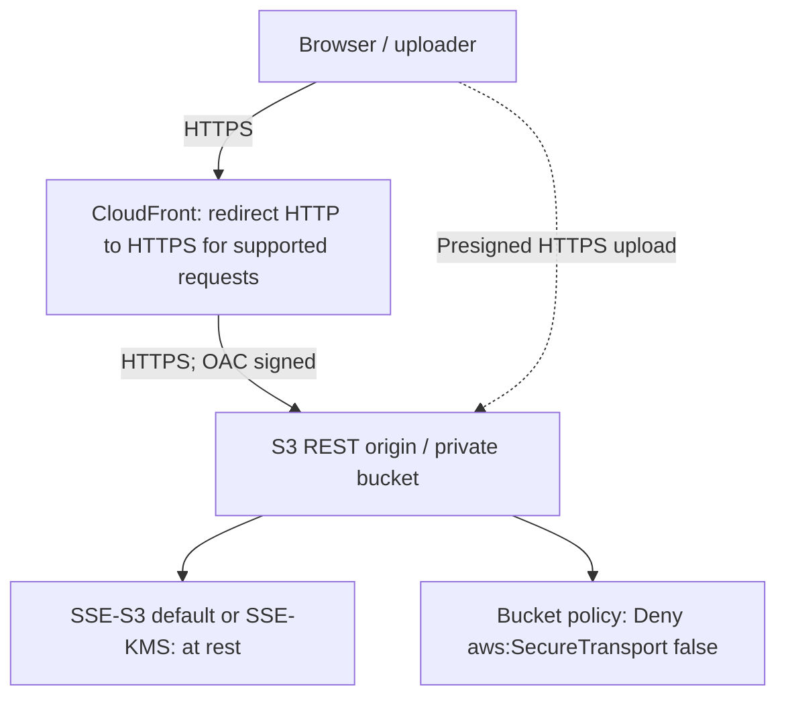
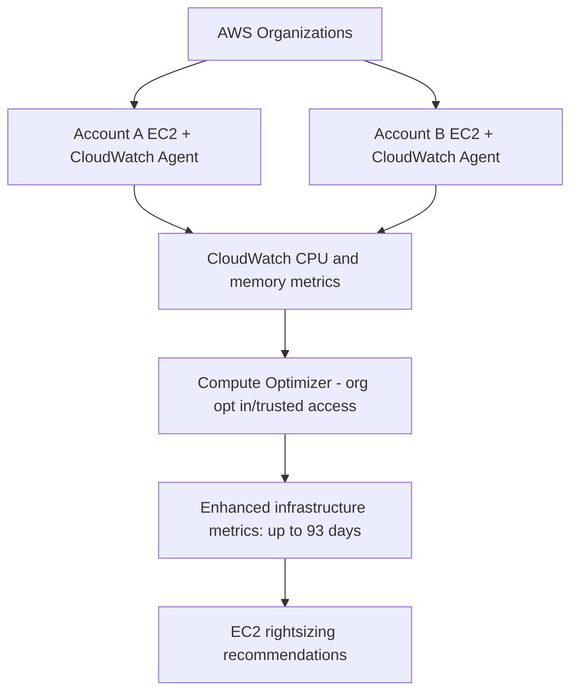
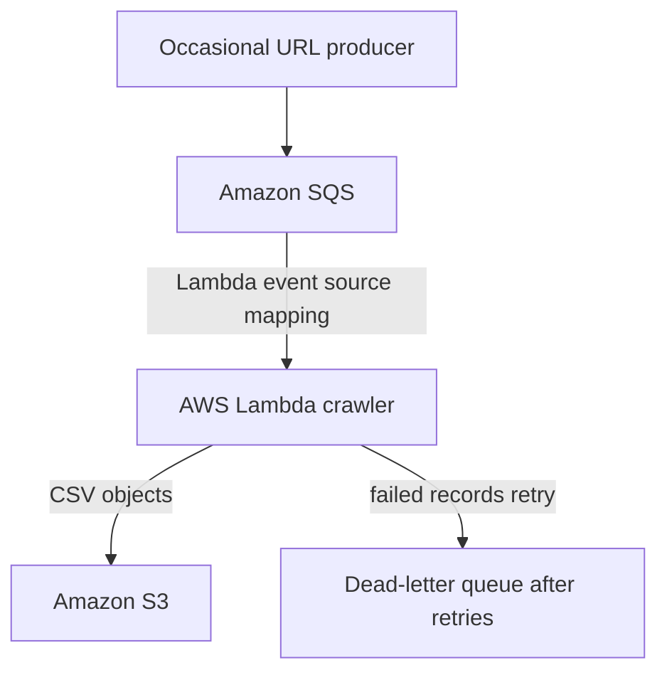
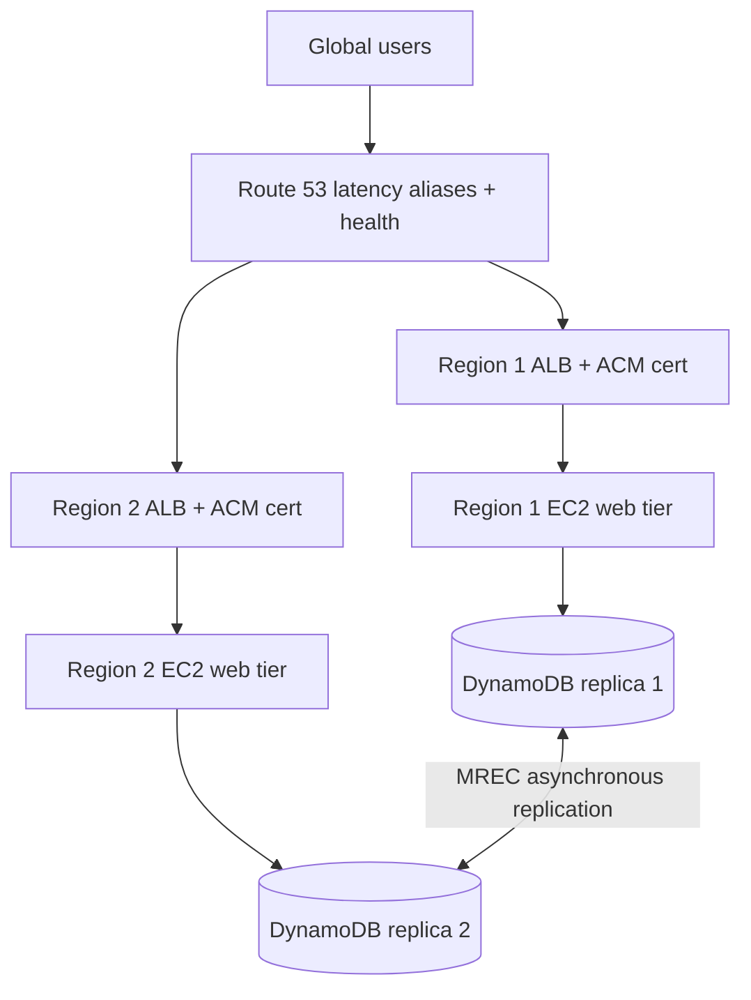
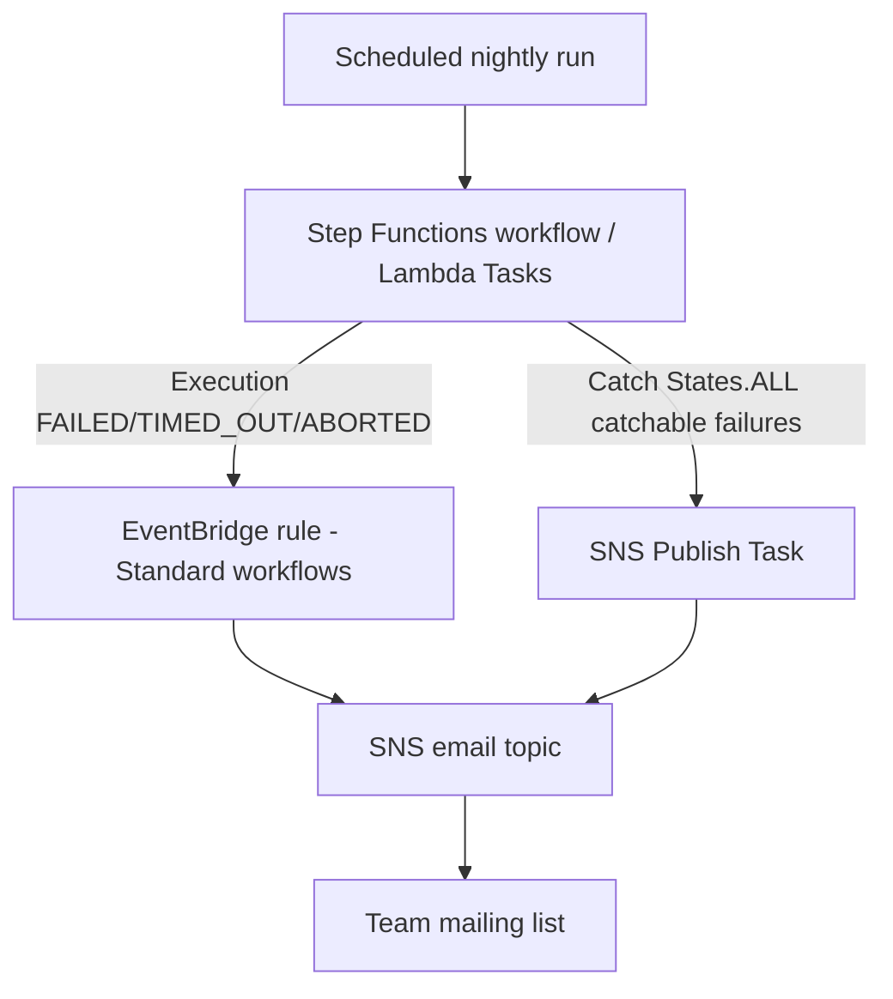
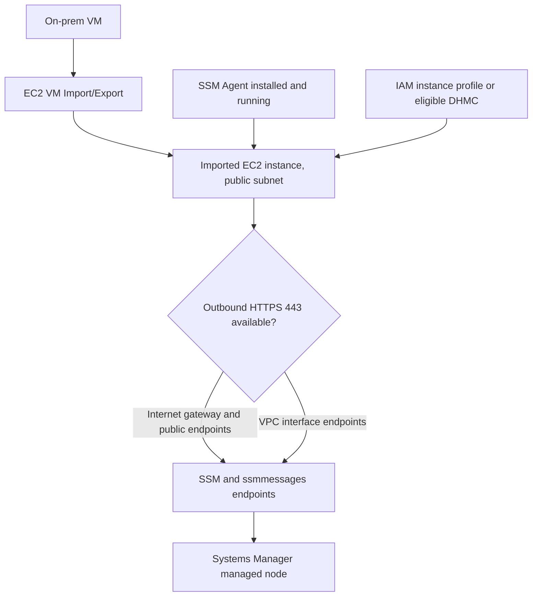
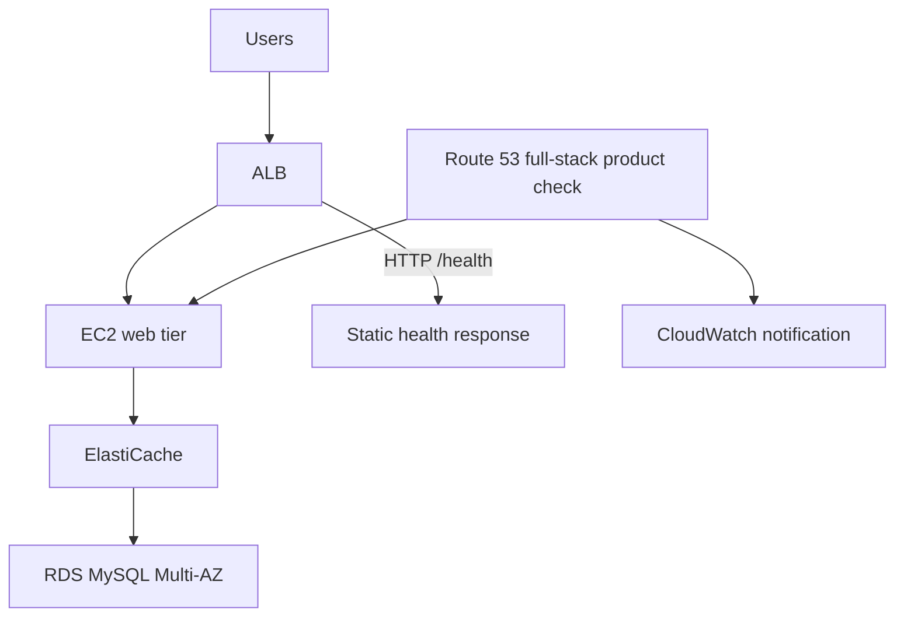

# Domain 3 multi-answer study — Q83 (6 of 58)

## Verdict
**C and E verified.** Q83 is a near-duplicate of Q32 (same five options, answers, and core scenario) and should be flagged, not deleted automatically. Source text has missing spaces; Q83 omits Q32's explicit anonymous/named requester constraint.

## Original question
A company has an application that stores user-uploaded videos in an Amazon S3 bucket using S3 Standard storage. Users access videos frequently for the first 180 days, and rarely after that. Most videos are over 100 MB. Users often have poor internet connectivity, and the company uses multipart uploads. A solutions architect needs tooptimize S3 storage costs. Which combination of actions will meet these requirements? (Select TWO.)

- **A.** Configure the S3 bucket to be a Requester Pays bucket.
- **B.** Use S3 Transfer Acceleration to upload the videos.
- **C.** Create a lifecycle rule to expireincomplete multipart uploadsafter 7 days.
- **D.** Create a lifecycle rule to transition objects toS3 Glacier Instant Retrieval after 1 day.
- **E.** Create a lifecycle rule to transition objects toS3 Standard-IA after 180 days.

## Explain the answer
- **A incorrect:** Requester Pays moves requester charges, does not reduce underlying stored bytes. Unlike Q32, Q83 does not explicitly mention anonymous access, so do not claim that alone disproves A for Q83.
- **B incorrect:** S3 Transfer Acceleration improves upload speed for some paths, but adds transfer charges and does not clear orphaned multipart-upload parts.
- **C correct:** S3 Lifecycle `AbortIncompleteMultipartUpload` after 7 days deletes stored parts that were never completed, stopping ongoing part charges; does not delete completed objects.
- **D incorrect:** S3 Glacier Instant Retrieval after 1 day conflicts with frequent reads for 180 days and imposes retrieval fees and 90-day minimum storage duration.
- **E correct:** Transition completed objects from S3 Standard to S3 Standard-IA after 180 days, matching later infrequent access (retrieval fees; 30-day minimum).

## Diagram
```text
User multipart video upload
    |-- Complete --> S3 Standard (day 0–180) --> Standard-IA (day 180+): E
    +-- Incomplete -> charged staged parts --> abort after 7 days: C
```

## Duplicate/variant check
- **Q32:** near-identical objective, storage class, lifecycle timings, options A–E, answer C+E; Q32 additionally states named/anonymous users and explicitly distinguishes >100 MB objects.
- **Q305:** other large video S3 uploads, but its performance/geography requirements change the solution. Do not carry C+E into Q305 automatically.
- Published exact Q83 text variants at examsvce and certprep also give C+E, but these are third-party sources, not an AWS exam authority.
- Source typos: `tooptimize`, `expireincomplete multipart uploadsafter`, `toS3`. Original question and options preserved in questions.json for traceability.

## AWS documentation
- https://docs.aws.amazon.com/AmazonS3/latest/userguide/mpu-abort-incomplete-mpu-lifecycle-config.html
- https://docs.aws.amazon.com/AmazonS3/latest/userguide/mpuoverview.html
- https://docs.aws.amazon.com/AmazonS3/latest/userguide/storage-class-intro.html
- https://docs.aws.amazon.com/AmazonS3/latest/userguide/lifecycle-transition-general-considerations.html

## External variants
- https://www.examsvce.com/sap-c02/questiona-company-has-an-application-that-stores-question-answer.html
- https://www.certprep.io/amazon/sap-c02/questions


## Q115 (7 of 58): Aurora database activity auditing and 10-year WORM retention

**Intended A+C.** Aurora PostgreSQL encrypted at rest and TLS in transit; Aurora Database Activity Streams -> managed Kinesis Data Streams -> Data Firehose -> S3 Object Lock compliance mode (10 years). A: intended Aurora cluster. B: also supports encryption/TLS but does not establish Aurora cluster; question has ambiguity. C: strongest separation of duties; omitted Kinesis intermediary. D: pgAudit to CloudWatch and immutable S3 can be viable if permissions and audit configuration robust, but not equivalent managed stream separation. E: governance retention bypassable. Validate Region/engine version, audit policy, event delivery, KMS, versioning, retention, least privilege. No exact external exam variant independently confirmed; don't claim otherwise.

AWS: https://docs.aws.amazon.com/AmazonRDS/latest/AuroraUserGuide/DBActivityStreams.html ; https://docs.aws.amazon.com/AmazonRDS/latest/AuroraUserGuide/DBActivityStreams.Enabling.html ; https://docs.aws.amazon.com/AmazonS3/latest/userguide/object-lock.html


## Q127 — Domain 3 multi-answer 8/58: patched AMIs and Auto Scaling
**Answer C+D**, with caveat: D alone fixes stale AMI; C supplies ALB target health monitoring/availability. A misstates ASG UpdatePolicy; B patches mutable groups but not launch image; E termination protection does not fix image or reliably prevent ASG replacement.

```text
OLD: unpatched AMI -> patched running EC2 -> reboot/unhealthy -> replacement from unpatched AMI
NEW: patch/test AMI -> versioned launch template -> ASG instance refresh -> ALB target health verification
```

**Current AWS guidance:** prefer launch templates over legacy launch configurations; use rolling instance refresh with healthy percentages, warmup, grace periods and optionally checkpoints. Source caveat: reboot alone need not cause replacement; health-check behavior is configuration-dependent.

**External variants:** Scribd ExamTopics-derived Q348 lists C,D (same order). Exam-tests Q85 reorders B/C and reports A,B, an internally inconsistent key. Verify option text, not letters. No exact duplicate confirmed by initial dataset phrase scan; related IDs: 567.

AWS docs: https://docs.aws.amazon.com/autoscaling/ec2/userguide/instance-refresh-overview.html ; https://docs.aws.amazon.com/autoscaling/ec2/userguide/health-checks-overview.html ; https://docs.aws.amazon.com/autoscaling/ec2/userguide/launch-templates.html


## Q135 (9 of 58): 90-day allowlisted client IP inactivity from ALB logs

**Answer B+D.** Enable ALB access logging, create Athena table over S3 logs, and have Lambda query client IP and timestamps to identify security group allowlist candidates inactive for 90 days. A VPC Flow Logs to CloudWatch is more expensive and network-oriented; C checks flow logs rather than HTTP requests; E CloudTrail logs AWS API actions, not user web requests. D queries ALB logs through Athena.

```text
Client IP -> ALB (SG allowlist) -> EC2 targets
                 |
                 +-> access logs -> S3 -> Athena <- Lambda
                                                 |
                                       validate candidate IP
                                                 |
                                     update ALB security group
```

**Defects/caveats:** 'IPaddresses' spacing typo. AWS states ALB access logs are best-effort and eventually consistent, so missing events do not prove inactivity. Proxies/NAT can change observed source IP. Keep 90+ days retention, use partitions to control Athena scanned bytes, validate CIDR rules and protect critical IPs before revocation. Newer ALB CloudWatch Logs integrations exist; legacy S3 ALB logs + Athena remains valid. External exact-stem FreeCram 2025-04-03 q227 reorders options, so compare answer text, not letters. Related logging IDs: 24, 90, 232, 492, 496, 508, 591; no exact duplicate confirmed.

AWS references: https://docs.aws.amazon.com/elasticloadbalancing/latest/application/load-balancer-access-logs.html ; https://docs.aws.amazon.com/athena/latest/ug/application-load-balancer-logs.html ; https://docs.aws.amazon.com/athena/latest/ug/query-alb-access-logs-examples.html
External: https://www.freecram.net/Amazon.SAP-C02.v2025-04-03.q227.pdf


## Q140 (10 of 58) — VM-imported EC2 not registered in Systems Manager

**A+B**. Imported VM -> custom AMI -> EC2 instance: verify SSM Agent installed/running and effective IAM permissions (EC2 instance profile with AmazonSSMManagedInstanceCore, or Default Host Management Configuration). Verify outbound HTTPS 443 and SSM endpoint reachability separately.

```text
On-prem VM -> VM Import/Export -> AMI -> EC2
                                      | SSM Agent running (A)
                                      | SSM permissions (B)
                                      v
                           HTTPS 443 -> SSM endpoint -> managed node
```

A correct: custom image may lack agent. B correct in traditional model; modern DHMC alternative. C VPC interface endpoint optional if internet egress exists. D Application Discovery Agent is for migration discovery. E service-linked roles do not replace per-node permissions. Source issue: legacy phrase 'EC2 VM Import feature of AWS Import/Export'; use VM Import/Export. Public IP alone does not ensure routing or outbound access. Duplicate scan related IDs: 14, 31, 35, 44, 57, 60, 106, 110, 111, 117, 121, 125, 144, 164, 172, 212, 213, 224, 225, 229, 245, 250, 267, 309, 316, 322, 336, 371, 389, 443, 465, 466, 470, 473, 507, 511, 514, 545, 567, 581, 609, 618, 620, 626, 637, 644, 653; no exact duplicate confirmed. Exact external exam variant not independently confirmed, AWS official docs validate answer mechanics.

Sources: https://docs.aws.amazon.com/systems-manager/latest/userguide/fleet-manager-troubleshooting-managed-nodes.html ; https://docs.aws.amazon.com/systems-manager/latest/userguide/setup-instance-permissions.html ; https://docs.aws.amazon.com/systems-manager/latest/userguide/troubleshooting-managed-nodes-using-ssm-cli.html


## Q147 (11 of 58): 1,000-node tightly coupled HPC cluster

**Correct A+C+F.** Single AZ, ideally cluster placement group, EFA-capable EC2 instances, and shared Amazon FSx for Lustre. Single AZ reduces latency for tightly coupled MPI communication; EFA provides high-performance networking; Lustre is a parallel file system optimized for demanding HPC throughput/metadata operations.

```text
           ONE AVAILABILITY ZONE (A)
    +-------------------------------------+
    | Cluster placement group             |
    | EC2/EFA <--> EC2/EFA <--> ... 1000  | (C)
    +-----------------+-------------------+
                      |
            shared parallel I/O
                      v
             Amazon FSx for Lustre         (F)
                      |
                  optional S3
```

A yes: tightly coupled compute in single AZ. B no: ENI counts in multiples of four is not HPC rule. C yes: EFA supports low-latency/high-throughput inter-node communication. D no: multi-AZ is better for loosely coupled jobs, not this one. E no: EBS RAID isn't a shared parallel filesystem for 1000 workers. F yes: FSx for Lustre, provision throughput and metadata IOPS appropriately.

**Caveats:** Stem typo 'AWS tor'. EFS may work for other HPC workloads; performance is workload-specific. Cluster placement group is best practice though not one of the options. Modern FSx for Lustre supports EFA-enabled file systems for supported clients and deployments, an additional tuning possibility. Exact external exam variants on FreeCram and Exam-Tests both key A,C,F. Dataset duplicate scan found no exact same-stem question; related IDs: none.

Official AWS: https://docs.aws.amazon.com/wellarchitected/latest/high-performance-computing-lens/tightly-coupled-scenarios.html ; https://docs.aws.amazon.com/wellarchitected/latest/high-performance-computing-lens/workload-architecture.html ; https://docs.aws.amazon.com/fsx/latest/LustreGuide/performance.html ; https://docs.aws.amazon.com/fsx/latest/LustreGuide/efa-file-systems.html
External: https://www.freecram.net/question/Amazon.SAP-C02.v2026-03-31.q264/a-company-has-built-a-high-performance-computing-hpc-cluster-in-aws-tor-a-tightly-coupled-workload ; https://www.exam-tests.com/SAP-C02-exam/Amazon.SAP-C02.v2025-02-24.q513.html?p=63


## Q155 (12/58) — Active-active ECS Regions, ECR, ACM and Aurora

**Original intended answers: A, D, E. Critical outdated recommendation in D.**

A: correct, ACM ALB certificates are regional. B: incorrect, RAM cannot share a regional ACM certificate across Regions. C: incorrect, ECR VPC endpoint does not replace image replication. D: cross-Region ECR replication correct, but manually re-pushing existing images is obsolete as the least-overhead approach: AWS ECR now supports replication backfill. Proposed revised D: Configure cross-Region ECR replication and start replication backfill for existing images. E: correct, Aurora Global Database can forward supported DML from secondary to the single primary writer. F: incorrect, not an independent multi-writer Aurora global database.

Architecture:

```text
                 Route 53 geolocation
                  /              \
       Primary Region         Secondary Region
       ALB + ACM              ALB + ACM (A)
          ECS                    ECS
          ECR ---- replicate --> ECR (D)
       Aurora primary <--- writes forwarded --- Aurora secondary (E)
       single writer --- asynchronous replication --> secondary
```

Aurora MySQL global write forwarding requires supported version, enabling forwarding, setting aurora_replica_read_consistency, and verifying SQL limitations. 'Active-active' refers to app traffic, not independent DB writers. Route 53 geolocation needs a sensible default. Duplicate audit across dataset: Q200 is close ECS/ALB/ECR/Aurora multi-Region variant but tests DR RPO/RTO and backups; Q123 and Q242 related, no exact duplicate confirmed. External same-stem variant appears on CertEnsure Q163, but exact external answer key was not independently confirmed.

Official docs: https://docs.aws.amazon.com/acm/latest/userguide/acm-overview.html ; https://docs.aws.amazon.com/AmazonECR/latest/userguide/replication-backfill.html ; https://docs.aws.amazon.com/AmazonRDS/latest/AuroraUserGuide/aurora-global-database-write-forwarding-ams.html


## Q157 (13 of 58) — IAM CreateUser approval, lockdown and notification

**Verified A + D + E.** Detect the IAM CreateUser management event using EventBridge via CloudTrail, start Step Functions to restrict access and coordinate approval, and notify the security team through SNS.

Original options: A EventBridge CloudTrail CreateUser rule (correct); B CloudTrail directly sends per-CreateUser SNS (incorrect, log delivery SNS differs); C Fargate container to remove access (possible but operationally excessive); D Step Functions remediation (correct); E SNS security notification (correct); F Pinpoint (unnecessary).

Architecture:

    IAM CreateUser -> CloudTrail management event -> EventBridge rule (A)
                                                  |
                                                  v
                                        Step Functions (D)
                                          | lockdown
                                          | approval workflow
                                          v
                                      SNS notification (E)
                                          |
                                      security review

EventBridge pattern:

    {"source":["aws.iam"],"detail-type":["AWS API Call via CloudTrail"],"detail":{"eventSource":["iam.amazonaws.com"],"eventName":["CreateUser"]}}

**Critical security caveat:** CloudTrail-originated EventBridge events are best effort and asynchronous, so this alone cannot enforce zero access at every instant. New IAM users initially have no permissions; add preventive IAM controls and reconciliation to protect against grants before response. For IAM global service events, create the EventBridge rule in us-east-1. 'Amazon CloudWatch Events' is legacy terminology. Step Functions can publish directly to SNS; explicit approval callback and controlled grant require implementation.

External exact-stem variants: https://www.exam-tests.com/SAP-C02-exam/Amazon.SAP-C02.v2025-02-24.q513.html?p=23 (Q110) and https://www.examcollection.us/exam/SAP-C02-question-answer-3.html (both A,D,E). No exact/near duplicate detected by CreateUser and approval scan of all 674.

AWS: https://docs.aws.amazon.com/eventbridge/latest/ref/events-ref-iam.html ; https://docs.aws.amazon.com/step-functions/latest/dg/connect-sns.html ; https://repost.aws/knowledge-center/iam-eventbridge-sns-rule


## Q158 (14 of 58) — Global document upload and API latency

**Original intended A+C; verified with architecture defects.** Serverless document system in eu-central-1: CloudFront static site, Regional API Gateway, Lambda writes Aurora Serverless metadata and S3 documents. Global clients need lower latency.

- **A correct only after changing upload flow:** Enable S3 Transfer Acceleration and generate acceleration-aware presigned PUT/POST URLs so the browser uploads directly to S3 edge endpoint. The described Lambda-to-S3 upload path will not benefit simply by enabling acceleration.
- **B wrong:** Global Accelerator standard endpoints are ALB, NLB, EC2, EIP; not CloudFront distributions.
- **C correct for REST APIs:** API Gateway edge-optimized REST endpoints use AWS-managed CloudFront to improve geographically distributed client connection time. HTTP APIs do not support edge-optimized endpoint type; alternatively put customer-managed CloudFront before Regional API.
- **D not preferred:** Whole-stack multi-Region deployment adds considerable complexity; Aurora Serverless global database support depends on version/architecture.
- **E wrong:** RDS Proxy addresses database connection scaling, not client-to-API/upload latency.

Architecture:

    Global browser
        |-- static site --> CloudFront --> S3 web assets (Frankfurt)
        |-- API request --> Edge-optimized API Gateway (C) --> Lambda --> Aurora
        |-- presigned URL from API --> S3 Transfer Acceleration edge (A)
                                           |
                                      S3 bucket Frankfurt

**Defects and outdated recommendations:** Original stem explicitly says Lambda PUTs documents into S3; A requires changing that to browser-to-S3 direct upload, which is not stated. C presumes REST API, not specified. CloudFront website distribution is separate from edge-optimized API's managed distribution. S3 Transfer Acceleration has additional charges and variable geographic benefit. Neither option eliminates backend-to-database latency.

**External variants:** Exam-Tests exact stem A+C; FreeCram discussion A+C; ExamTopics discussion has dissenting A+D and B+C arguments, but B is technically impossible as stated. Related feature-question IDs: 18,32,83,149,170,273,285,305,323,349,365,495,496,516,570,592,596,648,656; no exact same-stem duplicate detected in dataset.

Sources: https://docs.aws.amazon.com/AmazonS3/latest/userguide/transfer-acceleration-examples.html ; https://docs.aws.amazon.com/apigateway/latest/developerguide/api-gateway-api-endpoint-types.html ; https://docs.aws.amazon.com/global-accelerator/latest/dg/about-endpoints.html ; https://aws.amazon.com/blogs/networking-and-content-delivery/implementing-secure-file-uploads-to-amazon-s3-at-the-edge-choosing-the-right-pattern/ ; https://www.exam-tests.com/SAP-C02-exam/Amazon.SAP-C02.v2025-02-24.q513.html?p=43 ; https://www.freecram.com/discussions/Amazon/exam-sap-c02-topic-2-question-284-discussion-p1298270.html


---

# Domain 3 multi-answer study — Q159 (15 of 58)

## Verdict
**A, C, E verified as intended exam answers; C ambiguous, A outdated premise.** No exact stem duplicate among the 674 dataset questions. Similar-but-distinct Q115, Q456, Q469, Q390, Q541.

## Original question
A company is designing a new website that hosts static content. The website will give users the ability to upload and download large files. According to company requirements, all data must be encrypted in transit and at rest. A solutions architect is building the solution by using Amazon S3 and Amazon CloudFront. Which combination of steps will meet the encryption requirements? (Select THREE.)

- **A.** Turn on S3 server-side encryption for the S3 bucket that the web application uses.
- **B.** Add a policy attribute of "aws:SecureTransport": "true" for read and write operations in the S3 ACLs.
- **C.** Create a bucket policy that denies any unencrypted operations in the S3 bucket that the web application uses.
- **D.** Configure encryption at rest on CloudFront by using server-side encryption with AWS KMS keys (SSE-KMS).
- **E.** Configure redirection of HTTP requests to HTTPS requests in CloudFront.
- **F.** Use the RequireSSL option in the creation of presigned URLs for the S3 bucket that the web application uses.

## Detailed option analysis
- **A — Correct (historical wording).** S3 server-side encryption protects objects at rest. Since January 5, 2023, all new S3 uploads receive at least SSE-S3 automatically. A is still the intended exam choice but no longer requires a manual toggle for SSE-S3.
- **B — Incorrect.** An S3 ACL cannot contain `aws:SecureTransport` IAM condition keys. Enforce transport policy through a bucket policy.
- **C — Correct, with ambiguity.** Bucket policies can deny `aws:SecureTransport=false` for S3 requests; that is a TLS-in-transit condition. To require specified encryption-at-rest settings, use appropriate separate controls. The question's term 'unencrypted operations' does not identify the actual bucket policy condition.
- **D — Incorrect.** CloudFront does not expose SSE-KMS encryption at rest for cached content. Apply encryption to S3 origin objects, with suitable OAC and KMS permissions when needed.
- **E — Correct.** CloudFront's viewer protocol policy can redirect HTTP to HTTPS. For file writes/uploads, send HTTPS directly or use HTTPS Only to avoid redirect-method caveats.
- **F — Incorrect.** Generating S3 presigned URLs has no `RequireSSL` flag. Use HTTPS URLs and a bucket policy denying insecure transport.

## Diagram


## Duplicate and variant review
- Full 674-question exact normalized stem comparison: **no exact duplicate**.
- Related concepts: **Q115** encrypt data at rest and in transit; **Q456** S3 cross-account security; **Q469** static site architecture; **Q390** S3 regional storage; **Q541** encryption governance for EBS. These are not identical questions and answer letters must not be transferred between them.
- External SAP-C02 variant includes the same scenario/options in different ordering: original A→external E, B→F, C→A, D→B, E→D, F→C. Dataset A,C,E maps to external E,A,D. External source confirms variant wording, not independently its published answer key.

## Outdated / defective warnings
- **2023 default encryption update:** S3 new objects always encrypted with SSE-S3 at baseline, so A's implied manual-enablement requirement is stale.
- **C is underspecified:** state specifically bucket policy `Deny` with `aws:SecureTransport=false` for transport; bucket-policy SSE-KMS enforcement is a different condition.
- **Redirect is not a universal write-safe answer:** for uploads require direct HTTPS or HTTPS Only where appropriate; viewer protocol behavior has method/version caveats.
- **CloudFront origin:** use S3 REST origin and OAC, not an S3 static website origin for CloudFront→S3 HTTPS.

## Sources
- https://docs.aws.amazon.com/AmazonS3/latest/userguide/default-encryption-faq.html
- https://docs.aws.amazon.com/AmazonS3/latest/userguide/amazon-s3-policy-keys.html
- https://docs.aws.amazon.com/AmazonCloudFront/latest/DeveloperGuide/using-https-viewers-to-cloudfront.html
- https://docs.aws.amazon.com/AmazonCloudFront/latest/DeveloperGuide/using-https-cloudfront-to-s3-origin.html
- https://docs.aws.amazon.com/AmazonCloudFront/latest/DeveloperGuide/private-content-restricting-access-to-s3.html
- https://myportal.utt.edu.tt/ICS/icsfs/d97df75f-867e-411a-ac5f-e13435c2eedc.pdf?target=c53e5228-7ce9-4ef5-a5ec-d932dc3abaad


---
# Domain 3 multi-answer Q172 (16 of 58) — independently rechecked 2026-11-02

## Original
A company has many AWS accounts in an organization in AWS Organizations. The accounts contain many Amazon EC2 instances that run different types of workloads. The workloads have different usage patterns. The company needs recommendations for how to rightsize the EC2 instances based on CPU and memory usage during the last 90 days. Which combination of steps will provide these recommendations? (Select THREE.)
- **A.** Opt in to AWS Compute Optimizer and enable trusted access for Compute Optimizer for the organization.
- **B.** Configure a delegated administrator account for AWS Systems Manager for the organization.
- **C.** Use an AWS CloudFormation stack set to enable detailed monitoring for all the EC2 instances.
- **D.** Install and configure the Amazon CloudWatch agent on all the EC2 instances to send memory utilization metrics to CloudWatch.
- **E.** Activate enhanced metrics in AWS Compute Optimizer.
- **F.** Configure AWS Systems Manager to pass metrics to AWS Trusted Advisor.

## Answer
**A, D, E**. Historical answer **A,D,F** is wrong.

## Every option
- A **correct**: opt organization into Compute Optimizer; trusted access permits analyzing member accounts.
- B **incorrect**: Systems Manager delegated administrator is not required; Compute Optimizer has its own optional delegated administration.
- C **incorrect**: EC2 detailed monitoring gives 1-minute basic hypervisor metrics, not guest OS memory utilization or a 90-day analysis preference.
- D **correct**: CloudWatch agent supplies EC2 memory usage to CloudWatch; Compute Optimizer recognizes Linux CWAgent mem_used_percent and supported Windows memory metrics.
- E **correct**: enhanced infrastructure metrics (paid) extends 14-day lookback to **up to 93 days**; sufficient for 90-day request if history exists.
- F **incorrect**: Systems Manager cannot pass metrics to Trusted Advisor as described; Trusted Advisor may show Compute Optimizer findings, but is not the rightsizing engine described.

## Diagram


## External variants and defects
FreeCram SAP-C02 v2026-03-31 q264 contains same scenario and reordered options (dataset A→variant C, B→B, C→A, D→E, E→F, F→D). Published key C,D,E maps to dataset A,F,D and is **incorrect**: variant D (dataset F) is unsupported and variant F (dataset E) is essential for 90 days. Treat third-party answer keys as unverified. AWS docs support A,D,E.

## Duplicate audit
Compared against all 674 stems. No exact duplicate. Top lexical matches: Q473 (0.24), Q189 (0.21), Q283 (0.21), Q12 (0.19), Q136 (0.18), Q276 (0.17), Q644 (0.17), Q106 (0.16). These are similarity candidates, not established duplicates.

## Caveats
Enhanced infrastructure metrics incurs charges and extends analysis to up to 93 days; historical memory observations must already exist. Compute Optimizer rightsizing preferences now include a 32-day option, which still does not satisfy 90 days. For organization-wide recommendations use trusted access and org opt-in, not Systems Manager delegated admin.

## Sources
- https://docs.aws.amazon.com/compute-optimizer/latest/ug/account-opt-in.html
- https://docs.aws.amazon.com/compute-optimizer/latest/ug/ec2-metrics-analyzed.html
- https://docs.aws.amazon.com/compute-optimizer/latest/ug/enhanced-infrastructure-metrics.html
- https://docs.aws.amazon.com/compute-optimizer/latest/ug/rightsizing-preferences-process.html
- https://www.freecram.net/question/Amazon.SAP-C02.v2026-03-31.q264/a-company-has-many-aws-accounts-in-an-organization-in-aws-organizations-the-accounts-contain-many-amazon


---
# Domain 3 multi-answer Q177 (19 of 58) — 2026-11-02

## Original
A company runs a web-crawling process on a list of target URLs to obtain training documents for machine learning (ML) training algorithms. A fleet of Amazon EC2 t2.micro instances pulls the target URLs from an Amazon SQS queue. The instances write the result of the crawling algorithm as a CSV file to an Amazon EFS volume. The EFS volume is mounted on all instances in the fleet. A second system occasionally adds the URLs to the SQS queue. The EC2 instances crawl each new URL in 10 seconds or less. Metrics indicate that some instances are idle when no URLs are in the SQS queue. A solutions architect needs to redesign the architecture to optimize costs. Which combination of steps will meet these requirements MOST cost-effectively? (Select TWO.)
- **A.** Use m5.8xlarge instances instead of t2.micro instances for the web-crawling process. Reduce the number of instances in the fleet by 50%.
- **B.** Use an AWS Lambda function to run the web-crawling process. Configure the Lambda function to pull URLs from the SQS queue.
- **C.** Modify the web-crawling process to store results in Amazon Neptune.
- **D.** Modify the web-crawling process to store results in an Amazon Aurora Serverless MySQL instance.
- **E.** Modify the web-crawling process to store results in Amazon S3.

## Verified answer: B, E
- A wrong: m5.8xlarge replacement with half the instance count is not economical for intermittent 10-second jobs.
- B correct: Lambda SQS event source mapping polls messages and invokes functions only when jobs arrive; removes idle EC2 cost. The application function itself need not poll SQS.
- C wrong: Neptune graph DB is not appropriate CSV object storage.
- D wrong: Aurora Serverless relational database adds unnecessary infrastructure for files.
- E correct: S3 is durable low-ops object storage for CSV output; no shared EFS volume necessary.

## Architecture


## Duplicate/variant review
Compared all 674 stems: no exact normalized duplicate. Closest lexical candidates Q600, Q442, Q337, Q247, Q326; not confirmed semantic duplicates. No matching independent external exam variant verified; do not claim external corroboration.

## Outdated/defect warnings
B says 'Lambda function pulls URLs' but AWS-managed event source mapping polls SQS. Configure timeout and visibility timeout (AWS recommends >=6x Lambda timeout, plus batching window), partial batch failure reporting, DLQ and idempotency because at-least-once delivery may duplicate work. Confirm crawl egress and robots rules. No outdated service requirement identified.

## AWS sources
- https://docs.aws.amazon.com/lambda/latest/dg/with-sqs.html
- https://docs.aws.amazon.com/lambda/latest/dg/services-sqs-configure.html
- https://docs.aws.amazon.com/lambda/latest/dg/services-sqs-errorhandling.html
- https://docs.aws.amazon.com/lambda/latest/dg/configuration-timeout.html


---
# Backfilled pending Domain 3 Q174 (17 of 58) — 2026-11-02
Original question in dataset is truncated; preserve it without fabricating full text. **A,C**: IAM Identity Center ABAC principal tag policy scopes user S3 prefix; CloudTrail S3 object-level data events to Athena for per-user monthly reporting. B lacks required per-user ABAC conditions; D management events insufficient; E S3 Select is not a cross-file reporting engine. Data events opt-in and billed. Sources: https://docs.aws.amazon.com/singlesignon/latest/userguide/attributesforaccesscontrol.html ; https://docs.aws.amazon.com/awscloudtrail/latest/userguide/logging-data-events-with-cloudtrail.html . No complete independently verified external variant.

# Backfilled pending Domain 3 Q175 (18 of 58) — 2026-11-02
**B,E**: alternative solutions, not cumulative steps. B: Lambda in private Neptune VPC subnets with NAT for DynamoDB; E: Lambda in private/isolated subnets and DynamoDB gateway endpoint associated with route tables. A fails because Lambda in public subnet lacks public IP; C/D cannot reach Neptune private DB merely through SG or service endpoint. Neptune SG inbound from Lambda SG assumed. Gateway endpoint preferable if only DynamoDB egress. Sources: https://docs.aws.amazon.com/lambda/latest/dg/configuration-vpc-internet.html ; https://docs.aws.amazon.com/vpc/latest/privatelink/vpc-endpoints-ddb.html .


---
# Domain 3 multi-answer Q182 (20 of 58) — 2026-11-02

## Original question
A company is using a single AWS Region for its ecommerce website. The website includes a web application that runs on several Amazon EC2 instances behind an Application Load Balancer (ALB). The website also includes an Amazon DynamoDB table. A custom domain name in Amazon Route 53 is linked to the ALB. The company created an SSL/TLS certificate in AWS Certificate Manager (ACM) and attached the certificate to the ALB. The company is not using a content delivery network as part of its design. The company wants to replicate its entire application stack in a second Region to provide disaster recovery, plan for future growth, and provide improved access time to users. A solutions architect needs to implement a solution that achieves these goals and minimizes administrative overhead. Which combination of steps should the solutions architect take to meet these requirements? (Select THREE.)

- A. Create an AWS CloudFormation template for the current infrastructure design. Use parameters for important system values, including Region. Use the CloudFormation template to create the new infrastructure in the second Region.
- B. Use the AWS Management Console to document the existing infrastructure design in the first Region and to create the new infrastructure in the second Region.
- C. Update the Route 53 hosted zone record for the application to use weighted routing. Send 50% of the traffic to the ALB in each Region.
- D. Update the Route 53 hosted zone record for the application to use latency-based routing. Send traffic to the ALB in each Region.
- E. Update the configuration of the existing DynamoDB table by enabling DynamoDB Streams. Add the second Region to create a global table.
- F. Create a new DynamoDB table. Enable DynamoDB Streams for the new table. Add the second Region to create a global table. Copy the data from the existing DynamoDB table to the new table as a one-time operation.

## Verified answer: A, D, E
- A correct: repeatable infrastructure-as-code for second Region. Region parameter alone does not choose stack deployment Region; deploy in desired Region or use StackSets.
- B incorrect: manual console recreation increases effort and drift.
- C incorrect: 50/50 weighted routing does not optimize latency; suitable for traffic splitting.
- D correct: latency-based Route 53 alias records for regional ALBs; set Evaluate Target Health/health checks to support DR.
- E correct for MREC global tables: add replica to existing populated table; DynamoDB Streams used automatically for MREC. Replication eventually consistent.
- F incorrect: unnecessary new table, bulk copy and cutover for MREC; MRSC has different restrictions.

## Architecture


## Defects and caveats
CloudFormation Region parameter does not select target Region; region-specific ACM cert required on second ALB; Route 53 health evaluation is essential for practical DR; MREC has replication lag and last-writer-wins conflicts; current MREC global tables automatically enable DynamoDB Streams. The absence of CloudFront is not an issue for latency DNS but CDN could further improve static content delivery.

## Duplicate audit
Normalized full stems compared across 674: no exact duplicate. Top lexical similarity candidates Q346 (0.246), Q451 (0.198), Q155 (0.190), Q123 (0.190), Q460 (0.188), Q326 (0.185). These are similarity leads, not proven duplicates. No reliable exact external exam variant independently verified; do not claim external confirmation.

## AWS references
- https://docs.aws.amazon.com/amazondynamodb/latest/developerguide/V2globaltables_HowItWorks.html
- https://docs.aws.amazon.com/amazondynamodb/latest/developerguide/globaltables-CoreConcepts.html
- https://docs.aws.amazon.com/Route53/latest/DeveloperGuide/resource-record-sets-values-latency-alias.html
- https://docs.aws.amazon.com/Route53/latest/DeveloperGuide/dns-failover-complex-configs.html


---
# Domain 3 multi-answer Q210 (21 of 58) — 2026-11-02

## Original source (verbatim, malformed punctuation retained)
A company has automated the nightly retraining of its machine learning models by using AWS Step Functions. The workflow consists of multiple steps that use AWS Lambda Each step can fail for various reasons and any failure causes a failure of the overall workflow A review reveals that the retraining has failed multiple nights in a row without the company noticing the failure A solutions architect needs to improve the workflow so that notifications are sent for all types of failures in the retraining process Which combination of steps should the solutions architect take to meet these requirements? (Select THREE)

- A. Create an Amazon Simple Notification Service (Amazon SNS) topic with a subscription of type "Email" that targets the team's mailing list.
- B. Create a task named "Email" that forwards the input arguments to the SNS topic
- C. Add a Catch field all Task Map. and Parallel states that have a statement of "Error Equals": [ “States. ALL”] and "Next": "Email".
- D. Add a new email address to Amazon Simple Email Service (Amazon SES). Verify the email address.
- E. Create a task named "Email" that forwards the input arguments to the SES email address
- F. Add a Catch field to all Task Map, and Parallel states that have a statement of "Error Equals": [ "states. Runtime”] and "Next": "Email".

## Exam key A,B,C; SOURCE DEFECT
A correct SNS email subscription; B correct SNS Publish service-integration Task (requires IAM publish permission); C best available catch-all on Task/Map/Parallel but **States.ALL cannot catch States.Runtime** and cannot catch States.DataLimitExceeded via wildcard. AWS documentation says DataLimitExceeded may be explicitly caught by name, but Runtime cannot. D SES address verification unnecessary; E SES direct integration not best fit; F incorrect: States.Runtime terminal and malformed casing, cannot be caught normally. Source overclaims notification for *all* failures. Add EventBridge Step Functions Execution Status Change rule FAILED, TIMED_OUT, ABORTED targeting SNS for Standard Workflows, best-effort delivery; Express needs CloudWatch Logs/metrics monitoring. Consider notification Task errors and avoiding duplicate notifications; don't claim exactly-once delivery.

## Diagram


## External variants
Exact stem/options verified in CertEmpire SAP-C02 demo PDF Q35, published key A,B,C; its claim that States.ALL catches any type is contradicted by AWS documentation. CramPDF Feb 2025 Q20 includes reordered variant with same stem and choices; do not rely on third-party keys for error semantics.

## Duplicates
No exact normalized stem duplicate among 674. Top lexical candidates Q600 (0.200), Q664 (0.191), Q353 (0.188), Q106 (0.177), Q326 (0.176), Q346 (0.170). These are not established semantic duplicates.

## Sources
- https://docs.aws.amazon.com/step-functions/latest/dg/concepts-error-handling.html
- https://docs.aws.amazon.com/step-functions/latest/dg/eventbridge-integration.html
- https://docs.aws.amazon.com/step-functions/latest/dg/connect-sns.html
- https://certempire.com/demo-files/sap-c02-demo-certempire.pdf
- https://actualtests.crampdf.com/articles/amazon-sap-c02-certification-all-in-one-exam-guide-feb-2025-q14-q32/


---
# Domain 3 multi-answer Q225 (22 of 58) — 2026-11-02

## Original (verbatim)
A solutions architect is importing a VM from an on-premises environment by using the Amazon EC2 VM Import feature. The imported instance has a public IP and runs in a public subnet in a VPC. However, the instance doesnot appearin the AWS Systems Manager (SSM) console as a managed instance. Which combination of steps should the architect take to resolve the issue? (Select TWO.)
- **A.** Verify that Systems Manager Agent is installed on the instance and is running.
- **B.** Verify that the instance is assigned an appropriate IAM role for Systems Manager.
- **C.** Verify the existence of a VPC endpoint on the VPC.
- **D.** Verify that the AWS Application Discovery Agent is configured.
- **E.** Verify the correct configuration of service-linked roles for Systems Manager.

## Verified answer: A, B (Select TWO)
A: **Correct.** SSM Agent must exist and run inside the imported AMI instance. Verify its service status, version, logs and connectivity.
B: **Correct intended exam answer.** The instance needs SSM permissions. Historically an EC2 IAM instance profile with `AmazonSSMManagedInstanceCore`; today Default Host Management Configuration can provide account-level permissions if IMDSv2 and SSM Agent >=3.2.582.0 are used. Thus attaching an IAM instance role is *not universally necessary*.
C: **Incorrect as a universal requirement.** SSM interface VPC endpoints are optional if HTTPS access to the public service endpoints works; if isolated or no internet egress, configure/check appropriate interface endpoints. A public IP and public subnet do not guarantee working internet egress: inspect route table Internet Gateway, security groups, NACLs and DNS.
D: **Incorrect.** AWS Application Discovery Agent collects migration discovery data, not SSM managed node registration.
E: **Incorrect.** Service-linked roles don't replace the per-node agent, permissions and network connectivity requirements.

## Architecture


## Duplicate/similarity audit across all 674
- Q140: **near-exact duplicate**, same five option texts in identical A–E order, same key A,B. Stems differ in length, but core scenario is the same.
- No identical fully normalized stem; avoid double-counting Q140/Q225 in distinct-concept study coverage.

## External variants
- ExamsVCE: exact Q225 with A,B published, which agrees with independently checked AWS docs.
- ExamTopics topic 1 Q492: longer version like Q140.
- CramPDF Feb 2025 Q14: reordered longer version, but published B,D,E is three options for a Select TWO question; invalid/defective key. Remap and validate against AWS, not the third-party key.

## Outdated/defective warnings
- Q225 stem has 'doesnot appearin' typo; preserve original. Q140 uses older 'AWS Import/Export' wording.
- Treat 'appropriate IAM role on the instance' as the *conventional* solution, not universal after Default Host Management Configuration.
- Public subnet/public IP alone does not guarantee HTTPS connectivity. If networking fails, check Internet Gateway route, SG/NACL egress, DNS, and optional PrivateLink interface endpoints.
- For modern Regions, `ssmmessages` is central; `ec2messages` may be relevant only for earlier-Region/legacy agent behavior.

## AWS and variant references
- https://docs.aws.amazon.com/systems-manager/latest/userguide/ssm-agent.html
- https://docs.aws.amazon.com/systems-manager/latest/userguide/setup-instance-permissions.html
- https://docs.aws.amazon.com/systems-manager/latest/userguide/troubleshooting-ssm-agent.html
- https://docs.aws.amazon.com/systems-manager/latest/userguide/fleet-manager-default-host-management-configuration.html
- https://www.examsvce.com/sap-c02/questiona-solutions-architect-is-importing-a-vm-question-answer.html
- https://www.examtopics.com/discussions/amazon/view/142926-exam-aws-certified-solutions-architect-professional-sap-c02/
- https://actualtests.crampdf.com/articles/amazon-sap-c02-certification-all-in-one-exam-guide-feb-2025-q14-q32/


## Q225 — Domain 3 multi-answer 22/58 — EC2 VM Import and SSM registration

**Original stem:** A solutions architect is importing a VM from an on-premises environment by using the Amazon EC2 VM Import feature. The imported instance has a public IP and runs in a public subnet in a VPC. However, the instance doesnot appearin the AWS Systems Manager (SSM) console as a managed instance. Which combination of steps should the architect take to resolve the issue? (Select TWO.)

- **A.** Verify that Systems Manager Agent is installed on the instance and is running.
- **B.** Verify that the instance is assigned an appropriate IAM role for Systems Manager.
- **C.** Verify the existence of a VPC endpoint on the VPC.
- **D.** Verify that the AWS Application Discovery Agent is configured.
- **E.** Verify the correct configuration of service-linked roles for Systems Manager.

**Verified intended answer: A and B.** A: SSM Agent must be installed/running. B: instance requires SSM permissions, normally through an IAM instance profile (AmazonSSMManagedInstanceCore); Default Host Management Configuration is an alternative when its prerequisites (IMDSv2 and SSM Agent >= 3.2.582.0) are met. C: VPC interface endpoints are optional with working outbound HTTPS internet connectivity, but necessary as an alternative if there is no internet egress. D: Application Discovery Agent is unrelated to SSM managed-node registration. E: service-linked roles cannot replace the agent, its credentials, or connectivity.

**Architecture:** on-premises VM → EC2 VM Import/Export → EC2 instance [SSM Agent + SSM IAM permissions] → HTTPS 443 [internet egress OR interface VPC endpoints for ssm and ssmmessages] → Systems Manager managed node.

**Duplicate audit (674 records):** Q140 is a near-exact duplicate, with identical five options and A+B key; preserve both IDs and mark relationship. No other VM Import/SSM matching stems were found by targeted phrase scan.

**Defects/modernization:** Original typo 'doesnot appearin'; public IP and subnet do not guarantee outbound connectivity; B is not an unconditional instance-profile requirement under DHMC. For 2024+ Regions, ec2messages endpoints are not supported. Do not adopt external variant's invalid three-answer key for Select TWO.

**AWS sources:** https://docs.aws.amazon.com/systems-manager/latest/userguide/ssm-agent.html ; https://docs.aws.amazon.com/systems-manager/latest/userguide/fleet-manager-troubleshooting-managed-nodes.html ; https://docs.aws.amazon.com/systems-manager/latest/userguide/troubleshooting-ssm-agent.html ; https://docs.aws.amazon.com/systems-manager/latest/userguide/fleet-manager-default-host-management-configuration.html

**External variants recorded in dataset (not freshly re-fetched):** https://www.examsvce.com/sap-c02/questiona-solutions-architect-is-importing-a-vm-question-answer.html ; https://www.examtopics.com/discussions/amazon/view/142926-exam-aws-certified-solutions-architect-professional-sap-c02/ ; https://actualtests.crampdf.com/articles/amazon-sap-c02-certification-all-in-one-exam-guide-feb-2025-q14-q32/


## Q247 — Domain 3 multi-answer 23/58 — EC2 to Aurora security groups

**Original question:** A company has an application that runs on Amazon EC2 instances. A solutions architect is designing VPC infrastructure in an AWS Region where the application needs to access an Amazon Aurora DB cluster. The EC2 instances are all associated with the same security group. The DB cluster is associated with its own security group. The solutions architect needs to add rules to the security groups to provide the application with least privilege access to the DB cluster. Which combination of steps will meet these requirements? (Select TWO.)

- **A.** Add an inbound rule to the EC2 instances' security group. Specify the DB cluster's security group as the source over the default Aurora port.
- **B.** Add an outbound rule to the EC2 instances' security group. Specify the DB cluster's security group as the destination over the default Aurora port.
- **C.** Add an inbound rule to the DB cluster's security group. Specify the EC2 instances' security group as the source over the default Aurora port.
- **D.** Add an outbound rule to the DB cluster's security group. Specify the EC2 instances' security group as the destination over the default Aurora port.
- **E.** Add an outbound rule to the DB cluster's security group. Specify the EC2 instances' security group as the destination over the ephemeral ports.

**Corrected answer: B and C (original key A+B was incorrect).**

- A: Incorrect; EC2 ingress from Aurora reverses the connection direction.
- B: Correct; EC2 security group egress to Aurora security group on DB listener port.
- C: Correct; Aurora security group ingress from EC2 security group on DB listener port.
- D: Incorrect; Aurora egress to EC2 does not allow initial inbound DB connection; stateful return traffic needs no explicit egress rule.
- E: Incorrect; ephemeral-port egress on Aurora is unnecessary for stateful return packets.

**Diagram:** EC2 [SG-App outbound: TCP DB port to SG-DB] --> Aurora [SG-DB inbound: TCP DB port from SG-App]. Return packets <-- automatically allowed by stateful SG connection tracking.

**Ambiguities:** 'default Aurora port' is engine-dependent: Aurora MySQL 3306; Aurora PostgreSQL 5432. EC2 default allow-all egress may already permit the traffic; least-privilege egress assumes tightening that default rule.

**External key conflict:** Exam-Tests Q184 prints A+B but its own rationale identifies B+C. Reordered external variant prints B+D, equivalent to original B+C. Follow AWS docs, not inconsistent third-party key.

**Duplicate scan (674):** No exact duplicate established by targeted keyword scan; related IDs: 155, 200, 221, 230, 257, 328, 468, 516, 639. These are conceptual similarities, not confirmed duplicate questions.

**AWS documentation:** https://docs.aws.amazon.com/vpc/latest/userguide/security-group-rules.html ; https://docs.aws.amazon.com/us_en/AmazonRDS/latest/AuroraUserGuide/Overview.RDSSecurityGroups.html ; https://docs.aws.amazon.com/us_en/AWSEC2/latest/UserGuide/ec2-security-groups.html

**External:** https://www.exam-tests.com/SAP-C02-exam/Amazon.SAP-C02.v2025-02-24.q513.html?p=38 ; https://note.com/hip_wolf4336/n/nd8acc510d8b4?hl=en


## Q283 — Domain 3 multi-answer 24/58 — Firewall Manager WAF across CloudFront

**Original:** A company is using an organization in AWS Organizations to manage hundreds of AWS accounts. A solutions architect is working on a solution to provide baseline protection for the Open Web Application Security Project (OWASP) top 10 web application vulnerabilities. The solutions architect is using AWS WAF for all existing and new Amazon CloudFront distributions that are deployed within the organization. Which combination of steps should the solutions architect take to provide the baseline protection? (Select THREE.)

- **A.** Enable AWS Config in all accounts.
- **B.** Enable Amazon GuardDuty in all accounts.
- **C.** Enable all features for the organization.
- **D.** Use AWS Firewall Manager to deploy AWS WAF rules in all accounts for all CloudFront distributions.
- **E.** Use AWS Shield Advanced to deploy AWS WAF rules in all accounts for all CloudFront distributions.
- **F.** Use AWS Security Hub to deploy AWS WAF rules in all accounts for all CloudFront distributions.

**Corrected answer: A+C+D (original C+D+E is wrong).**

- A **Correct** — AWS Config continuously records required protected resource types in member accounts; CloudFront requires us-east-1 Config setup.
- B **Wrong** — GuardDuty detects threats, does not deploy WAF policies.
- C **Correct** — AWS Organizations all features is required for Firewall Manager.
- D **Correct** — Firewall Manager WAF policies centrally apply managed/custom rule groups to existing and new CloudFront distributions across the organization.
- E **Wrong** — Shield Advanced is DDoS protection, not the organization-wide WAF policy deployment mechanism.
- F **Wrong** — Security Hub aggregates findings, not WAF policy deployment.

**Architecture:** Organizations [all features] → Firewall Manager delegated administrator [WAF policy and managed rules] → member accounts [CloudFront distributions + WAF web ACLs]; AWS Config in accounts continuously records protected resources for compliance monitoring.

**Defects:** Original key CDE swaps AWS Config for Shield Advanced. Firewall Manager administrator designation is also mandatory but omitted from choices. OWASP Top 10 mitigation depends on suitable WAF rule groups and tuning, not an absolute protection guarantee.

**Duplicates/similarity (674 records):** No exact match found in targeted phrase scan. Related WAF/Firewall Manager concepts in Q465, Q655; looser related hits Q316, Q532, not verified duplicates.

**Official AWS:** https://docs.aws.amazon.com/waf/latest/developerguide/fms-prereq.html ; https://docs.aws.amazon.com/waf/latest/developerguide/join-aws-orgs.html ; https://docs.aws.amazon.com/waf/latest/developerguide/enable-config.html ; https://aws.amazon.com/documentation-overview/firewall-manager/

**External variants with defective keys:** https://www.allfreedumps.com/downloadfile.html?id=20649 ; https://www.examsreviews.com/articles/best-preparations-of-sap-c02-exam-2025-aws-certified-solutions-architect-unlimited-510-questions-q190-q208/ ; https://www.dumpsking.com/articles/get-the-important-preparation-guide-with-sap-c02-dumps-q117-q141/


## Q302 — Domain 3 multi-answer 25/58 — Cross-account S3 data lake and authorized VPC access

**Original question:** A company has an IoT data lake that is stored in Amazon S3. Data scientists in a separate AWS account need to analyze the data on Amazon EC2 instances in a VPC. Company policy requires that only authorized networks access the IoT data. The EC2 instances already have an IAM role that allows access to Amazon S3. An S3 access point exists on the data lake S3 bucket. The company needs to provide secure access to the S3 data lake for the EC2 instances while complying with the policy that requires access from only authorized networks. Which combination of steps will meet these requirements? (Select TWO.)

- **A.** Create a gateway VPC endpoint for Amazon S3 in the data scientists’ VPC.
- **B.** Update the S3 access point settings to block public access.
- **C.** Update the EC2 instance role. Add a policy with a condition that denies the s3:GetObject action when the value for the s3:DataAccessPointArn condition key is a valid access point ARN.
- **D.** Update the VPC route table to route S3 traffic to the S3 access point.
- **E.** Add an S3 bucket policy with a condition that allows the s3:GetObject action when the value for the s3:DataAccessPointArn condition key is a valid access point ARN.

**Exam-intended key A+E, with security defect.** A: S3 gateway VPC endpoint privately connects the data scientists' VPC to S3. E: bucket policy can delegate/permit GetObject through an approved S3 access point ARN, but merely checking a 'valid' access point ARN does not enforce authorized network origin.

**Option analysis:** A correct network path; B Block Public Access does not restrict access to authorized VPCs and cannot be edited on an existing access point; C explicit deny blocks desired GetObject; D route tables target gateway VPC endpoints rather than S3 access points; E intended correct bucket permission but incomplete without VPC network-origin controls.

**Architecture:** Account B EC2 [IAM role] -> S3 gateway endpoint [endpoint policy + route tables] -> Account A S3 access point [VPC network origin + AP policy] -> S3 bucket [approved AP ARN, cross-account principal and VPC/VPCE restrictions].

**Defects/outdated:** Existing access point VPC origin is unspecified and immutable after creation; creating gateway endpoint and an Allow bucket policy do not prohibit alternate access paths. Restrict bucket with explicit deny on unapproved access-point/VPC endpoint paths as appropriate, confirm VPC-origin AP, and configure all IAM/AP/bucket/endpoint policies. External older variant's option B differs and cross-account access points are supported today.

**Duplicate scan (674):** no exact duplicate established; conceptually related S3 access-point questions Q99, Q463, Q557. Q99/Q557 are similar to each other; do not mark as exact duplicate of Q302.

**Official AWS:** https://docs.aws.amazon.com/AmazonS3/latest/userguide/access-points.html ; https://docs.aws.amazon.com/AmazonS3/latest/userguide/access-points-policies.html ; https://docs.aws.amazon.com/vpc/latest/privatelink/vpc-endpoints-s3.html ; https://repost.aws/knowledge-center/s3-access-bucket-restricted-to-vpc

**External variants:** https://www.examtopics.com/discussions/amazon/view/143132-exam-aws-certified-solutions-architect-professional-sap-c02/ ; https://www.examtopics.cn/exam-aws-certified-solutions-architect-professional-1


## Q305 — Domain 3 multi-answer 26/58 — Australia-to-us-east-1 S3 video upload acceleration

**Original question:** A video streaming company recently launched a mobile app for video sharing. The app uploads various files to an Amazon S3 bucket in the us-east-1 Region. The files range in size from 1 GB to 10 GB. Users who access the app from Australia have experienced uploads that take long periods of time Sometimes the files fail to completely upload for these users . A solutions architect must improve the app' performance for these uploads Which solutions will meet these requirements? (Select TWO.)

- **A.** Enable S3 Transfer Acceleration on the S3 bucket Configure the app to use the Transfer Acceleration endpoint for uploads
- **B.** Configure an S3 bucket in each Region to receive the uploads. Use S3 Cross-Region Replication to copy the files to the distribution S3 bucket.
- **C.** Set up Amazon Route 53 with latency-based routing to route the uploads to the nearest S3 bucket Region.
- **D.** Configure the app to break the video files into chunks Use a multipart upload to transfer files to Amazon S3.
- **E.** Modify the app to add random prefixes to the files before uploading

**Verified answer A+D (unchanged).**

- **A correct:** S3 Transfer Acceleration uses nearby CloudFront edge locations and optimized AWS transport to the centralized us-east-1 S3 bucket. Configure bucket acceleration and use bucket-name.s3-accelerate.amazonaws.com.
- **B incorrect for stated requirement:** regional upload buckets + CRR is a more complex alternative with asynchronous replication and cost, not necessary to speed direct centralized uploads.
- **C incorrect:** Route 53 latency-based routing alone neither provisions buckets nor accelerates S3 uploads.
- **D correct:** multipart upload of 1–10 GB objects allows parallel parts and individual retries on flaky links. AWS recommends multipart >=100 MB.
- **E incorrect:** random prefixes can help request-rate partition scaling, not the geographic latency or failed large-file transfers in this stem.

**Architecture:** Australia mobile app [multipart parts + per-part retry] → nearby AWS edge [S3 Transfer Acceleration] → optimized AWS network → S3 bucket us-east-1 [CompleteMultipartUpload].

**Outdated/defective wording:** source has punctuation/spacing defects. Random-prefix advice is workload-specific rather than universally required. Transfer Acceleration requires DNS-compatible bucket name without dots and may incur charges; test benefit using AWS speed comparison tool. Multipart uploads should be completed or aborted to avoid orphaned-part charges.

**Duplicate scan of 674:** no exact Q305 duplicate found in targeted stem/option phrase scan. Related Q32 and Q83 are near-duplicates of each other but focus on video storage lifecycle; other related S3 upload/performance IDs Q149, Q158, Q170, Q323, Q349, Q592. Do not label these as exact Q305 duplicates.

**AWS sources:** https://docs.aws.amazon.com/AmazonS3/latest/userguide/transfer-acceleration.html ; https://docs.aws.amazon.com/AmazonS3/latest/userguide/mpuoverview.html ; https://docs.aws.amazon.com/AmazonS3/latest/userguide/optimizing-performance-design-patterns.html ; https://docs.aws.amazon.com/AmazonS3/latest/userguide/qfacts.html

**External variants:** Exam-Tests Q201 https://www.exam-tests.com/SAP-C02-exam/Amazon.SAP-C02.v2025-02-24.q513.html?p=42 (A+D); CertsTopics Q69 https://www.certstopics.com/questions/free-access-amazon-web-services-sap-c02-new-release.html (A+D); ExamsReviews reordered https://www.examsreviews.com/articles/best-preparations-of-sap-c02-exam-2025-aws-certified-solutions-architect-unlimited-510-questions-q190-q208/ (A+E maps to original D+A).


## Q323 — Domain 3 multi-answer 27/58 — S3 photo burst, Lambda concurrency and DynamoDB writes

**Original question:** A media storage application uploads user photos to Amazon S3 for processing by AWS Lambda functions. Application state is stored in Amazon DynamoOB tables. Users are reporting that some uploaded photos are not being processed properly. The application developers trace the logs and find that Lambda is experiencing photo processing issues when thousands of users upload photos simultaneously. The issues are the result of Lambda concurrency limits and the performance of DynamoDB when data is saved. Which combination of actions should a solutions architect take to increase the performance and reliability of the application? (Select TWO.)

- **A.** Evaluate and adjust the RCUs for the DynamoDB tables.
- **B.** Evaluate and adjust the WCUs for the DynamoDB tables.
- **C.** Add an Amazon ElastiCache layer to increase the performance of Lambda functions.
- **D.** Add an Amazon Simple Queue Service (Amazon SQS) queue and reprocessing logic between Amazon S3 and the Lambda functions.
- **E.** Use S3 Transfer Acceleration to provide lower latency to users.

**Verified answer B+D (unchanged).**

- A wrong: RCUs are for reads, while the failure is writing state.
- B correct: evaluate/increase provisioned DynamoDB WCUs; on-demand tables require throughput, throttling and hot-partition analysis instead.
- C wrong: ElastiCache does not fix concurrency throttling or state writes.
- D correct: SQS buffers S3 upload notifications for Lambda, with retry/reprocessing and DLQ.
- E wrong: S3 Transfer Acceleration improves client-to-S3 upload latency, not Lambda processing or DynamoDB saves.

**Architecture:** S3 ObjectCreated → SQS [durable backlog, DLQ] → Lambda [event source mapping, concurrency control, idempotent processing] → DynamoDB [sufficient write capacity].

**Modernization/defects:** 'DynamoOB' typo. WCUs only for provisioned tables; on-demand scaling and partition hot spots matter. SQS does not increase the Lambda account concurrency quota, but buffers and retries; at-least-once deliveries require idempotency. Configure visibility timeout, batch failure responses, event-source maximum concurrency and DLQ. Do not set event source max concurrency above function reserved concurrency.

**Duplicate audit:** targeted scan of all 674 questions found no exact duplicate; Q27 has related Lambda/DynamoDB concepts but a different scenario.

**AWS:** https://docs.aws.amazon.com/lambda/latest/dg/services-sqs-configure.html ; https://docs.aws.amazon.com/lambda/latest/dg/services-sqs-scaling.html ; https://docs.aws.amazon.com/lambda/latest/dg/with-sqs.html ; https://docs.aws.amazon.com/amazondynamodb/latest/developerguide/Constraints.html ; https://docs.aws.amazon.com/amazondynamodb/latest/developerguide/on-demand-capacity-mode.html

**External variants:** https://www.dumpstech.com/free-amazon-web-services/sap-c02-practice.html (B+D); https://www.examdiscuss.com/Amazon/discussions/1281529-exam-sap-c02-topic-1-question-397-discussion/ (reordered B+E equivalent to original B+D).


## Q328 — Domain 3 multi-answer 28/58 — EC2 Apache and Aurora performance observability

**Original:** A company built an ecommerce website on AWS using a three-tier web architecture. The application is Java-based and composed of an Amazon CloudFront distribution, an Apache web server layer of Amazon EC2 instances in an Auto Scaling group, and a backend Amazon Aurora MySQL database. Last month, during a promotional sales event, users reported errors and timeouts while adding items to their shopping carts. The operations team recovered the logs created by the web servers and reviewed Aurora DB cluster performance metrics. Some of the web servers were terminated before logs could be collected and the Aurora metrics were not sufficient for query performance analysis. Which combination of steps must the solutions architect take to improve application performance visibility during peak traffic events? (Choose three.)

- **A.** Configure the Aurora MySQL DB cluster to publish slow query and error logs to Amazon CloudWatch Logs.
- **B.** Implement the AWS X-Ray SDK to trace incoming HTTP requests on the EC2 instances and implement tracing of SQL queries with the X-Ray SDK for Java.
- **C.** Configure the Aurora MySQL DB cluster to stream slow query and error logs to Amazon Kinesis
- **D.** Install and configure an Amazon CloudWatch Logs agent on the EC2 instances to send the Apache logs to CloudWatch Logs.
- **E.** Enable and configure AWS CloudTrail to collect and analyze application activity from Amazon EC2 and Aurora.
- **F.** Enable Aurora MySQL DB cluster performance benchmarking and publish the stream to AWS X-Ray.

**Verified exam answer A+B+D (unchanged).**

- A correct: Aurora MySQL supports publishing slow query and error logs to CloudWatch Logs. Enable slow query logging, set appropriate long_query_time, and enable log exports.
- B correct for historical exam: X-Ray SDK for Java can trace incoming HTTP and JDBC SQL calls. **2026 warning:** X-Ray SDK/daemon maintenance mode began Feb 25, 2026; use OpenTelemetry or ADOT for new implementations.
- C wrong: native Aurora MySQL log exports target CloudWatch Logs, not the proposed direct Kinesis log stream.
- D correct: ship Apache access/error logs from EC2 Auto Scaling instances to durable CloudWatch Logs before termination. Use unified CloudWatch Agent rather than legacy Logs agent for new setups.
- E wrong: CloudTrail is AWS API auditing, not application HTTP/SQL performance monitoring.
- F wrong: no described Aurora 'performance benchmarking' stream to AWS X-Ray.

**Architecture:** Customers → CloudFront → Apache/Java EC2 Auto Scaling → Aurora MySQL; EC2 Apache logs → CloudWatch Logs (D); Aurora slow/error logs → CloudWatch Logs (A); HTTP and JDBC traces → X-Ray/OTel backend (B).

**Duplicate check (all 674):** no exact duplicate in targeted scenario/option phrase scan; no high-confidence identical question found. Related topics occur elsewhere but not established duplicates.

**Modernization:** AWS X-Ray Java SDK/daemon entered maintenance mode on 2026-02-25; use OpenTelemetry. Unified CloudWatch Agent replaces legacy CloudWatch Logs agent terminology. Tune Aurora slow-query thresholds; be mindful of logging overhead and retention.

**AWS:** https://docs.aws.amazon.com/AmazonRDS/latest/AuroraUserGuide/AuroraMySQL.Integrating.CloudWatch.html ; https://docs.aws.amazon.com/AmazonRDS/latest/AuroraUserGuide/aurora-mysql-troubleshooting-logging.html ; https://docs.aws.amazon.com/xray/latest/devguide/xray-sdk-java-sqlclients.html ; https://docs.aws.amazon.com/xray/latest/devguide/xray-sdk-java.html

**External variants:** https://www.realexamfree.com/articles/download-sap-c02-dumps-2023-free-pdf-exam-demo-q45-q60/ ; https://www.scribd.com/document/931432252/AWS-Certified-Solutions-Architect-Professional-SAP-C02-Exam-ExamTopics-351-400


## Q331 — Domain 3 multi-answer 29/58 — S3 CloudTrail audit, deletion alert, five-year archive

**Original:** A company is storing sensitive data in an Amazon S3 bucket. The company must log all activities for objects in the S3 bucket and must keep the logs for 5 years. The company's security team also must receive an email notification every time there is an attempt to delete data in the S3 bucket. Which combination of steps will meet these requirements MOST cost-effectively? (Select THREE.)

- **A.** Configure AWS CloudTrail to log S3 data events.
- **B.** Configure S3 server access logging for the S3 bucket.
- **C.** Configure Amazon S3 to send object deletion events to Amazon Simple Email Service (Amazon SES).
- **D.** Configure Amazon S3 to send object deletion events to an Amazon EventBridge event bus that publishes to an Amazon Simple Notification Service (Amazon SNS) topic.
- **E.** Configure Amazon S3 to send the logs to Amazon Timestream with data storage tiering.
- **F.** Configure a new S3 bucket to store the logs with an S3 Lifecycle policy.

**Intended exam answer A+D+F, with critical 'attempt' versus 'successful deletion' defect.**

- A correct: CloudTrail S3 object data events provide identity-aware API auditing including read/write/delete and unsuccessful API requests; data event logging must be enabled explicitly and incurs charges.
- B not selected: server access logs are an alternative but not preferred for this identity-aware API audit solution; do not duplicate unnecessarily.
- C wrong: S3 does not natively send object deletion notifications to SES.
- D intended correct: S3 Object Deleted -> EventBridge rule -> SNS email subscription. **But direct Object Deleted events do not capture failed/denied DeleteObject attempts.** To satisfy literal 'every attempt', use CloudTrail S3 data events and EventBridge 'AWS API Call via CloudTrail' matching DeleteObject/DeleteObjects, including errors. Event delivery is not a synchronous guarantee; design alert reliability accordingly.
- E wrong: Timestream is not a suitable native CloudTrail audit log storage target.
- F correct: dedicated S3 CloudTrail log bucket and S3 Lifecycle policy for cost-effective five-year storage. For immutable retention, enable Object Lock and proper permissions/retention.

**Architecture:** S3 sensitive bucket → CloudTrail S3 data events → S3 log archive [lifecycle 5 years]; S3 Object Deleted → EventBridge → SNS email (successful deletes); for *attempts*, CloudTrail DeleteObject/DeleteObjects → EventBridge → SNS email (including AccessDenied).

**Duplicates:** Targeted search over 674 questions found no exact Q331 duplicate; loose related security/S3 questions Q174, Q444, Q508 are not the same scenario.

**Official AWS:** https://docs.aws.amazon.com/AmazonS3/latest/userguide/cloudtrail-logging-s3-info.html ; https://docs.aws.amazon.com/eventbridge/latest/ref/events-ref-s3.html ; https://docs.aws.amazon.com/eventbridge/latest/userguide/eb-log-s3-data-events.html ; https://docs.aws.amazon.com/AmazonS3/latest/userguide/ev-events.html

**External exam variants:** https://www.freecram.com/discussions/Amazon/exam-sap-c02-topic-3-question-128-discussion-p1338480.html (A+D+F); https://pupuweb.com/aws-sap-c02-exam-question-answer-steps-keep-logs-notification/ (same scenario); https://www.certensure.com/amazon-web-services/sap-c02-cert-practice-test.html (A+D+F).


## Q353 — Domain 3 multi-answer 30/58 — SES email delivery event search (2026-11-02)

**Correct: A + C.** SES configuration set → Data Firehose event destination → S3 JSON event records → Athena SQL. Choose send, delivery, bounce, complaint, reject and delay events as needed. The sending application must specify the configuration set. SES `mail.destination`, `mail.timestamp`, and `mail.headers` (Subject when included) enable requested searches. Headers can be truncated or absent; add application-side correlation or custom tags when required.

**Options:** A correct: Firehose delivers detailed SES event JSON to S3. B wrong: CloudTrail tracks API activity, not complete email delivery outcomes. C correct: Athena queries S3 records. D wrong: SES CloudWatch event destination provides metrics rather than direct delivery into an arbitrary CloudWatch Logs log group. E wrong: Athena does not directly query CloudWatch Logs; Logs Insights is for CloudWatch Logs.

**Diagram:** Application → SES [configuration set] → Data Firehose → S3 JSON → Athena → Support search (recipient / subject / timestamp).

**Duplicates:** All 674 stems compared; no exact duplicate of Q353. Related observability/S3 and event-processing themes include Q42, Q174, Q331, Q444; not equivalent questions. External variants reorder option letters and use older Kinesis Data Firehose name.

**AWS docs:** https://docs.aws.amazon.com/ses/latest/dg/event-publishing-add-event-destination-firehose.html ; https://docs.aws.amazon.com/ses/latest/dg/event-publishing-retrieving-firehose-contents.html ; https://docs.aws.amazon.com/ses/latest/dg/event-publishing-send-email.html ; https://docs.aws.amazon.com/ses/latest/dg/event-publishing-retrieving-cloudwatch.html

**External variants:** https://www.exam-tests.com/SAP-C02-exam/Amazon.SAP-C02.v2025-02-24.q513.html?p=59 (A+C); https://pupuweb.com/aws-certified-solutions-architect-professional-sap-c02-actual-exam-question-answer-dumps-8/2/ (reordered choices); https://www.examtopics.cn/exam-aws-certified-solutions-architect-professional-2 (same stem).


## Q388 — Domain 3 multi-answer 31/58 — Route 53 latency + weighted failover (2026-11-02)

**Verified answers D + E.** Latency alias records can point to weighted record groups; AWS documents this exact complex routing tree. A latency alias with Evaluate Target Health disabled cannot back out of a failed regional branch based on child health. A weighted leaf without an HTTP health check is assumed healthy, even when its EC2 web server has stopped.

**Option-by-option:** A wrong: weight affects within-region server selection, not region choice. B wrong: one unhealthy secondary server is not enough if another is healthy. C wrong: combining latency aliases and weighted records is explicitly supported. D correct: Evaluate Target Health missing. E correct: weighted leaf health check missing.

**Diagram:** Client DNS → Route 53 latency alias Region A [Evaluate Target Health Yes] → weighted record EC2 A1 [HTTP check], EC2 A2 [HTTP check]; alternate latency alias Region B [Evaluate Target Health Yes] → weighted record EC2 B1 [HTTP check], EC2 B2 [HTTP check]. If both Region A checks fail, select Region B. Without parent health propagation or leaf checks, failover can fail.

**Duplicate audit:** Scanned all 674 stems (including punctuation-normalized text), no exact duplicate. Related Route 53 health/failover questions Q148, Q155, Q387, Q402, Q464, Q485, Q499, Q555; not equivalent stems.

**Defects/outdated:** Original question contains typographical errors. Some external exam sites (JPNTest) assert the unsupported claim that latency and weighted records cannot be combined; AWS's own complex configuration documentation directly contradicts that external key. DNS cache/TTL and health-check intervals also prevent instantaneous failover.

**AWS references:** https://docs.aws.amazon.com/Route53/latest/DeveloperGuide/dns-failover-complex-configs.html ; https://docs.aws.amazon.com/Route53/latest/DeveloperGuide/health-checks-how-route-53-chooses-records.html ; https://docs.aws.amazon.com/Route53/latest/DeveloperGuide/dns-failover-simple-configs.html

**External variants:** https://www.exam-tests.com/SAP-C02-exam/Amazon.SAP-C02.v2025-02-24.q513.html?p=13 (D/E); https://www.examtopics.com/discussions/amazon/view/132993-exam-aws-certified-solutions-architect-professional-sap-c02-topic-1-question-442-discussion/ (same stem); https://www.jpntest.com/blog/2024%E5%B9%B405%E6%9C%88-%E7%84%A1%E6%96%99aws-solutions-architect-professional%E8%A9%A6%E9%A8%93%E5%95%8F%E9%A1%8C%E9%9B%86%E8%A9%A6%E9%A8%93%E7%82%B9%E6%95%B0%E3%82%92%E4%BC%B8%E3%81%B0%E3%81%9D%E3%81%86-q10-q29/ (conflicting defective key).


## Q390 — Domain 3 multi-answer 32/58 — S3 Multi-Region Access Point and two-way CRR (2026-11-03)

**Verified A + B + E.** Two simultaneously active AWS Regions: application → S3 Multi-Region Access Point global endpoint → Region A S3 bucket (versioning enabled) ⇄ two-way Cross-Region Replication ⇄ Region B S3 bucket (versioning enabled). MRAP handles routing, not replication. CRR is asynchronous and requires versioning in both buckets.

**Option explanations:** A correct: one global endpoint routes requests to nearby regional buckets. B correct: managed two-way replication keeps new/changed objects asynchronously synchronized. C wrong: application dual writes add custom reconciliation and retry overhead. D wrong: S3 Lifecycle cannot copy objects between buckets. E correct: versioning mandatory for S3 replication. F wrong: Lambda event-driven copy adds custom operational burden.

**Nuances:** MRAP routes GET without checking object existence, so 404 can occur before replication completes. Live replication does not backfill preexisting objects: use S3 Batch Replication. S3 Replication Time Control can offer a predictable replication window at added cost; configure delete marker replication, replica modification sync and metrics where required. Simultaneous same-key updates need conflict handling; not strongly consistent across Regions. Typographical defects: missing punctuation and 'AVVS Lambda'.

**Duplicate audit:** 674 stems scanned; no exact or punctuation-normalized duplicate. Related S3/CRR scenarios Q15, Q156, Q495, but different requirements and answers.

**AWS documentation:** https://docs.aws.amazon.com/AmazonS3/latest/userguide/MultiRegionAccessPointRequestRouting.html ; https://docs.aws.amazon.com/AmazonS3/latest/userguide/mrap-create-two-way-replication-rules.html ; https://docs.aws.amazon.com/AmazonS3/latest/userguide/replication-requirements.html ; https://docs.aws.amazon.com/AmazonS3/latest/userguide/replication.html

**External exam variants:** https://www.examtopics.com/discussions/amazon/view/110403-exam-aws-certified-solutions-architect-professional-sap-c02-topic-1-question-186-discussion/ (same question, A+B+E); https://www.exact2pass.com/sap-c02-aws-certified-solutions-architect-professional-question-3.html (question 33, A+B+E).


## Q396 — Domain 3 multi-answer 33/58 — Marketing-domain HTTPS redirects (2026-11-03)

**Historical expected answer C+E+F, with modernization warning.** Ten marketing domains managed in Route 53 need hostname-specific redirects from JSON, over HTTP and HTTPS. Use Route 53 alias records → CloudFront distribution with all alternate domain names and ACM multi-SAN certificate in us-east-1 → Lambda@Edge viewer-request code (Lambda version) reads Host header, maps domain to target, returns HTTP 301/302 with Location. CloudFront need not contact origin for a viewer-request redirect.

**Every option:** A wrong: EC2 hosting adds maintenance. B alternative but not preferred: ALB redirect listener rules support redirects but introduce load balancer and rule management, no built-in arbitrary JSON map. C historical correct: Lambda function implements mapping; needs Lambda@Edge deployment in E. D possible but extra API Gateway/custom-domain overhead. E historical correct: CloudFront + Lambda@Edge executes redirect at edge. F correct: ACM certificate covers all ten domains; CloudFront ACM certificate must reside in us-east-1.

**Diagram:** Ten marketing domain viewers → Route 53 aliases → CloudFront (alternate domain names; ACM SAN TLS) → viewer-request Lambda@Edge (Host → JSON lookup) → 301/302 Location: target URL.

**Current recommendation:** AWS recommends CloudFront Functions for lightweight redirects and rewrites; optional CloudFront KeyValueStore supports mappings. Lambda@Edge is heavier and useful when networking, libraries or more compute is necessary. Option C and E partially duplicate deployment steps. Question is outdated as a least-operations assessment because CloudFront Functions is missing.

**Duplicates:** 674 stems checked, no exact or normalized-stem duplicate. Related but distinct Q388 (Route 53 DNS failover) and Q604 (application reliability).

**AWS references:** https://docs.aws.amazon.com/AmazonCloudFront/latest/DeveloperGuide/edge-functions-choosing.html ; https://docs.aws.amazon.com/AmazonCloudFront/latest/DeveloperGuide/CNAMEs.html ; https://docs.aws.amazon.com/AmazonCloudFront/latest/DeveloperGuide/lambda-examples.html ; https://www.repost.aws/knowledge-center/multiple-domains-https-cloudfront

**External variants and conflict:** https://passitexams.com/articles/quizzes/sap-c02-question-19/ (CEF); https://meatsby.github.io/05.-infrastructure/01.-aws/02.-certification/03.-aws-sap-c02/01.-aws-sap-c02-practice-questions (CEF); https://pupuweb.com/aws-certified-solutions-architect-professional-sap-c02-actual-exam-question-answer-dumps-1/ (BCF contradictory to Lambda@Edge reference); https://www.secexams.com/exams/Amazon/aws-certified-solutions-architect-professional-sap-c02/view/3 (BCF). Retain CEF historical intended key, note BCF alternate and modern better architecture.


## Q422 — Domain 3 multi-answer 34/58 — Kinesis consumer throttling (2026-11-03)

**Verified A+C+E**. IoT sensors → Kinesis Data Streams with increased shards (A) → multiple enhanced fan-out consumers each with dedicated 2 MiB/s/shard (C) → retry throttling exceptions with exponential backoff and jitter (E).

**Every option:** A correct, add shards to increase aggregate read capacity (but distribute partition keys). B wrong, KPL is producer library, KCL controls consumer polling. C correct, EFO avoids shared read limits. D wrong, fewer shards reduces capacity. E correct, exponential backoff/retry handles transient throughput errors. F wrong, dynamic partitioning is Data Firehose, not a Kinesis Data Streams read throttling option.

**Architecture:** IoT city sensors → Kinesis stream [shard 1 | shard 2 | shard 3 | shard 4] → enhanced fan-out consumer A (traffic analytics), enhanced fan-out consumer B (aggregation), enhanced fan-out consumer C (alerts); each independent 2 MiB/s/shard read budget; backoff/retry on transient throttles.

**Exam basics:** standard GetRecords consumers share 2 MiB/s/shard and 5 GetRecords TPS/shard; enhanced fan-out delivers dedicated 2 MiB/s/shard per registered consumer using SubscribeToShard. KPL is producer, KCL is consumer. Resharding helps aggregate throughput, not necessarily a hot partition key. CloudWatch ReadProvisionedThroughputExceeded and GetRecords.IteratorAgeMilliseconds diagnose issues. On-demand stream mode is a modern alternative for changing throughput, but EFO still addresses multiple competing consumers.

**Duplicate audit:** scanned all 674 question stems; no exact or normalized duplicate. Related but different sensor/stream processing questions Q114, Q288, Q372, Q399, Q435, Q446, Q565.

**Defects:** original 'loT', repeated 'are periodically', 'RealProvisioned Throughput Exceeded' (wrong metric/exception name), 'shards s', malformed 'KPL)' and imprecise 'dynamic partitioning'. Enhanced fan-out incurs extra costs.

**AWS sources:** https://docs.aws.amazon.com/streams/latest/dev/kinesis-fis-provisioned-throughput.html ; https://docs.aws.amazon.com/streams/latest/dev/enhanced-consumers.html ; https://docs.aws.amazon.com/streams/latest/dev/troubleshooting-consumers.html ; https://docs.aws.amazon.com/streams/latest/dev/how-do-i-size-a-stream.html ; https://www.repost.aws/knowledge-center/kinesis-readprovisionedthroughputexceeded

**External variants:** https://www.certensure.com/amazon-web-services/sap-c02-cert-practice-test.html (Q126, A+C+E); https://www.dumps-files.com/downloadfile.html?id=7391 (Exam Topic 2 Q119, A+C+E).


## Q425 — Domain 3 multi-answer 35/58 — Cross-account Route 53 private hosted zone association (2026-11-03)

**Verified C+E.** Account A owns Route 53 private hosted zone `example.com` with `db.example.com` CNAME → RDS endpoint. Account B owns application EC2 instance in a new VPC. The EC2 instance cannot resolve the CNAME because its VPC is not associated with the private hosted zone.

**Architecture:** Account A [Route 53 private hosted zone `example.com`; `db.example.com` CNAME → RDS endpoint] — Step 1: `CreateVPCAssociationAuthorization` (Account A) → Step 2: `AssociateVPCWithHostedZone` (Account B VPC) → Step 3: `DeleteVPCAssociationAuthorization` (Account A, optional recommended cleanup) → Account B VPC [Route 53 Resolver → `db.example.com` resolution → RDS endpoint]. The final delete removes permission, NOT the association.

**Option-by-option:** A wrong: no need to replace managed RDS with EC2 database. B wrong: `/etc/resolv.conf` specifies DNS servers, not fixed hostname mappings; RDS IP can change. C correct: zone-owning Account A authorizes the VPC. D wrong: Route 53 has no native private hosted zone replication across accounts. E correct: Account B associates its VPC with Account A's zone; Account A may delete association authorization afterward.

**Key concepts:** Private hosted zones answer queries only from associated VPCs (or configured hybrid inbound resolver endpoints). Cross-account association uses Route 53 CLI/API rather than console. VPC `enableDnsSupport` and `enableDnsHostnames` must be true. DNS resolution and VPC-to-RDS network connectivity are separate concerns. Do not confuse deletion of authorization with disassociation of VPC.

**Duplicate audit:** All 674 stems scanned, no exact or punctuation-normalized duplicate. Related but distinct DNS questions Q70, Q91, Q430, Q535, Q546 and Q672; especially Q430/Q672 address hybrid DNS rather than cross-account VPC association.

**Defects:** Original has transcription errors 'win', 'two-net', 'tor', '/eto/resolv.conf', 'domain m', etc. Option E includes recommended optional authorization cleanup with required association. No outdated AWS solution; modern Route 53 Profiles can also manage DNS associations at scale but do not invalidate C+E.

**AWS documentation:** https://docs.aws.amazon.com/Route53/latest/DeveloperGuide/hosted-zone-private-associate-vpcs-different-accounts.html ; https://repost.aws/knowledge-center/route53-private-hosted-zone ; https://docs.aws.amazon.com/Route53/latest/DeveloperGuide/hosted-zone-private-considerations.html ; https://docs.aws.amazon.com/Route53/latest/APIReference/API_CreateVPCAssociationAuthorization.html ; https://docs.aws.amazon.com/Route53/latest/APIReference/API_AssociateVPCWithHostedZone.html

**External exam variants:** https://www.examtopics.com/discussions/amazon/view/91008-exam-aws-certified-solutions-architect-professional-sap-c02-topic-1-question-15-discussion/ (Q15 C+E); https://certempire.com/demo-files/aws-sap-c02-demo-file.pdf (Q10 C+E); https://www.certensure.com/amazon-web-services/sap-c02-cert-practice-test.html (Q19 C+E).


## Q428 — Domain 3 multi-answer 36/58 — CloudFront and S3 cost optimization: DEFECTIVE SOURCE KEY (2026-11-03)

**Historical source key B+E, NOT independently verified.** Original question: CloudFront + App Runner + S3 static and user uploads, user uploads infrequently accessed after 30 days, European-only users. Options A expire S3 after 30 days, B transition to Glacier Deep Archive after 30 days, C App Runner Spot, D Aurora read replica auto scaling, E CloudFront Price Class 200 ('Europe and U.S. only').

**AWS evidence contradicts E:** Price Class 100 is the lowest-cost tier appropriate for Europe-only users and covers US, Canada, Europe and Israel. Price Class 200 adds regions across Asia, Africa and Middle East. The text of E is objectively wrong. **B conditional:** Glacier Deep Archive has 180-day minimum duration and retrieval hours (12-48h), suitable for long-term archival rather than unspecified interactive user uploads; choose Standard-IA, Intelligent-Tiering or Glacier Instant Retrieval when immediate access required.

**Every option:** A wrong because deletes retained data; B conditional archival option, not guaranteed; C wrong because App Runner does not offer Spot; D wrong because no Aurora architecture in stem; E wrong as written and suboptimal vs Price Class 100. No fully correct two-option answer is present. Preserve original `answers: ['B','E']` for source provenance and mark `answerStatus: defective-source-key-b-e-disputed`.

**Architecture:** European viewers → CloudFront [Price Class 100] → S3 static asset bucket and App Runner application → S3 user upload bucket [S3 lifecycle transitions selected by actual access/retention/retrieval needs].

**Modernization:** AWS App Runner stopped accepting new customers April 30, 2026; existing services remain accessible and AWS recommends ECS Express Mode for new applications.

**Duplicate audit:** 674 stems scanned, no exact or punctuation-normalized duplicate. Related CloudFront/storage architecture Q15, Q78, Q159, Q233, Q280, Q312, Q592 and Q621; none is an exact duplicate.

**External exam variants:** https://www.certstopics.com/questions/free-sap-c02-questions-attempt.html (Q144 B+E); https://www.dumpspedia.com/sap-c02-aws-certified-solutions-architect-professional-dumps.html (Q145 B+E). Both repeat the same defective E explanation; external agreement is not independent AWS verification.

**AWS documentation:** https://docs.aws.amazon.com/cdk/api/v2/python/aws_cdk.aws_cloudfront/PriceClass.html ; https://docs.aws.amazon.com/AmazonS3/latest/userguide/glacier-storage-classes.html ; https://docs.aws.amazon.com/AmazonS3/latest/userguide/storage-class-intro.html ; https://aws.amazon.com/apprunner/

**Recommended correction:** Change E to 'Use CloudFront Price Class 100' and add requirement that older uploads are long-term archives and delayed restoration is acceptable, or substitute an appropriate instantly accessible S3 tier.


## Q435 — Domain 3 multi-answer 37/58 — IoT streaming ingestion and write scaling (2026-11-03)

**Verified answer: C+E. CORRECTED historical source key B+E.** Source answer B+E is wrong because Aurora read replicas solve reads, not excessive database writes, and B plus E proposes two competing replacements for one RDS DB. Multiple external copies explicitly confirm C+E. Original source questions.json blob: `7bff046cdd39b18d0fcf0532d47aa628f5f1974b`.

**Complete original question (verbatim):**

A company runs an loT platform on AWS loT sensors in various locations send data to the company's Node js API servers on Amazon EC2 instances running behind an Application Load Balancer The data is stored in an Amazon RDS MySQL DB instance that uses a 4 TB General Purpose SSD volume The number of sensors the company has deployed in the field has increased over time and is expected to grow significantly The API servers are consistently overloaded and RDS metrics show high write latency Which of the following steps together will resolve the issues permanently and enable growth as new sensors are provisioned, while keeping this platform cost-efficient? {Select TWO.)

- **A.** Resize the MySQL General Purpose SSD storage to 6 TB to improve the volume's IOPS
- **B.** Re-architect the database tier to use Amazon Aurora instead of an RDS MySQL DB instance andadd read replicas
- **C.** Leverage Amazon Kinesis Data Streams and AWS Lambda to ingest and process the raw data
- **D.** Use AWS X-Ray to analyze and debug application issues and add more API servers to match the load
- **E.** Re-architect the database tier to use Amazon DynamoDB instead of an RDS MySQL DB instance

**Option-by-option assessment:**
- **A — Incorrect:** Increasing gp2 volume 4TB to 6TB may raise size-dependent baseline IOPS but increases cost and doesn't fix EC2 API overload; gp3 has configurable performance without size increase. Capacity-based scaling is finite.
- **B — Incorrect:** Aurora replicas process read-only SELECT traffic. They do not scale the primary's write throughput. Also the proposed Aurora migration conflicts with E's DynamoDB replacement.
- **C — Correct:** Use Kinesis Data Streams as resilient streaming ingestion buffer and Lambda event-source mapping to batch/process telemetry elastically; removes much of the hot ingestion workload from overloaded Node.js servers.
- **D — Incorrect:** X-Ray is for tracing/diagnostics; increasing EC2 servers could reduce API saturation temporarily but leaves write-latency root cause and operational overhead.
- **E — Correct:** DynamoDB supports low-latency horizontally partitioned writes and pay-per-request on-demand capacity, well suited to sensor events with suitable keys and access patterns, instead of a single RDS MySQL write bottleneck.

**Proposed architecture:** IoT sensors → Kinesis Data Streams → Lambda (batching, retries, idempotency) → DynamoDB [key: sensorId plus time-oriented sort key or write-sharded design]. Optional AWS IoT Core rules → Kinesis for device connectivity. Observe Kinesis IteratorAge, throttling, Lambda failures, DynamoDB hot partitions/throughput and quotas.

**Defects/modernization:** Source is transcription damaged ('loT', 'Node js', 'andadd', '{Select TWO.)'). It doesn't describe query patterns, relational requirements, write distribution, device protocol or target cost, so the DynamoDB redesign assumes telemetry key-value compatibility. With Kinesis/Lambda event source mapping, processing is at least once; implement deduplication/idempotency. Modern DynamoDB on-demand scales automatically but is not infinite: partitions and table quotas matter. Cost savings require comparison of actual workloads. AWS Aurora read replicas are valid for read pressure, not the write bottleneck here.

**Duplicate audit across all 674 questions:** No exact normalized stem duplicate, no identical ordered five-option set. Related but distinct: Q116 (IoT platform migration), Q155 (container ALB bottleneck), Q326 (RDS MySQL architecture/availability); none duplicates Q435's two simultaneous bottlenecks and C+E resolution. External question duplication: SPOTO lists it repeatedly (#9, #150, #152) and ExamTopics lists it as #80; this doesn't indicate duplicates within the user's 674.

**AWS docs:** https://docs.aws.amazon.com/wellarchitected/latest/iot-lens/workload-architecture.html ; https://docs.aws.amazon.com/wellarchitected/latest/serverless-applications-lens/streaming-processing.html ; https://docs.aws.amazon.com/lambda/latest/dg/with-kinesis.html ; https://docs.aws.amazon.com/amazondynamodb/latest/developerguide/on-demand-capacity-mode.html ; https://docs.aws.amazon.com/AmazonRDS/latest/AuroraUserGuide/Aurora.Replication.html

**External variants:** https://www.examtopics.com/discussions/amazon/view/95308-exam-aws-certified-solutions-architect-professional-sap-c02/ (Q80); https://cciedump.spoto.net/exam-questions/free-aws-sap-c02-practice-questions-answers-2026-part4 (Q9 and Q150, keyed CE); https://pupuweb.com/aws-certified-solutions-architect-professional-sap-c02-actual-exam-question-answer-dumps-1/10/ (Q97 keyed CE); https://www.brainscape.com/flashcards/solutions-architect-professional-deck-03-15140147/packs/21889491 (CE).


## Q442 — Domain 3 multi-answer 38/58 — AWS cost attribution, reporting, forecasting (2026-11-03)

**VERIFIED A+C+F; no answer correction. DUPLICATE ALERT: truncated variant of Q51 (Domain 1).** Original question-bank blob: `d31794ec66141437ec6ab80498936132fef3b31d`.

**Original question:** The company needs to determine which costs on the monthly AWS bill are attributable to each application or team. The company also must be able to create reports to compare costs from the last 12 months and to help forecast costs for the next 12 months. A solutions architect must recommend an AWS Billing and Cost Management solution that provides these cost reports. Which combination of actions will meet these requirements? (Select THREE.)

- **A.** Activate the user-defined cost allocation tags that represent the application and the team.
- **B.** Activate the AWS generated cost allocation tags that represent the application and the team.
- **C.** Create a cost category for each application in Billing and Cost Management.
- **D.** Activate IAM access to Billing and Cost Management.
- **E.** Create a cost budget.
- **F.** Enable Cost Explorer.

**Option analysis:**
- **A CORRECT:** Activate user-defined tags representing application/team in AWS Billing; resources must already be tagged for attribution. Activating now does not automatically backfill all historical tagging.
- **B INCORRECT:** AWS-generated cost allocation tags (e.g. createdBy) do not represent arbitrary application/team labels supplied by the organization.
- **C CORRECT (imprecise wording):** AWS Cost Categories provide rules to map accounts/tags/services into meaningful business groups. Prefer one `Application` category with values for each app, not a separate cost category for every app.
- **D INCORRECT for the reporting requirement:** IAM billing access is a permissions prerequisite when applicable to delegated users, not the reporting solution. Q51's longer source scenario mentions IAM users, so D is a tempting distractor.
- **E INCORRECT:** AWS Budgets sets cost/usage targets and alerts; it does not replace Cost Explorer for historical comparison and forecasting reports.
- **F CORRECT:** Cost Explorer displays and compares historical cost and forecasts future costs; the requested 12+12-month horizon is supported. AWS docs differ by experience (12 vs 18 months forecast), both sufficient.

**Architecture:** EC2/ECS/RDS and other billable AWS resources → user-defined tags `Application`/`Team` applied and activated → billing cost allocation dataset → Cost Categories (`Application` category with per-application values) → Cost Explorer (12-month history, 12-month forecast, group/filter reports).

**Duplicate audit of 674:** Q51 (Domain 1) contains a longer factory/automation, 23+ applications, 3 teams, already-tagged resources scenario plus Q442's entire reporting requirement and all six options (identical after punctuation normalization). Q442's stem is truncated; Q51 is the fuller variant. No exact normalized stem duplicate; one identical normalized option-set duplicate (Q51). Other related but nonduplicate: Q666 (team/account spending), Q203 (application cost optimization), Q382 (consolidated billing).

**Defects/modernization:** Q442 omits the crucial precondition that tags already exist and have been applied; recommend restoring opening scenario from Q51 after comparing source variants, without silently changing original stem. C uses suboptimal terminology ('category for each application'). Cost Explorer is not a guarantee that new tags retrospectively allocate 12 months of costs; verify tagging history and backfill features if needed. No obsolete AWS service in the intended answer.

**AWS sources:** https://docs.aws.amazon.com/cost-management/latest/userguide/ce-what-is.html ; https://docs.aws.amazon.com/cost-management/latest/userguide/bcm-lite-cost-explorer.html ; https://docs.aws.amazon.com/us_en/awsaccountbilling/latest/aboutv2/custom-tags.html ; https://docs.aws.amazon.com/us_en/awsaccountbilling/latest/aboutv2/manage-cost-categories.html

**External variants:** https://www.freecram.net/question/Amazon.SAP-C02.v2026-03-31.q264/a-company-s-factory-and-automaton-applications-are-running-in-a-single-vpc-more-than-23-applications (longer stem, ACF); https://www.exam-tests.com/SAP-C02-exam/Amazon.SAP-C02.v2025-02-24.q513.html?p=96 (shorter stem, ACF); https://www.testpassed.com/articles/2023-realistic-testpassed-sap-c02-dumps-pdf-100-passing-guarantee-q147-q171/ (reordered ADF equivalent to ACF); https://cciedump.spoto.net/exam-questions/free-aws-sap-c02-practice-questions-answers-2026-part2 (ACF). External agreement may stem from copied question banks; AWS docs are authority.


## Q469 — Domain 3 multi-answer 39/58 — CloudFront HTTPS viewer/origin policies: DEFECTIVE SOURCE KEY (2026-11-03)

**Original key D+E+F is contradictory. Technically required D+F only; no valid third option.** Original question bank SHA `fa1d83a1863d4fcc40033d9b17f5f320e08f75ec`. Retain historical sourceAnswers D,E,F in review; do not label verified.

**Complete original stem:**

A company stores a static website on Amazon S3. AWS Lambda functions retrieve content from an S3 bucket and serve the content as a website. An Application Load Balancer (ALB) directs incoming traffic to the Lambda functions. An Amazon CloudFront distribution routes requests to the ALB. The company has set up an AWS Certificate Manager (ACM) certificate on the HTTPS listener of the ALB. The company needs all users to communicate with the website through HTTPS. HTTP users must not receive an error. Which combination of steps will meet these requirements? (Select THREE.)

- **A.** Configure the ALB with a TCP listener on port 443 for passthrough to backend systems.
- **B.** Create an S3 bucket policy that denies access to the S3 bucket if the aws:SecureTransport request is false.
- **C.** Configure HTTP to HTTPS redirection on the S3 bucket.
- **D.** Set the origin protocol policy to HTTPS Only for CloudFront.
- **E.** Set the viewer protocol policy to HTTPS Only for CloudFront.
- **F.** Set the viewer protocol policy to Redirect HTTP to HTTPS for CloudFront.

**Every option:**
- **A WRONG:** ALB listeners support HTTP and HTTPS, not TCP passthrough. NLB provides TCP listener functionality.
- **B OPTIONAL SECURITY HARDENING, NOT REQUIRED:** S3 bucket policy denying `aws:SecureTransport=false` prevents insecure S3 API access, but does not redirect browser traffic. Valid if an additional requirement explicitly covers Lambda-to-S3 TLS enforcement; do not select as required solely for viewer HTTPS.
- **C WRONG:** S3 static website endpoints do not support HTTPS; bucket redirects do not implement viewer HTTP-to-HTTPS on the ALB-origin path.
- **D CORRECT:** CloudFront custom origin (ALB) Origin Protocol Policy HTTPS Only secures CloudFront-to-ALB communication; ACM cert already configured on ALB.
- **E WRONG:** Viewer HTTPS Only rejects HTTP viewer requests with 403, contrary to the no-error requirement, and cannot coexist with F on the same CloudFront cache behavior.
- **F CORRECT:** Viewer Redirect HTTP to HTTPS sends 301 for HTTP GET/HEAD, and 307 for supported HTTP/1.1+ non-GET/HEAD methods. Certain older HTTP/1.0 methods can still get 403, so absolute 'all HTTP users no error' wording needs qualification.

**Architecture:** Browser HTTP GET → CloudFront viewer policy Redirect HTTP to HTTPS [301] → browser HTTPS → CloudFront → HTTPS-only custom origin connection → ALB HTTPS listener with ACM certificate → Lambda target → S3 bucket via HTTPS. For a custom viewer hostname, CloudFront requires its own certificate in ACM us-east-1; the ALB origin cert can be in its regional ACM but must match origin hostname. ALB's ACM certificate alone does not provision a custom CloudFront viewer certificate.

**Defects and correction:** Source asks Select THREE while only D+F are needed. E and F are mutually exclusive viewer policies; E explicitly returns an HTTP 403. Recommended edit: Select TWO and key D+F. Alternative: explicitly require S3 bucket requests to be HTTPS and use B+D+F, with separate justification. Do not silently change original options or key; mark defective. Note CloudFront cache behavior policies are scoped per behavior; contrived different behaviors do not meet all-users redirect requirement.

**Duplicate audit across 674:** No exact punctuation-normalized stem duplicates or identical normalized option sets. Related but distinct Q159 (S3/CloudFront encryption), Q621 (CloudFront/ALB), Q47 (ALB origin security), Q582 (static assets). External identical variants repeat defective key: DumpsTech Q95, ExamCollection Q58, P2PExams Q1.

**AWS docs:** https://docs.aws.amazon.com/AmazonCloudFront/latest/DeveloperGuide/using-https-viewers-to-cloudfront.html ; https://docs.aws.amazon.com/AmazonCloudFront/latest/DeveloperGuide/DownloadDistValuesOrigin.html ; https://docs.aws.amazon.com/cloudfront/latest/APIReference/API_DefaultCacheBehavior.html ; https://docs.aws.amazon.com/elasticloadbalancing/latest/application/load-balancer-listeners.html ; https://docs.aws.amazon.com/AmazonS3/latest/userguide/WebsiteEndpoints.html ; https://docs.aws.amazon.com/AmazonS3/latest/userguide/amazon-s3-policy-keys.html ; https://docs.aws.amazon.com/AmazonCloudFront/latest/DeveloperGuide/cnames-and-https-requirements.html

**External variants (all D+E+F, independently refuted by AWS docs):** https://www.dumpstech.com/free-amazon-web-services/sap-c02-practice-7.html ; https://www.examcollection.us/exam/SAP-C02-question-answer-4.html ; https://www.p2pexams.com/free-questions/amazon-sap-c02-cheat-sheet-exam-by-deleon.pdf


## Q486 — Domain 3 multi-answer 40/58 — Central Lambda cross-account remediation via STS AssumeRole (2026-11-03)

**Verified A+B; original source key correct.** Original question-bank blob `eb996f050ff3fecf3c19675a1743c1ebf5cfaa0d`.

**Original question:** A company has several AWS accounts. A development team is building an automation framework for cloud governance and remediation processes. The automation framework uses AWS Lambda functions in a centralized account. A solutions architect must implement a least privilege permissions policy that allows the Lambda functions to run in each of the company's AWS accounts. Which combination of steps will meet these requirements? (Choose two.)

- **A.** In the centralized account, create an IAM role that has the Lambda service as a trusted entity. Add an inline policy to assume the roles of the other AWS accounts.
- **B.** In the other AWS accounts, create an IAM role that has minimal permissions. Add the centralized account's Lambda IAM role as a trusted entity.
- **C.** In the centralized account, create an IAM role that has roles of the other accounts as trusted entities. Provide minimal permissions.
- **D.** In the other AWS accounts, create an IAM role that has permissions to assume the role of the centralized account. Add the Lambda service as a trusted entity.
- **E.** In the other AWS accounts, create an IAM role that has minimal permissions. Add the Lambda service as a trusted entity.

**Detailed options:**
- **A CORRECT:** In centralized account create Lambda execution IAM role whose trust policy permits `lambda.amazonaws.com`, and identity policy allows `sts:AssumeRole` only on intended target role ARNs. Inline policy works; managed identity policy is also possible.
- **B CORRECT:** In each target account create narrowly scoped remediation role with trust policy naming the central Lambda execution role ARN; attach minimum target-account action permissions.
- **C WRONG:** Central role trusts target roles instead of Lambda, reversing the trust direction and failing to grant Lambda correct cross-account access.
- **D WRONG:** Target roles assume central role, reversing the actual call direction; service trust for Lambda in each target is not appropriate for centrally running functions.
- **E WRONG:** Target account trusting Lambda service principal alone does not authorize the centralized execution role as cross-account principal.

**Architecture:** Central account [Lambda function → execution role trusted by lambda.amazonaws.com, allowed sts:AssumeRole on explicit target ARNs] → AWS STS AssumeRole → temporary credentials → target account B/C roles [trust central role ARN, scoped EC2/Config/etc remediation permissions] → target resources. Lambda remains physically in central account; does not deploy/run in target accounts. Both source identity permission and target role trust policy are required; permissions boundaries, SCPs and explicit denies may further restrict.

**Example central identity policy:** `{"Effect":"Allow","Action":"sts:AssumeRole","Resource":"arn:aws:iam::222222222222:role/RemediationRole"}`. **Target trust:** `{"Effect":"Allow","Principal":{"AWS":"arn:aws:iam::111111111111:role/CentralLambdaRole"},"Action":"sts:AssumeRole"}`. Example IDs only. Use STS in Lambda handler or refresh cached credentials to avoid ExpiredToken.

**Duplicate audit across 674:** No exact normalized stem duplicates; no identical normalized option sets. Related but different Q456 (cross-account S3 copy), Q226 (GitHub Actions access), Q645 (AWS Organizations governance), Q299 (Organizations); none repeats this Lambda trust-role pattern. Several external variants repeat same question, which is not evidence of internal duplicates.

**Defects/modernization:** Source wording 'Lambda functions to run in each account' is imprecise: central functions execute in central account and perform authorized cross-account API operations. No outdated services. AWS recommends least privilege, explicit role ARNs and scoped permissions; inline policy not mandatory in production.

**AWS docs:** https://repost.aws/knowledge-center/lambda-function-assume-iam-role ; https://docs.aws.amazon.com/IAM/latest/UserGuide/id_roles_update-role-trust-policy.html ; https://docs.aws.amazon.com/IAM/latest/UserGuide/reference_policies_evaluation-logic-cross-account.html ; https://docs.aws.amazon.com/IAM/latest/UserGuide/id_roles_use_permissions-to-switch.html

**External matching variants:** SPOTO Q50 https://cciedump.spoto.net/exam-questions/free-aws-sap-c02-practice-questions-answers-2026-part2 ; FreePDFDumps Q165 https://www.freepdfdumps.com/Amazon.SAP-C02.v2025-06-02.q210.html?p=34 ; FreeCram Q116 https://www.freecram.net/question/Amazon.SAP-C02.v2023-09-11.q137/a-company-has-several-aws-accounts-a-development-team-is-building-an-automation-framework-for-cloud ; CertsMania Q42 https://www.certsmania.com/pdf/amazon-web-servicesquestion-answer-preparation-changed-sap-c02-questions-by-frederic.pdf . These may share a common exam source; AWS official guidance is primary verification.


## Q519 — Domain 3 multi-answer 41/58 — DynamoDB public serverless HTTPS API (2026-11-03)

**Verified A+C; no source-key change.** Original question-bank SHA `515da636f0f60f7b07d95084b4da672e7614e096`.

**Complete original question:** A company is storing data in several Amazon DynamoDB tables. A solutions architect must use a serverless architecture to make the data accessible publicly through a simple API over HTTPS. The solution must scale automatically in response to demand. Which solutions meet these requirements? (Choose two.)

- **A.** Create an Amazon API Gateway REST API. Configure this API with direct integrations to DynamoDB by using API Gateway’s AWS integration type.
- **B.** Create an Amazon API Gateway HTTP API. Configure this API with direct integrations to Dynamo DB by using API Gateway’s AWS integration type.
- **C.** Create an Amazon API Gateway HTTP API. Configure this API with integrations to AWS Lambda functions that return data from the DynamoDB tables.
- **D.** Create an accelerator in AWS Global Accelerator. Configure this accelerator with AWS Lambda@Edge function integrations that return data from the DynamoDB tables.
- **E.** Create a Network Load Balancer. Configure listener rules to forward requests to the appropriate AWS Lambda functions

**All options:**
- **A CORRECT:** API Gateway REST API AWS service integration invokes DynamoDB actions directly using integration credentials (IAM role) and mapping templates. No Lambda needed; public HTTPS, serverless scaling.
- **B WRONG:** API Gateway HTTP API has selected first-class AWS service integration subtypes, but DynamoDB is absent from supported list. Do NOT incorrectly say HTTP APIs have no AWS service integrations at all; they support SQS, EventBridge, Step Functions and others.
- **C CORRECT:** API Gateway HTTP API Lambda integration invokes Lambda which reads DynamoDB using SDK and IAM role. AWS publishes an exact CRUD HTTP API + Lambda + DynamoDB tutorial.
- **D WRONG:** AWS Global Accelerator endpoints cannot integrate Lambda@Edge; Lambda@Edge belongs to CloudFront request/response triggers.
- **E WRONG:** NLB does not support Lambda target groups; ALB can integrate with Lambda, but NLB cannot.

**Architecture diagram (two alternatives):**
```text
A: Public HTTPS client --> API Gateway REST API --AWS service integration / IAM--> DynamoDB
C: Public HTTPS client --> API Gateway HTTP API --Lambda integration--> Lambda --SDK / IAM--> DynamoDB
```

**Duplicates:** 674 stems and normalized option sets compared; no exact normalized stem duplicates, no identical normalized option sets. Related but distinct Q343 (API Gateway/Lambda), Q274 (DynamoDB performance), Q474 (microservices). No conflicting framework duplicate found.

**Defects and modern recommendations:** No obsolete AWS service or source-key issue. Option B says 'Dynamo DB' (typo). Important nuance: HTTP API supports a restricted set of direct AWS service integrations, just not DynamoDB (see current subtype list). Public HTTPS endpoint should have appropriate authorization, IAM, throttling, and quotas. Automatic scaling is not unlimited.

**Official AWS:** https://docs.aws.amazon.com/en_en/apigateway/latest/developerguide/how-to-integration-settings.html ; https://docs.aws.amazon.com/apigateway/latest/developerguide/http-api-develop-integrations-aws-services.html ; https://docs.aws.amazon.com/apigateway/latest/developerguide/http-api-develop-integrations-aws-services-reference.html ; https://docs.aws.amazon.com/apigateway/latest/developerguide/http-api-dynamo-db.html

**External variants (all A+C):** https://www.examsvce.com/sap-c02/a-company-is-storing-data-in-several-question-answer.html ; https://www.freecram.net/question/Amazon.SAP-C02.v2024-05-06.q201/a-company-is-storing-data-in-several-amazon-dynamodb-tables-a-solutions-architect-must-use-a-serverless ; https://www.freepdfdumps.com/Amazon.SAP-C02.v2023-09-29.q103.html?p=22 ; https://www.secexams.com/exams/Amazon/aws-certified-solutions-architect-professional-sap-c02/view/3 ; https://cciedump.spoto.net/exam-questions/free-aws-sap-c02-practice-questions-answers-2026-part2 . Third-party variants may share source material; AWS docs are authoritative.


## Q530 — Domain 3 multi-answer 42/58 — Hybrid streaming monitoring with Firehose and OpenSearch (2026-11-03)

**Verified A+D; source answer unchanged.** Source question blob `c4070649e54cf6a8d3a486da5635a3f8cde51106`.

**Complete original stem:** A company has an on-premises monitoring solution using a PostgreSQL database for persistence of events. The database is unable to scale due to heavy ingestion and it frequently runs out of storage. The company wants to create a hybrid solution and has already set up a VPN connection between its network and AWS. The solution should include the following attributes: • Managed AWS services to minimize operational complexity • A buffer that automatically scales to match the throughput of data and requires no on- going administration. • A visualization toot to create dashboards to observe events in near-real time. • Support for semi -structured JSON data and dynamic schemas. Which combination of components will enabled© company to create a monitoring solution that will satisfy these requirements'' (Select TWO.)

- **A.** Use Amazon Kinesis Data Firehose to buffer events Create an AWS Lambda function 10 process and transform events
- **B.** Create an Amazon Kinesis data stream to buffer events Create an AWS Lambda function to process and transform evens
- **C.** Configure an Amazon Aurora PostgreSQL DB cluster to receive events Use Amazon Quick Sight to read from the database and create near-real-time visualizations and dashboards
- **D.** Configure Amazon Elasticsearch Service (Amazon ES) to receive events Use the Kibana endpoint deployed with Amazon ES to create near-real-time visualizations and dashboards.
- **E.** Configure an Amazon Neptune 0 DB instance to receive events Use Amazon QuickSight to read from the database and create near-real-time visualizations and dashboards

**Detailed options:**
- **A CORRECT:** Amazon Data Firehose (formerly Kinesis Data Firehose) automatically scales throughput, buffers events, and can invoke AWS Lambda to transform records before delivering to OpenSearch. No shard provisioning; Lambda optional.
- **B LESS SUITABLE:** Kinesis Data Streams + Lambda works as a streaming processing architecture, and on-demand capacity reduces shard management, but requires consumer/delivery setup and more administration than Firehose; 'requires no ongoing administration' favors A.
- **C WRONG:** Aurora PostgreSQL can store JSON/JSONB (do not claim it cannot), but is a less appropriate high-volume event search/observability solution. QuickSight is BI rather than the native OpenSearch near-real-time dashboard tool.
- **D CORRECT (OLD NAMES):** Amazon Elasticsearch Service is now Amazon OpenSearch Service, and Kibana is now OpenSearch Dashboards. OpenSearch supports JSON documents, dynamic mapping and near-real-time search and dashboards.
- **E WRONG:** Neptune is optimized for graph relationships/queries, not general monitoring event logs and native dashboarding.

**Architecture:** On-prem event producer --VPN/connectivity and AWS ingestion API--> Amazon Data Firehose (automatic buffer, delivery scaling) --optional Lambda transformation--> Amazon OpenSearch Service (JSON indexing, dynamic mappings) --> OpenSearch Dashboards. Configure S3 backup for failures, IAM access, VPC endpoints/routing as appropriate; VPN existence alone does not automatically route public Firehose API traffic privately.

**Duplicate audit across 674:** No exact normalized stem duplicate or identical normalized option set. Related but distinct Q372 (streaming environmental data), Q482 (Grafana dashboard), Q363 and Q492 (hybrid AWS architecture).

**Defects and modernization:** OCR issues ('visualization toot', 'enabled©', 'function 10', 'evens', 'Neptune 0'). Kinesis Data Firehose renamed Amazon Data Firehose; Amazon Elasticsearch Service renamed OpenSearch Service; Kibana renamed OpenSearch Dashboards. OpenSearch dynamic mapping needs explicit templates/limits to prevent mapping explosion. Firehose delivery is buffered near-real-time, not necessarily sub-second. Kinesis Streams on-demand mode makes B plausible, but A better meets fully managed/no admin wording.

**AWS sources:** https://aws.amazon.com/firehose/faqs/ ; https://docs.aws.amazon.com/en_en/opensearch-service/latest/developerguide/integrations-fh.html ; https://docs.aws.amazon.com/opensearch-service/latest/developerguide/rename.html ; https://docs.opensearch.org/latest/mappings/

**External variants:** ExamTopics SAP-C02 Q114 (same ordering A+D, discussion including B+D dissent) https://www.examtopics.com/discussions/amazon/view/95454-exam-aws-certified-solutions-architect-professional-sap-c02-topic-1-question-114-discussion/ ; Fast2test Q200 reordered options and defective displayed A+E key (Kinesis Streams + Neptune) https://jp.fast2test.com/articles/%E6%9B%B4%E6%96%B0%E3%81%95%E3%82%8C%E3%81%9Fpdf-2024%E5%B9%B4%E6%9C%80%E6%96%B0-%E5%AE%9F%E9%9A%9B%E3%81%AB%E3%81%82%E3%82%8Bamazon-aws-solutions-architect-professional%E8%A9%A6%E9%A8%93%E5%95%8F%E9%A1%8C-q190-q209/ . Official AWS documentation takes precedence over third-party keys.


## Q533 — Domain 3 multi-answer 43/58 — Cross-account S3 IAM user access (2026-11-03)

**INTENDED ANSWER C+D; DO NOT MARK FULLY VERIFIED.** Original question-bank SHA `a92c8d80bf2e0b8be4d3cf960b8eefcebbc2ef3e`. GitHub dataset has lost every JSON policy body for B/C/D/E; external copies confirm intended C+D but their policies contain a bucket-ARN error affecting ListBucket.

**Complete original GitHub stem:** A retail company needs to provide a series of data files to another company, which is its business partner These files are saved in an Amazon S3 bucket under Account A. which belongs to the retail company. The business partner company wants one of its 1AM users. User_DataProcessor. to access the files from its own AWS account (Account B). Which combination of steps must the companies take so that User_DataProcessor can access the S3 bucket successfully? (Select TWO.)

- **A.** Turn on the cross-origin resource sharing (CORS) feature for the S3 bucket in Account
- **B.** In Account A. set the S3 bucket policy to the following:
- **C.** In Account A. set the S3 bucket policy to the following:
- **D.** In Account B. set the permissions of User_DataProcessor to the following:
- **E.** In Account Bt set the permissions of User_DataProcessor to the following:

**Recovered policy fragments from external variants (NOT in original GitHub):**
```json
{
  "B": {
    "Effect": "Allow",
    "Action": [
      "s3:GetObject",
      "s3:ListBucket"
    ],
    "Resource": "arn:aws:s3:::AccountABucketName/*"
  },
  "C": {
    "Effect": "Allow",
    "Principal": {
      "AWS": "arn:aws:iam::AccountB:user/User_DataProcessor"
    },
    "Action": [
      "s3:GetObject",
      "s3:ListBucket"
    ],
    "Resource": [
      "arn:aws:s3:::AccountABucketName/*"
    ]
  },
  "D": {
    "Effect": "Allow",
    "Action": [
      "s3:GetObject",
      "s3:ListBucket"
    ],
    "Resource": "arn:aws:s3:::AccountABucketName/*"
  },
  "E": {
    "Effect": "Allow",
    "Principal": {
      "AWS": "arn:aws:iam::AccountB:user/User_DataProcessor"
    },
    "Action": [
      "s3:GetObject",
      "s3:ListBucket"
    ],
    "Resource": [
      "arn:aws:s3:::AccountABucketName/*"
    ]
  }
}
```
These are policy statement fragments with placeholders; NOT fully working policies for both ListBucket and GetObject. B lacks Principal; E wrongly includes Principal in an identity-based policy. C names external user in Account A bucket policy; D grants corresponding IAM user permissions in Account B.

**Option-by-option:** A WRONG, CORS is browser-origin mechanism, not IAM cross-account grant. B WRONG, missing Principal in resource-based bucket policy. C INTENDED CORRECT, bucket policy in Account A grants exact Account B user; however ListBucket resource is invalid for that action. D INTENDED CORRECT, IAM identity policy in Account B allows S3 actions; same ListBucket ARN defect. E WRONG, identity-based IAM policy cannot include Principal. Source C+D permits GetObject for known keys but NOT ListBucket because only object ARN used.

**Corrected implementation:**
```text
Account B: IAM User_DataProcessor --identity policy Allow s3:GetObject on bucket/*; Allow s3:ListBucket on bucket ARN-->
S3 bucket Account A: resource bucket policy Principal=arn:aws:iam::222222222222:user/User_DataProcessor; matching actions and respective bucket/object ARNs
```
Use two statements per policy: `s3:ListBucket` with `arn:aws:s3:::AccountABucketName` and `s3:GetObject` with `arn:aws:s3:::AccountABucketName/*`. In bucket policy, each statement includes external Principal; in Account B IAM policy, no Principal. Example IAM account number 222222222222 is illustrative only. AWS docs explicitly require the resource owner and requesting account permissions. For SSE-KMS, KMS key access is additionally required.

**Defects:** Original option policies missing entirely, option A truncated, stem OCR ('1AM') and punctuation corrupted. External C+D policies incorrectly scope ListBucket to object ARN. Mark as defective rather than simply verified; preserve original answers and original text. Production guidance prefers roles over long-lived IAM users, Bucket owner enforced disables ACLs by default.

**Duplicate audit (674 questions):** No identical normalized stem or same normalized option set. Related but different Q456 cross-account S3 copy, Q302 cross-account S3 data lake, Q664 S3 ingestion, Q463 cross-account data sharing.

**Official AWS sources:** https://docs.aws.amazon.com/AmazonS3/latest/userguide/example-walkthroughs-managing-access-example2.html ; https://docs.aws.amazon.com/IAM/latest/UserGuide/id_roles_create_policy-examples.html ; https://repost.aws/knowledge-center/cross-account-access-s3 ; https://docs.aws.amazon.com/AmazonS3/latest/userguide/bucket-policies.html

**External variants:** Cert-Ready Q6 https://cert-ready.net/practice/aws/SAP-C02/page-2.html (policy JSON displayed), ExamGuru Q6 https://examguru.io/exams/sap-c02/review (policy image placeholders, C+D), FreeCram PDF https://www.freecram.net/Amazon.SAP-C02.v2025-04-03.q227.pdf (policy images). Multiple variants likely reuse source material, and none fixes the ListBucket ARN defect.


---

# Domain 3 multi-answer — Q548 (44 of 58) — 2026-11-03

## Verdict
**B + C + E verified.** Original dataset answer retained. This is the single-Region, multi-VPC outbound hybrid-DNS forwarding pattern. Source stem and option spacing is corrupted; one external answer key is incomplete and another explanation misstates SYSTEM rules. Preserve the original stem/options for traceability.

## Complete original dataset text

> A company runs workloads on EC2 inmultiple VPCsin a single Region. They also have anon-premises DNS server(via Direct Connect). All EC2 instances must resolve internal.company.com usingprivate communication. What should a solutions architect do? (Select THREE.) Options:

- **A.** Create an Amazon Route 53inbound endpointin all workload VPCs.
- **B.** Create a Route 53outbound endpointin one VPC.
- **C.** Create a Route 53forwarding ruleto forward internal.company.com to the on-prem DNS.
- **D.** Create a Route 53 rule with theSystemtype.
- **E.** Associate the rule with all VPCs.
- **F.** Associate the rule only with the VPC that has the outbound endpoint.

**Original selected:** B, C, E. **Independently verified:** B, C, E.

## Explanation of every option

- **A — Incorrect.** Route 53 Resolver *inbound* endpoints are for DNS queries arriving from on-premises/other networks into AWS. They are not needed in every VPC for EC2-to-on-premises name resolution.
- **B — Correct.** One *outbound* Resolver endpoint in a privately connected VPC can serve several workload VPCs in the same Region. Choose at least two AZs/IP addresses for availability and enable reachability to on-premises DNS through Direct Connect.
- **C — Correct.** A Resolver rule with type **FORWARD** matching `internal.company.com` sends queries to the on-premises DNS server IP addresses through the outbound endpoint. This is conditional DNS forwarding.
- **D — Incorrect.** **SYSTEM is an actual Route 53 Resolver rule type** (the CertsMania explanation is wrong on this point), but it lets the AWS VPC Resolver resolve certain subdomains locally instead of forwarding them under a broader rule. It does not forward queries to the on-premises target.
- **E — Correct.** The FORWARD rule must be associated with **all** workload VPCs that need to resolve `internal.company.com`. Rule association, not VPC peering, is what makes this resolution pattern work across those VPCs.
- **F — Incorrect.** Association only with the VPC hosting the outbound endpoint would not apply the rule to all other workload VPCs.

## Architecture and flow

```text
Region: multiple workload VPCs
EC2 in VPC-A --> VPC-A Resolver --\
EC2 in VPC-B --> VPC-B Resolver ----+--> shared FORWARD rule for internal.company.com
EC2 in VPC-C --> VPC-C Resolver --/                 |
              (associate rule with every VPC)      v
                                        Outbound Resolver endpoint
                                        (one VPC, 2+ AZs/IPs)
                                                  |
                                   private routing / Direct Connect
                                                  |
                                   On-premises authoritative DNS
                                   for internal.company.com
                                                  |
                                    DNS replies return to EC2
```

Implement with target DNS IPs, TCP+UDP 53 security group/firewall permissions, routing to on-premises via Direct Connect, and proper response paths. An outbound endpoint in every workload VPC is not required. For cross-account workloads use AWS RAM to share rules. 

## Duplicate and similarity audit — all 674 questions

- Exact normalized stem duplicate: **none**; identical normalized option-set duplicate: **none**.
- **Q91 (Domain 1):** Direct Connect + EC2 resolves on-premises AD domain; inbound/outbound conditional forwarding, one-VPC variant.
- **Q620 (Domain 3):** VPN + AWS-hosted intranet resolves on-premises names; outbound endpoint + forward rule (same direction, single-VPC variant).
- **Q430 (Domain 1):** on-premises must resolve AWS private hosted-zone name; inbound endpoint, *opposite* direction.
- **Q672 (Domain 4):** private hosted zone inside AWS, on-premises clients; inbound endpoint + on-premises forwarding, *opposite* direction.

Key exam discriminator: **AWS EC2 queries on-prem DNS → outbound + FORWARD + VPC associations. On-prem queries AWS private zone → inbound + private hosted zone association + on-prem forwarder.**

## Independent primary documentation

1. AWS outbound forwarding: https://docs.aws.amazon.com/Route53/latest/DeveloperGuide/resolver-forwarding-outbound-queries.html
2. AWS how endpoint forwards from VPC: https://docs.aws.amazon.com/Route53/latest/DeveloperGuide/resolver-overview-forward-vpc-to-network.html
3. AWS managing Resolver rule associations: https://docs.aws.amazon.com/Route53/latest/DeveloperGuide/resolver-rules-managing.html
4. AWS SYSTEM vs FORWARD rule types: https://docs.aws.amazon.com/Route53/latest/DeveloperGuide/resolver-overview-forward-vpc-to-network-using-rules.html
5. AWS central endpoint and sharing: https://docs.aws.amazon.com/Route53/latest/DeveloperGuide/resolver-choose-vpc.html
6. AWS re:Post DNS connectivity and port 53: https://repost.aws/knowledge-center/route-53-fix-dns-resolution-resolver

## Multiple external exam variants (independent of primary verification)

- **CertsMania / Jagjit PDF, Q6:** https://www.certsmania.com/pdf/revision-materials-effective-amazon-web-services-sap-c02-questions-answers-by-jagjit.pdf — same condensed OCR wording, key **B,C,E**. Its commentary falsely states SYSTEM rule type does not exist. **Explanation defective.**
- **P2PExams / Vargas PDF, Q6:** https://www.p2pexams.com/free-questions/free-amazon-sap-c02-exam-questions-by-vargas.pdf — complete uncondensed stem, same option semantics and letters; prints **C,E only** despite **Select THREE**. **Incomplete key**, missing B; not an alternative technically correct pair.
- **FreeCram PDF, question 38:** https://www.freecram.net/Amazon.SAP-C02.v2025-04-03.q227.pdf — full scenario, options permuted: B=outbound, E=all VPCs, F=Forward. Key hidden, so not used as answer corroboration.

These sources may derive from shared exam-dump material; AWS technical documentation governs the verified answer, not vote counting.

## Defects / dated guidance

- Missing spaces in stem and options and repeated 'Options:' marker. Do not silently substitute a different variant for original text.
- P2P/Vargas source key has only two answers for a three-answer question.
- CertsMania's claim that SYSTEM doesn't exist is *incorrect*; SYSTEM is a documented real type with a different purpose.
- No service deprecation found affecting **outbound endpoint + FORWARD rule + VPC associations**. Modern environments may use Route 53 Profiles/RAM for distribution at scale, but that does not invalidate the answer.


---

# Domain 3 multi-answer — Q563 (45 of 58) — 2026-11-03

## Verdict
**Preferred A+D, but not uniquely provable.** Original GitHub key A+D retained, marked `verified-with-ambiguity`. Several external exam keys give A+B. The missing performance constraints and workload metrics make B plausible, while D is a stronger decoupling/batch-ingestion design.

## Complete original GitHub question

> A utility company collects usage data from smart meters every 5 minutes. Data is sent to API Gateway, processed by Lambda, and stored in DynamoDB. As usage increased, Lambda durations increased and DynamoDB PUTs failed with ProvisionedThroughputExceededException. Lambda also experiences TooManyRequestsException errors. Which combination of changes will resolve these issues? (Select TWO.)

- **A.** Increase the write capacity units to the DynamoDB table.
- **B.** Increase the memory available to the Lambda functions.
- **C.** Increase the payload size from the smart meters.
- **D.** Stream the data into an Amazon Kinesis data stream from API Gateway and process the data in batches.
- **E.** Collect data in an Amazon SQS FIFO queue, which triggers a Lambda function to process each message.

Original answer: **A + D**. Preferred architecture answer: **A+D**. Alternative technically defensible pair: **A+B**.

## Basics and errors

- **DynamoDB ProvisionedThroughputExceededException on PUT:** Write capacity or per-partition capacity exceeded; examine provisioned WCU, consumed write capacity, throttled requests, partition-key distribution, item sizes, retries and backoff. Simply increasing WCU will not always fix a hot partition.
- **Lambda TooManyRequestsException:** Lambda throttling at function reserved concurrency, account concurrency, or scaling limits. Monitor `Throttles`, `ConcurrentExecutions`, `Duration`, and memory use. Higher memory increases CPU allocation and may shorten processing time; concurrency roughly follows requests per second times duration for synchronous invocations.
- **Kinesis:** Durable stream buffer between ingestion and Lambda consumer; Lambda polls and processes records in configurable batches. Batching can reduce per-record Lambda invocation overhead, but does not magically eliminate DynamoDB writes or all concurrency throttling. Configure batch size/window, stream capacity, retries, idempotency and monitoring.

## Every option

- **A — Correct.** Increase DynamoDB provisioned write capacity if table capacity is the bottleneck. Check hot keys/partition distribution; monitor `WriteThrottleEvents`, `ConsumedWriteCapacityUnits` and capacity before deciding the new WCU.
- **B — Plausible alternative, not preferred in the GitHub key.** Increasing Lambda memory also increases CPU, potentially cutting long function duration and therefore concurrency pressure. Multiple external answer keys select A+B. It cannot directly resolve DynamoDB throttling and does not buffer sudden ingestion bursts.
- **C — Incorrect.** Larger smart-meter payloads can increase Lambda processing duration, Kinesis/API throughput needs, and DynamoDB write costs.
- **D — Preferred correct.** API Gateway -> Kinesis Data Streams -> Lambda event-source mapping in batches -> DynamoDB. Decouples ingestion and compute and can reduce Lambda invocation count. Must still scale write capacity and stream consumers to handle sustained load.
- **E — Not preferred.** FIFO queues impose message-group ordering/throughput considerations and the proposed one-message-at-a-time pattern misses batching. A well-configured standard SQS queue plus batched Lambda could be a viable alternative, but that is not what this option states.

## Architecture diagram

```text
Smart meters (every 5 min)
          |
          v
     API Gateway
          |
          v
  Kinesis Data Streams  <-- absorbs bursts; tune stream capacity
          |
          v
  Lambda event-source mapping
  (batch size/window, retry, idempotency)
          |
          v
 DynamoDB (adequate WCU + balanced partition keys)

Monitor: Lambda Throttles / ConcurrentExecutions / Duration,
         Kinesis IteratorAge, DynamoDB write throttles / consumed WCUs.
```

## Similarity audit: all 674 questions

No exact normalized stem match and no identical normalized option set for Q563. Related:
- **Q552** API Gateway + Lambda + DynamoDB PUT errors, but concentrated API-key client traffic; throttling/usage-plan remedy differs.
- **Q566** API Gateway + Lambda + DynamoDB performance under increased demand; different bottleneck and optimization.
- **Q338** API Gateway + Lambda + DynamoDB on-demand throughput; partition/scale issue rather than this paired error case.
- **Q323** S3 -> Lambda -> DynamoDB with dropped/failed processing; event reliability concern.
- **Q446 / Q565** environmental-data ingestion architecture, near-duplicate of each other, not exact duplicates of Q563.

## Independent AWS references

1. Lambda with Kinesis batching: https://docs.aws.amazon.com/lambda/latest/dg/with-kinesis.html
2. Lambda stream/queue batching: https://docs.aws.amazon.com/lambda/latest/dg/invocation-eventsourcemapping.html
3. Lambda memory and CPU: https://docs.aws.amazon.com/lambda/latest/dg/configuration-memory.html
4. Lambda throttling troubleshooting: https://repost.aws/knowledge-center/lambda-troubleshoot-throttling
5. API Gateway Lambda concurrency issues: https://repost.aws/knowledge-center/api-gateway-lambda-integration-errors
6. DynamoDB throttling: https://docs.aws.amazon.com/amazondynamodb/latest/developerguide/TroubleshootingThrottling.html

## Multiple external variants — conflicting keys

- FreeCram, original longer wording, **A+B**: https://www.freecram.net/question/Amazon.SAP-C02.v2025-07-25.q355/a-utility-company-wants-to-collect-usage-data-every-5-minutes-from-its-smart-meters-to-facilitate-time-of
- Pupuweb, original longer wording, **A+B**: https://pupuweb.com/aws-certified-solutions-architect-professional-sap-c02-actual-exam-question-answer-dumps-5/2/
- VCEplus mirrored version, **A+B**: https://learn.exam-files.com/amazon/sap-c02/AWS%20Certified%20Solutions%20Architect%20-%20Professional.SAP-C02.VCEplus.2024-11-07.159q.vcex
- JPNShiken Japanese translation, **A+D**: https://www.jpnshiken.com/qa/Amazon.SAP-C02-JPN.v2025-08-08.q269/
- ExamTopics community discussion, many commenters **A+D** (community, not authoritative): https://www.examtopics.com/discussions/amazon/view/142920-exam-aws-certified-solutions-architect-professional-sap-c02-topic-1-question-485-discussion/

**Defects:** GitHub stem abridges original pilot-duration details; insufficient data to rule out B; source keys conflict. Do not present A+D as indisputably unique. No deprecated service recommendation detected; modern Lambda and Kinesis event-source batching remains supported. An actual production solution should measure duration, memory/CPU, concurrency limits, WCU and partition throttling before deciding, and may combine A+B+D.


---

# Q570 (46/58): Aurora RDS Proxy and Lambda reuse

Verified answer **B, D**. The full original question and options are preserved in questions.json.

A incorrect: Aurora cluster endpoint points to writer, not readers. B correct: create RDS Proxy READ_ONLY endpoint for connection pooling and reader distribution. C incorrect: provisioned concurrency reduces Lambda cold starts but not Aurora connection pressure. D correct: initialize connection outside handler for reuse within warm Lambda environment. E incorrect: edge-optimized API is unnecessary for nearby clients and does not fix database connections.

Architecture: Nearby users -> Regional API Gateway -> Lambda (reused DB connection) -> RDS Proxy READ_ONLY endpoint -> Aurora reader replicas 1, 2, 3.

Caveats: default RDS Proxy endpoint routes to writer; create additional READ_ONLY endpoint. Session pinning can limit multiplexing. Warm Lambda connections can become stale. No deprecated service.

674-question duplicate audit: no identical normalized stem or option set; related Q609, Q230, Q431, Q326, Q148.

AWS docs: https://docs.aws.amazon.com/AmazonRDS/latest/AuroraUserGuide/rds-proxy-endpoints.html ; https://docs.aws.amazon.com/lambda/latest/dg/best-practices.html ; https://docs.aws.amazon.com/AmazonRDS/latest/AuroraUserGuide/rds-proxy-pinning.html

External variants: Pupuweb B+D, FreeCram B+D, CertsMania B+D, ExamTopics B+D; ValidBraindumps reordered A+E semantically same.


---

# Q575 (47/58): EC2 right-sizing CPU, memory, network

Original GitHub answer B+D; AWS-supported corrected answer **C+D**. Source-key conflict flagged. Full original stem/options remain unchanged in questions.json.

A incorrect: Support plan not necessary. B insufficient: Trusted Advisor low utilization check lacks full memory-aware sizing. C correct: CloudWatch Agent publishes memory metrics. D correct: Compute Optimizer uses CPU/network metrics and agent memory data to recommend EC2 sizes. E incorrect: Savings Plans discount prices but do not size instances.

Architecture: EC2 -> standard CloudWatch CPU/network metrics + CloudWatch Agent memory metrics -> AWS Compute Optimizer -> right-sizing recommendations.

AWS documentation: https://docs.aws.amazon.com/compute-optimizer/latest/ug/ec2-metrics-analyzed.html ; https://docs.aws.amazon.com/compute-optimizer/latest/ug/rightsizing-preferences.html ; https://aws.amazon.com/blogs/compute/optimize-ec2-costs-with-aws-compute-optimizer-right-sizing/

External exam variants FreePDFDumps and DumpSolutions repeat B+D, but fail to address memory collection. https://www.freepdfdumps.com/Amazon.SAP-C02.v2025-06-02.q210.html?p=22 ; https://www.dumpsolutions.com/downloadfile.html?id=7636

All 674 checked: no identical normalized stem or option set. Related Q31 and Q172, which also test Compute Optimizer and memory metrics. No obsolete AWS services; source answer key defective for explicit memory requirement. Original key preserved in review.originalAnswer.


---

# Q576 (48/58): S3 Multi-Region Access Points and private hybrid ingress

**Preferred exam answer: A + E.** Original question and options preserved in questions.json. Verified with current AWS docs and FreeCram, Certstopics, ExamTopics, and ITDumpsKR variants.

A CORRECT: S3 Multi-Region Access Points (MRAP) provides one global endpoint and proximity-based routing to Regional buckets. B REQUIRED IN PRACTICE: S3 Cross-Region Replication synchronizes content but alone does not provide MRAP global routing or private ingress. C WRONG: Lambda routing increases overhead. D WRONG: Site-to-Site VPN typically traverses public internet, unlike dedicated Direct Connect. E CORRECT: AWS Direct Connect plus AWS PrivateLink interface VPC endpoint com.amazonaws.s3-global.accesspoint provides private connectivity from on premises to MRAP.

Architecture: On-premises File Gateway -> Direct Connect -> VPC PrivateLink interface endpoint -> S3 MRAP -> nearest active Regional S3 bucket. Regional buckets must also be synchronized by S3 CRR for identical global content; customers access MRAP global endpoint.

**Question defect:** MRAP does not automatically replicate objects. AWS warns that GET may return 404 if routed to a Regional bucket missing the object. CRR (B) is a production prerequisite for consistent global content; the choose-two stem omits this dependency. Confirm S3 File Gateway supported S3 target/endpoint; do not assume direct MRAP mount support. No deprecated services.

674-question audit: no exact normalized stem or identical normalized option set. Related Q390 (MRAP+CRR synchronization), Q664 (on-premises S3 multiple accounts), Q268 and Q241 (Direct Connect hybrid networking).

AWS: https://docs.aws.amazon.com/AmazonS3/latest/userguide/MultiRegionAccessPoints.html ; https://docs.aws.amazon.com/AmazonS3/latest/userguide/MultiRegionAccessPointsPrivateLink.html ; https://docs.aws.amazon.com/AmazonS3/latest/userguide/MultiRegionAccessPointBucketReplication.html ; https://docs.aws.amazon.com/AmazonS3/latest/userguide/multi-region-access-point-buckets.html

External: https://www.freecram.net/question/Amazon.SAP-C02.v2025-07-25.q355/a-company-operates-a-static-content-distribution-platform-that-serves-customers-globally-the-customers ; https://www.certstopics.com/questions/sap-c02-exam-results.html ; https://www.examtopics.com/discussions/amazon/view/143031-exam-aws-certified-solutions-architect-professional-sap-c02-topic-1-question-514-discussion/ ; https://www.itdumpskr.com/SAP-C02-practice-test.html


---

# Q592 (49/58): CloudFront multi-Region S3 origin for weather maps

**Verified B+D.** Original question and options remain unchanged in questions.json. Weather maps in eu-west-1 are frequently updated and CloudFront cache misses cause slow US origin fetches.

A WRONG: Global Accelerator cannot target S3 buckets directly; standard endpoints support ALB, NLB, EC2, Elastic IP. B CORRECT: create us-east-1 S3 bucket and configure Cross-Region Replication from eu-west-1 to us-east-1. C WRONG: S3 Transfer Acceleration does not select regional CloudFront origins. D CORRECT: Lambda@Edge origin-request trigger routes North American cache misses to us-east-1 S3 origin using CloudFront-Viewer-Country. E WRONG: unsupported direct S3 Global Accelerator endpoint and unnecessary complexity.

Architecture: Global users -> CloudFront -> Lambda@Edge (origin request, viewer-country) -> S3 eu-west-1 for Europe / S3 us-east-1 for North America; CRR asynchronously replicates eu-west-1 -> us-east-1.

Caveats: S3 CRR asynchronous, so map updates may lag. Set appropriate cache TTLs, origin access policies, and correct S3 Region/signing. AWS now supports CloudFront Functions dynamic origin selection as another option, but Lambda@Edge remains supported. The exam mirrors cite an irrelevant S3 Transfer Acceleration announcement; disregard that explanation.

674-question audit: no exact normalized stem or identical option set. Similar but distinct Q469, Q159, Q596, Q312, Q621.

AWS: https://docs.aws.amazon.com/AmazonCloudFront/latest/DeveloperGuide/lambda-examples.html ; https://docs.aws.amazon.com/AmazonCloudFront/latest/DeveloperGuide/helper-functions-origin-modification.html ; https://docs.aws.amazon.com/global-accelerator/latest/dg/introduction-how-it-works.html ; https://aws.amazon.com/blogs/networking-and-content-delivery/using-amazon-cloudfront-and-amazon-s3-to-build-multi-region-active-active-geo-proximity-applications/

External variants B+D: https://www.examsvce.com/sap-c02/a-weather-service-provides-highresolution-weather-maps-question-answer.html ; https://www.certsmania.com/pdf/amazon-web-services-selected-sap-c02-practice-simulations-questions-answers-by-amit.pdf ; https://www.dumpsolutions.com/downloadfile.html?id=7636


---

# Q600 (50/58): Shared multi-account VPC with low-bandwidth on-premises VPN

**Verdict: B + D independently verified (2026-11-03).** Preserve original stem and all five option texts in \`src/data/questions.json\`. The source key was B,D and remains B,D. The dataset is now marked \`verified-with-caveats\`.

## Original question

A solutions architect is designing an AWS account structure for a company that consists of multiple teams. All the teams will work in the same AWS Region. The company needs a VPC that is connected to the on-premises network. The company expects less than 50 Mbps of total traffic to and from the on-premises network. Which combination of steps will meet these requirements MOST cost-effectively? (Select TWO.)

A. Create an AWS Cloud Formation template that provisions a VPC and the required subnets. Deploy the template to each AWS account.

B. Create an AWS Cloud Formation template that provisions a VPC and the required subnets. Deploy the template to a shared services account Share the subnets by using AWS Resource Access Manager.

C. Use AWS Transit Gateway along with an AWS Site-to-Site VPN for connectivity to the on-premises network. Share the transit gateway by using AWS Resource Access Manager.

D. Use AWS Site-to-Site VPN for connectivity to the on-premises network.

E. Use AWS Direct Connect for connectivity to the on-premises network.

## Explained option by option

- **A — Wrong for MOST cost-effective:** separate VPC per team increases networking and hybrid-connectivity management. Additional inter-VPC connectivity, or more than one VPN, would be necessary for common on-prem reachability.
- **B — Correct:** deploy ONE VPC in a centrally managed networking/shared-services account via CloudFormation. Use AWS RAM to share its *subnets* with multiple AWS Organizations accounts. Each participant deploys its own compute in shared subnets while ownership, routes, NACLs and VPC networking remain centralized.
- **C — Wrong for this requirement, but viable for a different topology:** Transit Gateway (TGW) + VPN + RAM-shared TGW is suited to many independently owned VPCs needing transitive routing. Here it adds attachment and processing costs and does not simplify a single shared VPC.
- **D — Correct:** connect the owner VPC to on premises by standard AWS Site-to-Site VPN with a virtual private gateway (VGW), customer gateway, IPsec tunnels, routes and security controls. Standard tunnel bandwidth can reach 1.25 Gbps, though observed throughput depends on network and device characteristics; less than 50 Mbps is a reasonable low-bandwidth use case.
- **E — Wrong on requested cost optimum:** Direct Connect may offer more predictable private networking but involves dedicated/hosted connection charges and infrastructure. **Important:** modern hosted connections can be 50 Mbps; do not claim Direct Connect always starts at 1 Gbps or is technically impossible.

## Architecture diagram

\`\`\`mermaid
flowchart TB
  O["On-premises network"] --> CG["Customer Gateway"]
  CG <-->|"IPsec Site-to-Site VPN (two tunnels)"| VGW["Virtual Private Gateway"]
  subgraph ORG["AWS Organizations / one AWS Region"]
    subgraph NW["Shared services account (VPC owner)"]
      VGW --> VPC["Shared VPC"]
      VPC --> S1["Subnet A"]
      VPC --> S2["Subnet B"]
    end
    RAM["AWS RAM resource share"] -.-> S1
    RAM -.-> S2
    A["Team A AWS account workloads"] --> S1
    B["Team B AWS account workloads"] --> S2
  end
\`\`\`

**Why the combination works:** multi-account governance is independent of the number of VPCs. Team accounts can remain separate for IAM, billing, and workload isolation, while workloads use one common set of VPC routes and the VPC owner's single VPN attachment. Create appropriate security groups, subnet NACLs, CIDR routing and on-prem firewalls.

## 674-question duplicate and similar-framework audit

Scanned all 674 stems and full option texts. **No exact normalized-stem duplicate and no identical complete option set** for Q600 among the other 673. Related, but not duplicates:
- **Q415 (Domain 3, single answer, D)** is a **close conceptual variant**: central AWS Organizations VPC already connected via Site-to-Site VPN; answer is RAM subnet sharing. Distinction: Q600 asks **two choices** and adds lowest-cost network connection.
- **Q268 (Domain 4)**: multi-Region Direct Connect gateway/public-services connectivity; a different Direct Connect-centric architecture.
- **Q538 (Domain 4)**: 1-Gbps Direct Connect already exists, add VPN for cost-effective fault tolerance/security; different goal from building cheapest new connection.
- **Q360 (Domain 1)**: Transit Gateway centralized inspection and egress; TGW already exists and is justified by several VPCs, unlike Q600.
- **Q247 (Domain 3)** surfaced as a lexical match but is about application-to-database security groups, not hybrid connectivity; **not a semantic duplicate**.

## Defects / qualification

1. The original answer text writes “AWS Cloud Formation” instead of **AWS CloudFormation** and lacks punctuation in B. Retain original user-visible question/options for fidelity; explain the typo in notes.
2. The stem does not explicitly state AWS Organizations or shared-trust network boundaries. AWS RAM subnet sharing requires common AWS Organizations membership and organization resource sharing enabled; cross-team subnet segmentation and account isolation must be designed properly.
3. “Less than 50 Mbps” does not guarantee any particular observed VPN performance, availability, or a universal cost comparison; Site-to-Site VPN is the exam-intended cost-effective choice for the scenario.
4. Current Direct Connect supports **50-Mbps hosted connections**; it is incorrect to assert a 1-Gbps minimum. The choice is less cost-optimal in the generic scenario, not impossible.
5. External copies may descend from a shared exam-question bank; three matching keys do not independently validate AWS architecture.

## AWS primary documentation

- Shared VPC and organizational requirements: https://docs.aws.amazon.com/vpc/latest/userguide/vpc-sharing.html
- RAM/Organizations prerequisites: https://docs.aws.amazon.com/vpc/latest/userguide/vpc-share-prerequisites.html
- Owner and participant controls: https://docs.aws.amazon.com/vpc/latest/userguide/vpc-share-limitations.html
- AWS prescriptive network architecture / VPC sharing: https://docs.aws.amazon.com/whitepapers/latest/building-scalable-secure-multi-vpc-network-infrastructure/amazon-vpc-sharing.html
- AWS Site-to-Site VPN: https://docs.aws.amazon.com/vpn/latest/s2svpn/VPC_VPN.html
- VPN tunnel performance limits: https://docs.aws.amazon.com/vpn/latest/s2svpn/vpn-limits.html
- TGW VPN incurs both TGW and VPN charges: https://docs.aws.amazon.com/whitepapers/latest/building-scalable-secure-multi-vpc-network-infrastructure/vpn.html
- Direct Connect hosted 50-Mbps options: https://docs.aws.amazon.com/directconnect/latest/UserGuide/hosted_connection.html

## External exam variants and comparison

- CertsMania Q24 (exact five-option structure, **B+D**): https://www.certsmania.com/pdf/amazon-web-services-selected-sap-c02-practice-simulations-questions-answers-by-amit.pdf
- Killexams PDF Q91 (exact five-option structure, **B+D**): https://killexams.com/demo-download/SAP-C02.pdf
- TestMayor Q152 (five-option structure, consistent B+D): https://www.testmayor.com/SAP-C02-Practice-Test/13
- DummyExams 2026 question #4 (paraphrased five-option variant, same architectural choices; answer is behind a reveal control): https://dummyexams.com/en/free-practice/sap-c02


---

# Q614 (51/58): DynamoDB unused-table cost optimization

**Verified B + D + E (2026-11-03).** The original six option texts and question stem remain unchanged in \`questions.json\`; answerStatus updated from \`source-key-unverified\` to \`verified\` with caveats. Official AWS DynamoDB documentation directly recommends the same combination.

## Original question

A company has several Amazon DynamoDB tables in an AWS Region. Each table has more than 100,000 records and was created with default table settings. To reduce costs, the company needs to identify unused tables. However, the company must maintain the availability and current performance capability of the tables in case the company must use the tables in the future. Which combination of steps will meet these requirements? (Select THREE.)

A. In Amazon CloudWatch, graph the sum of the ReadThrottleEvents metric and the sum of the WriteThrottleEvents metric for each table over a period of 1 month.

B. In Amazon CloudWatch, graph the sum of the ConsumedReadCapacityUnits metric and the sum of the ConsumedWriteCapacityUnits metric for each table over a period of 1 month.

C. Change the provisioned RCUs to 1 for the unused tables. Change the provisioned WCUs to 1 for the unused tables.

D. Change the capacity mode of the unused tables to on-demand mode.

E. Change the table class of the unused tables to DynamoDB Standard-Infrequent Access (DynamoDB Standard-IA).

F. Purchase a reserved capacity of 1 RCU and 1 WCU for each unused table.

## Explanation of all options

- **A WRONG**: ReadThrottleEvents and WriteThrottleEvents measure throttling, not the presence or absence of traffic. Zero throttles can coexist with high use.
- **B CORRECT**: use CloudWatch Sum of ConsumedReadCapacityUnits and ConsumedWriteCapacityUnits over a month (~30 days). Both zero implies no table read/write traffic in the observed period. Check global secondary indexes separately, and consider seasonal/periodic workloads.
- **C WRONG**: 1 RCU/1 WCU still incurs provisioned charges, and would throttle sudden resumed demand; this fails the current-performance-capability requirement.
- **D CORRECT**: on-demand capacity charges actual read/write requests, not idle provisioned throughput. The table remains online and can scale, subject to on-demand previous-peak scaling rules. Storage and backup costs persist.
- **E CORRECT**: DynamoDB Standard-IA is cost-effective for storage-dominant infrequently accessed data; lower storage rates, higher request rates, same API, performance, availability, durability and scaling. Evaluate actual item size and request costs.
- **F WRONG**: reserved capacity creates a term commitment to provisioned capacity and is not appropriate for idle tables with potentially variable future use.

## Architecture

\`\`\`mermaid
flowchart TB
  T["Existing DynamoDB tables"] --> CW["CloudWatch: 30 days of ConsumedReadCapacityUnits + ConsumedWriteCapacityUnits (Sum)"]
  CW --> I{"Both read and write near zero?"}
  I -->|No| ACTIVE["Active tables: review actual traffic and choose cost-effective capacity"]
  I -->|Yes| OD["Switch idle table to on-demand capacity mode"]
  OD --> IA["Switch to Standard-IA if storage dominates total cost"]
  IA --> RESULT["Keep table available; pay storage + requests when used"]
\`\`\`

## 674-question duplicate and similar-framework check

Compared all 674 question stems and option texts. **No exact normalized stem or identical complete option set** among the other 673. The top raw lexical matches were unrelated, so distinguish *semantic* relationships:
- **Q145 (Domain 3):** weekly peaks; optimize provisioned capacity for an intermittently busy workload.
- **Q197 (Domain 3):** bulk write activity once daily; on-demand capacity performance planning.
- **Q274 (Domain 3):** latency-sensitive DynamoDB trading; optimize performance rather than unused storage.
- **Q338 (Domain 3):** on-demand DynamoDB request scaling/throttling.
- **Q563 (Domain 3):** provisioned-throughput exceeded on writes under increasing traffic.
- **Q572 (Domain 3):** predictable daily peaks, a distinct capacity-planning case.

## Defects, currency, and caveats

1. **Default capacity ambiguity**: "created with default table settings" does not necessarily imply provisioned mode in every modern console or creation path; check actual BillingMode. The intended solution remains B+D+E.
2. **Storage threshold**: 100,000 items alone does not prove Standard-IA wins. Compare GB stored and read/write request costs; AWS recommends IA specifically when storage dominates.
3. **On-demand scaling nuance**: no idle throughput charge, but instant scaling is bounded by prior observed peak and growth/doubling behavior. Do not promise unlimited burst performance.
4. **Monitoring nuance**: table-level consumed-capacity metrics exclude GSI-specific consumption. Check GSIs and longer seasonal activity windows.
5. **Table-class changes**: DynamoDB allows changes between Standard and Standard-IA twice in 30 days. This is not a lifecycle tier with retrieval delay.
6. **No obsolete AWS services** among options. Reserved capacity is valid for sustained provisioned workloads, not this use case.

## Official AWS verification

- AWS explicit unused-resource playbook (B, D and E): https://docs.aws.amazon.com/amazondynamodb/latest/developerguide/CostOptimization_UnusedResources.html
- CloudWatch metrics and Sum semantics: https://docs.aws.amazon.com/amazondynamodb/latest/developerguide/metrics-dimensions.html
- DynamoDB table classes: https://docs.aws.amazon.com/amazondynamodb/latest/developerguide/HowItWorks.TableClasses.html
- AWS DynamoDB FAQ (table class tradeoffs and on-demand): https://aws.amazon.com/dynamodb/faqs/
- DynamoDB features (scaling and Standard-IA): https://aws.amazon.com/dynamodb/features/

## External exam mirrors (independent cross-check of published key, not necessarily independent source banks)

- CertEnsure Q81, BDE: https://www.certensure.com/amazon-web-services/sap-c02-cert-practice-test.html
- ExamCollection Q77, same question/options, answer hidden: https://www.examcollection.us/exam/SAP-C02-question-answer-6.html
- SPOTO Q39, BDE: https://cciedump.spoto.net/exam-questions/free-aws-sap-c02-practice-questions-answers-2026-part2
- Pass4Success Topic 4 Q69, BDE: https://www.pass4success.com/amazon/discussions/exam-sap-c02-topic-4-question-69-discussion
- CertsMania Q19, BDE: https://www.certsmania.com/pdf/amazon-web-services-selected-sap-c02-practice-simulations-questions-answers-by-amit.pdf


---

# Q619 (52/58): Lambda timeout -> EventBridge ECS Fargate

**Verified A + D (2026-11-03); original question/options preserved.**

**Original stem:** A video processing company uses an AWS Lambda function to handle image processing tasks. An Amazon EventBridge rule that matches the event pattern when a new image is uploaded to an Amazon S3 bucket invokes the Lambda function. The processing task initially operated without errors. The Lambda function now encounters frequent timeout errors. The Lambda function is configured with the maximum timeout value. A solutions architect must refactor the application’s architecture to mitigate invocation failures. Which combination of steps will meet these requirements with the LEAST operational overhead? Select TWO.

**Original options**
- A. Build a Docker container image with the application code for deployment. Store the container image in Amazon ECR.
- B. Build a Docker container image with the application code for deployment. Store the container image in an S3 bucket with S3 Versioning enabled.
- C. Create a new Amazon ECS deployment with the Amazon EC2 launch type. Configure the ECS task definition to use the new Docker container image. Configure the Lambda function to invoke an ECS task by using the ECS task definition when a new file arrives in Amazon S3.
- D. Create a new Amazon ECS deployment with the Fargate launch type. Configure the ECS task definition to use the new Docker container image. Configure EventBridge to invoke an ECS task by using the ECS task definition.
- E. Create a new AWS Step Functions state machine. Configure the state machine to use the new Docker container image. Configure the Lambda function to invoke the state machine when a new file arrives in Amazon S3.

**Option analysis:** A correct: ECR hosts ECS images. B wrong: S3 object versioning is not an ECS container registry. C wrong: EC2 host management and unnecessary Lambda. D correct: EventBridge can directly invoke ECS RunTask on Fargate, bypassing Lambda's 15-minute limit. E wrong: Step Functions orchestrates tasks, does not execute a Docker image by itself; proposed Lambda is unnecessary.

\`\`\`mermaid
flowchart LR
  S3["S3 object created"] --> EB["EventBridge rule"]
  EB --> ECS["ECS RunTask / Fargate"]
  ECR["ECR container image"] --> ECS
  ECS --> OUT["Long-running image/video processing"]
\`\`\`

**Nuances:** Lambda maximum timeout is 900 seconds; Fargate avoids host management but requires task failure monitoring and idempotent processing. EventBridge target invocation success does not mean container processing succeeded. "Video processing" versus "new image" is minor imprecise wording. Compare Q323 (image processing but different failure mode); no exact duplicate found.

**Official AWS docs:** https://docs.aws.amazon.com/lambda/latest/dg/configuration-timeout.html ; https://docs.aws.amazon.com/eventbridge/latest/userguide/eb-targets.html ; https://docs.aws.amazon.com/AmazonECS/latest/developerguide/ecs-eventbridge.html

**External variants:** https://www.examcollection.us/exam/SAP-C02-question-answer-6.html ; external exam mirrors corroborate A+D, but are not independently authoritative.

---

# Q622 (53/58): Automatic high availability for EC2, RDS MariaDB, Redis

**Verified A + D + F (2026-11-03); original question/options preserved.**

**Original stem:** A company is hosting a critical application on a single Amazon EC2 instance. The application uses an Amazon ElastiCache for Redis single-node cluster for an in-memory data store. The application uses an Amazon RDS for MariaDB DB instance for a relational database. For the application to function, each piece of the infrastructure must be healthy and must be in an active state. A solutions architect needs to improve the application's architecture so that the infrastructure can automatically recover from failure with the least possible downtime. Which combination of steps will meet these requirements? (Select THREE.)

**Original options**
- A. Use an Elastic Load Balancer to distribute traffic across multiple EC2 instances. Ensure that the EC2 instances are part of an Auto Scaling group that has a minimum capacity of two instances.
- B. Use an Elastic Load Balancer to distribute traffic across multiple EC2 instances Ensure that the EC2 instances are configured in unlimited mode.
- C. Modify the DB instance to create a read replica in the same Availability Zone. Promote the read replica to be the primary DB instance in failure scenarios.
- D. Modify the DB instance to create a Multi-AZ deployment that extends across two Availability Zones.
- E. Create a replication group for the ElastiCache for Redis cluster. Configure the cluster to use an Auto Scaling group that has a minimum capacity of two instances.
- F. Create a replication group for the ElastiCache for Redis cluster. Enable Multi-AZ on the cluster.

**Option analysis:** A correct: ELB with EC2 ASG minimum two gives redundant compute; place across AZs. B wrong: EC2 unlimited is CPU credit billing, not failover. C wrong: same-AZ read replica with manual promotion is not Multi-AZ automatic failover. D correct: RDS MariaDB Multi-AZ maintains a cross-AZ standby and automatically fails over. E wrong: ElastiCache replication group nodes are not EC2 ASG instances. F correct: Redis replication group with cross-AZ replicas and Multi-AZ automatic failover promotes a replica after primary failure.

\`\`\`mermaid
flowchart TD
  U["Users"] --> LB["Elastic Load Balancer"]
  LB --> EC2A["EC2 instance in AZ A"]
  LB --> EC2B["EC2 instance in AZ B"]
  EC2A & EC2B --> RDS["RDS MariaDB Multi-AZ"]
  EC2A & EC2B --> REDIS["ElastiCache Redis replication group Multi-AZ"]
  RDS --> STANDBY["Cross-AZ standby: automatic failover"]
  REDIS --> REPLICA["Cross-AZ replica: automatic promotion"]
\`\`\`

**Nuances:** A should explicitly distribute across multiple AZs. F assumes one or more replicas in other AZs and automatic failover enabled. Redis asynchronous replication can lose latest unreplicated writes. Redis branding now also includes Redis OSS/Valkey. No original answer change needed.

**Official AWS docs:** https://docs.aws.amazon.com/autoscaling/ec2/userguide/auto-scaling-benefits.html ; https://docs.aws.amazon.com/AmazonRDS/latest/UserGuide/Concepts.MultiAZSingleStandby.html ; https://docs.aws.amazon.com/AmazonElastiCache/latest/dg/AutoFailover.html

**External variants:** https://www.examsvce.com/sap-c02/a-company-is-hosting-a-critical-application-question-answer.html ; https://www.freecram.net/question/Amazon.SAP-C02.v2024-05-06.q201/a-company-is-hosting-a-critical-application-on-a-single-amazon-ec2-instance-the-application-uses-an

**Duplicate audit:** Neither Q619 nor Q622 has an exact normalized stem or identical full option set in the 674-question dataset. Related Q323 has a distinct image-processing failure mode.


---

# Q628 (54/58): Serverless weekly timesheet submission and monthly payroll reporting

**Verified answer: C + E (2026-11-03).** Original question and all five options preserved verbatim in questions.json. Status verified-with-caveats.

## Complete original question

A solutions architect is designing an application to accept timesheet entries from employees on their mobile devices. Timesheets will be submitted weekly, with most of the submissions occurring on Friday. The data must be stored in a format that allows payroll administrators to run monthly reports The infrastructure must be highly available and scale to match the rate of incoming data and reporting requests. Which combination of steps meets these requirements while minimizing operational overhead? (Select TWO}

**Original options**

- **A.** Deploy the application to Amazon EC2 On-Demand Instances with load balancing across multiple Availability Zones. Use scheduled Amazon EC2 Auto Scaling to add capacity before the high volume of submissions on Fridays
- **B.** Deploy the application in a container using Amazon Elastic Container Service (Amazon ECS) with load balancing across multiple Availability Zones Use scheduled Service Auto Scaling to add capacity before the high volume of submissions on Fridays
- **C.** Deploy the application front end to an Amazon S3 bucket served by Amazon CloudFront Deploy the application backend using Amazon API Gateway with an AWSLambda proxy integration
- **D.** Store the timesheet submission data in Amazon Redshift Use Amazon QuickSight to generate the reports using Amazon Redshift as the data source
- **E.** Store the timesheet submission data in Amazon S3. Use Amazon Athena and Amazon QuickSight to generate the reports using Amazon S3 as the data source.

## Explain every option

- **A wrong**: Multi-AZ EC2 with scheduled Auto Scaling is feasible but incurs server maintenance, patching, instance management, and forecast/schedule maintenance. Not least operational overhead.
- **B wrong**: ECS containers and scheduled service Auto Scaling are also feasible but require container/service management and scaling schedules; serverless API wins for bursty Friday submissions.
- **C correct**: S3 + CloudFront static web UI, API Gateway + Lambda proxy integration for submission requests. Highly available managed services and elastic serverless backend.
- **D wrong**: Redshift + QuickSight works for warehouse reporting but is unnecessary overhead for modest monthly timesheet reporting; the question does not require a data warehouse.
- **E correct**: S3 stores queryable records, Athena performs serverless SQL over S3, and QuickSight uses an Athena data source to render monthly payroll dashboards.

## Architecture

\`\`\`mermaid
flowchart TD
    U["Employees using mobile web app"] --> CF["CloudFront"]
    CF --> FE["S3 static frontend"]
    U --> API["API Gateway"]
    API --> L["Lambda: validate timesheets"]
    L --> S3["S3: timesheet data, partitioned and cataloged"]
    S3 --> ATH["Athena: monthly SQL reports"]
    ATH --> QS["QuickSight dashboards"]
    QS --> P["Payroll administrators"]
\`\`\`

## AWS docs verification

- AWS serverless multi-tier architectures and Lambda proxy: https://docs.aws.amazon.com/pdfs/whitepapers/latest/serverless-multi-tier-architectures-api-gateway-lambda/serverless-multi-tier-architectures-api-gateway-lambda.pdf
- AWS CloudFront + S3 static website and OAC: https://repost.aws/knowledge-center/cloudfront-serve-static-website
- Athena is serverless SQL over S3: https://aws.amazon.com/documentation-overview/athena/
- QuickSight connects to Athena and requires Athena/S3 permissions: https://docs.aws.amazon.com/quick/latest/userguide/athena.html

## External exam variants

- CertEnsure Q121, exact stem/options: https://www.certensure.com/amazon-web-services/sap-c02-cert-practice-test.html
- CertEmpire demo PDF Q25, exact stem/options and answer C,E: https://certempire.com/demo-files/sap-c02-demo-certempire.pdf

These mirrors corroborate the keyed choice but may reuse the same exam-question source.

## Duplicate and similar-framework audit (674 total)

- Exact normalized question stem matches: **none**.
- Exact complete ordered option-set matches: **none**.
- **Q166**: financial reporting via web interface, different low-latency data requirement.
- **Q403**: S3 unstructured-data cost/analysis, not weekly timesheet submission.
- **Q496**: query centralized VPC flow logs with Athena, distinct data retention/use case.
- **Q524**: Hadoop/ORC analytics migration, distinct ingestion and SQL architecture.
- **Q658**: daily Athena analysis of WAF logs, distinct reporting schedule and data source.

## Defective or imprecise wording

1. Malformed '(Select TWO}' and concatenated 'AWSLambda'; missing sentence punctuation; preserve original source text.
2. E says QuickSight generates reports using S3 as a data source. Strictly, QuickSight queries Athena (Athena queries S3). Flag imprecision but the intended answer remains correct.
3. Athena requires supported structured/queryable formats, schema/catalog, and access to S3, not arbitrary files.
4. Assumes mobile users access a static web frontend; native mobile clients would not necessarily require S3/CloudFront.
5. Payroll data requires IAM access controls, encryption, audit logging, and retention policies; managed services still have limits/quotas.
6. Redshift is not invalid or obsolete; it simply adds complexity not warranted by these stated requirements.

**Exam memory cue:** Spiky weekly input + low operations = API Gateway/Lambda; periodic SQL reports on S3 = Athena + QuickSight.


---

# Q639 (55/58): Cross-Region Aurora MySQL and DynamoDB disaster recovery

**Verified A + D (2026-11-03).** Existing dataset answer retained. Original stem and options preserved in questions.json.

## Original question

A company has a critical application in which the data tier is deployed in a single AWS Region. The data tier uses an Amazon DynamoDB table and an Amazon Aurora MySQL DB cluster. The current Aurora MySQL engine version supports a global database. The application tier is already deployed in two Regions. Company policy states that critical applications must have application tier components and data tier components deployed across two Regions. The RTO and RPO must be no more than a few minutes each. A solutions architect must recommend a solution to make the data tier compliant with company policy. Which combination of steps will meet these requirements? (Choose two.)

**Original options**

- **A.** Add another Region to the Aurora MySQL DB cluster
- **B.** Add another Region to each table in the Aurora MySQL DB cluster
- **C.** Set up scheduled cross-Region backups for the DynamoDB table and the Aurora MySQL DB cluster
- **D.** Convert the existing DynamoDB table to a global table by adding another Region to its configuration
- **E.** Use Amazon Route 53 Application Recovery Controller to automate database backup and recovery to the secondary Region

## Detailed option-by-option verification

- **A CORRECT:** Convert/attach existing Aurora MySQL cluster to Aurora Global Database by adding a secondary Regional Aurora DB cluster. Physical storage-based async replication typically under one second, cross-Region RTO on order of minutes, RPO usually seconds. Must plan and initiate managed failover/switchover.
- **B WRONG:** Aurora Global Database replicates cluster storage; it does not create per-table cross-Region replication settings for individual MySQL tables.
- **C WRONG:** Scheduled backups are not an always-present secondary data tier; snapshot/backup recovery time and intervals can violate minute-level RTO/RPO.
- **D CORRECT:** DynamoDB global tables with MREC can add replica Region to existing Regional table; supports multi-active reads/writes, managed async replication, regional endpoints.
- **E WRONG:** Route 53 ARC routing controls reroute application traffic, not database backups/restores; it can complement but cannot replace Aurora/DynamoDB multi-Region data replication.

## Architecture diagram

\`\`\`mermaid
flowchart LR
  subgraph R1["Region 1"]
    APP1["Existing application tier"] --> A1["Aurora primary / writer"]
    APP1 --> D1["DynamoDB global table replica"]
  end
  subgraph R2["Region 2"]
    APP2["Existing application tier"] --> A2["Aurora read-only secondary / promoted on failover"]
    APP2 --> D2["DynamoDB global table replica"]
  end
  A1 -->|"Aurora Global Database async replication"| A2
  D1 <-->|"DynamoDB MREC global table replication"| D2
\`\`\`

## Current AWS official documentation

- Add Region to existing Aurora cluster: https://docs.aws.amazon.com/AmazonRDS/latest/AuroraUserGuide/aurora-global-database-attaching.html
- Aurora Global Database RTO/RPO and managed failover: https://docs.aws.amazon.com/AmazonRDS/latest/AuroraUserGuide/aurora-global-database-disaster-recovery.html
- Aurora global database feature and topology: https://docs.aws.amazon.com/AmazonRDS/latest/AuroraUserGuide/aurora-global-database.html
- DynamoDB global tables MREC/MRSC, replication and conversion: https://docs.aws.amazon.com/amazondynamodb/latest/developerguide/bp-global-table-design.html
- DynamoDB global tables architecture: https://docs.aws.amazon.com/amazondynamodb/latest/developerguide/GlobalTables.html
- ARC routing controls, not backup: https://docs.aws.amazon.com/r53recovery/latest/dg/routing-control.html

## Multiple external variants

- DumpsTech exact A+D: https://www.dumpstech.com/free-amazon-web-services/sap-c02-practice-4.html
- FreeCram Q203/264 exact A+D: https://www.freecram.net/question/Amazon.SAP-C02.v2026-03-31.q264/a-company-has-a-critical-application-in-which-the-data-tier-is-deployed-in-a-single-aws-region-the-data
- PassTest reordered options B+E correspond to Aurora Region + DynamoDB global table: https://www.passtest.jp/articles/2024%E5%B9%B407%E6%9C%88-%E5%90%88%E6%A0%BC-amazon-sap-c02-%E3%83%86%E3%82%B9%E3%83%88%E3%82%A8%E3%83%B3%E3%82%B8%E3%83%B3pdf-%E5%AE%8C%E5%85%A8%E7%89%88%E7%84%A1%E6%96%99%E5%95%8F%E9%A1%8C%E9%9B%86-q157-q172/
- ExamTopics Q160 variant: https://www.examtopics.com/discussions/amazon/view/97684-exam-aws-certified-solutions-architect-professional-sap-c02-topic-1-question-160-discussion/

External mirrors may share question banks; AWS docs provide independent technical verification.

## Duplicate/similar audit across all 674 questions

- Exact normalized stem matches: **none**.
- Identical complete option sets: **none**.
- Similar disaster-recovery themes: Q326 (RDS MySQL Multi-AZ and failover behavior) and Q499 (stateful web app recovery), but different design decisions and services.

## Defects and current caveats

1. A is abbreviated: one adds a secondary *Aurora DB cluster* in another Region to create an Aurora Global Database; a single cluster itself is Regional.
2. Aurora async replication means nonzero potential data loss. RTO and RPO of a few minutes are design targets, not unconditional service guarantees; plan, monitor lag, test failover, route traffic and handle reconnection.
3. DynamoDB global tables now support both MREC and MRSC. Adding a Region to an existing populated table is MREC; MRSC has distinct empty-table/replica/witness requirements and cannot simply be switched on later.
4. DynamoDB has Regional endpoints, no single global endpoint. Default MREC uses last-writer-wins for cross-Region concurrent updates.
5. Aurora current docs support up to 10 secondary Regions; older guides may say five.
6. ARC option E is misleading about backup/recovery; ARC is for routing controls/readiness and traffic recovery, not copying database state.
7. No obsolete service choice, but the distinction between Aurora Global Database and DynamoDB global tables is fundamental.

**Memory cue:** RTO/RPO minutes and pre-existing two-Region app => replicate both data stores continuously, not restore backups after disaster.


## Q641 — Domain 3 multi-answer 56/58 (verified 2026-11-03)

**Original stem:** A company is updating an application that customers use to make online orders. The number of attacks on the application by bad actors has increased recently. The company will host the updated application on an Amazon Elastic Container Service (Amazon ECS) cluster. The company will use Amazon DynamoDB to store application data. A public Application Load Balancer (ALB) will provide end users with access to the application. The company must prevent prevent attacks and ensure business continuity with minimal service interruptions during an ongoing attack. Which combination of steps will meet these requirements MOST cost-effectively? (Select TWO.)

- **A:** Create an Amazon CloudFront distribution with the ALB as the origin. Add a custom header and random value on the CloudFront domain. Configure the ALB to conditionally forward traffic if the header and value match.
- **B:** Deploy the application in two AWS Regions. Configure Amazon Route 53 to route to both Regions with equal weight.
- **C:** Configure auto scaling for Amazon ECS tasks. Create a DynamoDB Accelerator (DAX) cluster.
- **D:** Configure Amazon ElastiCache to reduce overhead on DynamoDB.
- **E:** Deploy an AWS WAF web ACL that includes an appropriate rule group. Associate the web ACL with the Amazon CloudFront distribution.

**Verified answer: A + E.** A uses CloudFront origin custom secret header and ALB conditional listener forwarding, with default fixed 403 for unmatched requests. E uses AWS WAF on CloudFront to block malicious HTTP(S) requests before the origin. B is expensive multi-Region weighted DNS without attack mitigation; C is capacity/DynamoDB read caching, not request filtering; D is application caching, not attack filtering or native DAX replacement.

**Architecture:** Customers → CloudFront + AWS WAF → (secret origin header) → public ALB listener conditional forward → ECS tasks → DynamoDB. Direct requests lacking the header → ALB 403.

**Defects/modern guidance:** repeated 'prevent'; option A should say CloudFront *origin* custom headers, not 'CloudFront domain'; a third-party explanation incorrectly invokes S3 OAI for ALB. Protect/rotate header and use HTTPS; optionally restrict ALB security group to CloudFront origin-facing managed prefix list. CloudFront VPC origins/internal ALB are a newer alternative not among choices. No obvious exact-stem duplicate in all 674 questions; thematically related Q200, Q135, Q206, Q242, Q247, without verified equivalence.

**Official AWS:** https://docs.aws.amazon.com/AmazonCloudFront/latest/DeveloperGuide/restrict-access-to-load-balancer.html ; https://docs.aws.amazon.com/waf/latest/developerguide/web-acl.html ; https://docs.aws.amazon.com/elasticloadbalancing/latest/application/load-balancer-integrations.html

**External variants:** Certstopics Question 141 (A,E): https://www.certstopics.com/questions/free-sap-c02-questions-attempt.html ; Certsmania Question 3 (same stem/options): https://www.certsmania.com/pdf/amazon-web-services-test-prep-material-pack-sap-c02-passing-score-by-binod.pdf . External answer explanations are not authoritative.


## Q649 — Domain 3 multi-answer 57/58 (2026-11-03)

**Original question:** A retail company is operating its ecommerce application on AWS. The application runs on Amazon EC2 instances behind an Application Load Balancer (ALB). The company uses an Amazon RDS DB instance as the database backend. Amazon CloudFront is configured with one origin that points to the ALB. Static content is cached. Amazon Route 53 is used to host all public zones. After an update of the application, the ALB occasionally returns a 502 status code (Bad Gateway) error. The root cause is malformed HTTP headers that are returned to the ALB. The webpage returns successfully when a solutions architect reloads the webpage immediately after the error occurs. While the company is working on the problem, the solutions architect needs to provide a custom error page instead of the standard ALB error page to visitors. Which combination of steps will meet this requirement with the LEAST amount of operational overhead? (Choose two.)

- **A:** Create an Amazon S3 bucket. Configure the S3 bucket to host a static webpage. Upload the custom error pages to Amazon S3.
- **B:** Create an Amazon CloudWatch alarm to invoke an AWS Lambda function if the ALB health check response Target.FailedHealthChecks is greater than 0. Configure the Lambda function to modify the forwarding rule at the ALB to point to a publicly accessible web server.
- **C:** Modify the existing Amazon Route 53 records by adding health checks. Configure a fallback target if the health check fails. Modify DNS records to point to a publicly accessible webpage.
- **D:** Create an Amazon CloudWatch alarm to invoke an AWS Lambda function if the ALB health check response Elb.InternalError is greater than 0. Configure the Lambda function to modify the forwarding rule at the ALB to point to a public accessible web server.
- **E:** Add a custom error response by configuring a CloudFront custom error page. Modify DNS records to point to a publicly accessible web page.

**Original source key C+E → corrected intended answer A+E (defective option wording).** A provides an independently available S3 error HTML object; E uses CloudFront custom error response for HTTP 502. Option E's DNS-change clause is not required and should not be implemented. Option A's S3 website hosting is also unnecessary when using a private S3 REST origin with CloudFront OAC. Strictly, the options do not offer a fully clean pair; retain a source-warning flag rather than presenting E as unqualified.

**Why not B:** Target.FailedHealthChecks detects unhealthy targets, not reliably intermittent malformed headers; CloudWatch-Lambda-ALB listener changes are operationally expensive. **Why not C:** Route 53 DNS health checks/failover do not provide request-level intermittent HTTP 502 error handling. **Why not D:** Elb.InternalError is not a reliable proxy for malformed backend HTTP headers and listener rewrites add overhead.

**Architecture:** Viewer → CloudFront → ALB → EC2 → RDS; when ALB responds 502, CloudFront CustomErrorResponse → second S3 origin containing /502.html → viewer. Keep error caching TTL low for transient faults. Fix malformed headers at the application separately.

**Duplicate audit:** normalized stem exact-match check across all 674: none. Related topics (not confirmed duplicates): Q621, Q356, Q155, Q160, Q284.

**Official AWS:** https://docs.aws.amazon.com/AmazonCloudFront/latest/DeveloperGuide/creating-custom-error-pages.html ; https://docs.aws.amazon.com/AmazonCloudFront/latest/DeveloperGuide/custom-error-pages-procedure.html ; https://repost.aws/knowledge-center/cloudfront-custom-error-page

**External variants:** ExamGuru Q10 https://examguru.io/exams/sap-c02/review ; ExamDiscuss Topic 1 Q45 (suggested A+E) https://www.examdiscuss.com/Amazon/discussions/1341156-exam-sap-c02-topic-1-question-45-discussion/ . External answer keys are secondary to AWS documentation.


## Q664 — Domain 3 multi-answer 58/58 (2026-11-03)

**Original stem:** A company wants to send data from its on-premises systems to Amazon S3 buckets. The company created the S3 buckets in three different accounts. The company must send the data privately without the data traveling across the internet The company has no existing dedicated connectivity to AWS Which combination of steps should a solutions architect take to meet these requirements? (Select TWO.)

- **A:** Establish a networking account in the AWS Cloud Create a private VPC in the networking account. Set up an AWS Direct Connect connection with a private VIF between the on-premises environment and the private VPC.
- **B:** Establish a networking account in the AWS Cloud Create a private VPC in the networking account. Set up an AWS Direct Connect connection with a public VlF between the on-premises environment and the private VPC.
- **C:** Create an Amazon S3 interface endpoint in the networking account.
- **D:** Create an Amazon S3 gateway endpoint in the networking account.
- **E:** Establish a networking account in the AWS Cloud Create a private VPC in the networking account. Peer VPCs from the accounts that host the S3 buckets with the VPC in the network account.

**Verified A+C.** A: Direct Connect private VIF establishes private network connectivity to networking VPC via appropriate virtual private gateway/Direct Connect gateway configuration. C: S3 interface endpoint (PrivateLink) supports private-IP on-premises access over Direct Connect and authorized cross-account buckets. B: public VIF targets AWS public endpoints, not private interface endpoint addresses. D: S3 gateway endpoint cannot be extended to on-premises over Direct Connect. E: bucket accounts need no VPC peering; S3 buckets are not inside VPCs.

**Architecture:** On-premises → Direct Connect private VIF → networking VPC → S3 interface endpoint ENIs (private IP) → AWS PrivateLink → S3 bucket in account 1 / 2 / 3. Configure routing, DNS, security groups, endpoint policy, cross-account IAM/bucket policies. Plan regional endpoints if buckets are in different Regions.

**Source defects:** missing punctuation and spaces; option A omits gateway attachment details. Exam-Tests Q55 gives wrong A+D, contradicted by AWS explicit gateway-endpoint limitation. CertEmpire Q26 and FreeCram Q37 give A+C.

**Duplicate audit:** no exact normalized stem duplicate in 674. Thematically related, not verified duplicates: Q463, Q44, Q346, Q9, Q106, Q189, Q268.

**AWS documentation:** https://docs.aws.amazon.com/AmazonS3/latest/userguide/privatelink-interface-endpoints.html ; https://docs.aws.amazon.com/vpc/latest/privatelink/vpc-endpoints-s3.html

**External variants:** CertEmpire Q26 https://certempire.com/demo-files/sap-c02-demo-certempire.pdf ; FreeCram Q37 https://www.freecram.net/question/Amazon.SAP-C02.v2025-07-25.q355/a-company-wants-to-send-data-from-its-on-premises-systems-to-amazon-s3-buckets-the-company-created-the ; conflicting Exam-Tests Q55 https://www.exam-tests.com/SAP-C02-exam/Amazon.SAP-C02.v2024-12-04.q106.html?p=12

**Domain 3 multi-answer sequence complete: 58/58.**


# Consolidation remediation — Q63, Q210, Q428, Q469, Q533 (2026-11-03)

**Evidence boundary:** Current AWS documentation was checked for technical semantics. The existing review records contain multiple external exam variants, but their exact live content was not independently re-fetched for every question in this pass. Do not mark the five as universally verified. Historical keys remain in the question dataset except for added, explicitly reconstructed Q533 option JSON.

## Q63 — ALB health check coupled to overloaded RDS MySQL
Original **A+E**, technical recommendation **B+E**, external exact variant unresolved.
- A invalid as worded: standard RDS MySQL read replicas have individual endpoints; no single managed reader endpoint (Aurora has one).
- B recommended: lightweight ALB HTTP health endpoint, separate Route 53 full-stack health check, CloudWatch alert.
- C invalid: ALB health checks use HTTP/HTTPS, not TCP.
- D invalid: CloudWatch high-load RDS recovery action is not available as stated.
- E recommended for cacheable repeated reads: ElastiCache reduces RDS read load; invalidation and TTL are application responsibilities.
Architecture: Users → ALB → EC2 → ElastiCache → RDS; ALB /health checks web tier; Route53 product page health check → CloudWatch alarm.
Official: https://docs.aws.amazon.com/elasticloadbalancing/latest/application/target-group-health-checks.html ; https://docs.aws.amazon.com/AmazonRDS/latest/UserGuide/USER_ReadRepl.html .

## Q210 — Step Functions all-failure notification
Original and historical intended **A+B+C**, but cannot guarantee notification for ALL error types.
- A SNS email subscription is valid.
- B Step Functions SNS Publish integration Task is valid when properly configured.
- C States.ALL Catch is valid for catchable Task/Map/Parallel errors; cannot catch States.Runtime.
- D SES address verification is unnecessary for SNS.
- E SES task is not the selected SNS design.
- F States.Runtime is terminal and source uses incorrect lowercase error prefix; not a universal Catch.
Architecture: Step Functions Task/Map/Parallel → Catch States.ALL → SNS Publish → email; separately Standard execution FAILED/TIMED_OUT/ABORTED → EventBridge → SNS (best effort).
Official: https://docs.aws.amazon.com/step-functions/latest/dg/concepts-error-handling.html ; https://docs.aws.amazon.com/step-functions/latest/dg/eventbridge-integration.html . External recorded variants: CertEmpire Q35 and CramPDF reordered variant; live match not re-fetched.

## Q428 — CloudFront cost / App Runner / S3 archival
Historical **B+E**, **no fully valid pair**.
- A expires content without retention justification.
- B Deep Archive may save money only with long retention and slow restoration acceptable; not justified merely by infrequent access after 30 days.
- C App Runner does not expose Spot Instances.
- D Aurora read-replica scaling is unrelated to the given App Runner and S3 architecture.
- E incorrectly says CloudFront Price Class 200 is Europe/US only; Price Class 100 is the cheaper Europe-suitable class.
Architecture: Europe viewers → CloudFront Price Class 100 → App Runner/static S3; uploads → lifecycle to suitable infrequent-access tier depending on retrieval/retention.
Official: https://docs.aws.amazon.com/AmazonCloudFront/latest/DeveloperGuide/PriceClass.html ; https://docs.aws.amazon.com/AmazonS3/latest/userguide/glacier-storage-classes.html . Existing records cite Certstopics/DumpsPedia B+E, but both repeat defective semantics.

## Q469 — CloudFront HTTPS redirect
Historical **D+E+F**, correct repaired **Select TWO D+F**.
- A ALB has HTTP/HTTPS listeners, not TCP passthrough.
- B S3 aws:SecureTransport deny policy is useful defense-in-depth but does not implement viewer redirect; optional.
- C S3 website endpoint cannot provide HTTPS redirect for this ALB-origin architecture.
- D correct: CloudFront origin protocol HTTPS Only to ALB.
- E wrong: viewer HTTPS Only returns 403 for HTTP, and conflicts with F for same cache behavior.
- F correct: viewer Redirect HTTP to HTTPS; 301 for GET/HEAD, 307 for supported HTTP/1.1+ other methods; older HTTP versions may get 403.
Architecture: HTTP viewer → CloudFront redirect → HTTPS viewer → CloudFront → HTTPS ALB → Lambda → S3.
Official: https://docs.aws.amazon.com/AmazonCloudFront/latest/DeveloperGuide/using-https-viewers-to-cloudfront.html ; https://docs.aws.amazon.com/AmazonCloudFront/latest/DeveloperGuide/DownloadDistValuesOrigin.html . Existing external copies DumpsTech, ExamCollection and P2PExams repeat flawed D+E+F.

## Q533 — Cross-account S3 access; recovered policy JSON
Original **C+D** conceptually intended, **not fully functional for ListBucket**. Dataset option JSON was absent; B–E now contain reconstructed policy text labeled as such from previously stored external variant extraction, NOT byte-exact source.
- A CORS is browser cross-origin behavior, not cross-account IAM permission.
- B recovered bucket policy lacks Principal, so cannot grant external principal as intended.
- C recovered bucket policy names Account B IAM user but puts s3:ListBucket against object ARN; add bucket ARN for ListBucket.
- D recovered IAM user identity policy has correct structure (no Principal), but similarly lacks bucket ARN for ListBucket.
- E recovered identity policy incorrectly contains Principal.
Corrected minimal **Account A bucket policy**: 
```json
{"Version":"2012-10-17","Statement":[{"Effect":"Allow","Principal":{"AWS":"arn:aws:iam::ACCOUNT_B_ID:user/User_DataProcessor"},"Action":"s3:ListBucket","Resource":"arn:aws:s3:::AccountABucketName"},{"Effect":"Allow","Principal":{"AWS":"arn:aws:iam::ACCOUNT_B_ID:user/User_DataProcessor"},"Action":"s3:GetObject","Resource":"arn:aws:s3:::AccountABucketName/*"}]}
```
Corrected minimal **Account B identity policy**:
```json
{"Version":"2012-10-17","Statement":[{"Effect":"Allow","Action":"s3:ListBucket","Resource":"arn:aws:s3:::AccountABucketName"},{"Effect":"Allow","Action":"s3:GetObject","Resource":"arn:aws:s3:::AccountABucketName/*"}]}
```
Replace ACCOUNT_B_ID and bucket placeholder; additional KMS permissions may be required for SSE-KMS. Architecture: Account B IAM user → identity policy + Account A bucket resource policy → Account A S3 objects. Official: https://docs.aws.amazon.com/AmazonS3/latest/userguide/access-policy-language-overview.html ; https://docs.aws.amazon.com/AmazonS3/latest/userguide/security_iam_service-with-iam.html . Existing external variants: ExamGuru, Cert-Ready, FreeCram; source JSON recovery remains uncertain.

**Remaining open:** exact external variant confirmation for Q63; source reconstruction provenance for Q533; Q210/Q428/Q469 require rewritten question wording to become technically unambiguous. No automatic answer-key replacement performed for disputed historical keys.


## Q63 — exact external variants resolved; corrected answer B+E (2026-11-03)

**Historical source key:** A+E. **Corrected technically supported key:** B+E. The exact stem/options appear at ExamsVCE (key A+E) and ExamTopics Q444 (community includes B+E and disagreements). Official AWS documentation takes precedence over exam dumps.

- **A WRONG as written:** Ordinary RDS for MySQL read replicas have distinct DB instance endpoints; a single built-in reader endpoint is an Aurora cluster capability. Although replicas can offload reads, the proposed endpoint does not exist in this deployment.
- **B CORRECT:** Change ALB target group health check from DB-dependent catalog page to lightweight static HTTP health endpoint; add separate Route 53 full-stack catalog check and CloudWatch alarm. Stops unnecessary Auto Scaling replacement churn when the database is slow.
- **C WRONG:** ALB target group health checks use HTTP/HTTPS, not TCP; TCP checks are associated with NLB.
- **D WRONG:** CloudWatch cannot automatically recover an overloaded RDS instance using the proposed high-load recover action.
- **E CORRECT (conditional):** ElastiCache caches repeatedly requested catalog reads and reduces DB load; configure suitable TTL and invalidation.



**Official AWS:** https://docs.aws.amazon.com/elasticloadbalancing/latest/application/target-group-health-checks.html ; https://docs.aws.amazon.com/AmazonRDS/latest/UserGuide/CHAP_CommonTasks.Connect.EndpointAndPort.html ; https://docs.aws.amazon.com/AmazonRDS/latest/AuroraUserGuide/Aurora.Endpoints.Reader.html

**Exact external variants:** https://www.examsvce.com/sap-c02/a-public-retail-web-application-uses-an-question-answer.html (A+E); https://www.examtopics.com/discussions/amazon/view/136548-exam-aws-certified-solutions-architect-professional-sap-c02-topic-1-question-444-discussion/ (community B+E and dissent). Original source answer preserved in question.review.sourceAnswers; dataset answers updated B+E.


# Four pending Domain 3 external audits — 2026-11-03

## Q18 — ECS ticketing costs — A+B, with availability caveat
**Full original options:** A gateway S3 VPC endpoint; B second Spot ECS ASG capacity provider with equal weight; C On-Demand Capacity Reservations; D S3 Transfer Acceleration; E replace predictive with scheduled scaling.
- **A correct:** Gateway endpoint avoids NAT gateway processing charges for same-Region S3; configure route tables and policies.
- **B intended correct:** Spot capacity provider reduces EC2 costs, but equal weight alone does NOT guarantee availability; retain On-Demand baseline, interruption handling and capacity provider managed scaling.
- **C wrong:** On-Demand Capacity Reservations reserve capacity, not a direct discount.
- **D wrong:** Transfer Acceleration is for remote transfers and adds charges; not relevant to in-Region ECS downloads.
- **E plausible alternative, not guaranteed cost reduction:** scheduled scaling may align with known event dates but is not inherently cheaper than predictive scaling; some reordered external dumps choose it.
**Diagram:** Users → ECS service → On-Demand ASG + Spot ASG; ECS → S3 Gateway Endpoint → S3 (bypass NAT). **External:** ExamTopics Q529 https://www.examtopics.com/discussions/amazon/view/143123-exam-aws-certified-solutions-architect-professional-sap-c02-topic-1-question-529-discussion/ ; P2PCerts https://www.p2pcerts.com/amazon/sap-c02.html ; conflicting reordered ExamsReviews Q203 https://www.examsreviews.com/articles/best-preparations-of-sap-c02-exam-2025-aws-certified-solutions-architect-unlimited-510-questions-q190-q208/ . **AWS:** https://docs.aws.amazon.com/vpc/latest/privatelink/vpc-endpoints-s3.html ; https://docs.aws.amazon.com/AmazonECS/latest/developerguide/asg-capacity-providers.html . No exact duplicate established.

## Q32 — S3 video lifecycle — C+E
**Full original options:** A Requester Pays; B Transfer Acceleration; C abort incomplete multipart uploads after 7 days; D Glacier Instant Retrieval after 1 day; E Standard-IA after 180 days.
- **A wrong:** Requester Pays cannot handle anonymous requests.
- **B wrong:** Transfer Acceleration improves distant upload performance but adds fees, not a direct S3 storage optimization.
- **C correct:** abort orphaned multipart uploads and stop billing for uploaded incomplete parts.
- **D wrong:** Glacier Instant Retrieval after day 1 conflicts with frequent reads during days 1–180 and incurs retrieval charges.
- **E correct:** Standard-IA after 180 days fits rare reads; minimum duration and retrieval charges apply.
**Diagram:** Upload → S3 Standard (0–180 days) → S3 Standard-IA; incomplete multipart uploads → abort after 7 days. **Duplicate:** Q83 near-identical scenario and C+E. **External:** Certstopics Q58 https://www.certstopics.com/questions/legit-sap-c02-exam-download.html ; reordered PassLeaderVCE https://itexambus.passleadervce.com/articles/nov-2025-sap-c02-dumps-with-100-verified-q-as-pass-guarantee-or-full-refund-q168-q183/ . **AWS:** https://docs.aws.amazon.com/AmazonS3/latest/userguide/mpu-abort-incomplete-mpu-lifecycle-config.html ; https://docs.aws.amazon.com/AmazonS3/latest/userguide/RequesterPaysBuckets.html .

## Q115 — Aurora PostgreSQL immutable audit — intended A+C, one exact external match
**Full original options:** A encrypted Aurora PostgreSQL with TLS; B encrypted RDS PostgreSQL with TLS; C database activity stream → Firehose → S3 Object Lock compliance 10 years; D pgAudit → CloudWatch → Firehose → Object Lock compliance; E same as D but governance mode.
- **A correct:** Aurora PostgreSQL encryption at rest and TLS in transit.
- **B not selected:** Encryption/TLS alone are feasible but the chosen cluster activity stream architecture is specifically Aurora. Wording does not make B inherently invalid for confidentiality.
- **C intended correct:** Aurora Database Activity Streams sends activity to managed Kinesis stream; Firehose consumer can deliver to Object Lock compliance S3; ensure audit policies, KMS and retention.
- **D weaker alternative:** pgAudit logs can be forwarded and locked, but DBA-controlled audit setup does not provide the same separation of duties; not the intended tamper-resistant stream.
- **E wrong:** Object Lock governance mode may be bypassed by sufficiently privileged users, so not immutable against authorized bypass.
**Diagram:** Patient portal → Aurora PostgreSQL (KMS + TLS) → Database Activity Streams → Kinesis Data Streams → Firehose → S3 Object Lock compliance (10 years). **External:** SPOTO exact A+C https://cciedump.spoto.net/exam-questions/free-aws-sap-c02-practice-questions-answers-2026-part1 . Second independent exact external variant not established. **AWS:** https://docs.aws.amazon.com/AmazonRDS/latest/AuroraUserGuide/DBActivityStreams.html ; https://docs.aws.amazon.com/AmazonS3/latest/userguide/object-lock.html . No exact duplicate established.

## Q140 — imported EC2 missing in Systems Manager — A+B
**Full original options:** A check SSM Agent running; B appropriate Systems Manager IAM role; C VPC endpoint; D Application Discovery Agent; E Systems Manager service-linked roles.
- **A correct:** VM-imported image might not have active SSM Agent.
- **B correct:** instance profile with AmazonSSMManagedInstanceCore or account-level Default Host Management Configuration grants needed permissions.
- **C not universally required:** private VPC endpoints optional with working outbound internet connectivity; public IP by itself does not guarantee egress.
- **D wrong:** Application Discovery Agent is for migration discovery, not SSM registration.
- **E wrong:** service-linked role configuration is not the main EC2 managed-instance registration prerequisite.
**Diagram:** Imported EC2 → SSM Agent + IAM permissions → outbound HTTPS 443 → Systems Manager endpoints. **Duplicate:** Q225 is a near-duplicate of Q140, same five options and answer A+B. **External:** ExamTopics Q492 https://www.examtopics.com/discussions/amazon/view/142926-exam-aws-certified-solutions-architect-professional-sap-c02/ ; ExamsVCE https://www.examsvce.com/sap-c02/questiona-solutions-architect-is-importing-a-vm-question-answer.html . **AWS:** https://docs.aws.amazon.com/systems-manager/latest/userguide/setup-instance-permissions.html ; https://docs.aws.amazon.com/systems-manager/latest/userguide/troubleshooting-ssm-agent.html . Outdated AWS Import/Export wording.
