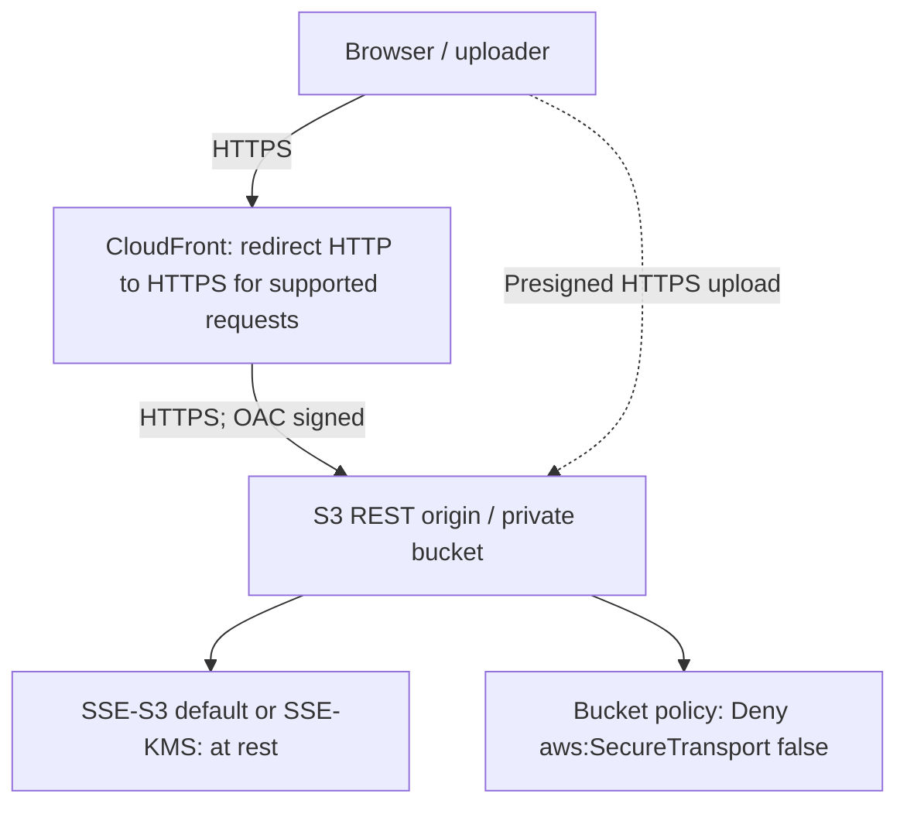
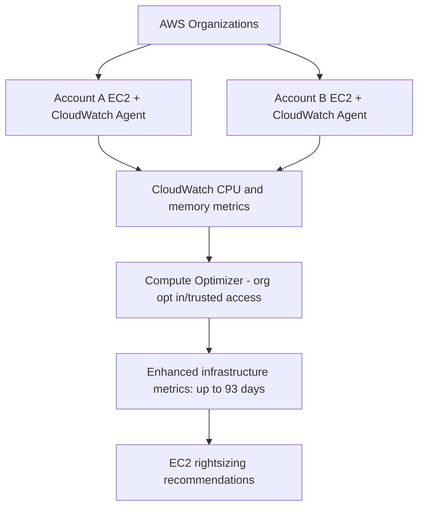
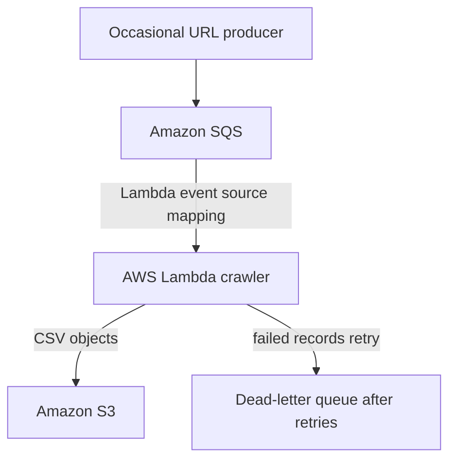
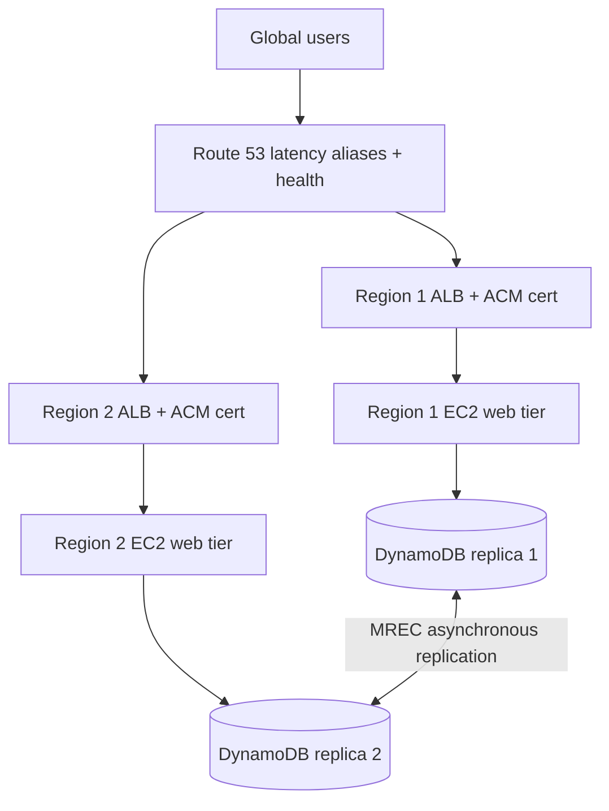
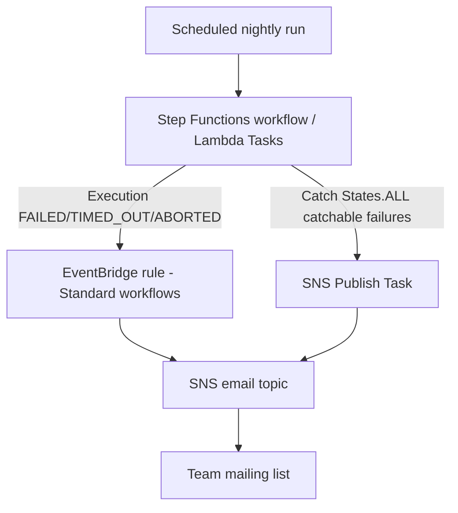
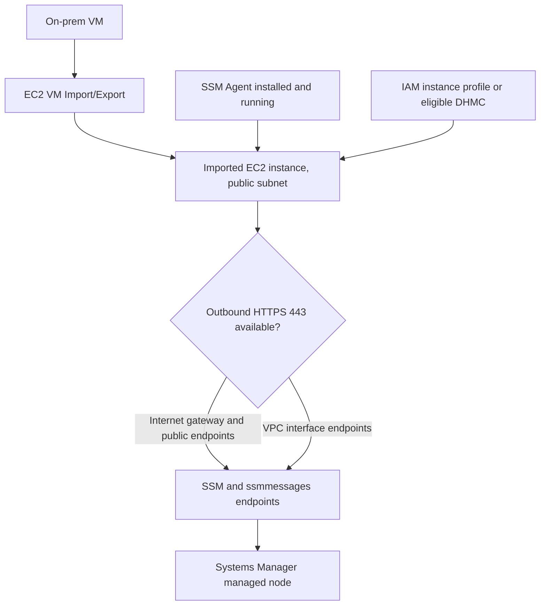

# Domain 3 multi-answer study — Q83 (6 of 58)

## Verdict
**C and E verified.** Q83 is a near-duplicate of Q32 (same five options, answers, and core scenario) and should be flagged, not deleted automatically. Source text has missing spaces; Q83 omits Q32's explicit anonymous/named requester constraint.

## Original question
A company has an application that stores user-uploaded videos in an Amazon S3 bucket using S3 Standard storage. Users access videos frequently for the first 180 days, and rarely after that. Most videos are over 100 MB. Users often have poor internet connectivity, and the company uses multipart uploads. A solutions architect needs tooptimize S3 storage costs. Which combination of actions will meet these requirements? (Select TWO.)

- **A.** Configure the S3 bucket to be a Requester Pays bucket.
- **B.** Use S3 Transfer Acceleration to upload the videos.
- **C.** Create a lifecycle rule to expireincomplete multipart uploadsafter 7 days.
- **D.** Create a lifecycle rule to transition objects toS3 Glacier Instant Retrieval after 1 day.
- **E.** Create a lifecycle rule to transition objects toS3 Standard-IA after 180 days.

## Explain the answer
- **A incorrect:** Requester Pays moves requester charges, does not reduce underlying stored bytes. Unlike Q32, Q83 does not explicitly mention anonymous access, so do not claim that alone disproves A for Q83.
- **B incorrect:** S3 Transfer Acceleration improves upload speed for some paths, but adds transfer charges and does not clear orphaned multipart-upload parts.
- **C correct:** S3 Lifecycle `AbortIncompleteMultipartUpload` after 7 days deletes stored parts that were never completed, stopping ongoing part charges; does not delete completed objects.
- **D incorrect:** S3 Glacier Instant Retrieval after 1 day conflicts with frequent reads for 180 days and imposes retrieval fees and 90-day minimum storage duration.
- **E correct:** Transition completed objects from S3 Standard to S3 Standard-IA after 180 days, matching later infrequent access (retrieval fees; 30-day minimum).

## Diagram
```text
User multipart video upload
    |-- Complete --> S3 Standard (day 0–180) --> Standard-IA (day 180+): E
    +-- Incomplete -> charged staged parts --> abort after 7 days: C
```

## Duplicate/variant check
- **Q32:** near-identical objective, storage class, lifecycle timings, options A–E, answer C+E; Q32 additionally states named/anonymous users and explicitly distinguishes >100 MB objects.
- **Q305:** other large video S3 uploads, but its performance/geography requirements change the solution. Do not carry C+E into Q305 automatically.
- Published exact Q83 text variants at examsvce and certprep also give C+E, but these are third-party sources, not an AWS exam authority.
- Source typos: `tooptimize`, `expireincomplete multipart uploadsafter`, `toS3`. Original question and options preserved in questions.json for traceability.

## AWS documentation
- https://docs.aws.amazon.com/AmazonS3/latest/userguide/mpu-abort-incomplete-mpu-lifecycle-config.html
- https://docs.aws.amazon.com/AmazonS3/latest/userguide/mpuoverview.html
- https://docs.aws.amazon.com/AmazonS3/latest/userguide/storage-class-intro.html
- https://docs.aws.amazon.com/AmazonS3/latest/userguide/lifecycle-transition-general-considerations.html

## External variants
- https://www.examsvce.com/sap-c02/questiona-company-has-an-application-that-stores-question-answer.html
- https://www.certprep.io/amazon/sap-c02/questions


## Q115 (7 of 58): Aurora database activity auditing and 10-year WORM retention

**Intended A+C.** Aurora PostgreSQL encrypted at rest and TLS in transit; Aurora Database Activity Streams -> managed Kinesis Data Streams -> Data Firehose -> S3 Object Lock compliance mode (10 years). A: intended Aurora cluster. B: also supports encryption/TLS but does not establish Aurora cluster; question has ambiguity. C: strongest separation of duties; omitted Kinesis intermediary. D: pgAudit to CloudWatch and immutable S3 can be viable if permissions and audit configuration robust, but not equivalent managed stream separation. E: governance retention bypassable. Validate Region/engine version, audit policy, event delivery, KMS, versioning, retention, least privilege. No exact external exam variant independently confirmed; don't claim otherwise.

AWS: https://docs.aws.amazon.com/AmazonRDS/latest/AuroraUserGuide/DBActivityStreams.html ; https://docs.aws.amazon.com/AmazonRDS/latest/AuroraUserGuide/DBActivityStreams.Enabling.html ; https://docs.aws.amazon.com/AmazonS3/latest/userguide/object-lock.html


## Q127 — Domain 3 multi-answer 8/58: patched AMIs and Auto Scaling
**Answer C+D**, with caveat: D alone fixes stale AMI; C supplies ALB target health monitoring/availability. A misstates ASG UpdatePolicy; B patches mutable groups but not launch image; E termination protection does not fix image or reliably prevent ASG replacement.

```text
OLD: unpatched AMI -> patched running EC2 -> reboot/unhealthy -> replacement from unpatched AMI
NEW: patch/test AMI -> versioned launch template -> ASG instance refresh -> ALB target health verification
```

**Current AWS guidance:** prefer launch templates over legacy launch configurations; use rolling instance refresh with healthy percentages, warmup, grace periods and optionally checkpoints. Source caveat: reboot alone need not cause replacement; health-check behavior is configuration-dependent.

**External variants:** Scribd ExamTopics-derived Q348 lists C,D (same order). Exam-tests Q85 reorders B/C and reports A,B, an internally inconsistent key. Verify option text, not letters. No exact duplicate confirmed by initial dataset phrase scan; related IDs: 567.

AWS docs: https://docs.aws.amazon.com/autoscaling/ec2/userguide/instance-refresh-overview.html ; https://docs.aws.amazon.com/autoscaling/ec2/userguide/health-checks-overview.html ; https://docs.aws.amazon.com/autoscaling/ec2/userguide/launch-templates.html


## Q135 (9 of 58): 90-day allowlisted client IP inactivity from ALB logs

**Answer B+D.** Enable ALB access logging, create Athena table over S3 logs, and have Lambda query client IP and timestamps to identify security group allowlist candidates inactive for 90 days. A VPC Flow Logs to CloudWatch is more expensive and network-oriented; C checks flow logs rather than HTTP requests; E CloudTrail logs AWS API actions, not user web requests. D queries ALB logs through Athena.

```text
Client IP -> ALB (SG allowlist) -> EC2 targets
                 |
                 +-> access logs -> S3 -> Athena <- Lambda
                                                 |
                                       validate candidate IP
                                                 |
                                     update ALB security group
```

**Defects/caveats:** 'IPaddresses' spacing typo. AWS states ALB access logs are best-effort and eventually consistent, so missing events do not prove inactivity. Proxies/NAT can change observed source IP. Keep 90+ days retention, use partitions to control Athena scanned bytes, validate CIDR rules and protect critical IPs before revocation. Newer ALB CloudWatch Logs integrations exist; legacy S3 ALB logs + Athena remains valid. External exact-stem FreeCram 2025-04-03 q227 reorders options, so compare answer text, not letters. Related logging IDs: 24, 90, 232, 492, 496, 508, 591; no exact duplicate confirmed.

AWS references: https://docs.aws.amazon.com/elasticloadbalancing/latest/application/load-balancer-access-logs.html ; https://docs.aws.amazon.com/athena/latest/ug/application-load-balancer-logs.html ; https://docs.aws.amazon.com/athena/latest/ug/query-alb-access-logs-examples.html
External: https://www.freecram.net/Amazon.SAP-C02.v2025-04-03.q227.pdf


## Q140 (10 of 58) — VM-imported EC2 not registered in Systems Manager

**A+B**. Imported VM -> custom AMI -> EC2 instance: verify SSM Agent installed/running and effective IAM permissions (EC2 instance profile with AmazonSSMManagedInstanceCore, or Default Host Management Configuration). Verify outbound HTTPS 443 and SSM endpoint reachability separately.

```text
On-prem VM -> VM Import/Export -> AMI -> EC2
                                      | SSM Agent running (A)
                                      | SSM permissions (B)
                                      v
                           HTTPS 443 -> SSM endpoint -> managed node
```

A correct: custom image may lack agent. B correct in traditional model; modern DHMC alternative. C VPC interface endpoint optional if internet egress exists. D Application Discovery Agent is for migration discovery. E service-linked roles do not replace per-node permissions. Source issue: legacy phrase 'EC2 VM Import feature of AWS Import/Export'; use VM Import/Export. Public IP alone does not ensure routing or outbound access. Duplicate scan related IDs: 14, 31, 35, 44, 57, 60, 106, 110, 111, 117, 121, 125, 144, 164, 172, 212, 213, 224, 225, 229, 245, 250, 267, 309, 316, 322, 336, 371, 389, 443, 465, 466, 470, 473, 507, 511, 514, 545, 567, 581, 609, 618, 620, 626, 637, 644, 653; no exact duplicate confirmed. Exact external exam variant not independently confirmed, AWS official docs validate answer mechanics.

Sources: https://docs.aws.amazon.com/systems-manager/latest/userguide/fleet-manager-troubleshooting-managed-nodes.html ; https://docs.aws.amazon.com/systems-manager/latest/userguide/setup-instance-permissions.html ; https://docs.aws.amazon.com/systems-manager/latest/userguide/troubleshooting-managed-nodes-using-ssm-cli.html


## Q147 (11 of 58): 1,000-node tightly coupled HPC cluster

**Correct A+C+F.** Single AZ, ideally cluster placement group, EFA-capable EC2 instances, and shared Amazon FSx for Lustre. Single AZ reduces latency for tightly coupled MPI communication; EFA provides high-performance networking; Lustre is a parallel file system optimized for demanding HPC throughput/metadata operations.

```text
           ONE AVAILABILITY ZONE (A)
    +-------------------------------------+
    | Cluster placement group             |
    | EC2/EFA <--> EC2/EFA <--> ... 1000  | (C)
    +-----------------+-------------------+
                      |
            shared parallel I/O
                      v
             Amazon FSx for Lustre         (F)
                      |
                  optional S3
```

A yes: tightly coupled compute in single AZ. B no: ENI counts in multiples of four is not HPC rule. C yes: EFA supports low-latency/high-throughput inter-node communication. D no: multi-AZ is better for loosely coupled jobs, not this one. E no: EBS RAID isn't a shared parallel filesystem for 1000 workers. F yes: FSx for Lustre, provision throughput and metadata IOPS appropriately.

**Caveats:** Stem typo 'AWS tor'. EFS may work for other HPC workloads; performance is workload-specific. Cluster placement group is best practice though not one of the options. Modern FSx for Lustre supports EFA-enabled file systems for supported clients and deployments, an additional tuning possibility. Exact external exam variants on FreeCram and Exam-Tests both key A,C,F. Dataset duplicate scan found no exact same-stem question; related IDs: none.

Official AWS: https://docs.aws.amazon.com/wellarchitected/latest/high-performance-computing-lens/tightly-coupled-scenarios.html ; https://docs.aws.amazon.com/wellarchitected/latest/high-performance-computing-lens/workload-architecture.html ; https://docs.aws.amazon.com/fsx/latest/LustreGuide/performance.html ; https://docs.aws.amazon.com/fsx/latest/LustreGuide/efa-file-systems.html
External: https://www.freecram.net/question/Amazon.SAP-C02.v2026-03-31.q264/a-company-has-built-a-high-performance-computing-hpc-cluster-in-aws-tor-a-tightly-coupled-workload ; https://www.exam-tests.com/SAP-C02-exam/Amazon.SAP-C02.v2025-02-24.q513.html?p=63


## Q155 (12/58) — Active-active ECS Regions, ECR, ACM and Aurora

**Original intended answers: A, D, E. Critical outdated recommendation in D.**

A: correct, ACM ALB certificates are regional. B: incorrect, RAM cannot share a regional ACM certificate across Regions. C: incorrect, ECR VPC endpoint does not replace image replication. D: cross-Region ECR replication correct, but manually re-pushing existing images is obsolete as the least-overhead approach: AWS ECR now supports replication backfill. Proposed revised D: Configure cross-Region ECR replication and start replication backfill for existing images. E: correct, Aurora Global Database can forward supported DML from secondary to the single primary writer. F: incorrect, not an independent multi-writer Aurora global database.

Architecture:

```text
                 Route 53 geolocation
                  /              \
       Primary Region         Secondary Region
       ALB + ACM              ALB + ACM (A)
          ECS                    ECS
          ECR ---- replicate --> ECR (D)
       Aurora primary <--- writes forwarded --- Aurora secondary (E)
       single writer --- asynchronous replication --> secondary
```

Aurora MySQL global write forwarding requires supported version, enabling forwarding, setting aurora_replica_read_consistency, and verifying SQL limitations. 'Active-active' refers to app traffic, not independent DB writers. Route 53 geolocation needs a sensible default. Duplicate audit across dataset: Q200 is close ECS/ALB/ECR/Aurora multi-Region variant but tests DR RPO/RTO and backups; Q123 and Q242 related, no exact duplicate confirmed. External same-stem variant appears on CertEnsure Q163, but exact external answer key was not independently confirmed.

Official docs: https://docs.aws.amazon.com/acm/latest/userguide/acm-overview.html ; https://docs.aws.amazon.com/AmazonECR/latest/userguide/replication-backfill.html ; https://docs.aws.amazon.com/AmazonRDS/latest/AuroraUserGuide/aurora-global-database-write-forwarding-ams.html


## Q157 (13 of 58) — IAM CreateUser approval, lockdown and notification

**Verified A + D + E.** Detect the IAM CreateUser management event using EventBridge via CloudTrail, start Step Functions to restrict access and coordinate approval, and notify the security team through SNS.

Original options: A EventBridge CloudTrail CreateUser rule (correct); B CloudTrail directly sends per-CreateUser SNS (incorrect, log delivery SNS differs); C Fargate container to remove access (possible but operationally excessive); D Step Functions remediation (correct); E SNS security notification (correct); F Pinpoint (unnecessary).

Architecture:

    IAM CreateUser -> CloudTrail management event -> EventBridge rule (A)
                                                  |
                                                  v
                                        Step Functions (D)
                                          | lockdown
                                          | approval workflow
                                          v
                                      SNS notification (E)
                                          |
                                      security review

EventBridge pattern:

    {"source":["aws.iam"],"detail-type":["AWS API Call via CloudTrail"],"detail":{"eventSource":["iam.amazonaws.com"],"eventName":["CreateUser"]}}

**Critical security caveat:** CloudTrail-originated EventBridge events are best effort and asynchronous, so this alone cannot enforce zero access at every instant. New IAM users initially have no permissions; add preventive IAM controls and reconciliation to protect against grants before response. For IAM global service events, create the EventBridge rule in us-east-1. 'Amazon CloudWatch Events' is legacy terminology. Step Functions can publish directly to SNS; explicit approval callback and controlled grant require implementation.

External exact-stem variants: https://www.exam-tests.com/SAP-C02-exam/Amazon.SAP-C02.v2025-02-24.q513.html?p=23 (Q110) and https://www.examcollection.us/exam/SAP-C02-question-answer-3.html (both A,D,E). No exact/near duplicate detected by CreateUser and approval scan of all 674.

AWS: https://docs.aws.amazon.com/eventbridge/latest/ref/events-ref-iam.html ; https://docs.aws.amazon.com/step-functions/latest/dg/connect-sns.html ; https://repost.aws/knowledge-center/iam-eventbridge-sns-rule


## Q158 (14 of 58) — Global document upload and API latency

**Original intended A+C; verified with architecture defects.** Serverless document system in eu-central-1: CloudFront static site, Regional API Gateway, Lambda writes Aurora Serverless metadata and S3 documents. Global clients need lower latency.

- **A correct only after changing upload flow:** Enable S3 Transfer Acceleration and generate acceleration-aware presigned PUT/POST URLs so the browser uploads directly to S3 edge endpoint. The described Lambda-to-S3 upload path will not benefit simply by enabling acceleration.
- **B wrong:** Global Accelerator standard endpoints are ALB, NLB, EC2, EIP; not CloudFront distributions.
- **C correct for REST APIs:** API Gateway edge-optimized REST endpoints use AWS-managed CloudFront to improve geographically distributed client connection time. HTTP APIs do not support edge-optimized endpoint type; alternatively put customer-managed CloudFront before Regional API.
- **D not preferred:** Whole-stack multi-Region deployment adds considerable complexity; Aurora Serverless global database support depends on version/architecture.
- **E wrong:** RDS Proxy addresses database connection scaling, not client-to-API/upload latency.

Architecture:

    Global browser
        |-- static site --> CloudFront --> S3 web assets (Frankfurt)
        |-- API request --> Edge-optimized API Gateway (C) --> Lambda --> Aurora
        |-- presigned URL from API --> S3 Transfer Acceleration edge (A)
                                           |
                                      S3 bucket Frankfurt

**Defects and outdated recommendations:** Original stem explicitly says Lambda PUTs documents into S3; A requires changing that to browser-to-S3 direct upload, which is not stated. C presumes REST API, not specified. CloudFront website distribution is separate from edge-optimized API's managed distribution. S3 Transfer Acceleration has additional charges and variable geographic benefit. Neither option eliminates backend-to-database latency.

**External variants:** Exam-Tests exact stem A+C; FreeCram discussion A+C; ExamTopics discussion has dissenting A+D and B+C arguments, but B is technically impossible as stated. Related feature-question IDs: 18,32,83,149,170,273,285,305,323,349,365,495,496,516,570,592,596,648,656; no exact same-stem duplicate detected in dataset.

Sources: https://docs.aws.amazon.com/AmazonS3/latest/userguide/transfer-acceleration-examples.html ; https://docs.aws.amazon.com/apigateway/latest/developerguide/api-gateway-api-endpoint-types.html ; https://docs.aws.amazon.com/global-accelerator/latest/dg/about-endpoints.html ; https://aws.amazon.com/blogs/networking-and-content-delivery/implementing-secure-file-uploads-to-amazon-s3-at-the-edge-choosing-the-right-pattern/ ; https://www.exam-tests.com/SAP-C02-exam/Amazon.SAP-C02.v2025-02-24.q513.html?p=43 ; https://www.freecram.com/discussions/Amazon/exam-sap-c02-topic-2-question-284-discussion-p1298270.html


---

# Domain 3 multi-answer study — Q159 (15 of 58)

## Verdict
**A, C, E verified as intended exam answers; C ambiguous, A outdated premise.** No exact stem duplicate among the 674 dataset questions. Similar-but-distinct Q115, Q456, Q469, Q390, Q541.

## Original question
A company is designing a new website that hosts static content. The website will give users the ability to upload and download large files. According to company requirements, all data must be encrypted in transit and at rest. A solutions architect is building the solution by using Amazon S3 and Amazon CloudFront. Which combination of steps will meet the encryption requirements? (Select THREE.)

- **A.** Turn on S3 server-side encryption for the S3 bucket that the web application uses.
- **B.** Add a policy attribute of "aws:SecureTransport": "true" for read and write operations in the S3 ACLs.
- **C.** Create a bucket policy that denies any unencrypted operations in the S3 bucket that the web application uses.
- **D.** Configure encryption at rest on CloudFront by using server-side encryption with AWS KMS keys (SSE-KMS).
- **E.** Configure redirection of HTTP requests to HTTPS requests in CloudFront.
- **F.** Use the RequireSSL option in the creation of presigned URLs for the S3 bucket that the web application uses.

## Detailed option analysis
- **A — Correct (historical wording).** S3 server-side encryption protects objects at rest. Since January 5, 2023, all new S3 uploads receive at least SSE-S3 automatically. A is still the intended exam choice but no longer requires a manual toggle for SSE-S3.
- **B — Incorrect.** An S3 ACL cannot contain `aws:SecureTransport` IAM condition keys. Enforce transport policy through a bucket policy.
- **C — Correct, with ambiguity.** Bucket policies can deny `aws:SecureTransport=false` for S3 requests; that is a TLS-in-transit condition. To require specified encryption-at-rest settings, use appropriate separate controls. The question's term 'unencrypted operations' does not identify the actual bucket policy condition.
- **D — Incorrect.** CloudFront does not expose SSE-KMS encryption at rest for cached content. Apply encryption to S3 origin objects, with suitable OAC and KMS permissions when needed.
- **E — Correct.** CloudFront's viewer protocol policy can redirect HTTP to HTTPS. For file writes/uploads, send HTTPS directly or use HTTPS Only to avoid redirect-method caveats.
- **F — Incorrect.** Generating S3 presigned URLs has no `RequireSSL` flag. Use HTTPS URLs and a bucket policy denying insecure transport.

## Diagram


## Duplicate and variant review
- Full 674-question exact normalized stem comparison: **no exact duplicate**.
- Related concepts: **Q115** encrypt data at rest and in transit; **Q456** S3 cross-account security; **Q469** static site architecture; **Q390** S3 regional storage; **Q541** encryption governance for EBS. These are not identical questions and answer letters must not be transferred between them.
- External SAP-C02 variant includes the same scenario/options in different ordering: original A→external E, B→F, C→A, D→B, E→D, F→C. Dataset A,C,E maps to external E,A,D. External source confirms variant wording, not independently its published answer key.

## Outdated / defective warnings
- **2023 default encryption update:** S3 new objects always encrypted with SSE-S3 at baseline, so A's implied manual-enablement requirement is stale.
- **C is underspecified:** state specifically bucket policy `Deny` with `aws:SecureTransport=false` for transport; bucket-policy SSE-KMS enforcement is a different condition.
- **Redirect is not a universal write-safe answer:** for uploads require direct HTTPS or HTTPS Only where appropriate; viewer protocol behavior has method/version caveats.
- **CloudFront origin:** use S3 REST origin and OAC, not an S3 static website origin for CloudFront→S3 HTTPS.

## Sources
- https://docs.aws.amazon.com/AmazonS3/latest/userguide/default-encryption-faq.html
- https://docs.aws.amazon.com/AmazonS3/latest/userguide/amazon-s3-policy-keys.html
- https://docs.aws.amazon.com/AmazonCloudFront/latest/DeveloperGuide/using-https-viewers-to-cloudfront.html
- https://docs.aws.amazon.com/AmazonCloudFront/latest/DeveloperGuide/using-https-cloudfront-to-s3-origin.html
- https://docs.aws.amazon.com/AmazonCloudFront/latest/DeveloperGuide/private-content-restricting-access-to-s3.html
- https://myportal.utt.edu.tt/ICS/icsfs/d97df75f-867e-411a-ac5f-e13435c2eedc.pdf?target=c53e5228-7ce9-4ef5-a5ec-d932dc3abaad


---
# Domain 3 multi-answer Q172 (16 of 58) — independently rechecked 2026-11-02

## Original
A company has many AWS accounts in an organization in AWS Organizations. The accounts contain many Amazon EC2 instances that run different types of workloads. The workloads have different usage patterns. The company needs recommendations for how to rightsize the EC2 instances based on CPU and memory usage during the last 90 days. Which combination of steps will provide these recommendations? (Select THREE.)
- **A.** Opt in to AWS Compute Optimizer and enable trusted access for Compute Optimizer for the organization.
- **B.** Configure a delegated administrator account for AWS Systems Manager for the organization.
- **C.** Use an AWS CloudFormation stack set to enable detailed monitoring for all the EC2 instances.
- **D.** Install and configure the Amazon CloudWatch agent on all the EC2 instances to send memory utilization metrics to CloudWatch.
- **E.** Activate enhanced metrics in AWS Compute Optimizer.
- **F.** Configure AWS Systems Manager to pass metrics to AWS Trusted Advisor.

## Answer
**A, D, E**. Historical answer **A,D,F** is wrong.

## Every option
- A **correct**: opt organization into Compute Optimizer; trusted access permits analyzing member accounts.
- B **incorrect**: Systems Manager delegated administrator is not required; Compute Optimizer has its own optional delegated administration.
- C **incorrect**: EC2 detailed monitoring gives 1-minute basic hypervisor metrics, not guest OS memory utilization or a 90-day analysis preference.
- D **correct**: CloudWatch agent supplies EC2 memory usage to CloudWatch; Compute Optimizer recognizes Linux CWAgent mem_used_percent and supported Windows memory metrics.
- E **correct**: enhanced infrastructure metrics (paid) extends 14-day lookback to **up to 93 days**; sufficient for 90-day request if history exists.
- F **incorrect**: Systems Manager cannot pass metrics to Trusted Advisor as described; Trusted Advisor may show Compute Optimizer findings, but is not the rightsizing engine described.

## Diagram


## External variants and defects
FreeCram SAP-C02 v2026-03-31 q264 contains same scenario and reordered options (dataset A→variant C, B→B, C→A, D→E, E→F, F→D). Published key C,D,E maps to dataset A,F,D and is **incorrect**: variant D (dataset F) is unsupported and variant F (dataset E) is essential for 90 days. Treat third-party answer keys as unverified. AWS docs support A,D,E.

## Duplicate audit
Compared against all 674 stems. No exact duplicate. Top lexical matches: Q473 (0.24), Q189 (0.21), Q283 (0.21), Q12 (0.19), Q136 (0.18), Q276 (0.17), Q644 (0.17), Q106 (0.16). These are similarity candidates, not established duplicates.

## Caveats
Enhanced infrastructure metrics incurs charges and extends analysis to up to 93 days; historical memory observations must already exist. Compute Optimizer rightsizing preferences now include a 32-day option, which still does not satisfy 90 days. For organization-wide recommendations use trusted access and org opt-in, not Systems Manager delegated admin.

## Sources
- https://docs.aws.amazon.com/compute-optimizer/latest/ug/account-opt-in.html
- https://docs.aws.amazon.com/compute-optimizer/latest/ug/ec2-metrics-analyzed.html
- https://docs.aws.amazon.com/compute-optimizer/latest/ug/enhanced-infrastructure-metrics.html
- https://docs.aws.amazon.com/compute-optimizer/latest/ug/rightsizing-preferences-process.html
- https://www.freecram.net/question/Amazon.SAP-C02.v2026-03-31.q264/a-company-has-many-aws-accounts-in-an-organization-in-aws-organizations-the-accounts-contain-many-amazon


---
# Domain 3 multi-answer Q177 (19 of 58) — 2026-11-02

## Original
A company runs a web-crawling process on a list of target URLs to obtain training documents for machine learning (ML) training algorithms. A fleet of Amazon EC2 t2.micro instances pulls the target URLs from an Amazon SQS queue. The instances write the result of the crawling algorithm as a CSV file to an Amazon EFS volume. The EFS volume is mounted on all instances in the fleet. A second system occasionally adds the URLs to the SQS queue. The EC2 instances crawl each new URL in 10 seconds or less. Metrics indicate that some instances are idle when no URLs are in the SQS queue. A solutions architect needs to redesign the architecture to optimize costs. Which combination of steps will meet these requirements MOST cost-effectively? (Select TWO.)
- **A.** Use m5.8xlarge instances instead of t2.micro instances for the web-crawling process. Reduce the number of instances in the fleet by 50%.
- **B.** Use an AWS Lambda function to run the web-crawling process. Configure the Lambda function to pull URLs from the SQS queue.
- **C.** Modify the web-crawling process to store results in Amazon Neptune.
- **D.** Modify the web-crawling process to store results in an Amazon Aurora Serverless MySQL instance.
- **E.** Modify the web-crawling process to store results in Amazon S3.

## Verified answer: B, E
- A wrong: m5.8xlarge replacement with half the instance count is not economical for intermittent 10-second jobs.
- B correct: Lambda SQS event source mapping polls messages and invokes functions only when jobs arrive; removes idle EC2 cost. The application function itself need not poll SQS.
- C wrong: Neptune graph DB is not appropriate CSV object storage.
- D wrong: Aurora Serverless relational database adds unnecessary infrastructure for files.
- E correct: S3 is durable low-ops object storage for CSV output; no shared EFS volume necessary.

## Architecture


## Duplicate/variant review
Compared all 674 stems: no exact normalized duplicate. Closest lexical candidates Q600, Q442, Q337, Q247, Q326; not confirmed semantic duplicates. No matching independent external exam variant verified; do not claim external corroboration.

## Outdated/defect warnings
B says 'Lambda function pulls URLs' but AWS-managed event source mapping polls SQS. Configure timeout and visibility timeout (AWS recommends >=6x Lambda timeout, plus batching window), partial batch failure reporting, DLQ and idempotency because at-least-once delivery may duplicate work. Confirm crawl egress and robots rules. No outdated service requirement identified.

## AWS sources
- https://docs.aws.amazon.com/lambda/latest/dg/with-sqs.html
- https://docs.aws.amazon.com/lambda/latest/dg/services-sqs-configure.html
- https://docs.aws.amazon.com/lambda/latest/dg/services-sqs-errorhandling.html
- https://docs.aws.amazon.com/lambda/latest/dg/configuration-timeout.html


---
# Backfilled pending Domain 3 Q174 (17 of 58) — 2026-11-02
Original question in dataset is truncated; preserve it without fabricating full text. **A,C**: IAM Identity Center ABAC principal tag policy scopes user S3 prefix; CloudTrail S3 object-level data events to Athena for per-user monthly reporting. B lacks required per-user ABAC conditions; D management events insufficient; E S3 Select is not a cross-file reporting engine. Data events opt-in and billed. Sources: https://docs.aws.amazon.com/singlesignon/latest/userguide/attributesforaccesscontrol.html ; https://docs.aws.amazon.com/awscloudtrail/latest/userguide/logging-data-events-with-cloudtrail.html . No complete independently verified external variant.

# Backfilled pending Domain 3 Q175 (18 of 58) — 2026-11-02
**B,E**: alternative solutions, not cumulative steps. B: Lambda in private Neptune VPC subnets with NAT for DynamoDB; E: Lambda in private/isolated subnets and DynamoDB gateway endpoint associated with route tables. A fails because Lambda in public subnet lacks public IP; C/D cannot reach Neptune private DB merely through SG or service endpoint. Neptune SG inbound from Lambda SG assumed. Gateway endpoint preferable if only DynamoDB egress. Sources: https://docs.aws.amazon.com/lambda/latest/dg/configuration-vpc-internet.html ; https://docs.aws.amazon.com/vpc/latest/privatelink/vpc-endpoints-ddb.html .


---
# Domain 3 multi-answer Q182 (20 of 58) — 2026-11-02

## Original question
A company is using a single AWS Region for its ecommerce website. The website includes a web application that runs on several Amazon EC2 instances behind an Application Load Balancer (ALB). The website also includes an Amazon DynamoDB table. A custom domain name in Amazon Route 53 is linked to the ALB. The company created an SSL/TLS certificate in AWS Certificate Manager (ACM) and attached the certificate to the ALB. The company is not using a content delivery network as part of its design. The company wants to replicate its entire application stack in a second Region to provide disaster recovery, plan for future growth, and provide improved access time to users. A solutions architect needs to implement a solution that achieves these goals and minimizes administrative overhead. Which combination of steps should the solutions architect take to meet these requirements? (Select THREE.)

- A. Create an AWS CloudFormation template for the current infrastructure design. Use parameters for important system values, including Region. Use the CloudFormation template to create the new infrastructure in the second Region.
- B. Use the AWS Management Console to document the existing infrastructure design in the first Region and to create the new infrastructure in the second Region.
- C. Update the Route 53 hosted zone record for the application to use weighted routing. Send 50% of the traffic to the ALB in each Region.
- D. Update the Route 53 hosted zone record for the application to use latency-based routing. Send traffic to the ALB in each Region.
- E. Update the configuration of the existing DynamoDB table by enabling DynamoDB Streams. Add the second Region to create a global table.
- F. Create a new DynamoDB table. Enable DynamoDB Streams for the new table. Add the second Region to create a global table. Copy the data from the existing DynamoDB table to the new table as a one-time operation.

## Verified answer: A, D, E
- A correct: repeatable infrastructure-as-code for second Region. Region parameter alone does not choose stack deployment Region; deploy in desired Region or use StackSets.
- B incorrect: manual console recreation increases effort and drift.
- C incorrect: 50/50 weighted routing does not optimize latency; suitable for traffic splitting.
- D correct: latency-based Route 53 alias records for regional ALBs; set Evaluate Target Health/health checks to support DR.
- E correct for MREC global tables: add replica to existing populated table; DynamoDB Streams used automatically for MREC. Replication eventually consistent.
- F incorrect: unnecessary new table, bulk copy and cutover for MREC; MRSC has different restrictions.

## Architecture


## Defects and caveats
CloudFormation Region parameter does not select target Region; region-specific ACM cert required on second ALB; Route 53 health evaluation is essential for practical DR; MREC has replication lag and last-writer-wins conflicts; current MREC global tables automatically enable DynamoDB Streams. The absence of CloudFront is not an issue for latency DNS but CDN could further improve static content delivery.

## Duplicate audit
Normalized full stems compared across 674: no exact duplicate. Top lexical similarity candidates Q346 (0.246), Q451 (0.198), Q155 (0.190), Q123 (0.190), Q460 (0.188), Q326 (0.185). These are similarity leads, not proven duplicates. No reliable exact external exam variant independently verified; do not claim external confirmation.

## AWS references
- https://docs.aws.amazon.com/amazondynamodb/latest/developerguide/V2globaltables_HowItWorks.html
- https://docs.aws.amazon.com/amazondynamodb/latest/developerguide/globaltables-CoreConcepts.html
- https://docs.aws.amazon.com/Route53/latest/DeveloperGuide/resource-record-sets-values-latency-alias.html
- https://docs.aws.amazon.com/Route53/latest/DeveloperGuide/dns-failover-complex-configs.html


---
# Domain 3 multi-answer Q210 (21 of 58) — 2026-11-02

## Original source (verbatim, malformed punctuation retained)
A company has automated the nightly retraining of its machine learning models by using AWS Step Functions. The workflow consists of multiple steps that use AWS Lambda Each step can fail for various reasons and any failure causes a failure of the overall workflow A review reveals that the retraining has failed multiple nights in a row without the company noticing the failure A solutions architect needs to improve the workflow so that notifications are sent for all types of failures in the retraining process Which combination of steps should the solutions architect take to meet these requirements? (Select THREE)

- A. Create an Amazon Simple Notification Service (Amazon SNS) topic with a subscription of type "Email" that targets the team's mailing list.
- B. Create a task named "Email" that forwards the input arguments to the SNS topic
- C. Add a Catch field all Task Map. and Parallel states that have a statement of "Error Equals": [ “States. ALL”] and "Next": "Email".
- D. Add a new email address to Amazon Simple Email Service (Amazon SES). Verify the email address.
- E. Create a task named "Email" that forwards the input arguments to the SES email address
- F. Add a Catch field to all Task Map, and Parallel states that have a statement of "Error Equals": [ "states. Runtime”] and "Next": "Email".

## Exam key A,B,C; SOURCE DEFECT
A correct SNS email subscription; B correct SNS Publish service-integration Task (requires IAM publish permission); C best available catch-all on Task/Map/Parallel but **States.ALL cannot catch States.Runtime** and cannot catch States.DataLimitExceeded via wildcard. AWS documentation says DataLimitExceeded may be explicitly caught by name, but Runtime cannot. D SES address verification unnecessary; E SES direct integration not best fit; F incorrect: States.Runtime terminal and malformed casing, cannot be caught normally. Source overclaims notification for *all* failures. Add EventBridge Step Functions Execution Status Change rule FAILED, TIMED_OUT, ABORTED targeting SNS for Standard Workflows, best-effort delivery; Express needs CloudWatch Logs/metrics monitoring. Consider notification Task errors and avoiding duplicate notifications; don't claim exactly-once delivery.

## Diagram


## External variants
Exact stem/options verified in CertEmpire SAP-C02 demo PDF Q35, published key A,B,C; its claim that States.ALL catches any type is contradicted by AWS documentation. CramPDF Feb 2025 Q20 includes reordered variant with same stem and choices; do not rely on third-party keys for error semantics.

## Duplicates
No exact normalized stem duplicate among 674. Top lexical candidates Q600 (0.200), Q664 (0.191), Q353 (0.188), Q106 (0.177), Q326 (0.176), Q346 (0.170). These are not established semantic duplicates.

## Sources
- https://docs.aws.amazon.com/step-functions/latest/dg/concepts-error-handling.html
- https://docs.aws.amazon.com/step-functions/latest/dg/eventbridge-integration.html
- https://docs.aws.amazon.com/step-functions/latest/dg/connect-sns.html
- https://certempire.com/demo-files/sap-c02-demo-certempire.pdf
- https://actualtests.crampdf.com/articles/amazon-sap-c02-certification-all-in-one-exam-guide-feb-2025-q14-q32/


---
# Domain 3 multi-answer Q225 (22 of 58) — 2026-11-02

## Original (verbatim)
A solutions architect is importing a VM from an on-premises environment by using the Amazon EC2 VM Import feature. The imported instance has a public IP and runs in a public subnet in a VPC. However, the instance doesnot appearin the AWS Systems Manager (SSM) console as a managed instance. Which combination of steps should the architect take to resolve the issue? (Select TWO.)
- **A.** Verify that Systems Manager Agent is installed on the instance and is running.
- **B.** Verify that the instance is assigned an appropriate IAM role for Systems Manager.
- **C.** Verify the existence of a VPC endpoint on the VPC.
- **D.** Verify that the AWS Application Discovery Agent is configured.
- **E.** Verify the correct configuration of service-linked roles for Systems Manager.

## Verified answer: A, B (Select TWO)
A: **Correct.** SSM Agent must exist and run inside the imported AMI instance. Verify its service status, version, logs and connectivity.
B: **Correct intended exam answer.** The instance needs SSM permissions. Historically an EC2 IAM instance profile with `AmazonSSMManagedInstanceCore`; today Default Host Management Configuration can provide account-level permissions if IMDSv2 and SSM Agent >=3.2.582.0 are used. Thus attaching an IAM instance role is *not universally necessary*.
C: **Incorrect as a universal requirement.** SSM interface VPC endpoints are optional if HTTPS access to the public service endpoints works; if isolated or no internet egress, configure/check appropriate interface endpoints. A public IP and public subnet do not guarantee working internet egress: inspect route table Internet Gateway, security groups, NACLs and DNS.
D: **Incorrect.** AWS Application Discovery Agent collects migration discovery data, not SSM managed node registration.
E: **Incorrect.** Service-linked roles don't replace the per-node agent, permissions and network connectivity requirements.

## Architecture


## Duplicate/similarity audit across all 674
- Q140: **near-exact duplicate**, same five option texts in identical A–E order, same key A,B. Stems differ in length, but core scenario is the same.
- No identical fully normalized stem; avoid double-counting Q140/Q225 in distinct-concept study coverage.

## External variants
- ExamsVCE: exact Q225 with A,B published, which agrees with independently checked AWS docs.
- ExamTopics topic 1 Q492: longer version like Q140.
- CramPDF Feb 2025 Q14: reordered longer version, but published B,D,E is three options for a Select TWO question; invalid/defective key. Remap and validate against AWS, not the third-party key.

## Outdated/defective warnings
- Q225 stem has 'doesnot appearin' typo; preserve original. Q140 uses older 'AWS Import/Export' wording.
- Treat 'appropriate IAM role on the instance' as the *conventional* solution, not universal after Default Host Management Configuration.
- Public subnet/public IP alone does not guarantee HTTPS connectivity. If networking fails, check Internet Gateway route, SG/NACL egress, DNS, and optional PrivateLink interface endpoints.
- For modern Regions, `ssmmessages` is central; `ec2messages` may be relevant only for earlier-Region/legacy agent behavior.

## AWS and variant references
- https://docs.aws.amazon.com/systems-manager/latest/userguide/ssm-agent.html
- https://docs.aws.amazon.com/systems-manager/latest/userguide/setup-instance-permissions.html
- https://docs.aws.amazon.com/systems-manager/latest/userguide/troubleshooting-ssm-agent.html
- https://docs.aws.amazon.com/systems-manager/latest/userguide/fleet-manager-default-host-management-configuration.html
- https://www.examsvce.com/sap-c02/questiona-solutions-architect-is-importing-a-vm-question-answer.html
- https://www.examtopics.com/discussions/amazon/view/142926-exam-aws-certified-solutions-architect-professional-sap-c02/
- https://actualtests.crampdf.com/articles/amazon-sap-c02-certification-all-in-one-exam-guide-feb-2025-q14-q32/


## Q225 — Domain 3 multi-answer 22/58 — EC2 VM Import and SSM registration

**Original stem:** A solutions architect is importing a VM from an on-premises environment by using the Amazon EC2 VM Import feature. The imported instance has a public IP and runs in a public subnet in a VPC. However, the instance doesnot appearin the AWS Systems Manager (SSM) console as a managed instance. Which combination of steps should the architect take to resolve the issue? (Select TWO.)

- **A.** Verify that Systems Manager Agent is installed on the instance and is running.
- **B.** Verify that the instance is assigned an appropriate IAM role for Systems Manager.
- **C.** Verify the existence of a VPC endpoint on the VPC.
- **D.** Verify that the AWS Application Discovery Agent is configured.
- **E.** Verify the correct configuration of service-linked roles for Systems Manager.

**Verified intended answer: A and B.** A: SSM Agent must be installed/running. B: instance requires SSM permissions, normally through an IAM instance profile (AmazonSSMManagedInstanceCore); Default Host Management Configuration is an alternative when its prerequisites (IMDSv2 and SSM Agent >= 3.2.582.0) are met. C: VPC interface endpoints are optional with working outbound HTTPS internet connectivity, but necessary as an alternative if there is no internet egress. D: Application Discovery Agent is unrelated to SSM managed-node registration. E: service-linked roles cannot replace the agent, its credentials, or connectivity.

**Architecture:** on-premises VM → EC2 VM Import/Export → EC2 instance [SSM Agent + SSM IAM permissions] → HTTPS 443 [internet egress OR interface VPC endpoints for ssm and ssmmessages] → Systems Manager managed node.

**Duplicate audit (674 records):** Q140 is a near-exact duplicate, with identical five options and A+B key; preserve both IDs and mark relationship. No other VM Import/SSM matching stems were found by targeted phrase scan.

**Defects/modernization:** Original typo 'doesnot appearin'; public IP and subnet do not guarantee outbound connectivity; B is not an unconditional instance-profile requirement under DHMC. For 2024+ Regions, ec2messages endpoints are not supported. Do not adopt external variant's invalid three-answer key for Select TWO.

**AWS sources:** https://docs.aws.amazon.com/systems-manager/latest/userguide/ssm-agent.html ; https://docs.aws.amazon.com/systems-manager/latest/userguide/fleet-manager-troubleshooting-managed-nodes.html ; https://docs.aws.amazon.com/systems-manager/latest/userguide/troubleshooting-ssm-agent.html ; https://docs.aws.amazon.com/systems-manager/latest/userguide/fleet-manager-default-host-management-configuration.html

**External variants recorded in dataset (not freshly re-fetched):** https://www.examsvce.com/sap-c02/questiona-solutions-architect-is-importing-a-vm-question-answer.html ; https://www.examtopics.com/discussions/amazon/view/142926-exam-aws-certified-solutions-architect-professional-sap-c02/ ; https://actualtests.crampdf.com/articles/amazon-sap-c02-certification-all-in-one-exam-guide-feb-2025-q14-q32/


## Q247 — Domain 3 multi-answer 23/58 — EC2 to Aurora security groups

**Original question:** A company has an application that runs on Amazon EC2 instances. A solutions architect is designing VPC infrastructure in an AWS Region where the application needs to access an Amazon Aurora DB cluster. The EC2 instances are all associated with the same security group. The DB cluster is associated with its own security group. The solutions architect needs to add rules to the security groups to provide the application with least privilege access to the DB cluster. Which combination of steps will meet these requirements? (Select TWO.)

- **A.** Add an inbound rule to the EC2 instances' security group. Specify the DB cluster's security group as the source over the default Aurora port.
- **B.** Add an outbound rule to the EC2 instances' security group. Specify the DB cluster's security group as the destination over the default Aurora port.
- **C.** Add an inbound rule to the DB cluster's security group. Specify the EC2 instances' security group as the source over the default Aurora port.
- **D.** Add an outbound rule to the DB cluster's security group. Specify the EC2 instances' security group as the destination over the default Aurora port.
- **E.** Add an outbound rule to the DB cluster's security group. Specify the EC2 instances' security group as the destination over the ephemeral ports.

**Corrected answer: B and C (original key A+B was incorrect).**

- A: Incorrect; EC2 ingress from Aurora reverses the connection direction.
- B: Correct; EC2 security group egress to Aurora security group on DB listener port.
- C: Correct; Aurora security group ingress from EC2 security group on DB listener port.
- D: Incorrect; Aurora egress to EC2 does not allow initial inbound DB connection; stateful return traffic needs no explicit egress rule.
- E: Incorrect; ephemeral-port egress on Aurora is unnecessary for stateful return packets.

**Diagram:** EC2 [SG-App outbound: TCP DB port to SG-DB] --> Aurora [SG-DB inbound: TCP DB port from SG-App]. Return packets <-- automatically allowed by stateful SG connection tracking.

**Ambiguities:** 'default Aurora port' is engine-dependent: Aurora MySQL 3306; Aurora PostgreSQL 5432. EC2 default allow-all egress may already permit the traffic; least-privilege egress assumes tightening that default rule.

**External key conflict:** Exam-Tests Q184 prints A+B but its own rationale identifies B+C. Reordered external variant prints B+D, equivalent to original B+C. Follow AWS docs, not inconsistent third-party key.

**Duplicate scan (674):** No exact duplicate established by targeted keyword scan; related IDs: 155, 200, 221, 230, 257, 328, 468, 516, 639. These are conceptual similarities, not confirmed duplicate questions.

**AWS documentation:** https://docs.aws.amazon.com/vpc/latest/userguide/security-group-rules.html ; https://docs.aws.amazon.com/us_en/AmazonRDS/latest/AuroraUserGuide/Overview.RDSSecurityGroups.html ; https://docs.aws.amazon.com/us_en/AWSEC2/latest/UserGuide/ec2-security-groups.html

**External:** https://www.exam-tests.com/SAP-C02-exam/Amazon.SAP-C02.v2025-02-24.q513.html?p=38 ; https://note.com/hip_wolf4336/n/nd8acc510d8b4?hl=en


## Q283 — Domain 3 multi-answer 24/58 — Firewall Manager WAF across CloudFront

**Original:** A company is using an organization in AWS Organizations to manage hundreds of AWS accounts. A solutions architect is working on a solution to provide baseline protection for the Open Web Application Security Project (OWASP) top 10 web application vulnerabilities. The solutions architect is using AWS WAF for all existing and new Amazon CloudFront distributions that are deployed within the organization. Which combination of steps should the solutions architect take to provide the baseline protection? (Select THREE.)

- **A.** Enable AWS Config in all accounts.
- **B.** Enable Amazon GuardDuty in all accounts.
- **C.** Enable all features for the organization.
- **D.** Use AWS Firewall Manager to deploy AWS WAF rules in all accounts for all CloudFront distributions.
- **E.** Use AWS Shield Advanced to deploy AWS WAF rules in all accounts for all CloudFront distributions.
- **F.** Use AWS Security Hub to deploy AWS WAF rules in all accounts for all CloudFront distributions.

**Corrected answer: A+C+D (original C+D+E is wrong).**

- A **Correct** — AWS Config continuously records required protected resource types in member accounts; CloudFront requires us-east-1 Config setup.
- B **Wrong** — GuardDuty detects threats, does not deploy WAF policies.
- C **Correct** — AWS Organizations all features is required for Firewall Manager.
- D **Correct** — Firewall Manager WAF policies centrally apply managed/custom rule groups to existing and new CloudFront distributions across the organization.
- E **Wrong** — Shield Advanced is DDoS protection, not the organization-wide WAF policy deployment mechanism.
- F **Wrong** — Security Hub aggregates findings, not WAF policy deployment.

**Architecture:** Organizations [all features] → Firewall Manager delegated administrator [WAF policy and managed rules] → member accounts [CloudFront distributions + WAF web ACLs]; AWS Config in accounts continuously records protected resources for compliance monitoring.

**Defects:** Original key CDE swaps AWS Config for Shield Advanced. Firewall Manager administrator designation is also mandatory but omitted from choices. OWASP Top 10 mitigation depends on suitable WAF rule groups and tuning, not an absolute protection guarantee.

**Duplicates/similarity (674 records):** No exact match found in targeted phrase scan. Related WAF/Firewall Manager concepts in Q465, Q655; looser related hits Q316, Q532, not verified duplicates.

**Official AWS:** https://docs.aws.amazon.com/waf/latest/developerguide/fms-prereq.html ; https://docs.aws.amazon.com/waf/latest/developerguide/join-aws-orgs.html ; https://docs.aws.amazon.com/waf/latest/developerguide/enable-config.html ; https://aws.amazon.com/documentation-overview/firewall-manager/

**External variants with defective keys:** https://www.allfreedumps.com/downloadfile.html?id=20649 ; https://www.examsreviews.com/articles/best-preparations-of-sap-c02-exam-2025-aws-certified-solutions-architect-unlimited-510-questions-q190-q208/ ; https://www.dumpsking.com/articles/get-the-important-preparation-guide-with-sap-c02-dumps-q117-q141/


## Q302 — Domain 3 multi-answer 25/58 — Cross-account S3 data lake and authorized VPC access

**Original question:** A company has an IoT data lake that is stored in Amazon S3. Data scientists in a separate AWS account need to analyze the data on Amazon EC2 instances in a VPC. Company policy requires that only authorized networks access the IoT data. The EC2 instances already have an IAM role that allows access to Amazon S3. An S3 access point exists on the data lake S3 bucket. The company needs to provide secure access to the S3 data lake for the EC2 instances while complying with the policy that requires access from only authorized networks. Which combination of steps will meet these requirements? (Select TWO.)

- **A.** Create a gateway VPC endpoint for Amazon S3 in the data scientists’ VPC.
- **B.** Update the S3 access point settings to block public access.
- **C.** Update the EC2 instance role. Add a policy with a condition that denies the s3:GetObject action when the value for the s3:DataAccessPointArn condition key is a valid access point ARN.
- **D.** Update the VPC route table to route S3 traffic to the S3 access point.
- **E.** Add an S3 bucket policy with a condition that allows the s3:GetObject action when the value for the s3:DataAccessPointArn condition key is a valid access point ARN.

**Exam-intended key A+E, with security defect.** A: S3 gateway VPC endpoint privately connects the data scientists' VPC to S3. E: bucket policy can delegate/permit GetObject through an approved S3 access point ARN, but merely checking a 'valid' access point ARN does not enforce authorized network origin.

**Option analysis:** A correct network path; B Block Public Access does not restrict access to authorized VPCs and cannot be edited on an existing access point; C explicit deny blocks desired GetObject; D route tables target gateway VPC endpoints rather than S3 access points; E intended correct bucket permission but incomplete without VPC network-origin controls.

**Architecture:** Account B EC2 [IAM role] -> S3 gateway endpoint [endpoint policy + route tables] -> Account A S3 access point [VPC network origin + AP policy] -> S3 bucket [approved AP ARN, cross-account principal and VPC/VPCE restrictions].

**Defects/outdated:** Existing access point VPC origin is unspecified and immutable after creation; creating gateway endpoint and an Allow bucket policy do not prohibit alternate access paths. Restrict bucket with explicit deny on unapproved access-point/VPC endpoint paths as appropriate, confirm VPC-origin AP, and configure all IAM/AP/bucket/endpoint policies. External older variant's option B differs and cross-account access points are supported today.

**Duplicate scan (674):** no exact duplicate established; conceptually related S3 access-point questions Q99, Q463, Q557. Q99/Q557 are similar to each other; do not mark as exact duplicate of Q302.

**Official AWS:** https://docs.aws.amazon.com/AmazonS3/latest/userguide/access-points.html ; https://docs.aws.amazon.com/AmazonS3/latest/userguide/access-points-policies.html ; https://docs.aws.amazon.com/vpc/latest/privatelink/vpc-endpoints-s3.html ; https://repost.aws/knowledge-center/s3-access-bucket-restricted-to-vpc

**External variants:** https://www.examtopics.com/discussions/amazon/view/143132-exam-aws-certified-solutions-architect-professional-sap-c02/ ; https://www.examtopics.cn/exam-aws-certified-solutions-architect-professional-1


## Q305 — Domain 3 multi-answer 26/58 — Australia-to-us-east-1 S3 video upload acceleration

**Original question:** A video streaming company recently launched a mobile app for video sharing. The app uploads various files to an Amazon S3 bucket in the us-east-1 Region. The files range in size from 1 GB to 10 GB. Users who access the app from Australia have experienced uploads that take long periods of time Sometimes the files fail to completely upload for these users . A solutions architect must improve the app' performance for these uploads Which solutions will meet these requirements? (Select TWO.)

- **A.** Enable S3 Transfer Acceleration on the S3 bucket Configure the app to use the Transfer Acceleration endpoint for uploads
- **B.** Configure an S3 bucket in each Region to receive the uploads. Use S3 Cross-Region Replication to copy the files to the distribution S3 bucket.
- **C.** Set up Amazon Route 53 with latency-based routing to route the uploads to the nearest S3 bucket Region.
- **D.** Configure the app to break the video files into chunks Use a multipart upload to transfer files to Amazon S3.
- **E.** Modify the app to add random prefixes to the files before uploading

**Verified answer A+D (unchanged).**

- **A correct:** S3 Transfer Acceleration uses nearby CloudFront edge locations and optimized AWS transport to the centralized us-east-1 S3 bucket. Configure bucket acceleration and use bucket-name.s3-accelerate.amazonaws.com.
- **B incorrect for stated requirement:** regional upload buckets + CRR is a more complex alternative with asynchronous replication and cost, not necessary to speed direct centralized uploads.
- **C incorrect:** Route 53 latency-based routing alone neither provisions buckets nor accelerates S3 uploads.
- **D correct:** multipart upload of 1–10 GB objects allows parallel parts and individual retries on flaky links. AWS recommends multipart >=100 MB.
- **E incorrect:** random prefixes can help request-rate partition scaling, not the geographic latency or failed large-file transfers in this stem.

**Architecture:** Australia mobile app [multipart parts + per-part retry] → nearby AWS edge [S3 Transfer Acceleration] → optimized AWS network → S3 bucket us-east-1 [CompleteMultipartUpload].

**Outdated/defective wording:** source has punctuation/spacing defects. Random-prefix advice is workload-specific rather than universally required. Transfer Acceleration requires DNS-compatible bucket name without dots and may incur charges; test benefit using AWS speed comparison tool. Multipart uploads should be completed or aborted to avoid orphaned-part charges.

**Duplicate scan of 674:** no exact Q305 duplicate found in targeted stem/option phrase scan. Related Q32 and Q83 are near-duplicates of each other but focus on video storage lifecycle; other related S3 upload/performance IDs Q149, Q158, Q170, Q323, Q349, Q592. Do not label these as exact Q305 duplicates.

**AWS sources:** https://docs.aws.amazon.com/AmazonS3/latest/userguide/transfer-acceleration.html ; https://docs.aws.amazon.com/AmazonS3/latest/userguide/mpuoverview.html ; https://docs.aws.amazon.com/AmazonS3/latest/userguide/optimizing-performance-design-patterns.html ; https://docs.aws.amazon.com/AmazonS3/latest/userguide/qfacts.html

**External variants:** Exam-Tests Q201 https://www.exam-tests.com/SAP-C02-exam/Amazon.SAP-C02.v2025-02-24.q513.html?p=42 (A+D); CertsTopics Q69 https://www.certstopics.com/questions/free-access-amazon-web-services-sap-c02-new-release.html (A+D); ExamsReviews reordered https://www.examsreviews.com/articles/best-preparations-of-sap-c02-exam-2025-aws-certified-solutions-architect-unlimited-510-questions-q190-q208/ (A+E maps to original D+A).


## Q323 — Domain 3 multi-answer 27/58 — S3 photo burst, Lambda concurrency and DynamoDB writes

**Original question:** A media storage application uploads user photos to Amazon S3 for processing by AWS Lambda functions. Application state is stored in Amazon DynamoOB tables. Users are reporting that some uploaded photos are not being processed properly. The application developers trace the logs and find that Lambda is experiencing photo processing issues when thousands of users upload photos simultaneously. The issues are the result of Lambda concurrency limits and the performance of DynamoDB when data is saved. Which combination of actions should a solutions architect take to increase the performance and reliability of the application? (Select TWO.)

- **A.** Evaluate and adjust the RCUs for the DynamoDB tables.
- **B.** Evaluate and adjust the WCUs for the DynamoDB tables.
- **C.** Add an Amazon ElastiCache layer to increase the performance of Lambda functions.
- **D.** Add an Amazon Simple Queue Service (Amazon SQS) queue and reprocessing logic between Amazon S3 and the Lambda functions.
- **E.** Use S3 Transfer Acceleration to provide lower latency to users.

**Verified answer B+D (unchanged).**

- A wrong: RCUs are for reads, while the failure is writing state.
- B correct: evaluate/increase provisioned DynamoDB WCUs; on-demand tables require throughput, throttling and hot-partition analysis instead.
- C wrong: ElastiCache does not fix concurrency throttling or state writes.
- D correct: SQS buffers S3 upload notifications for Lambda, with retry/reprocessing and DLQ.
- E wrong: S3 Transfer Acceleration improves client-to-S3 upload latency, not Lambda processing or DynamoDB saves.

**Architecture:** S3 ObjectCreated → SQS [durable backlog, DLQ] → Lambda [event source mapping, concurrency control, idempotent processing] → DynamoDB [sufficient write capacity].

**Modernization/defects:** 'DynamoOB' typo. WCUs only for provisioned tables; on-demand scaling and partition hot spots matter. SQS does not increase the Lambda account concurrency quota, but buffers and retries; at-least-once deliveries require idempotency. Configure visibility timeout, batch failure responses, event-source maximum concurrency and DLQ. Do not set event source max concurrency above function reserved concurrency.

**Duplicate audit:** targeted scan of all 674 questions found no exact duplicate; Q27 has related Lambda/DynamoDB concepts but a different scenario.

**AWS:** https://docs.aws.amazon.com/lambda/latest/dg/services-sqs-configure.html ; https://docs.aws.amazon.com/lambda/latest/dg/services-sqs-scaling.html ; https://docs.aws.amazon.com/lambda/latest/dg/with-sqs.html ; https://docs.aws.amazon.com/amazondynamodb/latest/developerguide/Constraints.html ; https://docs.aws.amazon.com/amazondynamodb/latest/developerguide/on-demand-capacity-mode.html

**External variants:** https://www.dumpstech.com/free-amazon-web-services/sap-c02-practice.html (B+D); https://www.examdiscuss.com/Amazon/discussions/1281529-exam-sap-c02-topic-1-question-397-discussion/ (reordered B+E equivalent to original B+D).


## Q328 — Domain 3 multi-answer 28/58 — EC2 Apache and Aurora performance observability

**Original:** A company built an ecommerce website on AWS using a three-tier web architecture. The application is Java-based and composed of an Amazon CloudFront distribution, an Apache web server layer of Amazon EC2 instances in an Auto Scaling group, and a backend Amazon Aurora MySQL database. Last month, during a promotional sales event, users reported errors and timeouts while adding items to their shopping carts. The operations team recovered the logs created by the web servers and reviewed Aurora DB cluster performance metrics. Some of the web servers were terminated before logs could be collected and the Aurora metrics were not sufficient for query performance analysis. Which combination of steps must the solutions architect take to improve application performance visibility during peak traffic events? (Choose three.)

- **A.** Configure the Aurora MySQL DB cluster to publish slow query and error logs to Amazon CloudWatch Logs.
- **B.** Implement the AWS X-Ray SDK to trace incoming HTTP requests on the EC2 instances and implement tracing of SQL queries with the X-Ray SDK for Java.
- **C.** Configure the Aurora MySQL DB cluster to stream slow query and error logs to Amazon Kinesis
- **D.** Install and configure an Amazon CloudWatch Logs agent on the EC2 instances to send the Apache logs to CloudWatch Logs.
- **E.** Enable and configure AWS CloudTrail to collect and analyze application activity from Amazon EC2 and Aurora.
- **F.** Enable Aurora MySQL DB cluster performance benchmarking and publish the stream to AWS X-Ray.

**Verified exam answer A+B+D (unchanged).**

- A correct: Aurora MySQL supports publishing slow query and error logs to CloudWatch Logs. Enable slow query logging, set appropriate long_query_time, and enable log exports.
- B correct for historical exam: X-Ray SDK for Java can trace incoming HTTP and JDBC SQL calls. **2026 warning:** X-Ray SDK/daemon maintenance mode began Feb 25, 2026; use OpenTelemetry or ADOT for new implementations.
- C wrong: native Aurora MySQL log exports target CloudWatch Logs, not the proposed direct Kinesis log stream.
- D correct: ship Apache access/error logs from EC2 Auto Scaling instances to durable CloudWatch Logs before termination. Use unified CloudWatch Agent rather than legacy Logs agent for new setups.
- E wrong: CloudTrail is AWS API auditing, not application HTTP/SQL performance monitoring.
- F wrong: no described Aurora 'performance benchmarking' stream to AWS X-Ray.

**Architecture:** Customers → CloudFront → Apache/Java EC2 Auto Scaling → Aurora MySQL; EC2 Apache logs → CloudWatch Logs (D); Aurora slow/error logs → CloudWatch Logs (A); HTTP and JDBC traces → X-Ray/OTel backend (B).

**Duplicate check (all 674):** no exact duplicate in targeted scenario/option phrase scan; no high-confidence identical question found. Related topics occur elsewhere but not established duplicates.

**Modernization:** AWS X-Ray Java SDK/daemon entered maintenance mode on 2026-02-25; use OpenTelemetry. Unified CloudWatch Agent replaces legacy CloudWatch Logs agent terminology. Tune Aurora slow-query thresholds; be mindful of logging overhead and retention.

**AWS:** https://docs.aws.amazon.com/AmazonRDS/latest/AuroraUserGuide/AuroraMySQL.Integrating.CloudWatch.html ; https://docs.aws.amazon.com/AmazonRDS/latest/AuroraUserGuide/aurora-mysql-troubleshooting-logging.html ; https://docs.aws.amazon.com/xray/latest/devguide/xray-sdk-java-sqlclients.html ; https://docs.aws.amazon.com/xray/latest/devguide/xray-sdk-java.html

**External variants:** https://www.realexamfree.com/articles/download-sap-c02-dumps-2023-free-pdf-exam-demo-q45-q60/ ; https://www.scribd.com/document/931432252/AWS-Certified-Solutions-Architect-Professional-SAP-C02-Exam-ExamTopics-351-400


## Q331 — Domain 3 multi-answer 29/58 — S3 CloudTrail audit, deletion alert, five-year archive

**Original:** A company is storing sensitive data in an Amazon S3 bucket. The company must log all activities for objects in the S3 bucket and must keep the logs for 5 years. The company's security team also must receive an email notification every time there is an attempt to delete data in the S3 bucket. Which combination of steps will meet these requirements MOST cost-effectively? (Select THREE.)

- **A.** Configure AWS CloudTrail to log S3 data events.
- **B.** Configure S3 server access logging for the S3 bucket.
- **C.** Configure Amazon S3 to send object deletion events to Amazon Simple Email Service (Amazon SES).
- **D.** Configure Amazon S3 to send object deletion events to an Amazon EventBridge event bus that publishes to an Amazon Simple Notification Service (Amazon SNS) topic.
- **E.** Configure Amazon S3 to send the logs to Amazon Timestream with data storage tiering.
- **F.** Configure a new S3 bucket to store the logs with an S3 Lifecycle policy.

**Intended exam answer A+D+F, with critical 'attempt' versus 'successful deletion' defect.**

- A correct: CloudTrail S3 object data events provide identity-aware API auditing including read/write/delete and unsuccessful API requests; data event logging must be enabled explicitly and incurs charges.
- B not selected: server access logs are an alternative but not preferred for this identity-aware API audit solution; do not duplicate unnecessarily.
- C wrong: S3 does not natively send object deletion notifications to SES.
- D intended correct: S3 Object Deleted -> EventBridge rule -> SNS email subscription. **But direct Object Deleted events do not capture failed/denied DeleteObject attempts.** To satisfy literal 'every attempt', use CloudTrail S3 data events and EventBridge 'AWS API Call via CloudTrail' matching DeleteObject/DeleteObjects, including errors. Event delivery is not a synchronous guarantee; design alert reliability accordingly.
- E wrong: Timestream is not a suitable native CloudTrail audit log storage target.
- F correct: dedicated S3 CloudTrail log bucket and S3 Lifecycle policy for cost-effective five-year storage. For immutable retention, enable Object Lock and proper permissions/retention.

**Architecture:** S3 sensitive bucket → CloudTrail S3 data events → S3 log archive [lifecycle 5 years]; S3 Object Deleted → EventBridge → SNS email (successful deletes); for *attempts*, CloudTrail DeleteObject/DeleteObjects → EventBridge → SNS email (including AccessDenied).

**Duplicates:** Targeted search over 674 questions found no exact Q331 duplicate; loose related security/S3 questions Q174, Q444, Q508 are not the same scenario.

**Official AWS:** https://docs.aws.amazon.com/AmazonS3/latest/userguide/cloudtrail-logging-s3-info.html ; https://docs.aws.amazon.com/eventbridge/latest/ref/events-ref-s3.html ; https://docs.aws.amazon.com/eventbridge/latest/userguide/eb-log-s3-data-events.html ; https://docs.aws.amazon.com/AmazonS3/latest/userguide/ev-events.html

**External exam variants:** https://www.freecram.com/discussions/Amazon/exam-sap-c02-topic-3-question-128-discussion-p1338480.html (A+D+F); https://pupuweb.com/aws-sap-c02-exam-question-answer-steps-keep-logs-notification/ (same scenario); https://www.certensure.com/amazon-web-services/sap-c02-cert-practice-test.html (A+D+F).


## Q353 — Domain 3 multi-answer 30/58 — SES email delivery event search (2026-11-02)

**Correct: A + C.** SES configuration set → Data Firehose event destination → S3 JSON event records → Athena SQL. Choose send, delivery, bounce, complaint, reject and delay events as needed. The sending application must specify the configuration set. SES `mail.destination`, `mail.timestamp`, and `mail.headers` (Subject when included) enable requested searches. Headers can be truncated or absent; add application-side correlation or custom tags when required.

**Options:** A correct: Firehose delivers detailed SES event JSON to S3. B wrong: CloudTrail tracks API activity, not complete email delivery outcomes. C correct: Athena queries S3 records. D wrong: SES CloudWatch event destination provides metrics rather than direct delivery into an arbitrary CloudWatch Logs log group. E wrong: Athena does not directly query CloudWatch Logs; Logs Insights is for CloudWatch Logs.

**Diagram:** Application → SES [configuration set] → Data Firehose → S3 JSON → Athena → Support search (recipient / subject / timestamp).

**Duplicates:** All 674 stems compared; no exact duplicate of Q353. Related observability/S3 and event-processing themes include Q42, Q174, Q331, Q444; not equivalent questions. External variants reorder option letters and use older Kinesis Data Firehose name.

**AWS docs:** https://docs.aws.amazon.com/ses/latest/dg/event-publishing-add-event-destination-firehose.html ; https://docs.aws.amazon.com/ses/latest/dg/event-publishing-retrieving-firehose-contents.html ; https://docs.aws.amazon.com/ses/latest/dg/event-publishing-send-email.html ; https://docs.aws.amazon.com/ses/latest/dg/event-publishing-retrieving-cloudwatch.html

**External variants:** https://www.exam-tests.com/SAP-C02-exam/Amazon.SAP-C02.v2025-02-24.q513.html?p=59 (A+C); https://pupuweb.com/aws-certified-solutions-architect-professional-sap-c02-actual-exam-question-answer-dumps-8/2/ (reordered choices); https://www.examtopics.cn/exam-aws-certified-solutions-architect-professional-2 (same stem).


## Q388 — Domain 3 multi-answer 31/58 — Route 53 latency + weighted failover (2026-11-02)

**Verified answers D + E.** Latency alias records can point to weighted record groups; AWS documents this exact complex routing tree. A latency alias with Evaluate Target Health disabled cannot back out of a failed regional branch based on child health. A weighted leaf without an HTTP health check is assumed healthy, even when its EC2 web server has stopped.

**Option-by-option:** A wrong: weight affects within-region server selection, not region choice. B wrong: one unhealthy secondary server is not enough if another is healthy. C wrong: combining latency aliases and weighted records is explicitly supported. D correct: Evaluate Target Health missing. E correct: weighted leaf health check missing.

**Diagram:** Client DNS → Route 53 latency alias Region A [Evaluate Target Health Yes] → weighted record EC2 A1 [HTTP check], EC2 A2 [HTTP check]; alternate latency alias Region B [Evaluate Target Health Yes] → weighted record EC2 B1 [HTTP check], EC2 B2 [HTTP check]. If both Region A checks fail, select Region B. Without parent health propagation or leaf checks, failover can fail.

**Duplicate audit:** Scanned all 674 stems (including punctuation-normalized text), no exact duplicate. Related Route 53 health/failover questions Q148, Q155, Q387, Q402, Q464, Q485, Q499, Q555; not equivalent stems.

**Defects/outdated:** Original question contains typographical errors. Some external exam sites (JPNTest) assert the unsupported claim that latency and weighted records cannot be combined; AWS's own complex configuration documentation directly contradicts that external key. DNS cache/TTL and health-check intervals also prevent instantaneous failover.

**AWS references:** https://docs.aws.amazon.com/Route53/latest/DeveloperGuide/dns-failover-complex-configs.html ; https://docs.aws.amazon.com/Route53/latest/DeveloperGuide/health-checks-how-route-53-chooses-records.html ; https://docs.aws.amazon.com/Route53/latest/DeveloperGuide/dns-failover-simple-configs.html

**External variants:** https://www.exam-tests.com/SAP-C02-exam/Amazon.SAP-C02.v2025-02-24.q513.html?p=13 (D/E); https://www.examtopics.com/discussions/amazon/view/132993-exam-aws-certified-solutions-architect-professional-sap-c02-topic-1-question-442-discussion/ (same stem); https://www.jpntest.com/blog/2024%E5%B9%B405%E6%9C%88-%E7%84%A1%E6%96%99aws-solutions-architect-professional%E8%A9%A6%E9%A8%93%E5%95%8F%E9%A1%8C%E9%9B%86%E8%A9%A6%E9%A8%93%E7%82%B9%E6%95%B0%E3%82%92%E4%BC%B8%E3%81%B0%E3%81%9D%E3%81%86-q10-q29/ (conflicting defective key).


## Q390 — Domain 3 multi-answer 32/58 — S3 Multi-Region Access Point and two-way CRR (2026-11-03)

**Verified A + B + E.** Two simultaneously active AWS Regions: application → S3 Multi-Region Access Point global endpoint → Region A S3 bucket (versioning enabled) ⇄ two-way Cross-Region Replication ⇄ Region B S3 bucket (versioning enabled). MRAP handles routing, not replication. CRR is asynchronous and requires versioning in both buckets.

**Option explanations:** A correct: one global endpoint routes requests to nearby regional buckets. B correct: managed two-way replication keeps new/changed objects asynchronously synchronized. C wrong: application dual writes add custom reconciliation and retry overhead. D wrong: S3 Lifecycle cannot copy objects between buckets. E correct: versioning mandatory for S3 replication. F wrong: Lambda event-driven copy adds custom operational burden.

**Nuances:** MRAP routes GET without checking object existence, so 404 can occur before replication completes. Live replication does not backfill preexisting objects: use S3 Batch Replication. S3 Replication Time Control can offer a predictable replication window at added cost; configure delete marker replication, replica modification sync and metrics where required. Simultaneous same-key updates need conflict handling; not strongly consistent across Regions. Typographical defects: missing punctuation and 'AVVS Lambda'.

**Duplicate audit:** 674 stems scanned; no exact or punctuation-normalized duplicate. Related S3/CRR scenarios Q15, Q156, Q495, but different requirements and answers.

**AWS documentation:** https://docs.aws.amazon.com/AmazonS3/latest/userguide/MultiRegionAccessPointRequestRouting.html ; https://docs.aws.amazon.com/AmazonS3/latest/userguide/mrap-create-two-way-replication-rules.html ; https://docs.aws.amazon.com/AmazonS3/latest/userguide/replication-requirements.html ; https://docs.aws.amazon.com/AmazonS3/latest/userguide/replication.html

**External exam variants:** https://www.examtopics.com/discussions/amazon/view/110403-exam-aws-certified-solutions-architect-professional-sap-c02-topic-1-question-186-discussion/ (same question, A+B+E); https://www.exact2pass.com/sap-c02-aws-certified-solutions-architect-professional-question-3.html (question 33, A+B+E).
