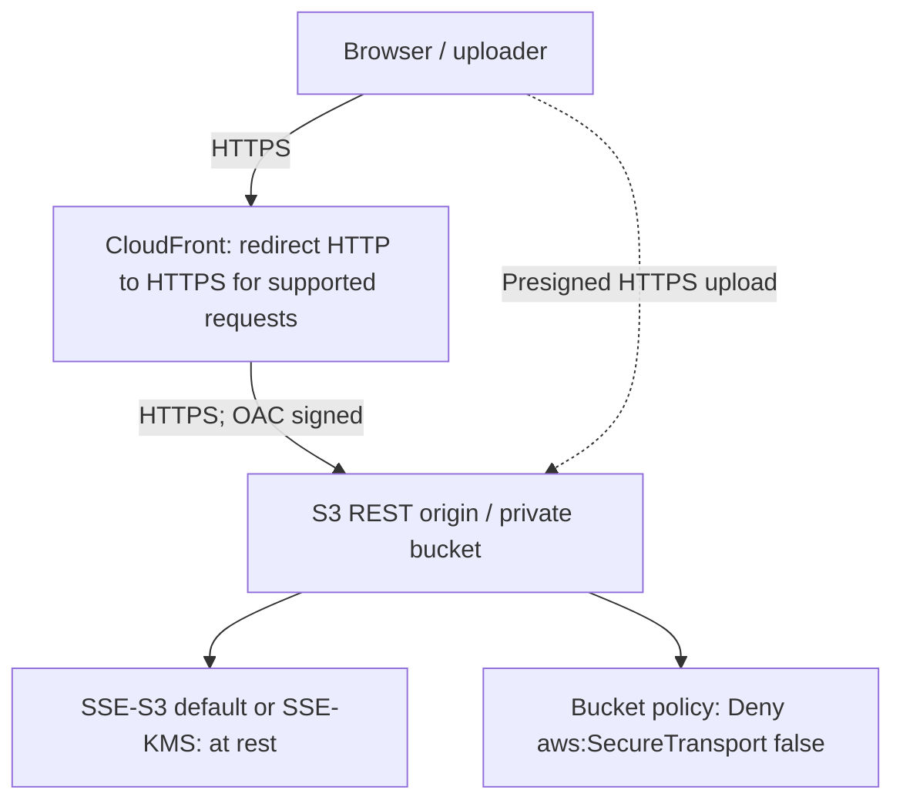

# Domain 3 multi-answer study — Q83 (6 of 58)

## Verdict
**C and E verified.** Q83 is a near-duplicate of Q32 (same five options, answers, and core scenario) and should be flagged, not deleted automatically. Source text has missing spaces; Q83 omits Q32's explicit anonymous/named requester constraint.

## Original question
A company has an application that stores user-uploaded videos in an Amazon S3 bucket using S3 Standard storage. Users access videos frequently for the first 180 days, and rarely after that. Most videos are over 100 MB. Users often have poor internet connectivity, and the company uses multipart uploads. A solutions architect needs tooptimize S3 storage costs. Which combination of actions will meet these requirements? (Select TWO.)

- **A.** Configure the S3 bucket to be a Requester Pays bucket.
- **B.** Use S3 Transfer Acceleration to upload the videos.
- **C.** Create a lifecycle rule to expireincomplete multipart uploadsafter 7 days.
- **D.** Create a lifecycle rule to transition objects toS3 Glacier Instant Retrieval after 1 day.
- **E.** Create a lifecycle rule to transition objects toS3 Standard-IA after 180 days.

## Explain the answer
- **A incorrect:** Requester Pays moves requester charges, does not reduce underlying stored bytes. Unlike Q32, Q83 does not explicitly mention anonymous access, so do not claim that alone disproves A for Q83.
- **B incorrect:** S3 Transfer Acceleration improves upload speed for some paths, but adds transfer charges and does not clear orphaned multipart-upload parts.
- **C correct:** S3 Lifecycle `AbortIncompleteMultipartUpload` after 7 days deletes stored parts that were never completed, stopping ongoing part charges; does not delete completed objects.
- **D incorrect:** S3 Glacier Instant Retrieval after 1 day conflicts with frequent reads for 180 days and imposes retrieval fees and 90-day minimum storage duration.
- **E correct:** Transition completed objects from S3 Standard to S3 Standard-IA after 180 days, matching later infrequent access (retrieval fees; 30-day minimum).

## Diagram
```text
User multipart video upload
    |-- Complete --> S3 Standard (day 0–180) --> Standard-IA (day 180+): E
    +-- Incomplete -> charged staged parts --> abort after 7 days: C
```

## Duplicate/variant check
- **Q32:** near-identical objective, storage class, lifecycle timings, options A–E, answer C+E; Q32 additionally states named/anonymous users and explicitly distinguishes >100 MB objects.
- **Q305:** other large video S3 uploads, but its performance/geography requirements change the solution. Do not carry C+E into Q305 automatically.
- Published exact Q83 text variants at examsvce and certprep also give C+E, but these are third-party sources, not an AWS exam authority.
- Source typos: `tooptimize`, `expireincomplete multipart uploadsafter`, `toS3`. Original question and options preserved in questions.json for traceability.

## AWS documentation
- https://docs.aws.amazon.com/AmazonS3/latest/userguide/mpu-abort-incomplete-mpu-lifecycle-config.html
- https://docs.aws.amazon.com/AmazonS3/latest/userguide/mpuoverview.html
- https://docs.aws.amazon.com/AmazonS3/latest/userguide/storage-class-intro.html
- https://docs.aws.amazon.com/AmazonS3/latest/userguide/lifecycle-transition-general-considerations.html

## External variants
- https://www.examsvce.com/sap-c02/questiona-company-has-an-application-that-stores-question-answer.html
- https://www.certprep.io/amazon/sap-c02/questions


## Q115 (7 of 58): Aurora database activity auditing and 10-year WORM retention

**Intended A+C.** Aurora PostgreSQL encrypted at rest and TLS in transit; Aurora Database Activity Streams -> managed Kinesis Data Streams -> Data Firehose -> S3 Object Lock compliance mode (10 years). A: intended Aurora cluster. B: also supports encryption/TLS but does not establish Aurora cluster; question has ambiguity. C: strongest separation of duties; omitted Kinesis intermediary. D: pgAudit to CloudWatch and immutable S3 can be viable if permissions and audit configuration robust, but not equivalent managed stream separation. E: governance retention bypassable. Validate Region/engine version, audit policy, event delivery, KMS, versioning, retention, least privilege. No exact external exam variant independently confirmed; don't claim otherwise.

AWS: https://docs.aws.amazon.com/AmazonRDS/latest/AuroraUserGuide/DBActivityStreams.html ; https://docs.aws.amazon.com/AmazonRDS/latest/AuroraUserGuide/DBActivityStreams.Enabling.html ; https://docs.aws.amazon.com/AmazonS3/latest/userguide/object-lock.html


## Q127 — Domain 3 multi-answer 8/58: patched AMIs and Auto Scaling
**Answer C+D**, with caveat: D alone fixes stale AMI; C supplies ALB target health monitoring/availability. A misstates ASG UpdatePolicy; B patches mutable groups but not launch image; E termination protection does not fix image or reliably prevent ASG replacement.

```text
OLD: unpatched AMI -> patched running EC2 -> reboot/unhealthy -> replacement from unpatched AMI
NEW: patch/test AMI -> versioned launch template -> ASG instance refresh -> ALB target health verification
```

**Current AWS guidance:** prefer launch templates over legacy launch configurations; use rolling instance refresh with healthy percentages, warmup, grace periods and optionally checkpoints. Source caveat: reboot alone need not cause replacement; health-check behavior is configuration-dependent.

**External variants:** Scribd ExamTopics-derived Q348 lists C,D (same order). Exam-tests Q85 reorders B/C and reports A,B, an internally inconsistent key. Verify option text, not letters. No exact duplicate confirmed by initial dataset phrase scan; related IDs: 567.

AWS docs: https://docs.aws.amazon.com/autoscaling/ec2/userguide/instance-refresh-overview.html ; https://docs.aws.amazon.com/autoscaling/ec2/userguide/health-checks-overview.html ; https://docs.aws.amazon.com/autoscaling/ec2/userguide/launch-templates.html


## Q135 (9 of 58): 90-day allowlisted client IP inactivity from ALB logs

**Answer B+D.** Enable ALB access logging, create Athena table over S3 logs, and have Lambda query client IP and timestamps to identify security group allowlist candidates inactive for 90 days. A VPC Flow Logs to CloudWatch is more expensive and network-oriented; C checks flow logs rather than HTTP requests; E CloudTrail logs AWS API actions, not user web requests. D queries ALB logs through Athena.

```text
Client IP -> ALB (SG allowlist) -> EC2 targets
                 |
                 +-> access logs -> S3 -> Athena <- Lambda
                                                 |
                                       validate candidate IP
                                                 |
                                     update ALB security group
```

**Defects/caveats:** 'IPaddresses' spacing typo. AWS states ALB access logs are best-effort and eventually consistent, so missing events do not prove inactivity. Proxies/NAT can change observed source IP. Keep 90+ days retention, use partitions to control Athena scanned bytes, validate CIDR rules and protect critical IPs before revocation. Newer ALB CloudWatch Logs integrations exist; legacy S3 ALB logs + Athena remains valid. External exact-stem FreeCram 2025-04-03 q227 reorders options, so compare answer text, not letters. Related logging IDs: 24, 90, 232, 492, 496, 508, 591; no exact duplicate confirmed.

AWS references: https://docs.aws.amazon.com/elasticloadbalancing/latest/application/load-balancer-access-logs.html ; https://docs.aws.amazon.com/athena/latest/ug/application-load-balancer-logs.html ; https://docs.aws.amazon.com/athena/latest/ug/query-alb-access-logs-examples.html
External: https://www.freecram.net/Amazon.SAP-C02.v2025-04-03.q227.pdf


## Q140 (10 of 58) — VM-imported EC2 not registered in Systems Manager

**A+B**. Imported VM -> custom AMI -> EC2 instance: verify SSM Agent installed/running and effective IAM permissions (EC2 instance profile with AmazonSSMManagedInstanceCore, or Default Host Management Configuration). Verify outbound HTTPS 443 and SSM endpoint reachability separately.

```text
On-prem VM -> VM Import/Export -> AMI -> EC2
                                      | SSM Agent running (A)
                                      | SSM permissions (B)
                                      v
                           HTTPS 443 -> SSM endpoint -> managed node
```

A correct: custom image may lack agent. B correct in traditional model; modern DHMC alternative. C VPC interface endpoint optional if internet egress exists. D Application Discovery Agent is for migration discovery. E service-linked roles do not replace per-node permissions. Source issue: legacy phrase 'EC2 VM Import feature of AWS Import/Export'; use VM Import/Export. Public IP alone does not ensure routing or outbound access. Duplicate scan related IDs: 14, 31, 35, 44, 57, 60, 106, 110, 111, 117, 121, 125, 144, 164, 172, 212, 213, 224, 225, 229, 245, 250, 267, 309, 316, 322, 336, 371, 389, 443, 465, 466, 470, 473, 507, 511, 514, 545, 567, 581, 609, 618, 620, 626, 637, 644, 653; no exact duplicate confirmed. Exact external exam variant not independently confirmed, AWS official docs validate answer mechanics.

Sources: https://docs.aws.amazon.com/systems-manager/latest/userguide/fleet-manager-troubleshooting-managed-nodes.html ; https://docs.aws.amazon.com/systems-manager/latest/userguide/setup-instance-permissions.html ; https://docs.aws.amazon.com/systems-manager/latest/userguide/troubleshooting-managed-nodes-using-ssm-cli.html


## Q147 (11 of 58): 1,000-node tightly coupled HPC cluster

**Correct A+C+F.** Single AZ, ideally cluster placement group, EFA-capable EC2 instances, and shared Amazon FSx for Lustre. Single AZ reduces latency for tightly coupled MPI communication; EFA provides high-performance networking; Lustre is a parallel file system optimized for demanding HPC throughput/metadata operations.

```text
           ONE AVAILABILITY ZONE (A)
    +-------------------------------------+
    | Cluster placement group             |
    | EC2/EFA <--> EC2/EFA <--> ... 1000  | (C)
    +-----------------+-------------------+
                      |
            shared parallel I/O
                      v
             Amazon FSx for Lustre         (F)
                      |
                  optional S3
```

A yes: tightly coupled compute in single AZ. B no: ENI counts in multiples of four is not HPC rule. C yes: EFA supports low-latency/high-throughput inter-node communication. D no: multi-AZ is better for loosely coupled jobs, not this one. E no: EBS RAID isn't a shared parallel filesystem for 1000 workers. F yes: FSx for Lustre, provision throughput and metadata IOPS appropriately.

**Caveats:** Stem typo 'AWS tor'. EFS may work for other HPC workloads; performance is workload-specific. Cluster placement group is best practice though not one of the options. Modern FSx for Lustre supports EFA-enabled file systems for supported clients and deployments, an additional tuning possibility. Exact external exam variants on FreeCram and Exam-Tests both key A,C,F. Dataset duplicate scan found no exact same-stem question; related IDs: none.

Official AWS: https://docs.aws.amazon.com/wellarchitected/latest/high-performance-computing-lens/tightly-coupled-scenarios.html ; https://docs.aws.amazon.com/wellarchitected/latest/high-performance-computing-lens/workload-architecture.html ; https://docs.aws.amazon.com/fsx/latest/LustreGuide/performance.html ; https://docs.aws.amazon.com/fsx/latest/LustreGuide/efa-file-systems.html
External: https://www.freecram.net/question/Amazon.SAP-C02.v2026-03-31.q264/a-company-has-built-a-high-performance-computing-hpc-cluster-in-aws-tor-a-tightly-coupled-workload ; https://www.exam-tests.com/SAP-C02-exam/Amazon.SAP-C02.v2025-02-24.q513.html?p=63


## Q155 (12/58) — Active-active ECS Regions, ECR, ACM and Aurora

**Original intended answers: A, D, E. Critical outdated recommendation in D.**

A: correct, ACM ALB certificates are regional. B: incorrect, RAM cannot share a regional ACM certificate across Regions. C: incorrect, ECR VPC endpoint does not replace image replication. D: cross-Region ECR replication correct, but manually re-pushing existing images is obsolete as the least-overhead approach: AWS ECR now supports replication backfill. Proposed revised D: Configure cross-Region ECR replication and start replication backfill for existing images. E: correct, Aurora Global Database can forward supported DML from secondary to the single primary writer. F: incorrect, not an independent multi-writer Aurora global database.

Architecture:

```text
                 Route 53 geolocation
                  /              \
       Primary Region         Secondary Region
       ALB + ACM              ALB + ACM (A)
          ECS                    ECS
          ECR ---- replicate --> ECR (D)
       Aurora primary <--- writes forwarded --- Aurora secondary (E)
       single writer --- asynchronous replication --> secondary
```

Aurora MySQL global write forwarding requires supported version, enabling forwarding, setting aurora_replica_read_consistency, and verifying SQL limitations. 'Active-active' refers to app traffic, not independent DB writers. Route 53 geolocation needs a sensible default. Duplicate audit across dataset: Q200 is close ECS/ALB/ECR/Aurora multi-Region variant but tests DR RPO/RTO and backups; Q123 and Q242 related, no exact duplicate confirmed. External same-stem variant appears on CertEnsure Q163, but exact external answer key was not independently confirmed.

Official docs: https://docs.aws.amazon.com/acm/latest/userguide/acm-overview.html ; https://docs.aws.amazon.com/AmazonECR/latest/userguide/replication-backfill.html ; https://docs.aws.amazon.com/AmazonRDS/latest/AuroraUserGuide/aurora-global-database-write-forwarding-ams.html


## Q157 (13 of 58) — IAM CreateUser approval, lockdown and notification

**Verified A + D + E.** Detect the IAM CreateUser management event using EventBridge via CloudTrail, start Step Functions to restrict access and coordinate approval, and notify the security team through SNS.

Original options: A EventBridge CloudTrail CreateUser rule (correct); B CloudTrail directly sends per-CreateUser SNS (incorrect, log delivery SNS differs); C Fargate container to remove access (possible but operationally excessive); D Step Functions remediation (correct); E SNS security notification (correct); F Pinpoint (unnecessary).

Architecture:

    IAM CreateUser -> CloudTrail management event -> EventBridge rule (A)
                                                  |
                                                  v
                                        Step Functions (D)
                                          | lockdown
                                          | approval workflow
                                          v
                                      SNS notification (E)
                                          |
                                      security review

EventBridge pattern:

    {"source":["aws.iam"],"detail-type":["AWS API Call via CloudTrail"],"detail":{"eventSource":["iam.amazonaws.com"],"eventName":["CreateUser"]}}

**Critical security caveat:** CloudTrail-originated EventBridge events are best effort and asynchronous, so this alone cannot enforce zero access at every instant. New IAM users initially have no permissions; add preventive IAM controls and reconciliation to protect against grants before response. For IAM global service events, create the EventBridge rule in us-east-1. 'Amazon CloudWatch Events' is legacy terminology. Step Functions can publish directly to SNS; explicit approval callback and controlled grant require implementation.

External exact-stem variants: https://www.exam-tests.com/SAP-C02-exam/Amazon.SAP-C02.v2025-02-24.q513.html?p=23 (Q110) and https://www.examcollection.us/exam/SAP-C02-question-answer-3.html (both A,D,E). No exact/near duplicate detected by CreateUser and approval scan of all 674.

AWS: https://docs.aws.amazon.com/eventbridge/latest/ref/events-ref-iam.html ; https://docs.aws.amazon.com/step-functions/latest/dg/connect-sns.html ; https://repost.aws/knowledge-center/iam-eventbridge-sns-rule


## Q158 (14 of 58) — Global document upload and API latency

**Original intended A+C; verified with architecture defects.** Serverless document system in eu-central-1: CloudFront static site, Regional API Gateway, Lambda writes Aurora Serverless metadata and S3 documents. Global clients need lower latency.

- **A correct only after changing upload flow:** Enable S3 Transfer Acceleration and generate acceleration-aware presigned PUT/POST URLs so the browser uploads directly to S3 edge endpoint. The described Lambda-to-S3 upload path will not benefit simply by enabling acceleration.
- **B wrong:** Global Accelerator standard endpoints are ALB, NLB, EC2, EIP; not CloudFront distributions.
- **C correct for REST APIs:** API Gateway edge-optimized REST endpoints use AWS-managed CloudFront to improve geographically distributed client connection time. HTTP APIs do not support edge-optimized endpoint type; alternatively put customer-managed CloudFront before Regional API.
- **D not preferred:** Whole-stack multi-Region deployment adds considerable complexity; Aurora Serverless global database support depends on version/architecture.
- **E wrong:** RDS Proxy addresses database connection scaling, not client-to-API/upload latency.

Architecture:

    Global browser
        |-- static site --> CloudFront --> S3 web assets (Frankfurt)
        |-- API request --> Edge-optimized API Gateway (C) --> Lambda --> Aurora
        |-- presigned URL from API --> S3 Transfer Acceleration edge (A)
                                           |
                                      S3 bucket Frankfurt

**Defects and outdated recommendations:** Original stem explicitly says Lambda PUTs documents into S3; A requires changing that to browser-to-S3 direct upload, which is not stated. C presumes REST API, not specified. CloudFront website distribution is separate from edge-optimized API's managed distribution. S3 Transfer Acceleration has additional charges and variable geographic benefit. Neither option eliminates backend-to-database latency.

**External variants:** Exam-Tests exact stem A+C; FreeCram discussion A+C; ExamTopics discussion has dissenting A+D and B+C arguments, but B is technically impossible as stated. Related feature-question IDs: 18,32,83,149,170,273,285,305,323,349,365,495,496,516,570,592,596,648,656; no exact same-stem duplicate detected in dataset.

Sources: https://docs.aws.amazon.com/AmazonS3/latest/userguide/transfer-acceleration-examples.html ; https://docs.aws.amazon.com/apigateway/latest/developerguide/api-gateway-api-endpoint-types.html ; https://docs.aws.amazon.com/global-accelerator/latest/dg/about-endpoints.html ; https://aws.amazon.com/blogs/networking-and-content-delivery/implementing-secure-file-uploads-to-amazon-s3-at-the-edge-choosing-the-right-pattern/ ; https://www.exam-tests.com/SAP-C02-exam/Amazon.SAP-C02.v2025-02-24.q513.html?p=43 ; https://www.freecram.com/discussions/Amazon/exam-sap-c02-topic-2-question-284-discussion-p1298270.html


---

# Domain 3 multi-answer study — Q159 (15 of 58)

## Verdict
**A, C, E verified as intended exam answers; C ambiguous, A outdated premise.** No exact stem duplicate among the 674 dataset questions. Similar-but-distinct Q115, Q456, Q469, Q390, Q541.

## Original question
A company is designing a new website that hosts static content. The website will give users the ability to upload and download large files. According to company requirements, all data must be encrypted in transit and at rest. A solutions architect is building the solution by using Amazon S3 and Amazon CloudFront. Which combination of steps will meet the encryption requirements? (Select THREE.)

- **A.** Turn on S3 server-side encryption for the S3 bucket that the web application uses.
- **B.** Add a policy attribute of "aws:SecureTransport": "true" for read and write operations in the S3 ACLs.
- **C.** Create a bucket policy that denies any unencrypted operations in the S3 bucket that the web application uses.
- **D.** Configure encryption at rest on CloudFront by using server-side encryption with AWS KMS keys (SSE-KMS).
- **E.** Configure redirection of HTTP requests to HTTPS requests in CloudFront.
- **F.** Use the RequireSSL option in the creation of presigned URLs for the S3 bucket that the web application uses.

## Detailed option analysis
- **A — Correct (historical wording).** S3 server-side encryption protects objects at rest. Since January 5, 2023, all new S3 uploads receive at least SSE-S3 automatically. A is still the intended exam choice but no longer requires a manual toggle for SSE-S3.
- **B — Incorrect.** An S3 ACL cannot contain `aws:SecureTransport` IAM condition keys. Enforce transport policy through a bucket policy.
- **C — Correct, with ambiguity.** Bucket policies can deny `aws:SecureTransport=false` for S3 requests; that is a TLS-in-transit condition. To require specified encryption-at-rest settings, use appropriate separate controls. The question's term 'unencrypted operations' does not identify the actual bucket policy condition.
- **D — Incorrect.** CloudFront does not expose SSE-KMS encryption at rest for cached content. Apply encryption to S3 origin objects, with suitable OAC and KMS permissions when needed.
- **E — Correct.** CloudFront's viewer protocol policy can redirect HTTP to HTTPS. For file writes/uploads, send HTTPS directly or use HTTPS Only to avoid redirect-method caveats.
- **F — Incorrect.** Generating S3 presigned URLs has no `RequireSSL` flag. Use HTTPS URLs and a bucket policy denying insecure transport.

## Diagram


## Duplicate and variant review
- Full 674-question exact normalized stem comparison: **no exact duplicate**.
- Related concepts: **Q115** encrypt data at rest and in transit; **Q456** S3 cross-account security; **Q469** static site architecture; **Q390** S3 regional storage; **Q541** encryption governance for EBS. These are not identical questions and answer letters must not be transferred between them.
- External SAP-C02 variant includes the same scenario/options in different ordering: original A→external E, B→F, C→A, D→B, E→D, F→C. Dataset A,C,E maps to external E,A,D. External source confirms variant wording, not independently its published answer key.

## Outdated / defective warnings
- **2023 default encryption update:** S3 new objects always encrypted with SSE-S3 at baseline, so A's implied manual-enablement requirement is stale.
- **C is underspecified:** state specifically bucket policy `Deny` with `aws:SecureTransport=false` for transport; bucket-policy SSE-KMS enforcement is a different condition.
- **Redirect is not a universal write-safe answer:** for uploads require direct HTTPS or HTTPS Only where appropriate; viewer protocol behavior has method/version caveats.
- **CloudFront origin:** use S3 REST origin and OAC, not an S3 static website origin for CloudFront→S3 HTTPS.

## Sources
- https://docs.aws.amazon.com/AmazonS3/latest/userguide/default-encryption-faq.html
- https://docs.aws.amazon.com/AmazonS3/latest/userguide/amazon-s3-policy-keys.html
- https://docs.aws.amazon.com/AmazonCloudFront/latest/DeveloperGuide/using-https-viewers-to-cloudfront.html
- https://docs.aws.amazon.com/AmazonCloudFront/latest/DeveloperGuide/using-https-cloudfront-to-s3-origin.html
- https://docs.aws.amazon.com/AmazonCloudFront/latest/DeveloperGuide/private-content-restricting-access-to-s3.html
- https://myportal.utt.edu.tt/ICS/icsfs/d97df75f-867e-411a-ac5f-e13435c2eedc.pdf?target=c53e5228-7ce9-4ef5-a5ec-d932dc3abaad
