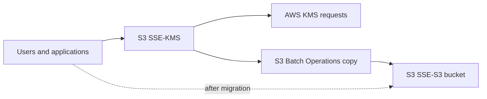

# Domain 3 single-answer study

## Q1 — 1 of 239 — S3 SSE-KMS request cost

**Original stem:** A company has millions of objects in an Amazon S3 bucket. The objects are in the S3 Standard storage class. All the S3 objects are accessed frequently. The number of users and applications that access the objects is increasing rapidly. The objects are encrypted with server-side encryption with AWS KMS Keys (SSE-KMS). A solutions architect reviews the company's monthly AWS invoice and notices that AWS KMS costs are increasing because of the high number of requests from Amazon S3. The solutions architect needs to optimize costs with minimal changes to the application. Which solution will meet these requirements with the LEAST operational overhead?

**Original options:**
- **A.** Create a new S3 bucket that has server-side encryption with customer-provided keys (SSE-C) as the encryption type. Copy the existing objects to the new S3 bucket. Specify SSE-C.
- **B.** Create a new S3 bucket that has server-side encryption with Amazon S3 managed keys (SSE-S3) as the encryption type. Use S3 Batch Operations to copy the existing objects to the new S3 bucket. Specify SSE-S3.
- **C.** Use AWS CloudHSM to store the encryption keys. Create a new S3 bucket. Use S3 Batch Operations to copy the existing objects to the new S3 bucket. Encrypt the objects by using the keys from CloudHSM.
- **D.** Use the S3 Intelligent-Tiering storage class for the S3 bucket. Create an S3 Intelligent-Tiering archive configuration to transition objects that are not accessed for 90 days to S3 Glacier Deep Archive.

**Verified exam answer: B**, with a question-design caveat. B avoids KMS calls for migrated objects using SSE-S3 and Batch Operations, but moving to a new bucket can require application updates and KMS may be a security requirement. **A** SSE-C adds client key management. **C** CloudHSM adds infrastructure and is not directly usable as native S3 key source. **D** tiering does not address KMS request charges and archival mismatches frequent access.

**Current recommendation:** If SSE-KMS must be retained, enable S3 Bucket Keys (up to 99% fewer KMS requests) and update existing object encryption appropriately. New 2026 S3 Batch Operations UpdateObjectEncryption can update object encryption and Bucket Key configuration without data movement for supported cases. Neither alternative is offered as an option.

**External exact variants:** [FreeCram](https://www.freecram.net/question/Amazon.SAP-C02.v2023-11-04.q183/a-company-has-millions-of-objects-in-an-amazon-s3-bucket-the-objects-are-in-the-s3-standard-storage) and [Exam-Tests](https://www.exam-tests.com/SAP-C02-exam/Amazon.SAP-C02.v2025-02-24.q513.html?p=27), both B. Their explanations cite S3 Bucket Keys even though B does not mention them; this is a source explanation defect.

**Official AWS:** [S3 Bucket Keys](https://docs.aws.amazon.com/AmazonS3/latest/userguide/bucket-key.html); [Configure Bucket Keys](https://docs.aws.amazon.com/AmazonS3/latest/userguide/configuring-bucket-key.html); [October 2026 Batch Operations encryption update](https://aws.amazon.com/blogs/storage/updating-encryption-on-existing-amazon-s3-objects-with-s3-batch-operations/).

**Duplicate audit:** No exact duplicate across 674. Q32 and Q83 concern other S3 cost optimization scenarios (multipart and lifecycle).

## Q2 — 2 of 239 — Lambda PostgreSQL connection surge

**Original stem:** An ecommerce company runs an application on AWS. The application has an Amazon API Gateway API that invokes an AWS Lambda function. The data is stored in an Amazon RDS for PostgreSQL DB instance. During the company's most recent flash sale, a sudden increase in API calls negatively affected the application's performance. A solutions architect reviewed the Amazon CloudWatch metrics during that time and noticed a significant increase in Lambda invocations and database connections. The CPU utilization also was high on the DB instance. What should the solutions architect recommend to optimize the application's performance?

**Original options:**
- **A.** Increase the memory of the Lambda function. Modify the Lambda function to close the database connections when the data is retrieved.
- **B.** Add an Amazon ElastiCache for Redis cluster to store the frequently accessed data from the RDS database.
- **C.** Create an RDS proxy by using the Lambda console. Modify the Lambda function to use the proxy endpoint.
- **D.** Modify the Lambda function to connect to the database outside of the function's handler. Check for an existing database connection before creating a new connection.

**Verified answer: C — Amazon RDS Proxy.** Lambda concurrency during flash sales causes many PostgreSQL connections. RDS Proxy pools and multiplexes backend connections to limit connection overhead.

**Option review:** A increases Lambda resources but doesn't solve DB connection growth; closing connections increases churn. B Redis can reduce cacheable reads but cannot solve general connection pressure. C proxy pools connections across concurrent Lambda environments. D handler-external connection reuse only works within a warm environment, not across environments.

**Caveat:** High CPU from costly SQL still requires query optimization; session pinning may reduce proxy multiplexing.

**Architecture:** API Gateway → Lambda concurrent invocations → RDS Proxy connection pool → RDS PostgreSQL.

**Exact external variants:** [FreePDFDumps Q149](https://www.freepdfdumps.com/Amazon.SAP-C02.v2024-09-24.q208.html?p=31); [FreeCram Q185](https://www.freecram.net/Amazon.SAP-C02.v2025-04-03.q227.pdf); [additional Q66](https://www.salesforcexamdumps.com/sap-c02-practice-questions/6).

**Official AWS:** [Lambda + RDS](https://docs.aws.amazon.com/lambda/latest/dg/services-rds.html); [RDS Proxy scenarios](https://docs.aws.amazon.com/AmazonRDS/latest/UserGuide/rds-proxy-best-practices.usage-scenarios.html); [RDS Proxy mechanics](https://docs.aws.amazon.com/AmazonRDS/latest/UserGuide/rds-proxy.howitworks.html).

**Duplicate audit:** Exact duplicates: none of 674. Keyword-related IDs: 41, 49, 158, 160, 230, 287, 326, 420, 429, 431, 570, 609; similarity is not exact duplication.
