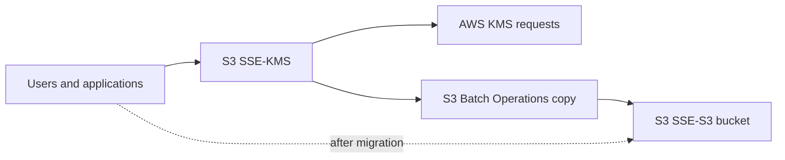

# Domain 3 single-answer study

## Q1 — 1 of 239 — S3 SSE-KMS request cost

**Original stem:** A company has millions of objects in an Amazon S3 bucket. The objects are in the S3 Standard storage class. All the S3 objects are accessed frequently. The number of users and applications that access the objects is increasing rapidly. The objects are encrypted with server-side encryption with AWS KMS Keys (SSE-KMS). A solutions architect reviews the company's monthly AWS invoice and notices that AWS KMS costs are increasing because of the high number of requests from Amazon S3. The solutions architect needs to optimize costs with minimal changes to the application. Which solution will meet these requirements with the LEAST operational overhead?

**Original options:**
- **A.** Create a new S3 bucket that has server-side encryption with customer-provided keys (SSE-C) as the encryption type. Copy the existing objects to the new S3 bucket. Specify SSE-C.
- **B.** Create a new S3 bucket that has server-side encryption with Amazon S3 managed keys (SSE-S3) as the encryption type. Use S3 Batch Operations to copy the existing objects to the new S3 bucket. Specify SSE-S3.
- **C.** Use AWS CloudHSM to store the encryption keys. Create a new S3 bucket. Use S3 Batch Operations to copy the existing objects to the new S3 bucket. Encrypt the objects by using the keys from CloudHSM.
- **D.** Use the S3 Intelligent-Tiering storage class for the S3 bucket. Create an S3 Intelligent-Tiering archive configuration to transition objects that are not accessed for 90 days to S3 Glacier Deep Archive.

**Verified exam answer: B**, with a question-design caveat. B avoids KMS calls for migrated objects using SSE-S3 and Batch Operations, but moving to a new bucket can require application updates and KMS may be a security requirement. **A** SSE-C adds client key management. **C** CloudHSM adds infrastructure and is not directly usable as native S3 key source. **D** tiering does not address KMS request charges and archival mismatches frequent access.

**Current recommendation:** If SSE-KMS must be retained, enable S3 Bucket Keys (up to 99% fewer KMS requests) and update existing object encryption appropriately. New 2026 S3 Batch Operations UpdateObjectEncryption can update object encryption and Bucket Key configuration without data movement for supported cases. Neither alternative is offered as an option.

**External exact variants:** [FreeCram](https://www.freecram.net/question/Amazon.SAP-C02.v2023-11-04.q183/a-company-has-millions-of-objects-in-an-amazon-s3-bucket-the-objects-are-in-the-s3-standard-storage) and [Exam-Tests](https://www.exam-tests.com/SAP-C02-exam/Amazon.SAP-C02.v2025-02-24.q513.html?p=27), both B. Their explanations cite S3 Bucket Keys even though B does not mention them; this is a source explanation defect.

**Official AWS:** [S3 Bucket Keys](https://docs.aws.amazon.com/AmazonS3/latest/userguide/bucket-key.html); [Configure Bucket Keys](https://docs.aws.amazon.com/AmazonS3/latest/userguide/configuring-bucket-key.html); [October 2026 Batch Operations encryption update](https://aws.amazon.com/blogs/storage/updating-encryption-on-existing-amazon-s3-objects-with-s3-batch-operations/).

**Duplicate audit:** No exact duplicate across 674. Q32 and Q83 concern other S3 cost optimization scenarios (multipart and lifecycle).

## Q2 — 2 of 239 — Lambda PostgreSQL connection surge

**Original stem:** An ecommerce company runs an application on AWS. The application has an Amazon API Gateway API that invokes an AWS Lambda function. The data is stored in an Amazon RDS for PostgreSQL DB instance. During the company's most recent flash sale, a sudden increase in API calls negatively affected the application's performance. A solutions architect reviewed the Amazon CloudWatch metrics during that time and noticed a significant increase in Lambda invocations and database connections. The CPU utilization also was high on the DB instance. What should the solutions architect recommend to optimize the application's performance?

**Original options:**
- **A.** Increase the memory of the Lambda function. Modify the Lambda function to close the database connections when the data is retrieved.
- **B.** Add an Amazon ElastiCache for Redis cluster to store the frequently accessed data from the RDS database.
- **C.** Create an RDS proxy by using the Lambda console. Modify the Lambda function to use the proxy endpoint.
- **D.** Modify the Lambda function to connect to the database outside of the function's handler. Check for an existing database connection before creating a new connection.

**Verified answer: C — Amazon RDS Proxy.** Lambda concurrency during flash sales causes many PostgreSQL connections. RDS Proxy pools and multiplexes backend connections to limit connection overhead.

**Option review:** A increases Lambda resources but doesn't solve DB connection growth; closing connections increases churn. B Redis can reduce cacheable reads but cannot solve general connection pressure. C proxy pools connections across concurrent Lambda environments. D handler-external connection reuse only works within a warm environment, not across environments.

**Caveat:** High CPU from costly SQL still requires query optimization; session pinning may reduce proxy multiplexing.

**Architecture:** API Gateway → Lambda concurrent invocations → RDS Proxy connection pool → RDS PostgreSQL.

**Exact external variants:** [FreePDFDumps Q149](https://www.freepdfdumps.com/Amazon.SAP-C02.v2024-09-24.q208.html?p=31); [FreeCram Q185](https://www.freecram.net/Amazon.SAP-C02.v2025-04-03.q227.pdf); [additional Q66](https://www.salesforcexamdumps.com/sap-c02-practice-questions/6).

**Official AWS:** [Lambda + RDS](https://docs.aws.amazon.com/lambda/latest/dg/services-rds.html); [RDS Proxy scenarios](https://docs.aws.amazon.com/AmazonRDS/latest/UserGuide/rds-proxy-best-practices.usage-scenarios.html); [RDS Proxy mechanics](https://docs.aws.amazon.com/AmazonRDS/latest/UserGuide/rds-proxy.howitworks.html).

**Duplicate audit:** Exact duplicates: none of 674. Keyword-related IDs: 41, 49, 158, 160, 230, 287, 326, 420, 429, 431, 570, 609; similarity is not exact duplication.

## Q4 — 3 of 239 — EC2 cluster placement group insufficient capacity

**Original stem:** A solutions architect has launched multiple Amazon EC2 instances in a placement group within a single Availability Zone. Because of additional load on the system, the solutions architect attempts to add new instances to the placement group. However, the solutions architect receives an insufficient capacity error. What should the solutions architect do to troubleshoot this issue?

**Original options:**
- **A.** Use a spread placement group. Set a minimum of eight instances for each Availability Zone.
- **B.** Stop and start all the instances in the placement group. Try the launch again.
- **C.** Create a new placement group. Merge the new placement group with the original placement group.
- **D.** Launch the additional instances as Dedicated Hosts in the placement groups.

**Verified answer: B.** AWS explicitly recommends stopping and starting all instances in an existing cluster placement group and retrying the launch when incremental capacity is unavailable. Reallocation may find sufficient contiguous hardware, but is not guaranteed.

**Option review:** A wrong: spread groups isolate hardware and allow at most seven running instances per AZ at rack level, not minimum eight. B correct: documented AWS troubleshooting. C wrong: placement groups cannot be merged. D wrong: Dedicated Hosts cannot be launched in placement groups.

**Architecture:** Existing EC2 cluster placement group → insufficient capacity on incremental launch → coordinated stop/start of existing group → possible hardware reallocation → retry launch.

**Defects and modern recommendations:** Stem implies but does not explicitly name cluster placement strategy. Stop/start causes downtime, may erase instance-store data and change auto-assigned public IPv4; not guaranteed. For future capacity, launch required instances together and consider On-Demand Capacity Reservations inside supported cluster placement groups.

**Official AWS:** [Placement strategies](https://docs.aws.amazon.com/AWSEC2/latest/UserGuide/placement-strategies.html); [Placement rules](https://docs.aws.amazon.com/AWSEC2/latest/UserGuide/placement-groups.html); [Stop/start](https://docs.aws.amazon.com/AWSEC2/latest/UserGuide/how-ec2-instance-stop-start-works.html); [Capacity Reservations](https://docs.aws.amazon.com/AWSEC2/latest/UserGuide/cr-cpg.html).

**Exact external variants:** [Cert Empire](https://certempire.com/practice-tests/free-sap-c02-practice-questions/) original order; [FreePDFDumps Q143](https://www.freepdfdumps.com/Amazon.SAP-C02.v2025-06-02.q210.html?p=30) reordered D is same correct action; [FreeCram](https://www.freecram.net/Amazon.SAP-C02.v2025-04-03.q227.pdf) swaps C/D.

**Duplicate audit:** Normalized exact stem duplicates across 674: none. Related placement/capacity stems: 40, 303; these are not established duplicates.

## Q5 — 4 of 239 — Multi-AZ private-subnet internet egress

**Original stem:** A VPC spans three Availability Zones, each with public and private subnets. One NAT gateway and one internet gateway exist. Private EC2 instances must connect to the internet.

**Original options:**
- **A.** Add two more NAT gateways (one per AZ). Configure each private subnet to use its AZ’s NAT gateway.
- **B.** Add two more NAT gateways and configure public subnets.
- **C.** Add internet gateways per AZ and route private subnets.
- **D.** Add internet gateways per AZ and configure public subnets.

**Verified answer: A.** For classic zonal NAT gateways, use a NAT gateway per Availability Zone in a public subnet, and route each private subnet's default IPv4 route to the NAT gateway in its AZ. A single VPC internet gateway serves all AZs.

**Option analysis:** A provides AZ-independent internet egress and reduces cross-AZ traffic. B misroutes public subnet traffic to NAT rather than IGW. C and D incorrectly propose internet gateways per AZ; IGW is a VPC-level component and does not give private IPv4-only EC2 instances internet egress by direct routing.

**Architecture:** Internet ⇄ VPC IGW ⇄ [AZ-A NAT gateway ← private EC2] + [AZ-B NAT gateway ← private EC2] + [AZ-C NAT gateway ← private EC2]. Each zonal public NAT uses a public subnet and Elastic IP.

**Modern caveats:** The original question asks only for connectivity, not explicitly for high availability. A single zonal NAT can technically serve all three AZs, but is a single-AZ failure dependency. AWS now supports regional NAT gateways that automatically expand across AZs; this newer alternative is absent from the options. Regional NAT is a better modern option for many public-egress workloads; consider VPC endpoints for supported AWS service traffic.

**Official AWS:** [NAT gateway basics](https://docs.aws.amazon.com/vpc/latest/userguide/nat-gateway-basics.html); [multi-AZ example](https://docs.aws.amazon.com/vpc/latest/userguide/vpc-example-private-subnets-nat.html); [internet gateways](https://docs.aws.amazon.com/vpc/latest/userguide/VPC_Internet_Gateway.html); [regional NAT gateways](https://docs.aws.amazon.com/vpc/latest/userguide/nat-gateways-regional.html).

**External variants:** [Certstopics Q53](https://www.certstopics.com/questions/last-attempt-sap-c02-questions.html) exact short-form question and answer A; [ExamCollection Q55](https://www.examcollection.us/exam/SAP-C02-question-answer-4.html) longer equivalent original scenario and answer A.

**Duplicate audit:** Exact normalized stem duplicates across 674: none. Keyword-related question IDs: 18, 20, 21, 24, 53, 57, 74, 90, 108, 112, 193, 195, 209, 250, 309, 316, 318, 351, 356, 378, 410, 429, 447, 481, 556, 562, 591, 669. Related does not imply duplicate.

## Q10 — 5 of 239 — CodeDeploy with EC2 Auto Scaling

**Original stem:** A company has an application that runs on Amazon EC2 instances in an Amazon EC2 Auto Scaling group. The company uses AWS CodePipeline to deploy the application. The instances that run in the Auto Scaling group are constantly changing because of scaling events. When the company deploys new application code versions, the company installs the AWS CodeDeploy agent on any new target EC2 instances and associates the instances with the CodeDeploy deployment group. The application is set to go live within the next 24 hours. What should a solutions architect recommend to automate the application deployment process with the LEAST amount of operational overhead?

**Original options:**
- **A.** Configure Amazon EventBridge to invoke an AWS Lambda function when a new EC2 instance is launched into the Auto Scaling group. Code the Lambda function to associate the EC2 instances with the CodeDeploy deployment group.
- **B.** Write a script to suspend Amazon EC2 Auto Scaling operations before the deployment of new code When the deployment is complete, create a new AMI and configure the Auto Scaling group's launch template to use the new AMI for new launches. Resume Amazon EC2 Auto Scaling operations.
- **C.** Create a new AWS CodeBuild project that creates a new AMI that contains the new code Configure CodeBuild to update the Auto Scaling group's launch template to the new AMI. Run an Amazon EC2 Auto Scaling instance refresh operation.
- **D.** Create a new AMI that has the CodeDeploy agent installed. Configure the Auto Scaling group's launch template to use the new AMI. Associate the CodeDeploy deployment group with the Auto Scaling group instead of the EC2 instances.

**Verified answer: D.** Associate the CodeDeploy deployment group with the Auto Scaling group and preinstall the CodeDeploy agent in the AMI. CodeDeploy creates lifecycle hooks and deploys the latest revision to instances created during scale-out.

**Option review:** A duplicates native integration with EventBridge/Lambda custom code. B suspends scaling and adds manual AMI management. C is a valid immutable AMI/instance-refresh alternative, but higher implementation overhead under a 24-hour launch constraint. D is least overhead given existing CodeDeploy.

**Architecture:** CodePipeline → CodeDeploy deployment group → Auto Scaling group lifecycle hooks → EC2 launch template with CodeDeploy agent AMI → newly launched instances receive application revision.

**Defects/outdated recommendations:** No fundamental defect. AWS cautions that baked agents can become outdated and cause deployment failure; regularly update agent in AMI. Installing agent at launch is another supported option. Existing dataset has minor missing punctuation in B and C; original options preserved.

**Official AWS:** [CodeDeploy ASG integration](https://docs.aws.amazon.com/codedeploy/latest/userguide/integrations-aws-auto-scaling.html); [CodeDeploy FAQs](https://aws.amazon.com/codedeploy/faqs/).

**Exact external variants:** [CertsMania Q14 page 17](https://www.certsmania.com/pdf/revision-materials-effective-amazon-web-services-sap-c02-questions-answers-by-jagjit.pdf); [SAP-C02 Q267](https://www.scribd.com/document/921182718/SAP-C02-CSL-09-26-341), keyed D.

**Duplicate audit:** Exact normalized stem matches among 674: none. Technology-related candidates: 8, 72, 127, 133, 178, 223, 234, 242, 246, 501, 567, 632, 661; related does not establish duplicates.

## Q16 — 6 of 239 — Write-heavy variable workload, Aurora Serverless and Savings Plans

**Original stem:** A company is running an application in the AWS Cloud. The application uses AWS Lambda functions and Amazon Elastic Container Service (Amazon ECS) containers that run with AWS Fargate technology as its primary compute. The load on the application is irregular. The application experiences long periods of no usage, followed by sudden and significant increases and decreases in traffic. The application is write-heavy and stores data in an Amazon Aurora MySQL database. The database runs on an Amazon RDS memory optimized DB instance that is not able to handle the load. What is the MOST cost-effective way for the company to handle the sudden and significant changes in traffic?

**Original options (preserved original snapshot):**
- **A.** Add additional read replicas to the database. Purchase Instance Savings Plans and RDS Reserved Instances.
- **B.** Migrate the database to an Aurora multi-master DB cluster. Purchase Instance Savings Plans.
- **C.** Migrate the database to an Aurora global database. Purchase Compute Savings Plans and RDS Reserved Instances.
- **D.** Migrate the database to Aurora Serverless v1. Purchase Compute Savings Plans.

**Historically verified answer: D.** Multiple exact external variants key Aurora Serverless v1 + Compute Savings Plans (some reorder the correct option to A). Aurora Serverless v1 reached end of life March 31, 2025; current study wording modernizes D to Aurora Serverless v2. Do not overwrite the original snapshot.

**Option analysis:** A adds read capacity, not writer elasticity, and commitments may go unused. B legacy multi-master does not automatically scale to irregular load; EC2 Instance Savings Plans don't cover Lambda/Fargate. C global database solves cross-Region read/DR, not writer capacity spikes. D is historical intended choice; replace retired v1 with Aurora Serverless v2 today. Compute Savings Plans cover Lambda and Fargate, not Aurora.

**Architecture:** Incoming requests → Lambda + ECS Fargate → Aurora MySQL Serverless v2 writer with elastic ACUs; Compute Savings Plans apply to eligible Lambda/Fargate baseline. Current Database Savings Plans can cover eligible Aurora serverless usage.

**Defects and caveats:** Original D is obsolete. Aurora Serverless v2 supports 0 ACU auto-pause for supported Aurora MySQL versions (3.08.0+), but open connections, RDS Proxy and other configurations can prevent pausing. Resumption introduces latency. Commitments should be sized against predictable baseline, not burst peaks.

**Official AWS:** [Aurora v1 EOL](https://docs.aws.amazon.com/AmazonRDS/latest/AuroraUserGuide/WhatsNew.html); [Aurora Serverless v2 behavior](https://docs.aws.amazon.com/AmazonRDS/latest/AuroraUserGuide/aurora-serverless-v2.how-it-works.html); [Auto-pause](https://docs.aws.amazon.com/AmazonRDS/latest/AuroraUserGuide/aurora-serverless-v2-auto-pause.html); [Savings Plans types](https://docs.aws.amazon.com/savingsplans/latest/userguide/plan-types.html).

**Exact external variants:** [Certstopics Q91](https://www.certstopics.com/questions/pass-sap-c02-exam-guide.html) D; [CertEnsure](https://www.certensure.com/amazon-web-services/sap-c02-cert-practice-test.html) D; [FreeCram Q149](https://www.freecram.net/question/Amazon.SAP-C02.v2024-03-21.q171/a-company-is-running-an-application-in-the-aws-cloud-the-application-uses-aws-lambda-functions-and-amazon) reordered A; [FreePDFDumps Q160](https://www.freepdfdumps.com/Amazon.SAP-C02.v2025-06-02.q210.html?p=33) reordered A.

**Duplicate audit:** Exact normalized stem duplicates among 674: none. Related IDs: 58, 77, 88, 103, 155, 158, 160, 167, 177, 200, 233, 242, 312, 342, 368, 385, 417, 431, 437, 485, 516, 547, 555, 560, 564, 663; not necessarily duplicates.

## Q17 — 7 of 239 — 200 TB monthly reporting with FSx for Lustre

**Original stem:** A company is running a data-intensive application on AWS. The application runs on a cluster of hundreds of Amazon EC2 instances. A shared file system also runs on several EC2 instances that store 200 TB of data. The application reads and modifies the data on the shared file system and generates a report. The job runs once monthly, reads a subset of the files from the shared file system, and takes about 72 hours to complete. The compute instances scale in an Auto Scaling group, but the instances that host the shared file system run continuously. The compute and storage instances are all in the same AWS Region. A solutions architect needs to reduce costs by replacing the shared file system instances. The file system must provide high performance access to the needed data for the duration of the 72-hour run. Which solution will provide the LARGEST overall cost reduction while meeting these requirements?

**Original options:**
- **A.** Migrate the data from the existing shared file system to an Amazon S3 bucket that uses the S3 Intelligent-Tiering storage class. Before the job runs each month, use Amazon FSx for Lustre to create a new file system with the data from Amazon S3 by using lazy loading. Use the new file system as the shared storage for the duration of the job. Delete the file system when the job is complete.
- **B.** Migrate the data from the existing shared file system to a large Amazon Elastic Block Store (Amazon EBS) volume with Multi-Attach enabled. Attach the EBS volume to each of the instances by using a user data script in the Auto Scaling group launch template. Use the EBS volume as the shared storage for the duration of the job. Detach the EBS volume when the job is complete.
- **C.** Migrate the data from the existing shared file system to an Amazon S3 bucket that uses the S3 Standard storage class. Before the job runs each month, use Amazon FSx for Lustre to create a new file system with the data from Amazon S3 by using batch loading. Use the new file system as the shared storage for the duration of the job. Delete the file system when the job is complete.
- **D.** Migrate the data from the existing shared file system to an Amazon S3 bucket. Before the job runs each month, use AWS Storage Gateway to create a file gateway with the data from Amazon S3. Use the file gateway as the shared storage for the job. Delete the file gateway when the job is complete.

**Verified answer A.** Migrate durable 200 TB to S3 Intelligent-Tiering, create an S3-linked temporary FSx for Lustre file system for each 72-hour monthly processing run, lazily load only accessed file contents, export modified data back to S3, verify export completion, then delete FSx. AWS documents metadata import, transparent file-content fetch, and automatic/on-demand exports.

**Option analysis:** A matches subset access, parallel POSIX I/O, temporary compute, and storage tiering. B EBS Multi-Attach supports at most 16 Nitro instances per AZ and requires clustered file system for concurrent writes; hundreds impossible. C eager batch loading all 200 TB and S3 Standard is likely more expensive than loading only accessed files; actual costs need measurement. D S3 File Gateway is not an HPC parallel Lustre filesystem.

**Architecture:** S3 Intelligent-Tiering (durable 200 TB) ⇄ FSx for Lustre (temporary S3 DRA; metadata import + on-demand file-content fetch; export changes) ⇄ hundreds of EC2 workers (72h/month). Wait for export completion, then delete FSx.

**Defects and current caveats:** The original answer omits persistence of modified files; deletion without export loses changes. With automatic export, ensure AgeOfOldestQueuedMessage=0 before deletion. Scratch 1 does not support DRA/autoexport; select compatible deployment. S3 Intelligent-Tiering optional Archive/Deep Archive tiers require restore and can delay access. S3 Intelligent-Tiering storage class differs from FSx Lustre Intelligent-Tiering storage class (the latter does not support S3 DRA). 'Largest' cost saving is not provable without access profile, object sizes, S3 charges, FSx provisioned throughput, and export costs.

**Official AWS:** [Data repositories](https://docs.aws.amazon.com/fsx/latest/LustreGuide/overview-dra-data-repo.html); [automatic export](https://docs.aws.amazon.com/fsx/latest/LustreGuide/autoexport-data-repo-dra.html); [export tasks](https://docs.aws.amazon.com/fsx/latest/LustreGuide/export-data-repo-task-dra.html); [EBS Multi-Attach](https://docs.aws.amazon.com/en_en/ebs/latest/userguide/ebs-volumes-multi.html); [S3 storage classes](https://docs.aws.amazon.com/AmazonS3/latest/userguide/storage-class-intro.html).

**Exact external variants:** [SecExams Q23, keyed A](https://www.secexams.com/exams/Amazon/aws-certified-solutions-architect-professional-sap-c02/view/3); [meatsby Q23](https://meatsby.github.io/05.-infrastructure/01.-aws/02.-certification/03.-aws-sap-c02/01.-aws-sap-c02-practice-questions); [Exact2Pass Q8](https://www.exact2pass.com/main/questions.html?url=sap-c02-aws-certified-solutions-architect-professional); [FreeCram Q30](https://www.freecram.net/Amazon.SAP-C02.v2025-04-03.q227.pdf).

**Duplicate audit:** Exact normalized original/current stem matches across all 674: none. Related technology question IDs: 3, 8, 66, 97, 102, 128, 134, 143, 147, 153, 211, 259, 281, 314, 320, 324, 345, 405, 477, 479, 502, 504, 506, 517, 536, 576, 613, 615, 635, 673; keyword matches do not establish duplicates.

## Q24 — 8 of 239 — NAT egress visibility and website blocking

**Original stem:** A company has multiple applications that run on Amazon EC2 instances in private subnets in a VPC. The company has deployed multiple NAT gateways in multiple Availability Zones for internet access. The company wants to block certain websites from being accessed through the NAT gateways. The company also wants to identify the internet destinations that the EC2 instances access. The company has already created VPC flow logs for the NAT gateways' elastic network interfaces. Which solution will meet these requirements?

**Original options:**
- **A.** Use Amazon CloudWatch Logs Insights to query the logs and determine the internet destinations that the EC2 instances communicate with. Use AWS Network Firewall to blockthe websites.
- **B.** Use Amazon CloudWatch Logs Insights to query the logs and determine the internet destinations that the EC2 instances communicate with. Use AWS WAF to block the websites.
- **C.** Use the BytesInFromSource and BytesInFromDestination Amazon CloudWatch metrics to determine the internet destinations that the EC2 instances communicate with. Use AWS Network Firewall to block the websites.
- **D.** Use the BytesInFromSource and BytesInFromDestination Amazon CloudWatch metrics to determine the internet destinations that the EC2 instances communicate with. Use AWS WAF to block the websites.

**Verified answer A.** CloudWatch Logs Insights queries VPC Flow Logs for NAT gateway ENIs to identify destination IP addresses. AWS Network Firewall with correctly routed AZ-aware firewall endpoints can deny outbound domains using HTTP Host/TLS SNI rules and now Route 53 resolved-domain validation.

**Option review:** A correct for IP destination discovery and egress filtering. B AWS WAF protects supported web applications, not arbitrary NAT outbound connections. C NAT BytesInFromSource/BytesInFromDestination metrics show aggregate bytes, not destination identity. D combines both wrong mechanisms.

**Architecture:** EC2 private subnets (multiple AZs) → zonal NAT gateway → Network Firewall endpoints (stateful domain deny list) → IGW → Internet; NAT ENI VPC Flow Logs → CloudWatch Logs → Logs Insights. Maintain symmetric firewall return paths and proper AZ route tables.

**Defects and modern caveats:** VPC Flow Logs record IPs/ports, not hostnames or full URLs; additional Network Firewall TLS SNI/HTTP Host logs, Route 53 Resolver query logs, or application-layer telemetry needed to identify websites by name. Domain rules alone may be bypassed by protocol behavior; consider resolved IP validation and appropriate DNS policies. Original A contains typo 'blockthe'.

**Official AWS:** [VPC traffic requirements](https://docs.aws.amazon.com/prescriptive-guidance/latest/secure-outbound-network-traffic/vpc-security-requirements.html); [Network Firewall domain rules](https://docs.aws.amazon.com/network-firewall/latest/developerguide/stateful-rule-groups-domain-names.html); [outbound egress design](https://docs.aws.amazon.com/prescriptive-guidance/latest/secure-outbound-network-traffic/restricting-outbound-traffic.html); [VPC Flow Logs](https://docs.aws.amazon.com/vpc/latest/userguide/flow-logs.html); [resolved IP validation](https://docs.aws.amazon.com/network-firewall/latest/developerguide/route53-resolved-ip-validation.html).

**Exact external variant:** [CertsMania Q43 page 52, keys A](https://www.certsmania.com/pdf/amazon-web-services-selected-sap-c02-practice-simulations-questions-answers-by-amit.pdf). A second independently verified exact external publication was not established; do not claim two-source exact external verification.

**Duplicate audit:** Exact normalized original stem duplicates across all 674: none. Related IDs: 5, 9, 18, 20, 21, 28, 34, 37, 39, 47, 49, 53, 57, 90, 107, 108, 112, 124, 135, 162, 165, 175, 195, 209, 219, 232, 233, 271, 283, 284, 309, 312, 316, 318, 346, 348, 356, 360, 378, 392, 397, 410, 427, 429, 447, 449, 465, 481, 492, 496, 508, 510, 513, 591, 631, 641, 655, 658, 662, 669. Keyword candidates do not establish duplicates.

## Q27 — 9 of 239 — Lambda account concurrency, Route 53 active-passive failover

**Original stem:** A company’s web application uses an Amazon API Gateway API, AWS Lambda functions, and Amazon DynamoDB global tables to handle backend requests. The web application is deployed in two AWS Regions in an active-passive model. The company uses Amazon Route 53 for DNS. The web application requires a manual DNS update to fail over to the secondary Region. An analytics Lambda function runs in the same AWS account. The function has caused Lambda concurrency to reach 90% of the current quota on an average day. A recent surge in traffic for the analytics workload resulted in throttled Lambda requests and a poor user experience for the web application users. A solutions architect must increase the reliability of the web application. The solution must use an Amazon CloudWatch alarm to send an Amazon SNS notification when the Lambda concurrency reaches a specific utilization threshold. Which solution will meet these requirements with the LEAST operational overhead?

**Original options:**
- **A.** Set reserved concurrency on the web application Lambda functions. Implement Route 53 health checks and failover records to route traffic to the secondary Region. Configure the CloudWatch alarm to use the AWS Trusted Advisor ServiceLimitUsage metric and to send the SNS notification.
- **B.** Set reserved concurrency on the web application Lambda functions. Implement Route 53 health checks and latency records to route traffic to the secondary Region. Configure the CloudWatch alarm to use the AWS Trusted Advisor ServiceLimitUsage metric and to send an SNS notification.
- **C.** Set provisioned concurrency on the web application Lambda functions. Implement Route 53 health checks and failover records to route traffic to the secondary Region. Configure the CloudWatch alarm to use the Lambda ConcurrentExecutions metric and to send an SNS notification.
- **D.** Set provisioned concurrency on the web application Lambda functions. Implement Route 53 health checks and geolocation records to route traffic to the secondary Region. Configure the CloudWatch alarm to use the Lambda ProvisionedConcurrencyInvocations metric and to send an SNS notification.

**Source keyed answer C, disputed/qualified.** CertEnsure Q201 reproduces exact original options and keys C (provisioned concurrency + Route53 failover + Lambda ConcurrentExecutions alarm). A second external source Pass2Lead presents the same scenario and favors reserved concurrency with Trusted Advisor ServiceLimitUsage, apparently A, but the full page returned 403, so its option-order mapping is not independently confirmed. Preserve source key C, flag A plausible rather than marking source as conclusively independently verified.

**Option analysis:** A reserved concurrency guarantees isolation from competing analytics Lambda, Route53 failover is correct, Trusted Advisor ServiceLimitUsage can monitor quota but depends on Trusted Advisor refresh and is less immediate; technically viable. B latency routing doesn't implement active-passive failover. C provisioned concurrency prewarms environments and counts against quota, but is paid and not the primary throttling-isolation tool; ConcurrentExecutions monitors active invocations but misses unused allocated concurrency. D geolocation isn't failover; ProvisionedConcurrencyInvocations counts invocations, not quota utilization.

**Architecture:** Users → Route 53 health checks with primary/secondary failover records → Region A API Gateway → web Lambda → local DynamoDB global table replica; failover → Region B same stack and local replica. Critical Lambda reserved concurrency prevents analytics starvation; CloudWatch ClaimedAccountConcurrency / SERVICE_QUOTA(ConcurrentExecutions) × 100 → alarm → SNS.

**Current AWS caveats:** For critical functions sharing account quota, reserved concurrency is free and directly guarantees isolation. Provisioned concurrency adds charges and chiefly reduces cold starts; may be combined with reserved concurrency. AWS recommends ClaimedAccountConcurrency rather than ConcurrentExecutions for regional quota alarms when reserved/provisioned allocations exist. Trusted Advisor ServiceLimitUsage exists and is valid but refresh-driven. DNS failover requires healthy standby, suitable TTL, and meaningful health checks.

**AWS sources:** [Lambda concurrency controls](https://docs.aws.amazon.com/lambda/latest/dg/configuration-concurrency.html); [monitoring concurrency](https://docs.aws.amazon.com/lambda/latest/dg/monitoring-concurrency.html); [Route53 failover](https://docs.aws.amazon.com/Route53/latest/DeveloperGuide/routing-policy-failover.html); [Trusted Advisor metrics](https://docs.aws.amazon.com/awssupport/latest/user/cloudwatch-metrics-ta.html); [CloudWatch recommended alarms](https://docs.aws.amazon.com/AmazonCloudWatch/latest/monitoring/Best_Practice_Recommended_Alarms_AWS_Services.html).

**External exact/related variants:** [CertEnsure Q201 exact key C](https://www.certensure.com/amazon-web-services/sap-c02-cert-practice-test.html); [Pass2Lead similar question and conflicting A preference; full page blocked](https://www.pass2lead.com/sap-c02/questions.html). Source conflict remains unresolved; not two independently confirmed matching keys.

**Duplicate audit:** Exact normalized stem duplicates across 674: none. Related candidates: 30, 41, 58, 79, 119, 123, 187, 200, 203, 228, 233, 242, 297, 312, 338, 387, 402, 464, 494, 552, 570, 587, 621, 659, 662; keyword matches are not verified duplicates.

## Q31 — 10 of 239 — Compute Optimizer for EC2 and EBS rightsizing

**Original stem:** A solutions architect must analyze a company's Amazon EC2 Instances and Amazon Elastic Block Store (Amazon EBS) volumes to determine whether the company is using resources efficiently The company is running several large, high-memory EC2 instances lo host database dusters that are deployed in active/passive configurations The utilization of these EC2 instances varies by the applications that use the databases, and the company has not identified a pattern The solutions architect must analyze the environment and take action based on the findings. Which solution meets these requirements MOST cost-effectively?

**Original options:**
- **A.** Create a dashboard by using AWS Systems Manager OpsConter Configure visualizations tor Amazon CloudWatch metrics that are associated with the EC2 instances and their EBS volumes Review the dashboard periodically and identify usage patterns Right size the EC2 instances based on the peaks in the metrics
- **B.** Turn on Amazon CloudWatch detailed monitoring for the EC2 instances and their EBS volumes Create and review a dashboard that is based on the metrics Identify usage patterns Right size the FC? instances based on the peaks In the metrics
- **C.** Install the Amazon CloudWatch agent on each of the EC2 Instances Turn on AWS Compute Optimizer, and let it run for at least 12 hours Review the recommendations from Compute Optimizer, and right size the EC2 instances as directed
- **D.** Sign up for the AWS Enterprise Support plan Turn on AWS Trusted Advisor Wait 12 hours Review the recommendations from Trusted Advisor, and rightsize the EC2 instances as directed

**Verified answer C.** Install CloudWatch agent on high-memory EC2 database hosts to collect guest memory utilization, opt in to AWS Compute Optimizer, analyze historical usage and review EC2/EBS rightsizing recommendations. Three exact independent exam publications agree: ExamTopics Q130, ExamsVCE and CertsMania Q49.

**Option review:** A OpsCenter manual dashboards and peak sizing are subjective and labor-intensive; B detailed monitoring adds frequency and cost but not guest memory metrics or automated rightsizing; C memory-aware Compute Optimizer is best; D Enterprise Support costs unnecessarily and Trusted Advisor isn't as granular for memory-aware instance/EBS recommendations.

**Architecture:** EC2 active/passive database hosts + attached EBS → EC2 standard metrics + CloudWatch agent guest memory and EBS I/O → CloudWatch → Compute Optimizer → review recommendations/performance risk → test and safely rightsize EC2 and EBS.

**Defects/current caveats:** Original OCR typos: 'OpsConter', 'lo host database dusters', 'FC?'. 'Wait at least 12 hours' is misleading: >=30 hours EC2 metrics in past 14 days and EBS attached to running instance >=30 consecutive hours; analysis may take up to 24 hours. Default 14-day lookback, optional free 32-day or paid 93-day enhanced metrics; default Compute Optimizer recommendations no extra charge but CloudWatch custom metrics can incur fees. Do not size passive database nodes only on low standby utilization; must support failover and peaks. Enable Cost Explorer for cost savings estimates and consider existing RIs/Savings Plans.

**AWS sources:** [requirements](https://docs.aws.amazon.com/compute-optimizer/latest/ug/requirements.html); [memory metrics](https://docs.aws.amazon.com/compute-optimizer/latest/ug/ec2-metrics-analyzed.html); [EC2 recommendations](https://docs.aws.amazon.com/compute-optimizer/latest/ug/view-ec2-recommendations.html); [EBS recommendations](https://docs.aws.amazon.com/compute-optimizer/latest/ug/view-ebs-recommendations.html); [pricing](https://aws.amazon.com/compute-optimizer/pricing/).

**Exact external variants:** [ExamTopics Q130](https://www.examtopics.com/discussions/amazon/view/95543-exam-aws-certified-solutions-architect-professional-sap-c02/) key C; [ExamsVCE](https://www.examsvce.com/sap-c02/a-solutions-architect-must-analyze-a-companys-question-answer.html) key C; [CertsMania Q49 p61](https://www.certsmania.com/pdf/amazon-web-servicesquestion-answer-preparation-changed-sap-c02-questions-by-frederic.pdf) exact options.

**Duplicate audit:** Exact normalized stem matches across all 674: none. Related candidates: 27, 56, 60, 106, 130, 144, 167, 168, 172, 212, 216, 254, 262, 264, 265, 266, 295, 313, 316, 364, 450, 458, 461, 473, 480, 575, 644, 645; keyword matches not established duplicates.

## Domain 3 single-answer 11/239 — Q34 (2026-11-04)

**Key: B (retained).** ALB + WAF + EC2 Auto Scaling, application-layer traffic floods with varying source IPs. A: CloudWatch alarm does not directly maintain WAF deny list. B: Shield Advanced can protect ALB and integrate with WAF; automatic L7 mitigation requires explicit configuration. C: subnet route tables cannot implement source-IP deny rules. D: Route 53 geolocation routing does not block requests by country.

**Current AWS guidance / defect:** Since March 26, 2026, AWS WAF Anti-DDoS Managed Rule Group is the default HTTP flood protection solution, superseding legacy Shield Advanced L7 automatic mitigation. B remains the only viable offered choice but is not a fully specified modern recommendation. ExamTopics topic 1 Q159 and FreeCram topic 3 Q465 show exact variants; suggested C conflicts with AWS routing capabilities. No exact-stem duplicate among 674 questions.

**References:** https://docs.aws.amazon.com/waf/latest/developerguide/ddos-automatic-app-layer-response.html ; https://docs.aws.amazon.com/waf/latest/developerguide/waf-anti-ddos.html ; https://www.examtopics.com/discussions/amazon/view/97671-exam-aws-certified-solutions-architect-professional-sap-c02/ ; https://www.freecram.com/discussions/Amazon/exam-sap-c02-topic-3-question-465-discussion-p1282174.html

## Domain 3 single-answer 12/239 — Q35 (2026-11-04)

**Correct C — Systems Manager State Manager.** 10,000 EC2 instances require latest antivirus SaaS agent version and predefined configuration. Create an idempotent SSM Command document to check/install/upgrade/reconfigure/start the vendor agent, and schedule a State Manager association daily using tag-based targeting. Ensure SSM Agent, IAM permissions, connectivity, installer availability; monitor association compliance and use rate controls.

**Every option:** A custom scheduled Lambda and S3 instance inventory entails remote-login/orchestration overhead. B AWS Config + custom Lambda is more complex and is not the native guest-OS desired-state mechanism. C State Manager scheduled desired-state enforcement is the native choice. D Session Manager interactive access + EC2 user data/reboot is not reliable recurring compliance; reboot does not generally rerun user data.

**Defects/outdated:** No service deprecation found. 'Consistently' is enforced on association runs rather than guaranteeing immediate real-time remediation; SSM document must explicitly check agent version, service and config. No exact normalized stem duplicates across all 674. Related keyword-topic IDs: 224. **External exact variants:** Searches for distinctive phrases did not locate independently verifiable full exact variants on multiple exam sites; do not claim external verification.

**Official AWS references:** https://docs.aws.amazon.com/us_en/systems-manager/latest/userguide/systems-manager-state.html ; https://docs.aws.amazon.com/systems-manager/latest/userguide/state-manager-about.html ; https://docs.aws.amazon.com/systems-manager/latest/userguide/systems-manager-state-manager-targets-and-rate-controls.html ; https://docs.aws.amazon.com/cli/latest/reference/ssm/create-association.html

## Domain 3 single-answer 13/239 — Q37 (2026-11-04)

**Answer D — verified.** Six US partners post daily figures through a Regional API Gateway REST API; botnet sends ~1,000 requests/sec from 500 worldwide IPs. WAFv2 Regional web ACL on API stage: allow known stable partner public IP ranges, default-block unknown sources. API Gateway usage plan: per-key throttling, quota and API keys (prefer distinct key per partner); associate stage and set POST `apiKeyRequired=true`.

**Options:** A invalid: CloudFront OAI is for S3 origins, not API Gateway; WAF rate-based rules do not enforce daily quotas. B unnecessarily adds CloudFront; shared origin custom API key is not partner authentication, and daily WAF quota is wrong. C resource policy cannot enforce request-rate limits. D correct native WAF + usage plan.

**Current AWS caution:** API keys are not authentication/authorization; use IAM/Lambda authorizers as appropriate. Usage-plan throttles/quotas are best-effort, not guaranteed cost ceilings. Partner IP allowlist requires stable public egress addresses. Original text contains typos: `1.000`, `lo`, `thai`, `fiverequests`, `distnbution`. D omits explicit POST API-key requirement and stage association.

**Exact external variants:** [ExamsVCE](https://www.examsvce.com/sap-c02/a-company-is-creating-a-rest-api-question-answer.html) (D); [CertsMania SAP-C02 PDF Q1](https://www.certsmania.com/pdf/practice-session-solution-download-full-version-sap-c02-exam-by-enrique.pdf) (D); Scribd SAP-C02 Q251 matches stem. **Duplicates:** no exact normalized stem duplicate among all 674. Related candidates: 34, 39, 47, 57, 59, 198, 219, 273, 284, 348, 356, 385, 392, 552, 641, 655, 662.

**Official AWS:** https://docs.aws.amazon.com/en_en/apigateway/latest/developerguide/apigateway-control-access-aws-waf.html ; https://docs.aws.amazon.com/apigateway/latest/developerguide/api-gateway-api-usage-plans.html ; https://docs.aws.amazon.com/apigateway/latest/developerguide/api-gateway-setup-api-keys.html

## Domain 3 single-answer 14/239 — Q41 (2026-11-04)

**Answer B — verified.** Sale traffic spikes create Java Lambda cold-start latency and RDS MySQL connection exhaustion. RDS Proxy reuses/pools DB connections; Secrets Manager stores proxy DB credentials; Lambda connects to proxy endpoint with correct VPC/security-group/IAM configuration; provisioned concurrency pre-initializes execution environments. Minimal application change versus redesign.

**Options:** A outside-handler DB connection reuse is per execution environment only and cannot prevent aggregate connection exhaustion. B addresses both connection pooling and initialization latency. C raising max_connections and reboot can increase DB memory pressure; reserved concurrency is not warm capacity. D proxy helps connections, but reserved concurrency does not eliminate Java cold starts.

**Architecture:** Client -> API Gateway -> Java Lambda (provisioned concurrency) -> RDS Proxy (Secrets Manager credential integration) -> RDS MySQL.

**Current AWS nuance:** SnapStart is an alternative for supported Java runtimes and cannot be used with provisioned concurrency on the same version. Provisioned concurrency incurs cost and excess demand may spill to on-demand cold starts. RDS Proxy can experience connection pinning; pooling does not solve slow SQL queries. Credentials can alternatively use supported end-to-end IAM auth.

**Exact external variants:** [Exam-Files Q4 longer variant](https://learn.exam-files.com/amazon/sap-c02/AWS%20Certified%20Solutions%20Architect%20-%20Professional.SAP-C02.VCEplus.2024-11-07.159q.vcex) (B); [CertsMania Q56](https://www.certsmania.com/pdf/amazon-web-services-selected-sap-c02-practice-simulations-questions-answers-by-amit.pdf) (exact short stem/options); [FreePDFDumps Q67](https://www.freepdfdumps.com/Amazon.SAP-C02.v2025-06-02.q210.html?p=15) (exact short stem/options). **Duplicate audit:** no exact normalized stem match across 674; related topic IDs 2, 27, 49, 158, 160, 203, 230, 233, 287, 297, 312, 326, 338, 420, 429, 431, 552, 570, 609, 662.

**Official docs:** https://docs.aws.amazon.com/lambda/latest/dg/services-rds.html ; https://docs.aws.amazon.com/lambda/latest/dg/lambda-concurrency.html ; https://docs.aws.amazon.com/lambda/latest/dg/snapstart.html

## Domain 3 single-answer 15/239 — Q43 (2026-11-04)

**Answer B — verified.** Existing CloudFront -> internet-facing ALB -> ECS site allows direct ALB access. Replace ALB security-group broad HTTPS ingress with AWS-managed `com.amazonaws.global.cloudfront.origin-facing` prefix list (IPv6 counterpart where relevant); AWS updates the ranges automatically. This is least effort among listed options.

**Options:** A standard CloudFront distribution cannot be attached to a user-created VPC security group. B managed prefix list is correct. C an ELB interface VPC endpoint is not CloudFront VPC origins and changing ALB to internal alone breaks the existing public-origin path. D manual ip-ranges.json updates require more operational work.

**Architecture:** Viewer -> CloudFront -> ALB SG (CloudFront origin-facing prefix list) -> public ALB -> ECS. Direct non-CloudFront client -> ALB SG -> blocked.

**Current AWS nuance/defect:** Prefix list allows *any* CloudFront distribution, not specifically this distribution; for stronger protection use a secret custom origin header validated at ALB or use CloudFront VPC origins with a private ALB (newer architecture). CloudFront VPC origins service-managed security group is not the user-created SG described by A. Prefix list has SG rule quota weight 55; consider IPv6. Original typos: `wanted` likely `moved`, `However.`, `internal_`, `IPS`.

**External exact variants:** [FreeCram Q108](https://www.freecram.net/question/Amazon.SAP-C02.v2026-03-31.q264/a-company-recently-wanted-a-web-application-from-an-on-premises-data-center-to-the-aws-cloud-the-web), [CertPrep Q5](https://www.certprep.io/amazon/sap-c02/questions), [CertsMania p51](https://www.certsmania.com/pdf/amazon-web-services-selected-sap-c02-practice-simulations-questions-answers-by-amit.pdf), all B. **Duplicate audit:** exact normalized stem matches 0; related candidate IDs 47, 48, 57, 98, 204, 206, 284, 290, 294, 346, 356, 446, 469, 489, 494, 499, 521, 555, 565, 571, 587, 621, 631, 641, 642, 649, 656.

**Official docs:** https://docs.aws.amazon.com/AmazonCloudFront/latest/DeveloperGuide/LocationsOfEdgeServers.html ; https://docs.aws.amazon.com/vpc/latest/userguide/working-with-aws-managed-prefix-lists.html ; https://docs.aws.amazon.com/AmazonCloudFront/latest/DeveloperGuide/private-content-vpc-origins.html

## Domain 3 single-answer 16/239 — Q46 (2026-11-04)

**CORRECTED C -> D: Amazon Redshift Concurrency Scaling.** Reserved-node Redshift cluster sees bursts of CPU-intensive audit read queries, but main cluster must remain available for read/write. Enable Concurrency Scaling (`auto`) on eligible WLM queues; queued eligible queries run on temporary capacity, removed when no longer needed. Earned free credits can cover intermittent bursts. The original bank's C (Lambda-triggered elastic resize) violates strict uninterrupted availability and adds custom automation; AWS documents brief cluster unavailability and potential dropped queries during resize.

**Every option:** A EMR requires separate architecture/data movement; B classic resize is slower and interrupts service; C elastic resize is faster but briefly unavailable and custom Lambda threshold is not native burst handling; D concurrency scaling automatically handles eligible queued queries while main cluster remains online.

**Architecture:** BI/business read/write -> main Redshift cluster; audit query queue (WLM Concurrency Scaling auto) -> temporary concurrency-scaling cluster; return to baseline when backlog clears.

**Nuances:** Concurrency Scaling does not automatically speed a single CPU-bound query without queueing, and eligibility depends on query type, node type, WLM settings, and supported features. Classic resize to RG/RA3 now permits reads/writes during much of background migration but still has a short restart; do not overgeneralize classic resize as always read-only. Reserved-node status does not guarantee query eligibility.

**Exact external variants:** [ExamTopics topic 1 Q866](https://www.examtopics.com/discussions/amazon/view/74192-exam-aws-certified-solutions-architect-professional-topic-1-question-866-discussion/) (community favors D, discussion includes conflicting comments); [Pupuweb Q114](https://pupuweb.com/aws-certified-solutions-architect-professional-sap-c02-actual-exam-question-answer-dumps-2/2/) (D); [Scribd SAP-C02 Q307](https://www.scribd.com/document/921182718/SAP-C02-CSL-09-26-341) (D). Reordered variants also choose Concurrency Scaling. **Duplicate check:** no exact normalized stem across 674; related-topic Q602.

**AWS references:** https://docs.aws.amazon.com/redshift/latest/dg/concurrency-scaling.html ; https://docs.aws.amazon.com/redshift/latest/mgmt/resizing-cluster.html ; https://aws.amazon.com/redshift/features/concurrency-scaling/

## Domain 3 single-answer 17/239 — Q47 (2026-11-04)

**Answer C — verified.** Public ALB behind CloudFront can be reached directly. Configure a random secret `OriginCustomHeaders` value in CloudFront, add ALB HTTPS listener rule with HTTP-header match -> forward to EC2 target group, and default listener rule -> fixed 403. AWS directly documents this solution.

**Options:** A ALB security group cannot restrict to one public CloudFront distribution; managed origin-facing prefix list permits any distribution. B CloudFront-attached WAF cannot see requests that bypass CloudFront. C secret origin header with ALB enforcement directly satisfies requirement. D OAC does not authorize public ALB custom origins.

**Architecture:** Client -> CloudFront -> HTTPS + secret custom header -> ALB header match -> EC2 Auto Scaling group. Direct client -> ALB (missing header) -> 403.

**Nuances:** Header secret must be kept private and rotated; HTTPS protects transit. A leaked header can be replayed, so combine CloudFront managed prefix list on ALB security group and/or use CloudFront VPC origins with private ALB and AWS service-managed SG. Distinguish Q43 (least effort: managed prefix list) from Q47 (ensure specific CloudFront distribution: custom header). AWS WAF on ALB *could* enforce header but WAF on CloudFront cannot see bypass.

**External verification:** [CertEnsure Q46](https://www.certensure.com/amazon-web-services/sap-c02-cert-practice-test.html) is one exact full stem/options variant and keys C. No second independent exact variant was established despite searching; do not claim otherwise.

**Duplicate audit:** 674 questions scanned, normalized exact stem matches 0; related candidates 43, 48, 57, 98, 204, 206, 284, 290, 294, 346, 356, 446, 469, 489, 494, 499, 521, 555, 565, 571, 587, 621, 631, 641, 642, 649, 656. Q43 is closely related but asks a different access restriction and least effort.

**Official AWS docs:** https://docs.aws.amazon.com/AmazonCloudFront/latest/DeveloperGuide/restrict-access-to-load-balancer.html ; https://docs.aws.amazon.com/AmazonCloudFront/latest/DeveloperGuide/add-origin-custom-headers.html ; https://docs.aws.amazon.com/AmazonCloudFront/latest/DeveloperGuide/private-content-vpc-origins.html

## Domain 3 single-answer 18/239 — Q52 (2026-11-04)

**Answer B — verified against AWS documentation and matching expanded exam variants.** ECS Fargate capacity quota alert: use Fargate `AWS/Usage` `ResourceCount` metric, CloudWatch metric math `m1/SERVICE_QUOTA(m1)*100`, alarm threshold 80%, SNS notification. Fargate metric dimensions include `Service=Fargate`, `Type=Resource`, `Resource=vCPU`, `Class=Standard/OnDemand` or `Standard/Spot`.

**Options:** A SampleCount statistic does not indicate quota consumption; B native AWS/Usage plus CloudWatch/SNS is correct; C Lambda polling plus SES is unnecessary custom implementation; D AWS Config is for configuration compliance, not live quota consumption.

**Architecture:** ECS Fargate workload -> AWS/Usage ResourceCount -> CloudWatch alarm (quota percentage >=80) -> SNS -> development team.

**Defects/current nuance:** Original shortened stem has missing spaces `usingAWS`, `Fargateinstead`, `themaximum`, `tasksallowed`, `reaches80%`. The generic 'maximum number of ECS tasks' is outdated/imprecise: current Fargate usage metric is concurrent vCPUs, with separate On-Demand/Spot and task launch-rate quotas. Select actual Region's applied quota. Preserve original stem/options while noting wording issue.

**External scenario/option matches:** [PrepBolt SAP-C02](https://prepbolt.com/paths/amazon/questions/sap-c02) has expanded 100-service scenario and the same options, B. [FreeCram topic 1 Q229](https://www.freecram.com/discussions/Amazon/exam-sap-c02-topic-1-question-229-discussion-p1257156.html) has expanded same scenario with option C equivalent to dataset B. [FreeCram PDF Q85](https://www.freecram.net/Amazon.SAP-C02.v2025-04-03.q227.pdf) has expanded same scenario with option B equivalent to dataset B. These are matching expanded variants, NOT exact verbatim matches to shortened dataset stem.

**Duplicate audit:** 674 questions checked, exact normalized duplicates 0; related candidate IDs 109, 474.

**Official docs:** https://docs.aws.amazon.com/AmazonECS/latest/developerguide/monitoring-fargate-usage.html ; https://docs.aws.amazon.com/AmazonCloudWatch/latest/monitoring/CloudWatch-Quotas-Visualize-Alarms.html ; https://docs.aws.amazon.com/general/latest/gr/ecs-service.html

## Domain 3 single-answer 19/239 — Q53 (2026-11-04)

**Verified answer: A.** Add two zonal public NAT gateways (one per remaining AZ), and use a distinct private subnet route table in each AZ pointing `0.0.0.0/0` to that AZ's NAT gateway. Public subnet routes target the VPC's single internet gateway. AWS explicitly recommends zone-independent NAT routing.

**Options:** A correct; B incorrectly routes public subnets through NAT rather than configuring private subnet egress; C cannot attach three internet gateways to one VPC, and private-only instances cannot use an IGW directly; D same invalid IGW premise and leaves private subnet egress unresolved.

**Architecture:** Internet <-> single VPC IGW <-> public subnet NAT-A/NAT-B/NAT-C <-> AZ-local private subnet EC2 A/B/C. Each private subnet has its own default route to its zonal NAT gateway.

**Duplicate audit:** All 674 dataset stems compared; zero normalized exact duplicates. **Q5 is a near-duplicate**: shortened same scenario and answer, and should be cross-referenced rather than counted as independent knowledge. Other broad vocabulary similarities do not establish duplicate scenarios.

**Current service nuance:** AWS now also documents **regional NAT gateways** for automatic multi-AZ expansion. The question's A remains best among listed options, but its zonal-only framing is not the full current solution space. Public NAT is needed for internet-bound IPv4 egress. Costs: multiple zonal NAT gateway-hours; AZ-local routing avoids cross-AZ NAT data transfer.

**Exact external variants:** [ExamCollection SAP-C02 question #55](https://www.examcollection.us/exam/SAP-C02-question-answer-4.html) repeats full question and four choices, answer A; [P2PExams Pena PDF question 3](https://www.p2pexams.com/free-questions/explore-amazon-sap-c02-questions-by-pena.pdf) repeats stem and option A, independently corroborating the scenario. Exam-site keys are secondary evidence; AWS docs are authoritative.

**AWS documentation:** https://docs.aws.amazon.com/vpc/latest/userguide/nat-gateway-basics.html ; https://docs.aws.amazon.com/vpc/latest/userguide/nat-gateway-scenarios.html ; https://docs.aws.amazon.com/vpc/latest/userguide/nat-gateways-regional.html

## Domain 3 single-answer 20/239 — Q55 (2026-11-04)

**Answer C — independently verified with AWS documentation.** Modify existing Elastic Beanstalk Java single-instance environment into LoadBalanced; configure Auto Scaling min/max and at least two AZs, and a CPUUtilization Average threshold above 85% for 5 minutes. This is lower operational overhead than recreating application/environment.

**Option analysis:** A unnecessarily creates a new Beanstalk application and uses Maximum CPU rather than Average; B traffic splitting deploys application versions and cannot conditionally split across environments based on CPU; C is the documented in-place configuration change; D rebuilding is disruptive and Sum CPU is not appropriate for the stated percentage threshold.

**Architecture:** Users -> ALB -> Auto Scaling Group -> Java EC2 instances distributed across AZs. CloudWatch CPUUtilization Average >85% for 5 minutes -> scale-out policy -> additional EC2 instances.

**Duplicate audit:** 674 stems compared; no exact normalized duplicates. Related generic scaling topics include Q514 and Q635, but no established near-duplicate of the same Elastic Beanstalk scenario.

**Defects/current nuances:** Option B grammar is broken ('in the average'); D is visibly corrupted ('option Select an Availability Zones'). 'All AZs' is not necessary for production; AWS recommends at least two suitable AZs. 85% is a scenario threshold, not a default recommendation. Environment updates can replace instances or interrupt service; plan production changes carefully.

**External variants:** Searches for distinctive full-stem and option phrases did not establish two independent exact matching external exam variants. Do not imply exact external verification. AWS official documentation is the basis for answer verification.

**Official AWS references:** https://docs.aws.amazon.com/elasticbeanstalk/latest/dg/using-features-managing-env-types.html ; https://docs.aws.amazon.com/elasticbeanstalk/latest/dg/environments-cfg-autoscaling-triggers.html ; https://docs.aws.amazon.com/elasticbeanstalk/latest/dg/using-features.deploy-existing-version.html

## Domain 3 single-answer 21/239 — Q57 (2026-11-04)

**Answer A — verified with primary AWS sources.** CloudFront adds a secret custom origin header; ALB-associated AWS WAF checks it and blocks missing/wrong values; AWS Secrets Manager + Lambda rotation coordinates updates to CloudFront and WAF. AWS published precisely this architecture and an implementation sample.

**Option analysis:** A correct; B moving public ALB to private subnets without configuring CloudFront VPC origins breaks reachability, and CloudFront IP ranges do not identify a specific distribution; C Parameter Store does not supply the claimed automatic rotation and ALB must be explicitly configured for header match; D Shield Advanced cannot attach the proposed security group policy to ALB.

**Diagram:** Clients -> CloudFront (inject secret header) -> ALB AWS WAF (allow header match, otherwise block 403) -> ALB -> EC2 Auto Scaling group in private subnets, across 3 AZs. Secrets Manager -> Lambda rotation -> update WAF and CloudFront custom header.

**External exact variants and conflicting answer keys:** [FreeCram 2026 Q177](https://www.freecram.net/question/Amazon.SAP-C02.v2026-03-31.q264/a-medical-company-is-running-a-rest-api-on-a-set-of-amazon-ec2-instances-the-ec2-instances-run-in-an) and [SalesforceExamDumps Q11](https://www.salesforcexamdumps.com/sap-c02-practice-questions/1.html) reproduce the exact options and key **A**. [FreeCram 2025 Q27](https://www.freecram.net/question/Amazon.SAP-C02.v2025-07-25.q355/a-medical-company-is-running-a-rest-api-on-a-set-of-amazon-ec2-instances-the-ec2-instances-run-in-an) keys **D**, while [Pupuweb Q769](https://pupuweb.com/aws-certified-solutions-architect-professional-sap-c02-actual-exam-question-answer-dumps-8/7/) keys the equivalent Shield Advanced option (reordered A), incorrectly. Some incorrect variants include an unrelated EC2 Auto Scaling process explanation. Reject those answer keys using AWS's documented implementation.

**Duplicate audit:** 674 stems compared; zero exact normalized duplicates. **Q47** is conceptually very close (CloudFront secret header and ALB enforcement), but Q57 specifically uses WAF and rotating Secrets Manager secret. Q43 is another related CloudFront/ALB restriction question.

**Current nuance:** CloudFront VPC origins now support internal ALBs in private subnets, a modern option not actually implemented by B. Enforce HTTPS, consider managed CloudFront prefix list on ALB SG, rotate secret with safe overlap, and ensure WAF default/rule action actually blocks missing headers.

**Official references:** https://aws.amazon.com/blogs/security/how-to-enhance-amazon-cloudfront-origin-security-with-aws-waf-and-aws-secrets-manager/ ; https://github.com/aws-samples/amazon-cloudfront-waf-secretsmanager ; https://docs.aws.amazon.com/AmazonCloudFront/latest/DeveloperGuide/restrict-access-to-load-balancer.html ; https://docs.aws.amazon.com/AmazonCloudFront/latest/DeveloperGuide/private-content-vpc-origins.html

## Domain 3 single-answer 22/239 — Q67 (2026-11-04)

**Answer D — verified against current AWS documentation.** Enable AWS Config recorder for `AWS::EC2::SecurityGroup`, configure applicable managed compliance rules, and send compliance-change notifications to SNS. For only NON_COMPLIANT notifications, route Config Rules Compliance Change via EventBridge to SNS. Config records resource configuration history; CloudTrail records the API caller.

**Options:** A Organizations SCPs restrict API permissions, not compliance change tracking/alerts. B CloudTrail captures security group API calls, but determining whether a resulting rule is noncompliant requires extra logic; legacy CloudWatch Events are now EventBridge. C SCPs do not generate compliance alerts. D is the direct managed service solution.

**Architecture:** Engineers -> EC2 security group configuration -> AWS Config recorder -> managed rule evaluation -> compliance change -> SNS (optionally EventBridge filter) -> subscribed security team. CloudTrail can be correlated to identify the actor.

**Exact external variants:** [FreePDFDumps SAP-C02 Q70](https://www.freepdfdumps.com/Amazon.SAP-C02.v2025-06-02.q210.html?p=15) reproduces original including 'CtoudWatch' typo and keys D. [Scribd SAP-C02 Q219](https://www.scribd.com/document/921182718/SAP-C02-CSL-09-26-341) reproduces scenario/options but incorrectly prints B as answer, while displaying 93% community vote for D. Official AWS documentation resolves disagreement in favor of D.

**Duplicate audit:** 674 stems compared with punctuation/case normalized; no exact duplicate. Broad security/configuration overlap with other questions is not sufficient to declare a near-duplicate.

**Defects/current nuances:** B misspells CloudWatch as CtoudWatch and calls EventBridge rules 'CloudWatch rules' (old terminology). D lacks punctuation. AWS Config SNS delivery can include configuration and other notifications; EventBridge filtering is recommended for targeted noncompliant alerts. Ensure the recorder includes security groups and a rule exists; AWS Config alone does not know the company's compliance standard.

**Official references:** https://docs.aws.amazon.com/config/latest/developerguide/evaluate-config_use-managed-rules.html ; https://docs.aws.amazon.com/config/latest/developerguide/notifications-for-AWS-Config.html ; https://docs.aws.amazon.com/config/latest/developerguide/monitor-config-with-cloudwatchevents.html
