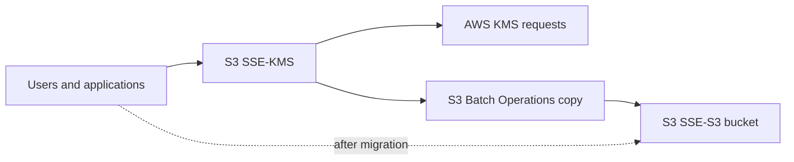

# Domain 3 single-answer study

## Q1 — 1 of 239 — S3 SSE-KMS request cost

**Original stem:** A company has millions of objects in an Amazon S3 bucket. The objects are in the S3 Standard storage class. All the S3 objects are accessed frequently. The number of users and applications that access the objects is increasing rapidly. The objects are encrypted with server-side encryption with AWS KMS Keys (SSE-KMS). A solutions architect reviews the company's monthly AWS invoice and notices that AWS KMS costs are increasing because of the high number of requests from Amazon S3. The solutions architect needs to optimize costs with minimal changes to the application. Which solution will meet these requirements with the LEAST operational overhead?

**Original options:**
- **A.** Create a new S3 bucket that has server-side encryption with customer-provided keys (SSE-C) as the encryption type. Copy the existing objects to the new S3 bucket. Specify SSE-C.
- **B.** Create a new S3 bucket that has server-side encryption with Amazon S3 managed keys (SSE-S3) as the encryption type. Use S3 Batch Operations to copy the existing objects to the new S3 bucket. Specify SSE-S3.
- **C.** Use AWS CloudHSM to store the encryption keys. Create a new S3 bucket. Use S3 Batch Operations to copy the existing objects to the new S3 bucket. Encrypt the objects by using the keys from CloudHSM.
- **D.** Use the S3 Intelligent-Tiering storage class for the S3 bucket. Create an S3 Intelligent-Tiering archive configuration to transition objects that are not accessed for 90 days to S3 Glacier Deep Archive.

**Verified exam answer: B**, with a question-design caveat. B avoids KMS calls for migrated objects using SSE-S3 and Batch Operations, but moving to a new bucket can require application updates and KMS may be a security requirement. **A** SSE-C adds client key management. **C** CloudHSM adds infrastructure and is not directly usable as native S3 key source. **D** tiering does not address KMS request charges and archival mismatches frequent access.

**Current recommendation:** If SSE-KMS must be retained, enable S3 Bucket Keys (up to 99% fewer KMS requests) and update existing object encryption appropriately. New 2026 S3 Batch Operations UpdateObjectEncryption can update object encryption and Bucket Key configuration without data movement for supported cases. Neither alternative is offered as an option.

**External exact variants:** [FreeCram](https://www.freecram.net/question/Amazon.SAP-C02.v2023-11-04.q183/a-company-has-millions-of-objects-in-an-amazon-s3-bucket-the-objects-are-in-the-s3-standard-storage) and [Exam-Tests](https://www.exam-tests.com/SAP-C02-exam/Amazon.SAP-C02.v2025-02-24.q513.html?p=27), both B. Their explanations cite S3 Bucket Keys even though B does not mention them; this is a source explanation defect.

**Official AWS:** [S3 Bucket Keys](https://docs.aws.amazon.com/AmazonS3/latest/userguide/bucket-key.html); [Configure Bucket Keys](https://docs.aws.amazon.com/AmazonS3/latest/userguide/configuring-bucket-key.html); [October 2026 Batch Operations encryption update](https://aws.amazon.com/blogs/storage/updating-encryption-on-existing-amazon-s3-objects-with-s3-batch-operations/).

**Duplicate audit:** No exact duplicate across 674. Q32 and Q83 concern other S3 cost optimization scenarios (multipart and lifecycle).

## Q2 — 2 of 239 — Lambda PostgreSQL connection surge

**Original stem:** An ecommerce company runs an application on AWS. The application has an Amazon API Gateway API that invokes an AWS Lambda function. The data is stored in an Amazon RDS for PostgreSQL DB instance. During the company's most recent flash sale, a sudden increase in API calls negatively affected the application's performance. A solutions architect reviewed the Amazon CloudWatch metrics during that time and noticed a significant increase in Lambda invocations and database connections. The CPU utilization also was high on the DB instance. What should the solutions architect recommend to optimize the application's performance?

**Original options:**
- **A.** Increase the memory of the Lambda function. Modify the Lambda function to close the database connections when the data is retrieved.
- **B.** Add an Amazon ElastiCache for Redis cluster to store the frequently accessed data from the RDS database.
- **C.** Create an RDS proxy by using the Lambda console. Modify the Lambda function to use the proxy endpoint.
- **D.** Modify the Lambda function to connect to the database outside of the function's handler. Check for an existing database connection before creating a new connection.

**Verified answer: C — Amazon RDS Proxy.** Lambda concurrency during flash sales causes many PostgreSQL connections. RDS Proxy pools and multiplexes backend connections to limit connection overhead.

**Option review:** A increases Lambda resources but doesn't solve DB connection growth; closing connections increases churn. B Redis can reduce cacheable reads but cannot solve general connection pressure. C proxy pools connections across concurrent Lambda environments. D handler-external connection reuse only works within a warm environment, not across environments.

**Caveat:** High CPU from costly SQL still requires query optimization; session pinning may reduce proxy multiplexing.

**Architecture:** API Gateway → Lambda concurrent invocations → RDS Proxy connection pool → RDS PostgreSQL.

**Exact external variants:** [FreePDFDumps Q149](https://www.freepdfdumps.com/Amazon.SAP-C02.v2024-09-24.q208.html?p=31); [FreeCram Q185](https://www.freecram.net/Amazon.SAP-C02.v2025-04-03.q227.pdf); [additional Q66](https://www.salesforcexamdumps.com/sap-c02-practice-questions/6).

**Official AWS:** [Lambda + RDS](https://docs.aws.amazon.com/lambda/latest/dg/services-rds.html); [RDS Proxy scenarios](https://docs.aws.amazon.com/AmazonRDS/latest/UserGuide/rds-proxy-best-practices.usage-scenarios.html); [RDS Proxy mechanics](https://docs.aws.amazon.com/AmazonRDS/latest/UserGuide/rds-proxy.howitworks.html).

**Duplicate audit:** Exact duplicates: none of 674. Keyword-related IDs: 41, 49, 158, 160, 230, 287, 326, 420, 429, 431, 570, 609; similarity is not exact duplication.

## Q4 — 3 of 239 — EC2 cluster placement group insufficient capacity

**Original stem:** A solutions architect has launched multiple Amazon EC2 instances in a placement group within a single Availability Zone. Because of additional load on the system, the solutions architect attempts to add new instances to the placement group. However, the solutions architect receives an insufficient capacity error. What should the solutions architect do to troubleshoot this issue?

**Original options:**
- **A.** Use a spread placement group. Set a minimum of eight instances for each Availability Zone.
- **B.** Stop and start all the instances in the placement group. Try the launch again.
- **C.** Create a new placement group. Merge the new placement group with the original placement group.
- **D.** Launch the additional instances as Dedicated Hosts in the placement groups.

**Verified answer: B.** AWS explicitly recommends stopping and starting all instances in an existing cluster placement group and retrying the launch when incremental capacity is unavailable. Reallocation may find sufficient contiguous hardware, but is not guaranteed.

**Option review:** A wrong: spread groups isolate hardware and allow at most seven running instances per AZ at rack level, not minimum eight. B correct: documented AWS troubleshooting. C wrong: placement groups cannot be merged. D wrong: Dedicated Hosts cannot be launched in placement groups.

**Architecture:** Existing EC2 cluster placement group → insufficient capacity on incremental launch → coordinated stop/start of existing group → possible hardware reallocation → retry launch.

**Defects and modern recommendations:** Stem implies but does not explicitly name cluster placement strategy. Stop/start causes downtime, may erase instance-store data and change auto-assigned public IPv4; not guaranteed. For future capacity, launch required instances together and consider On-Demand Capacity Reservations inside supported cluster placement groups.

**Official AWS:** [Placement strategies](https://docs.aws.amazon.com/AWSEC2/latest/UserGuide/placement-strategies.html); [Placement rules](https://docs.aws.amazon.com/AWSEC2/latest/UserGuide/placement-groups.html); [Stop/start](https://docs.aws.amazon.com/AWSEC2/latest/UserGuide/how-ec2-instance-stop-start-works.html); [Capacity Reservations](https://docs.aws.amazon.com/AWSEC2/latest/UserGuide/cr-cpg.html).

**Exact external variants:** [Cert Empire](https://certempire.com/practice-tests/free-sap-c02-practice-questions/) original order; [FreePDFDumps Q143](https://www.freepdfdumps.com/Amazon.SAP-C02.v2025-06-02.q210.html?p=30) reordered D is same correct action; [FreeCram](https://www.freecram.net/Amazon.SAP-C02.v2025-04-03.q227.pdf) swaps C/D.

**Duplicate audit:** Normalized exact stem duplicates across 674: none. Related placement/capacity stems: 40, 303; these are not established duplicates.

## Q5 — 4 of 239 — Multi-AZ private-subnet internet egress

**Original stem:** A VPC spans three Availability Zones, each with public and private subnets. One NAT gateway and one internet gateway exist. Private EC2 instances must connect to the internet.

**Original options:**
- **A.** Add two more NAT gateways (one per AZ). Configure each private subnet to use its AZ’s NAT gateway.
- **B.** Add two more NAT gateways and configure public subnets.
- **C.** Add internet gateways per AZ and route private subnets.
- **D.** Add internet gateways per AZ and configure public subnets.

**Verified answer: A.** For classic zonal NAT gateways, use a NAT gateway per Availability Zone in a public subnet, and route each private subnet's default IPv4 route to the NAT gateway in its AZ. A single VPC internet gateway serves all AZs.

**Option analysis:** A provides AZ-independent internet egress and reduces cross-AZ traffic. B misroutes public subnet traffic to NAT rather than IGW. C and D incorrectly propose internet gateways per AZ; IGW is a VPC-level component and does not give private IPv4-only EC2 instances internet egress by direct routing.

**Architecture:** Internet ⇄ VPC IGW ⇄ [AZ-A NAT gateway ← private EC2] + [AZ-B NAT gateway ← private EC2] + [AZ-C NAT gateway ← private EC2]. Each zonal public NAT uses a public subnet and Elastic IP.

**Modern caveats:** The original question asks only for connectivity, not explicitly for high availability. A single zonal NAT can technically serve all three AZs, but is a single-AZ failure dependency. AWS now supports regional NAT gateways that automatically expand across AZs; this newer alternative is absent from the options. Regional NAT is a better modern option for many public-egress workloads; consider VPC endpoints for supported AWS service traffic.

**Official AWS:** [NAT gateway basics](https://docs.aws.amazon.com/vpc/latest/userguide/nat-gateway-basics.html); [multi-AZ example](https://docs.aws.amazon.com/vpc/latest/userguide/vpc-example-private-subnets-nat.html); [internet gateways](https://docs.aws.amazon.com/vpc/latest/userguide/VPC_Internet_Gateway.html); [regional NAT gateways](https://docs.aws.amazon.com/vpc/latest/userguide/nat-gateways-regional.html).

**External variants:** [Certstopics Q53](https://www.certstopics.com/questions/last-attempt-sap-c02-questions.html) exact short-form question and answer A; [ExamCollection Q55](https://www.examcollection.us/exam/SAP-C02-question-answer-4.html) longer equivalent original scenario and answer A.

**Duplicate audit:** Exact normalized stem duplicates across 674: none. Keyword-related question IDs: 18, 20, 21, 24, 53, 57, 74, 90, 108, 112, 193, 195, 209, 250, 309, 316, 318, 351, 356, 378, 410, 429, 447, 481, 556, 562, 591, 669. Related does not imply duplicate.

## Q10 — 5 of 239 — CodeDeploy with EC2 Auto Scaling

**Original stem:** A company has an application that runs on Amazon EC2 instances in an Amazon EC2 Auto Scaling group. The company uses AWS CodePipeline to deploy the application. The instances that run in the Auto Scaling group are constantly changing because of scaling events. When the company deploys new application code versions, the company installs the AWS CodeDeploy agent on any new target EC2 instances and associates the instances with the CodeDeploy deployment group. The application is set to go live within the next 24 hours. What should a solutions architect recommend to automate the application deployment process with the LEAST amount of operational overhead?

**Original options:**
- **A.** Configure Amazon EventBridge to invoke an AWS Lambda function when a new EC2 instance is launched into the Auto Scaling group. Code the Lambda function to associate the EC2 instances with the CodeDeploy deployment group.
- **B.** Write a script to suspend Amazon EC2 Auto Scaling operations before the deployment of new code When the deployment is complete, create a new AMI and configure the Auto Scaling group's launch template to use the new AMI for new launches. Resume Amazon EC2 Auto Scaling operations.
- **C.** Create a new AWS CodeBuild project that creates a new AMI that contains the new code Configure CodeBuild to update the Auto Scaling group's launch template to the new AMI. Run an Amazon EC2 Auto Scaling instance refresh operation.
- **D.** Create a new AMI that has the CodeDeploy agent installed. Configure the Auto Scaling group's launch template to use the new AMI. Associate the CodeDeploy deployment group with the Auto Scaling group instead of the EC2 instances.

**Verified answer: D.** Associate the CodeDeploy deployment group with the Auto Scaling group and preinstall the CodeDeploy agent in the AMI. CodeDeploy creates lifecycle hooks and deploys the latest revision to instances created during scale-out.

**Option review:** A duplicates native integration with EventBridge/Lambda custom code. B suspends scaling and adds manual AMI management. C is a valid immutable AMI/instance-refresh alternative, but higher implementation overhead under a 24-hour launch constraint. D is least overhead given existing CodeDeploy.

**Architecture:** CodePipeline → CodeDeploy deployment group → Auto Scaling group lifecycle hooks → EC2 launch template with CodeDeploy agent AMI → newly launched instances receive application revision.

**Defects/outdated recommendations:** No fundamental defect. AWS cautions that baked agents can become outdated and cause deployment failure; regularly update agent in AMI. Installing agent at launch is another supported option. Existing dataset has minor missing punctuation in B and C; original options preserved.

**Official AWS:** [CodeDeploy ASG integration](https://docs.aws.amazon.com/codedeploy/latest/userguide/integrations-aws-auto-scaling.html); [CodeDeploy FAQs](https://aws.amazon.com/codedeploy/faqs/).

**Exact external variants:** [CertsMania Q14 page 17](https://www.certsmania.com/pdf/revision-materials-effective-amazon-web-services-sap-c02-questions-answers-by-jagjit.pdf); [SAP-C02 Q267](https://www.scribd.com/document/921182718/SAP-C02-CSL-09-26-341), keyed D.

**Duplicate audit:** Exact normalized stem matches among 674: none. Technology-related candidates: 8, 72, 127, 133, 178, 223, 234, 242, 246, 501, 567, 632, 661; related does not establish duplicates.

## Q16 — 6 of 239 — Write-heavy variable workload, Aurora Serverless and Savings Plans

**Original stem:** A company is running an application in the AWS Cloud. The application uses AWS Lambda functions and Amazon Elastic Container Service (Amazon ECS) containers that run with AWS Fargate technology as its primary compute. The load on the application is irregular. The application experiences long periods of no usage, followed by sudden and significant increases and decreases in traffic. The application is write-heavy and stores data in an Amazon Aurora MySQL database. The database runs on an Amazon RDS memory optimized DB instance that is not able to handle the load. What is the MOST cost-effective way for the company to handle the sudden and significant changes in traffic?

**Original options (preserved original snapshot):**
- **A.** Add additional read replicas to the database. Purchase Instance Savings Plans and RDS Reserved Instances.
- **B.** Migrate the database to an Aurora multi-master DB cluster. Purchase Instance Savings Plans.
- **C.** Migrate the database to an Aurora global database. Purchase Compute Savings Plans and RDS Reserved Instances.
- **D.** Migrate the database to Aurora Serverless v1. Purchase Compute Savings Plans.

**Historically verified answer: D.** Multiple exact external variants key Aurora Serverless v1 + Compute Savings Plans (some reorder the correct option to A). Aurora Serverless v1 reached end of life March 31, 2025; current study wording modernizes D to Aurora Serverless v2. Do not overwrite the original snapshot.

**Option analysis:** A adds read capacity, not writer elasticity, and commitments may go unused. B legacy multi-master does not automatically scale to irregular load; EC2 Instance Savings Plans don't cover Lambda/Fargate. C global database solves cross-Region read/DR, not writer capacity spikes. D is historical intended choice; replace retired v1 with Aurora Serverless v2 today. Compute Savings Plans cover Lambda and Fargate, not Aurora.

**Architecture:** Incoming requests → Lambda + ECS Fargate → Aurora MySQL Serverless v2 writer with elastic ACUs; Compute Savings Plans apply to eligible Lambda/Fargate baseline. Current Database Savings Plans can cover eligible Aurora serverless usage.

**Defects and caveats:** Original D is obsolete. Aurora Serverless v2 supports 0 ACU auto-pause for supported Aurora MySQL versions (3.08.0+), but open connections, RDS Proxy and other configurations can prevent pausing. Resumption introduces latency. Commitments should be sized against predictable baseline, not burst peaks.

**Official AWS:** [Aurora v1 EOL](https://docs.aws.amazon.com/AmazonRDS/latest/AuroraUserGuide/WhatsNew.html); [Aurora Serverless v2 behavior](https://docs.aws.amazon.com/AmazonRDS/latest/AuroraUserGuide/aurora-serverless-v2.how-it-works.html); [Auto-pause](https://docs.aws.amazon.com/AmazonRDS/latest/AuroraUserGuide/aurora-serverless-v2-auto-pause.html); [Savings Plans types](https://docs.aws.amazon.com/savingsplans/latest/userguide/plan-types.html).

**Exact external variants:** [Certstopics Q91](https://www.certstopics.com/questions/pass-sap-c02-exam-guide.html) D; [CertEnsure](https://www.certensure.com/amazon-web-services/sap-c02-cert-practice-test.html) D; [FreeCram Q149](https://www.freecram.net/question/Amazon.SAP-C02.v2024-03-21.q171/a-company-is-running-an-application-in-the-aws-cloud-the-application-uses-aws-lambda-functions-and-amazon) reordered A; [FreePDFDumps Q160](https://www.freepdfdumps.com/Amazon.SAP-C02.v2025-06-02.q210.html?p=33) reordered A.

**Duplicate audit:** Exact normalized stem duplicates among 674: none. Related IDs: 58, 77, 88, 103, 155, 158, 160, 167, 177, 200, 233, 242, 312, 342, 368, 385, 417, 431, 437, 485, 516, 547, 555, 560, 564, 663; not necessarily duplicates.
